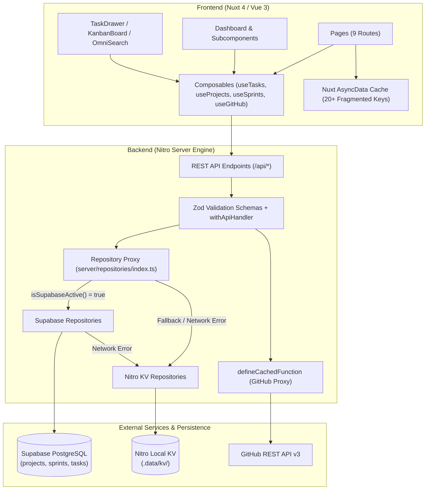
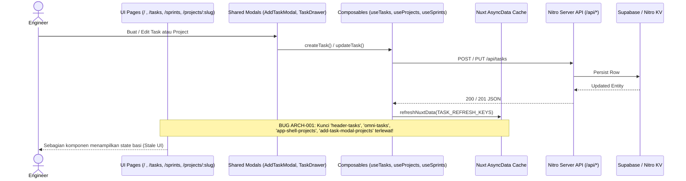
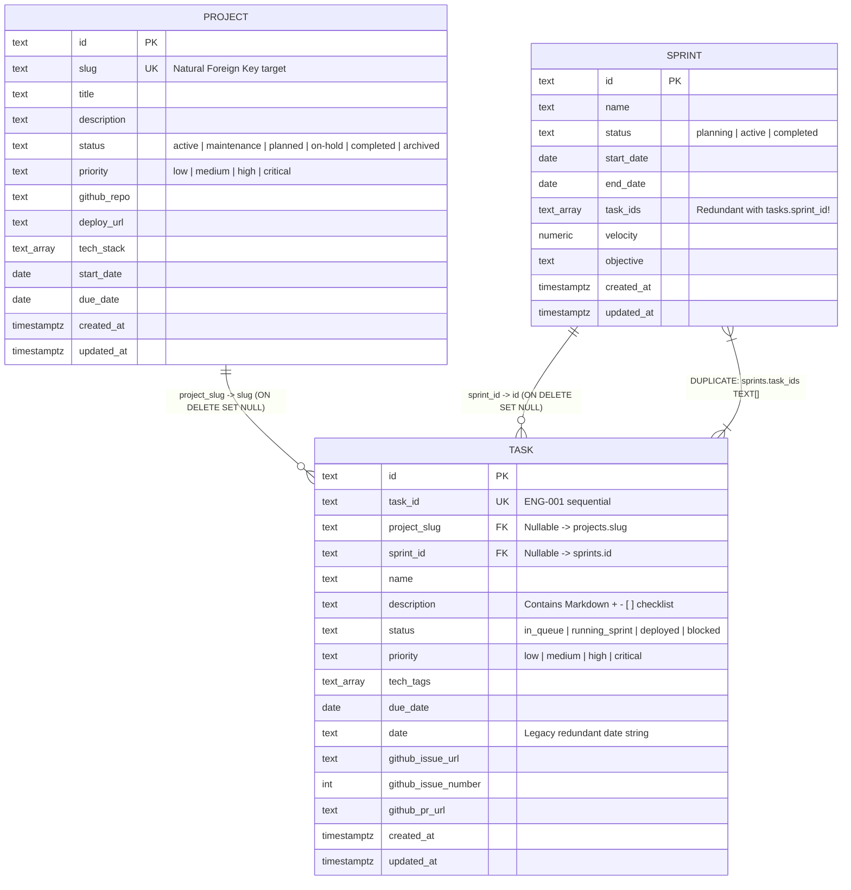
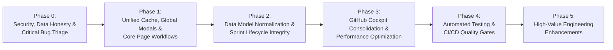
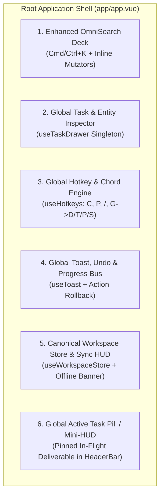

# Audit Sistem Manajemen & Cetak Biru Rekayasa Perangkat Lunak (Engineering Blueprint) — Nexura Workspace

**Dokumen:** `docs/management-system-audit.md`  
**Status Dokumen:** Baseline Audit & Perencanaan Arsitektur Fase Berikutnya  
**Ruang Lingkup:** Aplikasi Full-Stack Nuxt 4 / Nitro / Supabase (`Nexura Management`)  
**Metode Evaluasi:** Inspeksi Kode Sumber Langsung (*Evidence-Based Static & Architectural Audit*)  

---

## 1. Executive Summary

### 1.1. Kondisi Aplikasi Saat Ini (`VERIFIED`)
**Nexura Management** adalah aplikasi *Personal Engineering Command Center* berbasis **Nuxt 4 (Vue 3.5 + TypeScript)** dan **Nitro Server Engine** yang dirancang untuk menyatukan pengelolaan proyek perangkat lunak, *deliverables* tugas (`Task`), iterasi mingguan (`Sprint`), peta jalan arsitektur (`Roadmap`), serta telemetri *DevOps* langsung dari **GitHub REST API**, **Supabase PostgreSQL**, dan **Vercel**.

Dari sisi fondasi teknis, repositori ini telah memiliki beberapa keputusan arsitektur yang patut dipertahankan:
1. **Pola *Dual-Adapter Repository* (`server/repositories/`):** Pemisahan kontrak antarmuka (`ITaskRepository`, `IProjectRepository`, `ISprintRepository`) dengan implementasi ganda (`Supabase*Repository` untuk produksi cloud dan `Nitro*Repository` berbasis KV lokal sebagai *fallback*).
2. **Validasi Kontrak Input berbasis Zod (`server/schemas/`):** Seluruh *endpoint* mutasi (`POST`/`PUT`) dan *query* utama telah menggunakan skema Zod terpusat bersama pembungkus `withApiHandler` (`server/utils/handler.ts`).
3. **Proksi Server GitHub dengan *Caching* (`server/api/github/*`):** Integrasi GitHub menggunakan `defineCachedFunction` di sisi server sehingga melindungi *Personal Access Token* (PAT) dari eksposur langsung di *browser* dan menekan konsumsi *rate limit* GitHub API.
4. **Pengalaman Interaksi Cepat pada Komponen Inti:** Papan Kanban (`components/KanbanBoard.vue`) dengan pembaruan optimistik `0ms` berbasis `requestAnimationFrame` dan palet komando `OmniSearch` (`composables/useOmniSearch.ts`) dengan algoritma *fuzzy scoring* $O(N)$ menunjukkan kapabilitas rekayasa *frontend* yang kuat.

### 1.2. Risiko Produk & Rekayasa Paling Kritis (`VERIFIED`)
Di balik tampilan visual yang kaya, audit kode sumber secara menyeluruh mengungkap **enam masalah struktural dan integritas data tingkat tinggi/kritis** yang harus segera diperbaiki sebelum menambah fitur baru:

1. **Keamanan Endpoint Publik Tanpa Autentikasi (`CRITICAL` — `SEC-001`):** Aplikasi dideploy ke domain publik (`management-sona-ta.vercel.app`), tetapi **tidak memiliki autentikasi atau otorisasi sama sekali** pada halaman maupun seluruh *endpoint* `/api/*`. Siapa pun di internet dapat menghapus proyek/tugas di database produksi, membuat *GitHub Issue* asli di repositori pemilik melalui `POST /api/github/create-issue`, atau memicu *rerun* GitHub Actions melalui `POST /api/github/workflow-rerun` menggunakan `GITHUB_TOKEN` milik server. Selain itu, kebijakan RLS pada `server/database/migrations/001_create_nexura_tables.sql` menggunakan `FOR ALL USING (true) WITH CHECK (true)`.
2. **Fabrikasi Metrik & Angka *Hardcoded* yang Menyesatkan (*Data Integrity Lie* — `HIGH` — `DASH-001`, `PROJ-001`, `TELE-001`):**
   - Pada halaman **Active Projects (`/projects`)**, persentase progres proyek (`getProgress`), jumlah tugas (`getTaskCountLabel`), tanggal tenggat (`getDueDate`), dan status (`getDerivedStatus`) **100% dikodekan secara statis (*hardcoded*)** berdasarkan pencocokan kata pada `slug` (`hitnet` -> `75%`, `management` -> `90%`, lainnya -> `60%`). Halaman `/projects` sama sekali tidak mengambil atau menghitung data `tasks`.
   - Pada **Dashboard (`/`)** dan `UnifiedHeroBanner.vue`, metrik KPI menggunakan *fallback* angka palsu ketika jumlah sebenarnya adalah `0` (misal: `inFlightCount` menampilkan `14` saat ada `0` tugas aktif; `highPriorityCount` menampilkan `3`; `deployedTasksCount` menampilkan `11`; `openPrCount` menampilkan `7`; `ciWorkflowCount` dikunci pada `24`; `ciSuccessRate` dikunci pada `98.4%`).
   - Pada `InfrastructureMeshCard.vue`, tombol `Ping Edge ⚡` menangkap kegagalan jaringan (`catch`) pada `/api/stats` dan justru menampilkan pesan palsu `'32ms · OK'`.
   - Pada `RecentShipmentsCard.vue`, jika belum ada tugas berstatus `deployed`, komponen mengambil 3 tugas apa saja (termasuk yang masih `in_queue` atau `blocked`) dan menampilkannya dengan lencana hijau **`Verified Live`**.
3. **Tindakan Destruktif yang Menyesatkan pada `/repos` (`CRITICAL` — `REPO-001`):** Tombol bertuliskan **"Detach"** dengan dialog konfirmasi *"Detach Project from Management?"* pada `app/pages/repos.vue` (baris 717–738) tidak memutus tautan `githubRepo`, melainkan memanggil `projectsApi.deleteProject(projectSlug)` yang **menghapus permanen proyek beserta memutus relasi seluruh tugas terkait di database**.
4. **Fragmentasi Kunci Cache Data Nuxt (`HIGH` — `ARCH-001`):** Tidak ada sumber kebenaran tunggal (*single source of truth*) di sisi klien. Data `tasks` diambil menggunakan **8 kunci `useLazyAsyncData` yang berbeda** (`tasks-data`, `tasks-page`, `tasks-all`, `project-tasks`, `roadmap-tasks`, `sidebar-tasks`, `header-tasks`, `omni-tasks`), sementara `projects` menggunakan **10 kunci berbeda**. Daftar invalidasi `TASK_REFRESH_KEYS` dan `PROJECT_REFRESH_KEYS` tidak mencakup semua kunci tersebut, dan halaman-halaman memanggil `refreshNuxtData` secara parsial sehingga perpindahan antarhalaman sering menampilkan data basi (*stale state*).
5. **Ketidaksinkronan Relasi Ganda Tugas–Sprint & Risiko *Split-Brain* Penyimpanan (`HIGH` — `SPRI-001`, `DATA-001`):**
   - Hubungan antara `Task` dan `Sprint` disimpan secara duplikat di dua tempat (`task.sprintId` dan array `sprint.taskIds[]`) dan dimutasi dari *frontend* (`app/pages/sprints.vue`) melalui **dua permintaan HTTP terpisah tanpa transaksi atomik**.
   - Ketika koneksi Supabase mengalami gangguan sesaat, repositori beralih menulis ke penyimpanan lokal Nitro KV (`markSupabaseOffline`), lalu 60 detik kemudian kembali ke Supabase tanpa pernah menyinkronkan perubahan yang tertulis di KV lokal (*split-brain data loss*).
6. **Ketidaklengkapan Alur Kerja Inti di Halaman Terpusat (`HIGH` — `TASK-001`, `PROJ-002`, `PDET-001`):**
   - Halaman terpusat **Tasks & Queue (`/tasks`)** tidak mengimpor atau merender `<TaskDrawer />` sama sekali; pengguna tidak dapat membuka detail tugas, mengedit deskripsi/checklist/prioritas/tenggat, atau membuat *GitHub Issue* dari halaman `/tasks`.
   - Halaman **Active Projects (`/projects`)** mendeklarasikan modal `<AddProjectModal v-if="showAddModal" />`, tetapi **tidak memiliki satu pun tombol di dalam `<template>` untuk mengubah `showAddModal = true`**, serta menelan *error* API saat pembuatan proyek gagal namun tetap menampilkan pesan sukses palsu.
   - Halaman **Project Detail (`/projects/[slug]`)** memiliki dialog konfirmasi hapus proyek (`confirmDeleteProject`), tetapi **tidak memiliki tombol di UI untuk memicunya**, serta membuat objek proyek palsu (*ghost project*) alih-alih menampilkan halaman `404` jika `slug` tidak ditemukan.

### 1.3. Ringkasan Prioritas Strategis (`RECOMMENDATION`)
Sebelum melanjutkan pengembangan fitur baru atau menyelesaikan *rollout* desain UI/UX secara menyeluruh, tim rekayasa harus mengeksekusi **Fase 0 (Keamanan & Kejujuran Data)** dan **Fase 1 (Perbaikan Alur Kerja Inti & Konsistensi Cache)**. Jangan membangun halaman analitik atau fitur kolaborasi kompleks di atas metrik yang masih dipalsukan (*hardcoded*) atau *endpoint* mutasi yang terbuka tanpa autentikasi.

---

## 2. Audit Scope and Methodology

### 2.1. Ruang Lingkup Audit (`VERIFIED`)
Audit ini mencakup keseluruhan kode sumber, konfigurasi, skema data, dan dokumentasi di dalam repositori `d:\Project_Center\REWORK\Management`, meliputi:
- **Aplikasi Frontend (`app/`, `components/`, `composables/`, `types/`):** 9 file rute di `app/pages/`, komponen tata letak (`app/app.vue`, `Sidebar.vue`, `HeaderBar.vue`), 5 subkomponen baru *Dashboard*, komponen papan Kanban & *drawer* tugas, modal pencarian `OmniSearch`, serta 8 *composable* di `composables/`.
- **Aplikasi Backend (`server/`):** 19 *endpoint* API di `server/api/` (termasuk 10 *endpoint* integrasi GitHub), lapisan repositori ganda di `server/repositories/` (`contracts`, `nitro`, `supabase`), skema validasi Zod di `server/schemas/`, utilitas di `server/utils/`, *plugin* inisialisasi di `server/plugins/`, *middleware* di `server/middleware/`, serta migrasi SQL PostgreSQL di `server/database/migrations/`.
- **Infrastruktur & Konfigurasi:** `package.json`, `nuxt.config.ts`, `tailwind.config.ts`, `.env.example`, `.github/workflows/ci.yml`, `scripts/verify-supabase.mjs`, `README.md`, dan `DEPLOYMENT.md`.

### 2.2. Metodologi & Klasifikasi Bukti (`VERIFIED`)
Setiap temuan dan pernyataan dalam dokumen ini diklasifikasikan secara ketat menggunakan lima label bukti berikut:
- **`VERIFIED`:** Didukung secara langsung oleh kode sumber, konfigurasi, skema SQL, atau struktur file yang telah diinspeksi.
- **`INFERRED`:** Kesimpulan logis berdasarkan kombinasi bukti kode yang terverifikasi (disertai penjelasan penalaran).
- **`UNVERIFIED`:** Perilaku *runtime* eksternal (seperti status riil *database* produksi Supabase di cloud saat ini atau konfigurasi variabel lingkungan di akun Vercel pemilik) yang tidak dapat diverifikasi hanya dari repositori lokal.
- **`RECOMMENDATION`:** Usulan perbaikan teknis atau arsitektural berdasarkan pertimbangan rekayasa perangkat lunak.
- **`PRODUCT DECISION REQUIRED`:** Keputusan yang bergantung pada arah produk atau preferensi pemilik sistem, bukan semata-mata bukti teknis.

### 2.3. Batasan Pekerjaan Paralel UI/UX (`VERIFIED`)
Pemeriksaan `git status --short` menunjukkan adanya aliran kerja (*workstream*) desain ulang UI/UX paralel yang sedang berlangsung pada pohon kerja (*working tree*), khususnya pada:
- Modifikasi: `components/Dashboard.vue`, `components/OmniSearchModal.vue`, `composables/useOmniSearch.ts`, `composables/useQuickTask.ts`.
- Penambahan komponen baru: `components/dashboard/UnifiedHeroBanner.vue`, `components/dashboard/LiveDevOpsStream.vue`, `components/dashboard/ActiveExecutionQueue.vue`, `components/dashboard/InfrastructureMeshCard.vue`, `components/dashboard/RecentShipmentsCard.vue`, dan `components/search/*`.
- Penghapusan: `components/project/ProjectNavDock.vue`.

Sesuai aturan keselamatan repositori, audit ini **tidak mengubah satu baris pun kode sumber aplikasi** dan mengevaluasi kondisi terkini (termasuk komponen hasil *redesign* paralel tersebut) secara objektif agar agen UI/UX maupun agen *engineering* memiliki panduan yang selaras.

---

## 3. Repository and Architecture Overview

### 3.1. Struktur Direktori & Tanggung Jawab (`VERIFIED`)

```text
Management/
├── app/
│   ├── app.vue                        # Root shell: Sidebar + HeaderBar + <NuxtPage /> + Global Modals
│   └── pages/                         # 9 file rute berbasis file-system routing Nuxt 4
│       ├── index.vue                  # Wrapper rute '/' -> merender <Dashboard />
│       ├── focus.vue                  # Redirect-only rute '/focus' -> '/sprints'
│       ├── tasks.vue                  # Halaman matriks & antrean tugas terpusat ('/tasks')
│       ├── sprints.vue                # Halaman perencanaan & eksekusi sprint mingguan ('/sprints')
│       ├── roadmap.vue                # Halaman peta jalan kuartalan & linimasa ('/roadmap')
│       ├── repos.vue                  # Halaman penjelajah repositori GitHub ('/repos')
│       ├── telemetry.vue              # Halaman pemantauan kesehatan layanan ('/telemetry')
│       └── projects/
│           ├── index.vue              # Halaman katalog portofolio proyek ('/projects')
│           └── [slug].vue             # Halaman detail proyek 6-tab ('/projects/:slug')
├── components/
│   ├── Dashboard.vue                  # Orkestrator utama halaman '/' (Command Center)
│   ├── Sidebar.vue                    # Navigasi utama kiri (collapsible, 6 rute utama + quick actions)
│   ├── HeaderBar.vue                  # Bar atas: breadcrumb, metrik ringkas, pemicu OmniSearch
│   ├── KanbanBoard.vue                # Papan Kanban 4 kolom dengan drag-and-drop & filter lokal
│   ├── TaskDrawer.vue                 # Modal/drawer detail & penyuntingan penuh Task + GitHub Issue
│   ├── AddTaskModal.vue               # Modal pembuatan deliverable/task baru
│   ├── AddProjectModal.vue            # Modal pembuatan proyek baru
│   ├── OmniSearchModal.vue            # Wrapper palet komando & pencarian global (Cmd/Ctrl+K)
│   ├── dashboard/                     # 5 subkomponen zona Command Center (workstream UI baru)
│   ├── kanban/                        # Subkomponen KanbanToolbar, KanbanColumn, KanbanDragGhost
│   ├── project/                       # ProjectHeroHeader.vue, ProjectCicdCard.vue
│   ├── search/                        # Subkomponen split-view OmniSearch (60:40)
│   └── ui/                            # NexuraIcon.vue (wrapper ikon Lucide)
├── composables/
│   ├── useTasks.ts                    # Klien HTTP CRUD '/api/tasks' + invalidasi TASK_REFRESH_KEYS
│   ├── useProjects.ts                 # Klien HTTP CRUD '/api/projects' + invalidasi PROJECT_REFRESH_KEYS
│   ├── useSprints.ts                  # Klien HTTP CRUD '/api/sprints' + invalidasi SPRINT_REFRESH_KEYS
│   ├── useGitHub.ts                   # Composable useLazyAsyncData & fungsi fetch ke '/api/github/*'
│   ├── useOmniSearch.ts               # Mesin indeks, fuzzy scoring O(N), & navigasi palet komando
│   ├── useProjectNav.ts               # State global tab aktif pada halaman '/projects/:slug'
│   └── useQuickTask.ts                # State pembuka modal AddTaskModal & AddProjectModal global
├── server/
│   ├── api/                           # 19 endpoint REST Nitro (tasks, projects, sprints, stats, telemetry, github/*)
│   ├── database/migrations/           # 001_create_nexura_tables.sql, 002_cascade_cleanup_trigger.sql
│   ├── middleware/visit.ts            # Pencatat jumlah kunjungan halaman HTML ke Nitro KV
│   ├── plugins/                       # seed.ts (pembersihan & seed KV), supabase-sync.ts (auto-migrasi awal)
│   ├── repositories/                  # Pola Repository (contracts, nitro, supabase, proxy index.ts)
│   ├── schemas/                       # Skema validasi Zod (task, project, sprint, github, helper)
│   └── utils/                         # handler.ts, errors.ts, github.ts, supabase.ts, store.ts, storage-adapter.ts
├── types/                             # Definisi TypeScript domain (Task, Project, Sprint, Stat, GitHub*)
├── scripts/verify-supabase.mjs        # Skrip CLI verifikasi tabel & migrasi data lokal ke Supabase
└── .github/workflows/ci.yml           # Pipeline GitHub Actions (npm ci + npm run build)
```

### 3.2. Diagram Aliran Arsitektur Sistem Saat Ini (`VERIFIED`)



### 3.3. Penilaian Arsitektur Tingkat Tinggi (`VERIFIED`)
- **Kekuatan:** Pemisahan direktori antara `types/`, `server/schemas/`, `server/repositories/`, dan `server/api/` sangat bersih untuk ukuran aplikasi Nuxt *full-stack*. Penggunaan `withApiHandler` menyeragamkan respons kesalahan validasi (`422 Validation Failed`).
- **Kelemahan Struktural:**
  1. **Tidak ada lapisan *Domain Service* di sisi server:** Logika bisnis lintas entitas (seperti pengikatan otomatis tugas ke sprint aktif saat status berubah menjadi `running_sprint` di `server/api/tasks/[id].put.ts` baris 19–42, atau pembersihan `taskIds` dari sprint saat tugas dihapus di `SupabaseTaskRepository.delete`) tersebar di antara *controller* API, *repository*, komponen Vue (`sprints.vue`), dan *trigger* SQL.
  2. **Abstraksi Penyimpanan Ganda yang Bocor (*Leaky Dual-Storage*):** Proxy di `server/repositories/index.ts` tampak elegan di permukaan, tetapi tidak memiliki antrean sinkronisasi (*write-back queue*) ketika beralih dari Nitro KV kembali ke Supabase.
  3. **Ketergantungan Identitas Pemilik di Kode Sumber (*Hardcoded Identity*):** Nama pengguna `bagja-iskandar`, repositori `bagja-iskandar/Management`, proyek `tf-hitnet-eeg` / `neural-signal-lab`, URL Supabase `iklvthppfigprjhqmrlo.supabase.co`, dan URL Vercel `management-sona-ta.vercel.app` tersebar di puluhan file *frontend* dan *backend*.

---

## 4. Existing Route Inventory

Seluruh rute di bawah ini ditemukan secara langsung dari konfigurasi file `app/pages/**/*.vue` (`VERIFIED`). Tidak ada konfigurasi `router.options.ts` kustom; aplikasi sepenuhnya menggunakan *file-based routing* bawaan Nuxt.

| No | Route Path | File Sumber | Tujuan Halaman | Komponen Utama | Aksi Utama Pengguna | Dependensi Data & API | Status Pengujian | Keterbatasan Utama (`VERIFIED`) |
|---|---|---|---|---|---|---|---|---|
| 1 | `/` | `app/pages/index.vue` -> `components/Dashboard.vue` | *Command Center* utama: ringkasan KPI sprint, aliran aktivitas DevOps GitHub, antrean eksekusi tugas aktif, status infrastruktur, dan papan Kanban. | `Dashboard.vue`, `UnifiedHeroBanner.vue`, `LiveDevOpsStream.vue`, `ActiveExecutionQueue.vue`, `InfrastructureMeshCard.vue`, `RecentShipmentsCard.vue`, `KanbanBoard.vue`, `TaskDrawer.vue`, `AddTaskModal.vue` | Filter proyek di Kanban, *drag-and-drop* status tugas, buka `TaskDrawer` untuk edit/hapus/buat GitHub Issue, lihat *diff* commit GitHub, *ping* edge, buat tugas baru. | `/api/tasks`, `/api/projects`, `/api/sprints`, `/api/stats`, `/api/github/global-commits`, `/api/github/workflows`, `/api/github/deployments`, `/api/github/pulls-issues`, `/api/github/commit-detail` | **0 Tes** (`VERIFIED`) | Metrik KPI jatuh ke angka palsu (*hardcoded* `14`, `3`, `11`, `7`, `78%`, `98.4%`) saat data bernilai `0`; duplikasi `AddTaskModal` lokal vs global; *Recent Shipments* menampilkan tugas yang belum selesai sebagai *Verified Live*; `Ping Edge` memalsukan status sukses saat gagal. |
| 2 | `/focus` | `app/pages/focus.vue` | Rute warisan (*legacy*) untuk *Sprint Focus Mode* yang kini hanya mengalihkan (*redirect*) pengguna ke `/sprints`. | Tidak ada (hanya `<div />` kosong). | Tidak ada (otomatis *redirect* `replace: true` ke `/sprints`). | Tidak ada. | **0 Tes** (`VERIFIED`) | Masih terdaftar sebagai halaman mandiri di `OmniSearch` (`nav:focus` dan `action:view-focus`), sehingga membingungkan pengguna karena mengarah ke halaman yang sama dengan `/sprints`. |
| 3 | `/projects` | `app/pages/projects/index.vue` | Katalog portofolio seluruh proyek dalam bentuk *bento grid* dan tabel ringkasan. | `projects/index.vue`, `AddProjectModal.vue` | Cari proyek, filter berdasarkan status (`all`, `active`, `planned`, `completed`), klik kartu proyek menuju `/projects/:slug`. | `/api/projects` (Key: `'projects'`) | **0 Tes** (`VERIFIED`) | **Progres (`75%`/`90%`/`40%`/`60%`), jumlah tugas (`15/20`), tenggat waktu, dan status turunan 100% *hardcoded*** berdasarkan nama `slug`; tidak ada tombol di UI untuk membuka `AddProjectModal`; tidak ada fitur edit/hapus proyek; kegagalan API pembuatan proyek ditelan dan menampilkan pesan sukses palsu. |
| 4 | `/projects/:slug` | `app/pages/projects/[slug].vue` | Workspace mendalam untuk satu proyek spesifik dengan 6 tab (*Overview, Kanban, Deliverables Matrix, GitHub, Vercel, Supabase*). | `projects/[slug].vue`, `ProjectHeroHeader.vue`, `ProjectCicdCard.vue`, `KanbanBoard.vue`, `TaskDrawer.vue`, `AddTaskModal.vue` | Pindah antar 6 tab proyek, kelola tugas proyek di Kanban/Matrix, edit detail tugas via `TaskDrawer`, pantau commit/branch/workflow/security/PR/packages GitHub, *rerun* CI workflow, buat GitHub Issue. | `/api/projects`, `/api/tasks` (mengambil semua tugas lalu filter di klien), `/api/github/*`, `/api/telemetry` | **0 Tes** (`VERIFIED`) | Tidak menampilkan `404` jika `slug` tidak valid (membuat proyek palsu); dialog hapus proyek (`confirmDeleteProject`) tidak pernah dipicu oleh tombol mana pun; tidak ada fitur edit metadata proyek; tab *Deliverables Matrix* menggunakan *pagination* palsu (`Showing 1 to N of N` dengan tombol *Previous/Next* mati). |
| 5 | `/tasks` | `app/pages/tasks.vue` | Matriks dan antrean seluruh *deliverables* tugas lintas proyek dengan tampilan tabel dan grup berdasarkan status. | `tasks.vue`, `AddTaskModal.vue` | Cari tugas, filter berdasarkan proyek/status/prioritas, urutkan, ganti mode tampilan (*All Tasks* vs *By Status*), klik status untuk siklus 3-arah, hapus tugas, tambah tugas baru. | `/api/tasks` (Key: `'tasks-page'`), `/api/projects` (Key: `'tasks-projects'`) | **0 Tes** (`VERIFIED`) | **Tidak memiliki `<TaskDrawer />`** sehingga pengguna tidak bisa melihat/mengedit deskripsi, checklist, prioritas, tenggat, atau proyek tugas; siklus status hanya 3 tahap (`in_queue -> running_sprint -> deployed`) dan tidak bisa menyetel status `blocked`; menebak nama proyek secara *hardcoded* jika `projectSlug` kosong; tanggal kosong ditampilkan sebagai `'Sep 2026'`. |
| 6 | `/sprints` | `app/pages/sprints.vue` | Konsol perencanaan dan eksekusi *Weekly Sprint* (menetapkan objektif mingguan, menarik tugas dari *backlog* ke sprint aktif, dan menyelesaikan tugas). | `sprints.vue`, `AddTaskModal.vue` | Pilih minggu (W-1 s/d W+2), sunting objektif mingguan, klik tugas untuk siklus status, lepaskan tugas dari sprint, tarik tugas dari *Backlog Queue* ke sprint, buat tugas baru. | `/api/tasks` (Key: `'tasks-all'`), `/api/sprints` (Key: `'sprints-list'`), `/api/projects` (Key: `'projects-list'`), `localStorage` | **0 Tes** (`VERIFIED`) | *Dual-write* tanpa transaksi saat menambah/melepas tugas ke sprint (`updateTask` + `updateSprint`); sumber kebenaran ganda untuk objektif mingguan (`sprint.objective` vs `localStorage`); tidak bisa membuat sprint baru dengan rentang tanggal kustom atau menutup (*complete*) sprint; tidak memiliki `<TaskDrawer />`. |
| 7 | `/roadmap` | `app/pages/roadmap.vue` | Peta jalan arsitektur kuartalan (Q1–Q4) dan linimasa *milestone* berdasarkan proyek dan tugas. | `roadmap.vue`, `AddProjectModal.vue` | Ganti tab tampilan (*Quarterly* vs *Timeline*), filter berdasarkan status proyek, klik kartu menuju `/projects/:slug`, buka modal tambah proyek. | `/api/projects` (Key: `'roadmap-projects'`), `/api/tasks` (Key: `'roadmap-tasks'`), `/api/sprints` (Key: `'roadmap-sprints'`) | **0 Tes** (`VERIFIED`) | Penempatan proyek ke kuartal Q1–Q4 bersifat **statis/heuristik berdasarkan pencocokan kata pada `slug`** (`management` -> Q1, `hitnet` -> Q2, `signal` -> Q3, lainnya -> Q4) dan mengabaikan `startDate`/`dueDate` proyek; tahun pada beberapa label dikodekan statis ke `2026`; gagal membuat proyek tetap menampilkan pesan sukses palsu. |
| 8 | `/repos` | `app/pages/repos.vue` | Penjelajah seluruh repositori GitHub milik pengguna, penghubung repositori ke proyek manajemen (*Import to Management*), dan inspektur *commit/workflow/security/deployments/PR/packages* per repo. | `repos.vue` | Cari & filter repositori, segarkan cache GitHub, pilih repo untuk inspeksi detail (6 sub-panel), *rerun* workflow, buat GitHub Issue, impor repo menjadi proyek baru, atau lepaskan (*Detach*) proyek. | `/api/github/repos`, `/api/projects` (Key: `'repos-projects-list'`), `/api/github/commits`, `/api/github/branches`, `/api/github/workflows`, `/api/github/workflow-jobs`, `/api/github/security`, `/api/github/deployments`, `/api/github/pulls-issues`, `/api/github/packages` | **0 Tes** (`VERIFIED`) | **Kritis:** Tombol `"Detach"` memanggil `projectsApi.deleteProject(slug)` yang menghapus proyek secara permanen alih-alih hanya mengosongkan `githubRepo`; pencocokan repo ke proyek terlalu longgar (`slug === repo.name || title === repo.name`); membebani GitHub API dengan memicu 7 permintaan paralel setiap kali pengguna mengklik repositori berbeda di daftar. |
| 9 | `/telemetry` | `app/pages/telemetry.vue` | Dasbor pemantauan status koneksi penyimpanan (Supabase/Nitro KV), kuota *rate limit* GitHub API, dan status *deployment* Vercel. | `telemetry.vue` | Klik tombol *Refresh Status* untuk memuat ulang `/api/telemetry`. | `/api/telemetry` (Key: `'telemetry-status'`) | **0 Tes** (`VERIFIED`) | Menampilkan status palsu (`Active`, `Connected`, `100% Synced`, `Live (Production)`) dan membocorkan URL *instance* Supabase (`iklvthppfigprjhqmrlo.supabase.co`) serta URL Vercel (`management-sona-ta.vercel.app`) secara *hardcoded* meskipun layanan belum dikonfigurasi atau sedang *offline*. |

---

## 5. Page-by-Page Audit

---

# 5.1. Command Center / Dashboard (`/`)

## A. Page Identity
- **Route:** `/` (`app/pages/index.vue`)
- **Purpose:** Pusat kendali harian (*Command Center*) untuk memantau metrik eksekusi sprint, aktivitas langsung *DevOps* GitHub, antrean tugas prioritas tinggi yang sedang berjalan (*in-flight*), kesehatan layanan infrastruktur, dan papan Kanban lintas proyek.
- **Primary users:** *Solo Software Engineer / Technical Lead* pemilik *workspace* (`VERIFIED` dari `nuxt.config.ts` & `README.md`).
- **Main user goals:**
  1. Mengetahui progres *deliverables* minggu ini dan hambatan (*blockers*) secara instan.
  2. Mengambil tugas berikutnya dari antrean dan memperbarui status eksekusinya.
  3. Memantau status *commit*, *build* CI/CD, *deployment*, dan *Pull Request* terbaru tanpa meninggalkan aplikasi.
- **Related pages:** `/tasks`, `/sprints`, `/projects/:slug`, `/repos`, `/telemetry`.
- **Main components:**
  - `app/pages/index.vue` (baris 1–6)
  - `components/Dashboard.vue` (baris 1–435)
  - `components/dashboard/UnifiedHeroBanner.vue` (baris 1–189)
  - `components/dashboard/LiveDevOpsStream.vue` (baris 1–476)
  - `components/dashboard/ActiveExecutionQueue.vue` (baris 1–229)
  - `components/dashboard/InfrastructureMeshCard.vue` (baris 1–101)
  - `components/dashboard/RecentShipmentsCard.vue` (baris 1–123)
  - `components/KanbanBoard.vue` (baris 1–397)
  - `components/TaskDrawer.vue` (baris 1–513)
  - `components/AddTaskModal.vue` (baris 1–333)
- **Data dependencies:**
  - `useLazyAsyncData('tasks-data', () => tasksApi.getTasks())` (`components/Dashboard.vue` L170)
  - `useLazyAsyncData('projects-data', () => projectsApi.getProjects())` (`components/Dashboard.vue` L176)
  - `useLazyAsyncData('sprints-data', () => sprintsApi.getSprints())` (`components/Dashboard.vue` L180)
  - `useGitHubGlobalCommits(20)`, `useGitHubWorkflows(primaryRepo, 8)`, `useGitHubDeployments(primaryRepo, 5)`, `useGitHubPullsAndIssues(primaryRepo, 5)` di dalam `LiveDevOpsStream.vue` (L250–253).

## B. Current State
- **Tata Letak & Hierarki Informasi (`VERIFIED`):**
  - `Dashboard.vue` sedang berada dalam masa transisi desain ulang (*3-Zone Command Deck*). Saat ini terdapat:
    1. *Top Compact Action Bar* (L5–29): Menampilkan judul `"Command Center"`, waktu pembaruan, tombol `"Open OmniSearch"`, dan tombol `"+ New Task"` (yang memanggil `openAddTask()` dari `useQuickTask()`).
    2. **Zona 1 (`UnifiedHeroBanner.vue`):** Menggabungkan bar progres *Weekly Focus* di sisi kiri (5 kolom) dan 4 metrik KPI (*In-Flight, Velocity, CI/CD Builds, Open PRs*) di sisi kanan (7 kolom).
    3. **Zona 2 (Grid Asimetris 65:35):** Kolom kiri (8 kolom) memuat `LiveDevOpsStream.vue` (tab *All Stream, Commits, CI/CD, Deployments* dengan fitur *inline code diff* untuk *commit*) dan `ActiveExecutionQueue.vue` (tab *In Flight, Critical / High, All Queue*). Kolom kanan (4 kolom) memuat `InfrastructureMeshCard.vue` dan `RecentShipmentsCard.vue`.
    4. **Zona 3 (Bagian Bawah):** Panel kolapsibel (`showKanbanSection`, *default* `false` di L156) yang merender filter proyek dan `<KanbanBoard />` penuh, diikuti oleh satu kartu tambahan *"Vercel Production"* (L79–95) di luar `InfrastructureMeshCard`.
- **Interaksi yang Terverifikasi Bekerja (`VERIFIED`):**
  - Mengklik baris tugas pada `ActiveExecutionQueue`, `RecentShipmentsCard`, atau kartu di `KanbanBoard` membuka `<TaskDrawer />` (`openTaskDrawer` L306–308), di mana perubahan disimpan ke `PUT /api/tasks/:id` (`handleDrawerSave` L315–349) dan penghapusan memanggil `DELETE /api/tasks/:id` (`handleDrawerDelete` L351–384).
  - Mengklik baris *commit* pada `LiveDevOpsStream.vue` (L436–459) memanggil `/api/github/commit-detail` secara *lazy* dan merender baris *patch* (`+`/`-`) secara *inline*.
- **Pemisahan Keberadaan UI vs Fungsionalitas Riil (`VERIFIED`):**
  - Banyak indikator angka di *Dashboard* **bukan** berasal dari data aktual melainkan nilai *fallback* statis yang disuntikkan ketika data bernilai `0` atau tidak tersedia.

## C. What Is Already Good?
1. **Inspeksi *Inline Commit Diff* yang Fungsional (`LiveDevOpsStream.vue` L133–195, L436–459):** Pengambilan detail *diff* dilakukan *on-demand* hanya saat SHA *commit* diklik, disimpan dalam *map* lokal `commitDetails[sha]` agar tidak memicu *request* berulang, dan mendukung status *loading* serta *error* per baris.
2. **Pembaruan Optimistik pada `Dashboard.vue` & `KanbanBoard.vue`:** Saat tugas dipindahkan di Kanban (`handleUpdateTaskStatus` L287–304) atau disunting di `TaskDrawer` (`handleDrawerSave` L315–349), state lokal `tasks.value` diperbarui seketika (`0ms`) dan memiliki mekanisme *rollback* (`tasks.value = previous`) jika panggilan API gagal.
3. **Kolapsibilitas Papan Kanban (`showKanbanSection` L49–76):** Menyembunyikan papan Kanban 4 kolom secara *default* di bagian bawah *Command Center* mencegah beban visual berlebih (*scroll fatigue*) saat pengguna hanya ingin memeriksa status harian.

## D. Problems and Critical Findings

| Field | Description |
|---|---|
| **ID** | **DASH-001** |
| **Severity** | **High** |
| **Category** | Data / Product |
| **Finding** | **Metrik KPI Utama Menampilkan Angka Palsu (*Hardcoded Fallbacks*) Saat Data Riil Bernilai Nol.** |
| **Evidence** | `components/Dashboard.vue` L205–217 (`inFlightCount` mengembalikan `14` jika `count === 0`; `highPriorityCount` mengembalikan `3` jika `count === 0`), L235–244 (`deployedTasksCount` mengembalikan `11`; `totalSprintTasksCount` mengembalikan `14`), L252 (`ciWorkflowCount` dikunci `computed(() => 24)`), L255–259 (`openPrCount` mengembalikan `7` jika `count === 0`). Hal serupa terduplikasi di `components/dashboard/UnifiedHeroBanner.vue` L36 (`+18%` *hardcoded*), L82 (`2 review` *hardcoded*), L118–120 (`ciWorkflowCount: 24`, `ciSuccessRate: 98.4`), L154–184 (`14`, `3`, `78%`, `7`). |
| **Impact** | Ketika pengguna menyelesaikan seluruh tugas (`0` *in-flight*, `0` *high priority*) atau baru memulai *workspace* bersih, *Command Center* berbohong dengan menampilkan `"14 In-Flight"`, `"3 high priority"`, `"78% Velocity"`, `"98.4% CI/CD Builds (24 checks passed)"`, dan `"7 Open PRs (2 review)"`. Pengguna tidak dapat mempercayai dasbor untuk pengambilan keputusan rekayasa. |
| **Root cause** | Pengembang/desainer sebelumnya menyuntikkan angka *mockup* langsung ke dalam logika `computed` (`return count > 0 ? count : 14`) agar tampilan terlihat "ramai" saat data kosong. |
| **Recommendation** | Hapus seluruh operator *fallback* angka palsu (`14`, `3`, `11`, `78`, `24`, `98.4`, `7`, `+18%`, `2 review`). Tampilkan `0` secara jujur ketika nilai aktual adalah `0`, dan hubungkan `ciSuccessRate`, `ciWorkflowCount`, serta `openPrCount` ke data nyata dari `useGitHubWorkflows` dan `useGitHubPullsAndIssues`. |
| **Confidence** | **High (`VERIFIED`)** |

| Field | Description |
|---|---|
| **ID** | **DASH-002** |
| **Severity** | **High** |
| **Category** | Product / Data |
| **Finding** | **`RecentShipmentsCard.vue` Menampilkan Tugas yang Belum Selesai Sebagai *"Verified Live"*.** |
| **Evidence** | `components/dashboard/RecentShipmentsCard.vue` L95–100: `displayShipments` memeriksa `if (deployedTasks.value.length > 0) return deployedTasks.value.slice(0, 4); return allTasks.value.slice(0, 3);`. Pada template L28–31, setiap item di `displayShipments` diberi lencana hijau `Verified Live`. Selain itu, L102–107 memalsukan tag `['Vue 3', 'Nuxt 4', 'Tailwind']` jika tugas tidak memiliki `techTags`. |
| **Impact** | Jika belum ada tugas yang berstatus `deployed`, tugas yang masih `in_queue` atau bahkan `blocked` ditampilkan di bawah kartu **"Recent Shipments"** dengan lencana **"✓ Verified Live"**. Ini merusak keandalan informasi rilis. |
| **Root cause** | Logika *fallback* `return allTasks.value.slice(0, 3)` yang salah kaprah untuk menghindari tampilan *empty state* (padahal template sudah memiliki blok `v-else` *empty state* di L57–63 yang menjadi *dead code* kecuali seluruh database benar-benar memiliki 0 tugas). |
| **Recommendation** | Ubah `displayShipments` menjadi `computed(() => deployedTasks.value.slice(0, 4))` saja sehingga blok `v-else` (*"No shipments recorded in current sprint"*) tampil secara akurat ketika belum ada tugas yang dideploy. Hapus *fallback* tag palsu di `getTechTags`. |
| **Confidence** | **High (`VERIFIED`)** |

| Field | Description |
|---|---|
| **ID** | **DASH-003** |
| **Severity** | **Medium** |
| **Category** | Data / Reliability |
| **Finding** | **`InfrastructureMeshCard.vue` Sepenuhnya Statis dan Memalsukan Hasil *Ping Edge* Saat Terjadi Kegagalan.** |
| **Evidence** | `components/dashboard/InfrastructureMeshCard.vue` L25 (`iklvthppfigprjhqmrlo · ap-southeast-1`), L30 (`38ms`), L44 (`200 OK · production live`), L70 (`Zero-Downtime`), dan fungsi `pingEdge()` L84–100 di mana blok `catch` (L92–93) menyetel `pingResult.value = '32ms · OK'` saat `$fetch('/api/stats')` gagal! Selain itu, terdapat duplikasi kartu Vercel kedua di `components/Dashboard.vue` L79–95 dengan tautan *hardcoded* `https://management-sona-ta.vercel.app`. |
| **Impact** | Jika server atau database mati total, menekan tombol `Ping Edge ⚡` justru melaporkan `'32ms · OK'` berwarna normal, menyembunyikan insiden produksi dari pengguna. |
| **Root cause** | Komponen dibuat sebagai prototipe visual statis tanpa dihubungkan ke `/api/telemetry` dan blok `catch` ditulis untuk menyembunyikan kegagalan. |
| **Recommendation** | Hubungkan `InfrastructureMeshCard.vue` ke data `/api/telemetry` (atau ukur latensi nyata), tampilkan status merah `ERR · Offline` pada blok `catch` di `pingEdge()`, dan hapus kartu `"Vercel Production"` duplikat di `components/Dashboard.vue` L79–95. |
| **Confidence** | **High (`VERIFIED`)** |

| Field | Description |
|---|---|
| **ID** | **DASH-004** |
| **Severity** | **Medium** |
| **Category** | Architecture / UX |
| **Finding** | **Duplikasi Instans `<AddTaskModal />` antara Root Shell (`app.vue`) dan `Dashboard.vue` dengan Perilaku Pasca-Simpan Berbeda.** |
| **Evidence** | `app/app.vue` L21–26 merender `<AddTaskModal v-if="isAddTaskOpen" @create="handleGlobalTaskCreate" />` (dipicu oleh tombol `"+ New Task"` di header `Dashboard.vue` L23 melalui `openAddTask()`). Namun `components/Dashboard.vue` L112–117 juga merender `<AddTaskModal v-if="showAddTaskModal" @create="handleCreateTask" />` (dipicu dari tombol cepat di dalam `KanbanBoard.vue` L68). `handleGlobalTaskCreate` di `app.vue` bahkan tidak menyertakan `projectSlug` default yang dipilih di filter Kanban. |
| **Impact** | Beban pemeliharaan ganda dan inkonsistensi perilaku saat membuat tugas dari tombol atas vs tombol di dalam kolom Kanban. |
| **Root cause** | Penambahan `useQuickTask()` global dilakukan tanpa memigrasikan state `showAddTaskModal` lokal di halaman-halaman lama. |
| **Recommendation** | Konsolidasikan seluruh pemicu pembuatan tugas ke satu modal global melalui `useQuickTask()` dengan dukungan parameter opsional `openAddTask({ defaultProjectSlug, defaultStatus })`. |
| **Confidence** | **High (`VERIFIED`)** |

| Field | Description |
|---|---|
| **ID** | **DASH-005** |
| **Severity** | **Medium** |
| **Category** | Product / Data |
| **Finding** | **Perhitungan Progres Sprint di `UnifiedHeroBanner.vue` Menghitung Seluruh Tugas Sejak Awal Waktu, Bukan Tugas dalam Sprint Aktif.** |
| **Evidence** | `components/Dashboard.vue` L33 meneruskan `:tasks="tasks || []"` ke `<UnifiedHeroBanner />`. Di dalam `UnifiedHeroBanner.vue` L141–152, `completedCount` dan `totalCount` menghitung seluruh elemen `props.tasks` tanpa memfilter `t.sprintId === props.sprint?.id` atau `props.sprint?.taskIds.includes(t.id)`. |
| **Impact** | Label `"Weekly Focus · Sprint W38 — X of Y Done (Z%)"` sebenarnya menampilkan persentase seluruh tugas di *database* (termasuk *backlog* yang belum dijadwalkan ke sprint minggu ini dan tugas dari sprint masa lalu). |
| **Root cause** | Tidak adanya pemfilteran berbasis `sprint.id` / `sprint.taskIds` pada komputasi progres di `UnifiedHeroBanner.vue`. |
| **Recommendation** | Filter tugas sprint aktif (`t.sprintId === sprint.id || sprint.taskIds.includes(t.id)`) untuk perhitungan progres *Weekly Focus*, dan sediakan *fallback* yang jelas jika sprint aktif belum memiliki tugas yang ditugaskan. |
| **Confidence** | **High (`VERIFIED`)** |

## E. UX and Workflow Evaluation
- **Efisiensi Penyelesaian Tugas Utama:** Cukup baik. Pengguna dapat langsung mengklik item di `ActiveExecutionQueue` untuk menyunting detail di `TaskDrawer`, atau membuka panel Kanban di bawah untuk *drag-and-drop*.
- **Kejelasan & Pemindaian (*Scannability*):** Tata letak 3-zona baru (`UnifiedHeroBanner` + Grid 8:4 + Collapsible Kanban) jauh lebih terstruktur dibandingkan tumpukan vertikal panjang. Namun, keberadaan kartu *"Vercel Production"* yatim di bawah panel Kanban (`Dashboard.vue` L79–95) merusak kerapian akhir halaman dan menduplikasi informasi di `InfrastructureMeshCard`.
- **Perilaku *Anti-Abyss* yang Membingungkan pada `ActiveExecutionQueue.vue` (`VERIFIED`):** Pada L167–172, ketika tab `"In Flight (0)"` dipilih tetapi tidak ada tugas berstatus `running_sprint`, komponen diam-diam menampilkan daftar `criticalTasks` (yang berstatus `in_queue` atau `blocked`) di bawah tab `"In Flight (0)"` tanpa memberi tahu pengguna bahwa daftar tersebut adalah substitusi dari antrean kritis. Кроме itu, fungsi `formatDueOrDate` (L227) menampilkan `'Today'` untuk setiap tugas yang tidak memiliki `dueDate`, menciptakan urgensi palsu.

## F. Feature Recommendations
- **P0 (Wajib Segera):**
  - Hapus semua angka *fallback* palsu di `Dashboard.vue`, `UnifiedHeroBanner.vue`, `RecentShipmentsCard.vue`, dan `InfrastructureMeshCard.vue` (`DASH-001`, `DASH-002`, `DASH-003`).
  - Perbaiki perhitungan progres *Weekly Focus* di `UnifiedHeroBanner.vue` agar hanya menghitung tugas milik sprint aktif (`DASH-005`).
- **P1 (Nilai Tinggi):**
  - Tambahkan aksi cepat perubahan status satu-klik (*Quick Status Pill*: `Queue -> Running -> Deployed`) langsung pada baris `ActiveExecutionQueue.vue` sehingga pengguna tidak wajib membuka `TaskDrawer` hanya untuk menandai tugas selesai.
  - Izinkan pemilihan repositori (*repo selector pill*) pada header `LiveDevOpsStream.vue` (saat ini `primaryRepo` di L245–247 terkunci hanya pada `props.projects?.[0]?.githubRepo || 'bagja-iskandar/Management'` untuk tab *CI/CD* dan *Deployments*).
- **P2 (Peningkatan Menengah):**
  - Simpan preferensi buka/tutup `showKanbanSection` di `localStorage` agar pengguna yang menyukai tampilan Kanban terbuka tidak perlu mengkliknya setiap kali memuat ulang halaman.
- **P3 (Masa Depan):**
  - Integrasi *webhook* atau *Server-Sent Events* (SSE) ringan untuk memperbarui aliran CI/CD secara otomatis saat *build* GitHub Actions berjalan.

## G. Features to Remove, Simplify, or Defer
1. **Hapus Kartu `"Vercel Production"` Bawah (`components/Dashboard.vue` L79–95):** Sepenuhnya redundan dengan baris *Vercel Edge Network* di dalam `InfrastructureMeshCard.vue` (L37–56).
2. **Hapus Substitusi Diam-Diam pada Tab `"In Flight"` (`ActiveExecutionQueue.vue` L169–171):** Jika `inFlightTasks` kosong, tampilkan *empty state* yang sudah dirancang dengan baik di L110–121 beserta tombol satu-klik untuk beralih ke tab `"Critical / High"`, bukan menampilkan tugas `in_queue` di bawah label `"In Flight (0)"`.
3. **Hapus *Fallback* Tanggal `'Today'` pada Tugas Tanpa Tenggat (`ActiveExecutionQueue.vue` L227):** Ganti dengan `'No due date'` atau `'—'`.

## H. Cross-Page Dependencies
- Berbagi komponen `<TaskDrawer />`, `<KanbanBoard />`, dan `<AddTaskModal />` dengan `/projects/[slug]`.
- Berbagi data `tasks`, `projects`, dan `sprints` dengan `/tasks`, `/sprints`, `/projects`, dan `/roadmap` (saat ini terfragmentasi oleh kunci `tasks-data`, `projects-data`, `sprints-data`).

## I. Acceptance Criteria
1. Ketika database memiliki `0` tugas atau `0` tugas berstatus `running_sprint`, `UnifiedHeroBanner` menampilkan `0` (bukan `14` atau `3`) dan `Velocity` menampilkan `0%` (bukan `78%`).
2. Ketika belum ada tugas berstatus `deployed`, `RecentShipmentsCard` menampilkan pesan *empty state* `"No shipments recorded in current sprint"` dan tidak pernah melabeli tugas `in_queue`/`blocked` sebagai `"Verified Live"`.
3. Ketika `/api/stats` gagal saat menekan tombol `Ping Edge ⚡`, `InfrastructureMeshCard` menampilkan indikator kesalahan (`Offline / Error`), bukan `'32ms · OK'`.
4. Tugas tanpa `dueDate` di `ActiveExecutionQueue` menampilkan `'—'` (bukan `'Today'`).

## J. Final Page Assessment
Halaman **Command Center (`/`)** memiliki tata letak visual dan kapabilitas interaktif terbaik di seluruh aplikasi, namun kredibilitasnya sebagai alat kerja rekayasa dirusak oleh **angka-angka *fallback* statis yang memalsukan kondisi sistem**. Setelah seluruh metrik palsu dibersihkan dan dihubungkan secara jujur ke data aktual, halaman ini akan menjadi pusat kendali yang sangat solid.

---

# 5.2. Sprint Focus Mode (`/focus`)

## A. Page Identity
- **Route:** `/focus` (`app/pages/focus.vue`)
- **Purpose:** Rute pengalihan (*redirect route*) warisan yang langsung mengarahkan pengguna ke `/sprints`.
- **Primary users:** Pengguna yang mengakses URL lama `/focus` atau memilih item *Sprint Focus Mode* dari `OmniSearch`.
- **Main user goals:** Masuk ke tampilan fokus sprint aktif.
- **Related pages:** `/sprints`.
- **Main components:** `app/pages/focus.vue` (baris 1–20).
- **Data dependencies:** Tidak ada.

## B. Current State
- **Implementasi Aktual (`VERIFIED`):**
  - File `app/pages/focus.vue` hanya berisi `<template><div /></template>` dan memanggil `navigateTo('/sprints', { replace: true })` dua kali: sekali di dalam `definePageMeta({ middleware: [() => navigateTo('/sprints', { replace: true })] })` (L7–13) dan sekali lagi di tingkat atas `<script setup>` (L16).
  - Tidak ada UI, state, atau logika bisnis apa pun di halaman ini.

## C. What Is Already Good?
- Penggunaan `{ replace: true }` pada `navigateTo('/sprints', { replace: true })` mencegah polusi riwayat tombol *Back* di browser ketika URL `/focus` diakses.

## D. Problems and Critical Findings

| Field | Description |
|---|---|
| **ID** | **FOCU-001** |
| **Severity** | **Low** |
| **Category** | UX / Architecture |
| **Finding** | **Rute `/focus` Sudah Menjadi *Redirect* Mati, Namun Masih Dipromosikan Sebagai Halaman & Aksi Mandiri di `OmniSearch`.** |
| **Evidence** | `app/pages/focus.vue` L1–20 me-*redirect* ke `/sprints`. Namun `composables/useOmniSearch.ts` masih mendaftarkan dua entri terpisah: `nav:focus` (*"Sprint Focus Mode — /focus"*, L243–257) dan `action:view-focus` (*"> Switch to Sprint Focus Mode"*, L360–374) di samping `nav:sprints` (*"Weekly Sprints — /sprints"*, L226–241). |
| **Impact** | Pengguna melihat dua pilihan berbeda di `OmniSearch` (*Weekly Sprints* dan *Sprint Focus Mode*) yang keduanya membawa pengguna ke halaman `/sprints` yang persis sama tanpa perbedaan mode tampilan. |
| **Root cause** | Konsolidasi fitur *Focus Mode* ke dalam halaman `/sprints` dilakukan tanpa membersihkan entri navigasi di `useOmniSearch.ts` atau menggantinya dengan `routeRules` redirect di `nuxt.config.ts`. |
| **Recommendation** | Pindahkan aturan *redirect* `/focus -> /sprints` ke `nitro.routeRules` di `nuxt.config.ts`, hapus file `app/pages/focus.vue`, dan hapus entri duplikat `nav:focus` di `useOmniSearch.ts` (atau ubah `action:view-focus` menjadi `/sprints?mode=focus` jika mode bebas distraksi benar-benar diimplementasikan). |
| **Confidence** | **High (`VERIFIED`)** |

## E. UX and Workflow Evaluation
- Sebagai halaman *redirect*, halaman ini tidak memberikan nilai tambah mandiri. Keberadaannya di menu pencarian sebagai "HUD" tersendiri menimbulkan ekspektasi palsu bahwa terdapat mode layar penuh bebas distraksi.

## F. Feature Recommendations
- **P2:** Hapus `app/pages/focus.vue` dan gantikan dengan `routeRules: { '/focus': { redirect: '/sprints' } }` di `nuxt.config.ts`.

## G. Features to Remove, Simplify, or Defer
- **Hapus** file `app/pages/focus.vue` dan entri navigasi duplikat `nav:focus` pada `composables/useOmniSearch.ts` (L243–257).

## H. Cross-Page Dependencies
- Bergantung pada `/sprints` sebagai target *redirect* dan direferensikan oleh `composables/useOmniSearch.ts`.

## I. Acceptance Criteria
1. Mengakses `/focus` tetap mengarahkan pengguna ke `/sprints` melalui konfigurasi rute, dan `OmniSearch` tidak lagi menampilkan dua item navigasi halaman yang identik untuk `/sprints` dan `/focus`.

## J. Final Page Assessment
Rute warisan yang sudah tidak diperlukan sebagai file komponen halaman terpisah dan sebaiknya disederhanakan menjadi aturan *redirect* konfigurasi.

---

# 5.3. Active Projects Hub (`/projects`)

## A. Page Identity
- **Route:** `/projects` (`app/pages/projects/index.vue`)
- **Purpose:** Katalog portofolio seluruh proyek yang dikelola di dalam *workspace*, menampilkan ringkasan progres, status, tautan GitHub/Deployment, serta tabel perbandingan proyek.
- **Primary users:** *Solo Engineer / Technical Lead*.
- **Main user goals:**
  1. Memantau kesehatan, progres penyelesaian tugas, dan tenggat waktu seluruh proyek secara berdampingan.
  2. Menambahkan proyek baru atau membuka ruang kerja detail proyek (`/projects/:slug`).
- **Related pages:** `/projects/:slug`, `/repos`, `/roadmap`, `/`.
- **Main components:**
  - `app/pages/projects/index.vue` (baris 1–483)
  - `components/AddProjectModal.vue` (baris 1–282)
- **Data dependencies:**
  - `useLazyAsyncData('projects', () => projectsApi.getProjects())` (`app/pages/projects/index.vue` L309).
  - **Catatan Kritis (`VERIFIED`):** Halaman ini **sama sekali tidak mengambil data `tasks`** meskipun menampilkan persentase penyelesaian tugas dan label jumlah tugas (`"18/20 tasks"`) pada setiap kartu dan baris tabel proyek!

## B. Current State
- **Tata Letak & Fitur (`VERIFIED`):**
  - Header atas dengan judul `"Active Projects"`, tombol tautan ke `/repos` (*"Browse Repos"*), dan tombol tautan ke `/` (*"Back to Overview"*).
  - Bar pencarian (`searchQuery`) dan pil filter status (`all`, `active`, `planned`, `completed`).
  - *Bento Grid* 2 kolom yang menampilkan kartu proyek (ikon, judul, badge status, deskripsi, bar progres penyelesaian, jumlah tugas, tenggat waktu, *tech stack*, serta tautan GitHub & Live URL).
  - Tabel ringkasan di bagian bawah (*"All Projects Overview"*) dengan kolom *Project, Status, Progress, Tech Stack, Repository, Action*.
- **Pemisahan UI vs Fungsionalitas Riil (`VERIFIED`):**
  - Seluruh indikator progres, jumlah tugas, tenggat waktu, dan status proyek di halaman ini adalah **ilusi statis (*hardcoded*)** yang tidak mencerminkan isi database.
  - Modal `<AddProjectModal v-if="showAddModal" />` dipasang di baris 289, namun **tidak ada tombol di seluruh halaman yang dapat membukanya**.

## C. What Is Already Good?
1. **Struktur Informasi Dual-View (Kartu Bento + Tabel Ringkasan):** Menyajikan kartu visual untuk proyek utama sekaligus tabel padat di bawahnya memudahkan pemindaian cepat ketika jumlah proyek bertambah.
2. **Navigasi Klik Baris & Kartu yang Konsisten:** Baik kartu maupun baris tabel mengarahkan pengguna dengan benar ke `/projects/${project.slug}` sementara tautan eksternal GitHub/Deploy menggunakan `@click.stop` agar tidak memicu navigasi ganda.

## D. Problems and Critical Findings

| Field | Description |
|---|---|
| **ID** | **PROJ-001** |
| **Severity** | **Critical** |
| **Category** | Data / Product |
| **Finding** | **100% Data Progres, Jumlah Tugas, Tenggat Waktu, dan Status pada `/projects` Dikodekan Secara Statis (*Hardcoded*) Berdasarkan Pencocokan String `slug`.** |
| **Evidence** | `app/pages/projects/index.vue` L331–364: `getProgress(slug)` mengembalikan `75` jika `slug.includes('hitnet')`, `90` jika `slug.includes('management')`, `40` jika `slug.includes('signal')`, dan `60` untuk proyek lainnya. `getTaskCountLabel(slug)` mengembalikan string statis `'15/20 tasks'`, `'18/20 tasks'`, `'4/10 tasks'`, atau `'12/20 tasks'`. `getDueDate(slug)` mengembalikan `'Oct 2026'`, `'Sep 2026'`, `'Dec 2026'`, atau `'Nov 2026'` tanpa membaca `project.dueDate`! `getDerivedStatus(slug)` mengabaikan `project.status` dari database kecuali untuk `'signal'` dan proyek tak dikenal! |
| **Impact** | Data di halaman `/projects` sepenuhnya palsu dan bertentangan langsung dengan halaman `/projects/:slug` (yang menghitung progres nyata dari daftar tugas proyek). Pengguna yang mengubah `status` atau `dueDate` proyek di database, atau menyelesaikan tugas, tidak akan pernah melihat perubahan di `/projects`. |
| **Root cause** | Fungsi pembantu (*helper*) prototipe awal tidak pernah diganti dengan perhitungan dinamis dari properti `project` dan daftar `tasks`. |
| **Recommendation** | Ambil data `tasks` (melalui *composable* bersama), hitung progres dan jumlah tugas (`deployed / total`) secara aktual per `project.slug`, gunakan `project.status` langsung dari objek proyek, dan baca `project.dueDate` (dengan *fallback* `'No due date'`). |
| **Confidence** | **High (`VERIFIED`)** |

| Field | Description |
|---|---|
| **ID** | **PROJ-002** |
| **Severity** | **High** |
| **Category** | UX / Product |
| **Finding** | **`<AddProjectModal />` Dipasang di Template Tetapi Tidak Ada Tombol untuk Membukanya (*Unreachable Feature*).** |
| **Evidence** | `app/pages/projects/index.vue` mendeklarasikan `const showAddModal = ref(false)` (L304) dan merender `<AddProjectModal v-if="showAddModal" ... />` (L289–293), serta menyediakan fungsi `onProjectCreated` (L454–482). Namun di seluruh blok `<template>` (L1–295), **tidak ada satu pun elemen yang menyetel `showAddModal = true`**! |
| **Impact** | Pengguna tidak dapat membuat proyek baru dari halaman utama **Active Projects (`/projects`)**. |
| **Root cause** | Tombol `"+ New Project"` di bagian header terhapus atau terlupa saat pembaruan tampilan header halaman `/projects`. |
| **Recommendation** | Tambahkan tombol utama `"+ New Project"` pada header `app/pages/projects/index.vue` (di samping tombol `"Browse Repos"`). |
| **Confidence** | **High (`VERIFIED`)** |

| Field | Description |
|---|---|
| **ID** | **PROJ-003** |
| **Severity** | **High** |
| **Category** | Data / Reliability |
| **Finding** | **Kegagalan API Pembuatan Proyek Ditelan Secara Diam-Diam (*Silent Error Swallowing*) dan Menampilkan Pesan Sukses Palsu.** |
| **Evidence** | `app/pages/projects/index.vue` L472–479: di dalam blok `catch` saat `projectsApi.createProject(...)` gagal (misal: error `409 Conflict` karena slug duplikat atau `500` database error), kode memasukkan objek proyek lokal palsu (`id: 'proj-' + Date.now()`) ke `localNewProjects.value`, menutup modal, dan menyetel `successFeedback.value = 'Project "..." created successfully.'`! |
| **Impact** | Pengguna mengira proyek telah berhasil disimpan ke database, padahal permintaan API gagal dan proyek tersebut akan hilang begitu halaman dimuat ulang (*refresh*). |
| **Root cause** | Pola *mock fallback* saat pengembangan awal yang menyembunyikan kegagalan jaringan/validasi. |
| **Recommendation** | Hapus `localNewProjects` dan jangan tutup modal saat `createProject` melempar *error*; tampilkan pesan kesalahan API yang sebenarnya kepada pengguna di dalam `AddProjectModal`. |
| **Confidence** | **High (`VERIFIED`)** |

| Field | Description |
|---|---|
| **ID** | **PROJ-004** |
| **Severity** | **Medium** |
| **Category** | Product / UX |
| **Finding** | **Tidak Ada Kemampuan Mengedit atau Menghapus Proyek dari `/projects` Maupun `/projects/:slug`, Serta Filter Status Tidak Mencakup Semua Status Valid.** |
| **Evidence** | `types/project.ts` L1 mendefinisikan 6 status: `'active' | 'maintenance' | 'planned' | 'on-hold' | 'completed' | 'archived'`. Namun `statusFilters` di `app/pages/projects/index.vue` L315–320 hanya menyediakan `all`, `active`, `planned`, dan `completed`. Selain itu, tidak ada menu aksi untuk mengedit metadata proyek (`title`, `description`, `status`, `priority`, `githubRepo`, `deployUrl`, `dueDate`) atau menghapus proyek. |
| **Impact** | Setelah sebuah proyek dibuat, atributnya tidak dapat diubah melalui UI aplikasi sama sekali (kecuali melalui panggilan API manual). |
| **Root cause** | Endpoint `PUT /api/projects/:slug` dan `DELETE /api/projects/:slug` sudah dibuat di backend (`server/api/projects/[slug].put.ts` & `.delete.ts`), tetapi antarmuka penyuntingannya belum diimplementasikan di frontend. |
| **Recommendation** | Tambahkan tombol `Edit Project` dan `Delete Project` (dengan konfirmasi eksplisit) pada kartu/baris proyek dan pada halaman detail `/projects/:slug`, serta lengkapi filter status sesuai skema `ProjectStatus`. |
| **Confidence** | **High (`VERIFIED`)** |

## E. UX and Workflow Evaluation
- Pengguna yang mengunjungi `/projects` untuk membuat proyek baru akan mengalami jalan buntu karena tombol `"+ New Project"` tidak ada.
- Pengguna yang melihat progres `90% (18/20 tasks)` pada proyek `management` di `/projects` lalu mengkliknya menuju `/projects/management` akan bingung karena di halaman detail angkanya berubah drastis mengikuti jumlah tugas sesungguhnya di database.

## F. Feature Recommendations
- **P0:**
  - Ganti seluruh fungsi *hardcoded* (`getProgress`, `getTaskCountLabel`, `getDueDate`, `getDerivedStatus`) dengan data nyata dari objek `Project` dan perhitungan `Task` (`PROJ-001`).
  - Tambahkan tombol `"+ New Project"` di header `/projects` (`PROJ-002`).
  - Hapus *silent error swallowing* pada `onProjectCreated` (`PROJ-003`).
- **P1:**
  - Sediakan modal/drawer `EditProjectModal.vue` yang terhubung ke `PUT /api/projects/:slug` dan aksi hapus proyek terkonfirmasi (`PROJ-004`).

## G. Features to Remove, Simplify, or Defer
- **Hapus** state `localNewProjects` (`app/pages/projects/index.vue` L306) dan seluruh fungsi pencocokan string *hardcoded* (`getProgress`, `getDerivedStatus`, `getTaskCountLabel`, `getDueDate`, `getCardGlyph` berbasis nama proyek spesifik).

## H. Cross-Page Dependencies
- Berbagi data proyek dengan `/projects/:slug`, `/roadmap`, `/repos`, `/tasks`, dan `/`.
- Membutuhkan data ringkasan tugas dari `/api/tasks` (atau *composable* terpusat) agar progres proyek konsisten dengan `/projects/:slug` dan `/roadmap`.

## I. Acceptance Criteria
1. Progres persentase dan jumlah tugas (`X/Y tasks`) untuk setiap proyek di `/projects` sama persis dengan yang ditampilkan di `/projects/:slug`.
2. Tanggal tenggat dan badge status pada `/projects` menampilkan nilai `project.dueDate` dan `project.status` dari database.
3. Tombol `"+ New Project"` terlihat di header `/projects`, membuka `AddProjectModal`, dan jika API mengembalikan error (misal `409`), pesan error tampil tanpa membuat proyek palsu di memori.

## J. Final Page Assessment
Secara visual `/projects` terlihat rapi, tetapi secara fungsional halaman ini adalah salah satu yang paling bermasalah karena **seluruh metrik progresnya palsu (*hardcoded*)** dan tombol pembuatan proyeknya hilang dari template. Perbaikan halaman ini wajib menjadi prioritas utama (P0).

---

# 5.4. Project Detail Workspace (`/projects/[slug]`)

## A. Page Identity
- **Route:** `/projects/:slug` (`app/pages/projects/[slug].vue`)
- **Purpose:** Ruang kerja komprehensif untuk satu proyek tunggal yang mengintegrasikan ringkasan proyek, papan Kanban khusus proyek, matriks tabel *deliverables*, serta kokpit integrasi langsung ke GitHub, Vercel, dan Supabase.
- **Primary users:** *Solo Engineer / Technical Lead*.
- **Main user goals:**
  1. Mengelola siklus hidup tugas (*create, inspect, edit, move status, delete*) khusus untuk proyek terkait.
  2. Memantau *commit*, *branch*, *CI/CD workflows*, *security alerts*, *PR/Issues*, dan *packages* dari repositori GitHub yang tertaut ke proyek.
  3. Memicu *rerun* workflow CI yang gagal atau membuat *GitHub Issue* langsung dari tugas proyek.
- **Related pages:** `/projects`, `/tasks`, `/repos`, `/telemetry`.
- **Main components:**
  - `app/pages/projects/[slug].vue` (baris 1–810)
  - `components/project/ProjectHeroHeader.vue` (baris 1–98)
  - `components/project/ProjectCicdCard.vue` (baris 1–90)
  - `components/KanbanBoard.vue` (baris 1–397)
  - `components/TaskDrawer.vue` (baris 1–513)
  - `components/AddTaskModal.vue` (baris 1–333)
- **Data dependencies:**
  - `useLazyAsyncData('projects-detail', () => projectsApi.getProjects())` (`[slug].vue` L389)
  - `useLazyAsyncData('project-tasks', () => tasksApi.getTasks())` (`[slug].vue` L390)
  - `useGitHubCommits`, `useGitHubBranches`, `useGitHubWorkflows`, `useGitHubSecurity`, `useGitHubDeployments`, `useGitHubPullsAndIssues`, `useGitHubPackages` (`[slug].vue` L463–499)
  - `useLazyAsyncData('project-telemetry-supabase', () => $fetch('/api/telemetry'))` (`[slug].vue` L502–506).

## B. Current State
- **Tata Letak & 6 Tab Navigasi (`VERIFIED`):**
  - Header proyek dirender melalui `<ProjectHeroHeader />` (menampilkan breadcrumb, judul, badge status/prioritas, tautan repo GitHub & Live URL, serta bar progres nyata berdasarkan `derivedPercentage`).
  - Navigasi sub-halaman dikendalikan oleh `useProjectNav()` (`activeTab` di `composables/useProjectNav.ts` L4) yang juga disinkronkan ke sub-menu pohon di `Sidebar.vue` (L74–129) ketika pengguna berada di rute `/projects/:slug`:
    1. **Tab `dashboard` (Overview):** Menampilkan kartu metrik tugas proyek, `<ProjectCicdCard />`, daftar tugas aktif proyek, daftar *commit* terbaru dengan *inline diff*, serta panel informasi proyek.
    2. **Tab `kanban` (Kanban Board):** Merender `<KanbanBoard :tasks="projectTasks" />`.
    3. **Tab `matrix` (Deliverables Matrix):** Tabel tugas proyek dengan pencarian lokal, filter status (`All`, `In Progress`, `Queued`, `Completed`), pengurutan kolom, dan klik baris untuk membuka `TaskDrawer`.
    4. **Tab `github` (GitHub Cockpit):** Menampilkan *Security Alerts* (Dependabot, Secret Scanning, Code Scanning), *Pull Requests & Issues* (dengan modal pembuatan GitHub Issue baru), *Packages Registry*, daftar *Branches*, dan *Workflow Runs* (beserta inspeksi *jobs/steps* dan tombol *Rerun*).
    5. **Tab `vercel` (Vercel Deployment Cockpit):** Menampilkan status *deployment* terbaru, *commit status checks*, dan riwayat *deployment* dari GitHub Deployments API.
    6. **Tab `supabase` (Supabase Database Cockpit):** Menampilkan status koneksi dari `/api/telemetry`, jumlah baris tabel (`projects`, `tasks`, `sprints`), dan daftar skema tabel.
- **Pemisahan UI vs Fungsionalitas Riil (`VERIFIED`):**
  - Perhitungan progres proyek (`derivedPercentage` di L638–641), papan Kanban, `TaskDrawer`, pembuatan GitHub Issue, dan *rerun* workflow berfungsi secara nyata dari ujung ke ujung (*end-to-end*).
  - Namun, paginasi di tab `matrix` (L186–198), tombol hapus proyek (`confirmDeleteProject` L268–277), penanganan proyek tidak ditemukan (`currentProject` L392–413), dan penyuntingan proyek memiliki cacat fungsional.

## C. What Is Already Good?
1. **Perhitungan Progres Proyek yang Jujur (`[slug].vue` L633–641):** Berbeda dengan `/projects`, halaman detail ini menghitung `completedTasksCount` (`status === 'deployed'`) dibagi `projectTasks.value.length` secara akurat.
2. **Integrasi Sidebar Kontekstual (`Sidebar.vue` L74–129 + `useProjectNav.ts`):** Saat membuka `/projects/:slug`, sidebar menampilkan sub-navigasi 6 tab beserta lencana jumlah item (`tasksCount`, `commitsCount`), memberikan pengalaman ruang kerja terfokus yang sangat baik.
3. **Kokpit GitHub & CI/CD yang Kaya dan Fungsional:** Pengguna dapat memperluas *workflow run* untuk melihat langkah-langkah (*steps*) pekerjaan via `/api/github/workflow-jobs` dan memicu *rerun* via `/api/github/workflow-rerun`.

## D. Problems and Critical Findings

| Field | Description |
|---|---|
| **ID** | **PDET-001** |
| **Severity** | **High** |
| **Category** | Product / Data |
| **Finding** | **Rute `/projects/:slug` Tidak Pernah Menampilkan Status 404 untuk Slug yang Tidak Ada, Melainkan Memfabrikasi Objek Proyek Palsu (*Ghost Project*).** |
| **Evidence** | `app/pages/projects/[slug].vue` L392–413: `currentProject` mencari proyek di `allProjects.value`. Jika tidak ditemukan (`!found`), alih-alih menampilkan *not-found state* atau melempar 404, fungsi mengembalikan objek proyek palsu berstatus `'active'`, prioritas `'high'`, deskripsi `"High-performance stereoscopic depth estimation and neural signal processing architecture."`, dan `techStack: ['Vue 3', 'Nuxt 4', 'TypeScript', 'Tailwind CSS']`! |
| **Impact** | Mengunjungi URL salah ketik seperti `/projects/proyek-ngawur-123` menampilkan halaman proyek aktif seolah-olah proyek tersebut nyata dengan deskripsi riset EEG/stereoskopik yang tidak relevan. |
| **Root cause** | *Fallback* statis dari masa prototipe awal yang belum dihapus. |
| **Recommendation** | Jika `!pending` dan proyek tidak ditemukan di `allProjects`, tampilkan tampilan *404 Project Not Found* yang jelas dengan tombol kembali ke `/projects`. |
| **Confidence** | **High (`VERIFIED`)** |

| Field | Description |
|---|---|
| **ID** | **PDET-002** |
| **Severity** | **Medium** |
| **Category** | UX / Product |
| **Finding** | **Fitur Penghapusan Proyek (`confirmDeleteProject`) Merupakan *Dead Code* yang Tidak Bisa Diakses dari UI, dan Tidak Ada Fitur Edit Proyek.** |
| **Evidence** | `app/pages/projects/[slug].vue` memiliki modal konfirmasi hapus proyek `v-if="confirmDeleteProject"` (L268–277), state `const confirmDeleteProject = ref(false)` (L384), dan handler `onProjectDeleted()` (L801–809). Namun tidak ada tombol di `projects/[slug].vue` maupun di `ProjectHeroHeader.vue` yang menyetel `confirmDeleteProject = true`! Selain itu, tidak ada modal untuk menyunting metadata proyek (`PUT /api/projects/:slug`). |
| **Impact** | Pengguna tidak dapat mengedit pengaturan proyek (misal mengganti tautan `githubRepo` atau `deployUrl`) maupun menghapus proyek dari halaman detailnya. |
| **Root cause** | Saat header proyek diekstrak menjadi komponen `ProjectHeroHeader.vue`, tombol *Edit* dan *Delete Project* tidak ikut dipindahkan atau di-*emit*. |
| **Recommendation** | Tambahkan tombol `Edit Project` dan `Delete Project` pada `ProjectHeroHeader.vue` yang memancarkan event `@edit` dan `@delete` ke `projects/[slug].vue`. |
| **Confidence** | **High (`VERIFIED`)** |

| Field | Description |
|---|---|
| **ID** | **PDET-003** |
| **Severity** | **Medium** |
| **Category** | UX / Navigation |
| **Finding** | **Tab Aktif (`activeTab`) Tidak Disinkronkan dengan Query URL (`?tab=`), Menyebabkan Deep-Link dari `OmniSearch` Gagal dan State Tab Hilang Saat Refresh.** |
| **Evidence** | `composables/useOmniSearch.ts` L499 mengarahkan pencarian tugas ke `/projects/${t.projectSlug}?tab=tasks`. Namun `app/pages/projects/[slug].vue` L361–378 hanya mereset `setActiveTab('dashboard')` saat `slug` berubah dan **tidak pernah membaca `route.query.tab`**! Terlebih lagi, nama tab yang valid di `ProjectTabId` (`composables/useProjectNav.ts` L1) adalah `'kanban'` atau `'matrix'`, bukan `'tasks'`. |
| **Impact** | Mengklik tugas dari `OmniSearch` selalu mendaratkan pengguna di tab `Overview` (`dashboard`), bukan di tab daftar tugas atau membuka tugas yang dicari. Memuat ulang halaman (*refresh*) saat berada di tab `github` atau `kanban` juga selalu melempar pengguna kembali ke tab `dashboard`. |
| **Root cause** | State tab disimpan hanya di memori `useState('projectNav_activeTab')` tanpa sinkronisasi dua arah dengan `route.query.tab`, serta ketidaksesuaian nama tab di `useOmniSearch.ts`. |
| **Recommendation** | Sinkronkan `activeTab` dengan `route.query.tab` (`?tab=dashboard|kanban|matrix|github|vercel|supabase`) dan dukung parameter `?taskId=ENG-xxx` untuk langsung membuka `TaskDrawer` saat dinavigasikan dari `OmniSearch`. |
| **Confidence** | **High (`VERIFIED`)** |

| Field | Description |
|---|---|
| **ID** | **PDET-004** |
| **Severity** | **Medium** |
| **Category** | Performance / API |
| **Finding** | **Pengambilan Data Tidak Terfokus (*Unscoped Fetch*) dan 7 Permintaan GitHub API Dipicu Sekaligus Meskipun Pengguna Hanya Membuka Tab Overview/Kanban.** |
| **Evidence** | `app/pages/projects/[slug].vue` L389–390 memanggil `projectsApi.getProjects()` (semua proyek) dan `tasksApi.getTasks()` (semua tugas seluruh proyek) padahal endpoint `GET /api/projects/:slug` dan `GET /api/tasks?project=:slug` sudah tersedia. Selain itu, L463–506 langsung memanggil `useGitHubCommits`, `useGitHubBranches`, `useGitHubWorkflows`, `useGitHubSecurity`, `useGitHubDeployments`, `useGitHubPullsAndIssues`, `useGitHubPackages`, dan `/api/telemetry` saat halaman dimuat, meskipun tab `github`, `vercel`, dan `supabase` belum dibuka. |
| **Impact** | Pemborosan *bandwidth*, waktu muat awal halaman detail yang lebih lambat, dan konsumsi kuota *rate limit* GitHub API yang tidak perlu setiap kali pengguna hanya ingin melihat papan Kanban proyek. |
| **Root cause** | Semua composable dipanggil secara *eager* di tingkat atas `<script setup>` tanpa memperhatikan `activeTab`. |
| **Recommendation** | Tunda (*lazy-fetch* berdasarkan `activeTab`) pengambilan data khusus tab (`security`, `pulls-issues`, `packages`, `branches` hanya saat `activeTab === 'github'`; `telemetry` hanya saat `activeTab === 'supabase'`). |
| **Confidence** | **High (`VERIFIED`)** |

| Field | Description |
|---|---|
| **ID** | **PDET-005** |
| **Severity** | **Low** |
| **Category** | UX |
| **Finding** | **Kontrol Paginasi Palsu dan Filter Status Tidak Lengkap pada Tab *Deliverables Matrix*.** |
| **Evidence** | `app/pages/projects/[slug].vue` L132–138: pil filter di tab `matrix` hanya memiliki `'all'`, `'running_sprint'`, `'in_queue'`, dan `'deployed'` (tidak ada `'blocked'`). Pada L186–198, footer tabel menampilkan `"Showing 1 to X of Y deliverables"` dan dua tombol `<button disabled>Previous</button>` serta `<button disabled>Next</button>` yang dikunci mati secara permanen, padahal tabel di atasnya merender seluruh baris sekaligus tanpa paginasi. |
| **Impact** | Tugas berstatus `blocked` tidak dapat difilter di tab Matrix, dan tombol *Previous/Next* yang mati secara permanen membingungkan pengguna. |
| **Root cause** | Elemen UI tabel disalin dari template statis tanpa implementasi logika paginasi atau opsi filter `'blocked'`. |
| **Recommendation** | Tambahkan pil filter `'blocked'` pada tab Matrix dan hapus tombol *Previous/Next* palsu (atau implementasikan paginasi nyata jika jumlah tugas > 25). |
| **Confidence** | **High (`VERIFIED`)** |

## E. UX and Workflow Evaluation
- Halaman `/projects/:slug` adalah halaman paling matang secara fungsional di dalam aplikasi karena menyatukan Kanban, tabel Matrix, dan `TaskDrawer` dengan lancar.
- Kelemahan alur kerja utamanya adalah ketidakmampuan mengedit pengaturan proyek (seperti menautkan/mengubah `githubRepo` atau `deployUrl` setelah proyek dibuat) dan hilangnya posisi tab saat pengguna menekan tombol *Refresh* atau membagikan URL tab tertentu.

## F. Feature Recommendations
- **P0:**
  - Tampilkan halaman *404 Project Not Found* yang jujur ketika `slug` tidak ditemukan di database (`PDET-001`).
  - Sinkronkan `activeTab` dengan `?tab=` dan dukung pembukaan otomatis `TaskDrawer` melalui `?taskId=` (`PDET-003`).
- **P1:**
  - Aktifkan tombol **Edit Project** (membuka modal sunting proyek) dan **Delete Project** (memicu `confirmDeleteProject = true`) di `ProjectHeroHeader.vue` (`PDET-002`).
  - Terapkan *tab-gated lazy fetching* untuk permintaan GitHub Security, Packages, Branches, dan Supabase Telemetry (`PDET-004`).
- **P2:**
  - Tambahkan filter `'blocked'` dan bersihkan tombol paginasi mati di tab *Deliverables Matrix* (`PDET-005`).

## G. Features to Remove, Simplify, or Defer
1. **Hapus objek *fallback* proyek palsu** di `currentProject` (`app/pages/projects/[slug].vue` L396–412).
2. **Hapus tombol `Previous` / `Next` statis yang selalu `disabled`** pada footer tab *Deliverables Matrix* (L190–196).
3. **Sederhanakan Tab `supabase` (`[slug].vue` L243–265):** Tab `supabase` di dalam detail proyek sebenarnya menampilkan metrik database global *workspace* Nexura itu sendiri (bukan database milik proyek `tf-hitnet-eeg` atau proyek lain). Jika sebuah proyek bukan proyek `management`, menampilkan jumlah baris tabel `projects/tasks/sprints` milik Nexura di dalam tab proyek tersebut menyesatkan secara kontekstual. Sebaiknya tab `supabase` hanya ditampilkan untuk proyek `management` atau dikonsolidasikan ke `/telemetry`.

## H. Cross-Page Dependencies
- Bergantung pada `useProjectNav` yang juga dibaca oleh `components/Sidebar.vue` untuk menampilkan sub-menu tab proyek.
- Berbagi `<KanbanBoard />` dan `<TaskDrawer />` dengan `/`.

## I. Acceptance Criteria
1. Mengakses `/projects/slug-tidak-valid` menampilkan pesan *Project Not Found* dengan tombol kembali ke `/projects`.
2. Mengakses `/projects/management?tab=kanban` langsung membuka tab Kanban, dan memilih tugas dari `OmniSearch` langsung membuka tugas tersebut.
3. Pengguna dapat mengubah judul, deskripsi, status, prioritas, `githubRepo`, dan `deployUrl` proyek dari halaman `/projects/:slug` dan perubahan tersimpan di database.

## J. Final Page Assessment
Halaman kerja paling kuat di dalam sistem yang berhasil mewujudkan visi *Engineering Command Center* tingkat proyek, namun membutuhkan pembersihan *fallback* palsu, aktivasi aksi Edit/Hapus proyek, dan sinkronisasi URL *query parameter*.

---

# 5.5. Tasks & Queue (`/tasks`)

## A. Page Identity
- **Route:** `/tasks` (`app/pages/tasks.vue`)
- **Purpose:** Pusat pengelolaan seluruh *deliverables* dan antrean tugas lintas proyek dalam bentuk tabel matriks dan tampilan kelompok berdasarkan status.
- **Primary users:** *Solo Engineer / Technical Lead*.
- **Main user goals:**
  1. Mencari, memfilter, dan mengurutkan seluruh tugas lintas proyek dari satu layar terpusat.
  2. Memeriksa detail tugas, mengubah status/prioritas/tenggat waktu, atau membuat tugas baru.
  3. Mengidentifikasi tugas yang terhambat (*blocked*) atau berprioritas kritis lintas proyek.
- **Related pages:** `/`, `/projects/:slug`, `/sprints`.
- **Main components:**
  - `app/pages/tasks.vue` (baris 1–557)
  - `components/AddTaskModal.vue` (baris 1–333)
  - **Catatan Kritis (`VERIFIED`):** `app/pages/tasks.vue` **tidak mengimpor atau merender `<TaskDrawer />` maupun `<KanbanBoard />`**.
- **Data dependencies:**
  - `useLazyAsyncData('tasks-page', () => tasksApi.getTasks())` (`app/pages/tasks.vue` L369)
  - `useLazyAsyncData('tasks-projects', () => projectsApi.getProjects())` (`app/pages/tasks.vue` L370).

## B. Current State
- **Tata Letak & Fitur (`VERIFIED`):**
  - Header halaman dengan judul `"Tasks & Queue"`, tombol `"+ New Task"` (membuka `AddTaskModal` lokal), dan tautan `"Back to Overview"`.
  - Bar metrik 4 kartu: *Total Tasks, In Progress (`running_sprint`), Queued (`in_queue`), Completed (`deployed`)* — **tidak ada kartu untuk `blocked`**.
  - Bar kontrol dengan input pencarian, dropdown filter proyek, dropdown filter status (`all`, `in_queue`, `running_sprint`, `deployed`, `blocked`), dropdown filter prioritas (`all`, `critical`, `high`, `medium`, `low`), serta sakelar tampilan **All Tasks** (tabel) vs **By Status** (4 kartu grup status).
  - Pada mode tabel (**All Tasks**), kolom dapat diurutkan berdasarkan *ID, Deliverable, Project, Status, Priority, Due Date*.
- **Interaksi yang Tersedia (`VERIFIED`):**
  - Klik tombol status pada baris tugas memanggil `toggleStatus(task)` (L510–520) yang memutar status secara satu arah: `in_queue -> running_sprint -> deployed -> in_queue`.
  - Klik ikon tempat sampah memicu modal konfirmasi hapus (`confirmDelete(task)` L529–531 -> `executeDelete()` L533–548).
- **Pemisahan UI vs Fungsionalitas Riil (`VERIFIED`):**
  - Baris tugas **tidak dapat diklik** untuk melihat deskripsi, *checklist*, atau menyunting atribut tugas karena `TaskDrawer.vue` tidak dipasang di halaman ini.
  - Query URL `?status=blocked` yang dikirim dari aksi `> Filter Critical Blockers` di `OmniSearch` (`composables/useOmniSearch.ts` L356) **diabaikan sepenuhnya** karena `tasks.vue` tidak membaca `route.query.status`!

## C. What Is Already Good?
1. **Filter Multi-Dimensi & Pengurutan Tabel yang Komprehensif (`tasks.vue` L440–487):** Pengguna dapat menggabungkan filter proyek, status, prioritas, dan kata kunci pencarian sekaligus mengurutkan berdasarkan 6 kolom berbeda (`id`, `name`, `project`, `status`, `priority`, `dueDate`).
2. **Dukungan Tampilan Ganda (*Table View* & *Grouped By Status View*):** Mode *By Status* (L247–332) merender keempat status (`running_sprint`, `in_queue`, `blocked`, `deployed`) secara terstruktur.

## D. Problems and Critical Findings

| Field | Description |
|---|---|
| **ID** | **TASK-001** |
| **Severity** | **High** |
| **Category** | Product / UX |
| **Finding** | **Halaman Terpusat `/tasks` Tidak Memiliki `<TaskDrawer />`, Sehingga Pengguna Tidak Dapat Membuka, Membaca Deskripsi/Checklist, atau Mengedit Tugas.** |
| **Evidence** | Inspeksi penuh `app/pages/tasks.vue` L1–557: tidak ada impor `TaskDrawer.vue` dan tidak ada event `@click` pada `<tr>` (L128–131) maupun pada item di mode *By Status* (L286–289). Satu-satunya mutasi yang tersedia di `/tasks` hanyalah `toggleStatus` dan `executeDelete`. |
| **Impact** | Pada halaman yang seharusnya menjadi pusat pengelolaan tugas (*Tasks & Queue*), pengguna justru tidak dapat mengedit judul, deskripsi, *checklist*, prioritas, proyek, tenggat waktu, tag, atau membuat *GitHub Issue*. Pengguna terpaksa pindah ke `/` atau `/projects/:slug` hanya untuk mengedit sebuah tugas. |
| **Root cause** | `<TaskDrawer />` diintegrasikan ke `Dashboard.vue` dan `projects/[slug].vue`, tetapi terlewat saat membangun `app/pages/tasks.vue`. |
| **Recommendation** | Pasang `<TaskDrawer />` di `app/pages/tasks.vue` dan hubungkan klik baris tugas untuk membuka drawer penyuntingan penuh. |
| **Confidence** | **High (`VERIFIED`)** |

| Field | Description |
|---|---|
| **ID** | **TASK-002** |
| **Severity** | **Medium** |
| **Category** | UX / Business Logic |
| **Finding** | **Fungsi `toggleStatus` Hanya Berputar di 3 Status dan Menghilangkan Kemampuan Menyetel Status `blocked` (serta Menghapus Status `blocked` Secara Permanen Jika Diklik).** |
| **Evidence** | `app/pages/tasks.vue` L510–513: `const order = ['in_queue', 'running_sprint', 'deployed']; const idx = order.indexOf(task.status); const nextStatus = order[(idx + 1) % order.length];`. Jika sebuah tugas berstatus `'blocked'`, `order.indexOf('blocked')` menghasilkan `-1`, sehingga `(-1 + 1) % 3 = 0` (`'in_queue'`), dan tidak ada cara di `/tasks` untuk mengubah tugas menjadi `'blocked'`. |
| **Impact** | Pengguna tidak dapat menandai tugas sebagai terhambat (*blocked*) dari halaman `/tasks`. |
| **Root cause** | Penggunaan tombol siklus sederhana 3-elemen alih-alih dropdown status 4-opsi atau penyuntingan melalui `TaskDrawer`. |
| **Recommendation** | Ganti tombol siklus buta dengan *popover/dropdown* pemilih 4 status (`in_queue`, `running_sprint`, `blocked`, `deployed`) atau integrasikan dengan `TaskDrawer`. |
| **Confidence** | **High (`VERIFIED`)** |

| Field | Description |
|---|---|
| **ID** | **TASK-003** |
| **Severity** | **Medium** |
| **Category** | UX / Navigation |
| **Finding** | **Parameter Query URL (`?status=blocked`, `?project=`, `?q=`) Diabaikan Sepenuhnya oleh `/tasks`.** |
| **Evidence** | `composables/useOmniSearch.ts` L356 menavigasikan aksi `> Filter Critical Blockers` ke `/tasks?status=blocked`. Namun `app/pages/tasks.vue` L361–365 menginisialisasi `selectedStatus = ref('all')` secara statis dan tidak pernah membaca `useRoute().query`. |
| **Impact** | Aksi cepat `> Filter Critical Blockers` di `OmniSearch` gagal memfilter tugas yang *blocked* saat mendarat di `/tasks`. |
| **Root cause** | State filter di `tasks.vue` tidak diinisialisasi atau disinkronkan dengan `route.query`. |
| **Recommendation** | Baca `route.query.status`, `route.query.project`, `route.query.priority`, dan `route.query.q` saat inisialisasi dan `watch` perubahan *route query*. |
| **Confidence** | **High (`VERIFIED`)** |

| Field | Description |
|---|---|
| **ID** | **TASK-004** |
| **Severity** | **Medium** |
| **Category** | Data / Product |
| **Finding** | **Heuristik Tebakan Proyek Palsu (`getProjectName`) dan *Fallback* Tanggal `'Sep 2026'` yang Menyesatkan.** |
| **Evidence** | `app/pages/tasks.vue` L377–384: Jika `task.projectSlug` kosong, `getProjectName(task)` memeriksa kata di dalam judul tugas (`if (n.includes('hitnet') || n.includes('eeg')) return 'tf-hitnet-eeg'`) dan jika tidak cocok mengembalikan `'management'`, padahal filter `selectedProject` di L446 memfilter berdasarkan `t.projectSlug === selectedProject.value`! Selain itu, `formatDate(dateStr)` di L434 mengembalikan string *hardcoded* `'Sep 2026'` ketika `dueDate` kosong! |
| **Impact** | Tugas tanpa proyek ditampilkan seolah-olah milik proyek `'management'`, tetapi ketika pengguna memfilter proyek `'management'`, tugas tersebut hilang dari daftar. Tugas tanpa tenggat waktu ditampilkan memiliki tenggat `'Sep 2026'`. |
| **Root cause** | Sisa kode *mock* untuk menutupi data kosong pada prototipe awal. |
| **Recommendation** | Tampilkan `'Unassigned'` jika `task.projectSlug` kosong, dan tampilkan `'—'` jika `task.dueDate` kosong. |
| **Confidence** | **High (`VERIFIED`)** |

## E. UX and Workflow Evaluation
- Halaman `/tasks` memiliki tabel yang mudah dipindai, namun absennya `<TaskDrawer />` membuat alur kerja terputus: pengguna bisa melihat daftar tugas, tetapi begitu ingin membaca deskripsi atau mengubah prioritas/tenggat waktu, tidak ada yang terjadi saat baris diklik.
- Kartu ringkasan di bagian atas (L35–52) hanya menampilkan 4 kotak (*Total, In Progress, Queued, Completed*) dan melewatkan metrik paling penting bagi seorang *Tech Lead*, yaitu jumlah tugas yang **Blocked**.

## F. Feature Recommendations
- **P0:**
  - Integrasikan `<TaskDrawer />` ke dalam `app/pages/tasks.vue` (`TASK-001`).
  - Sinkronkan filter dengan `route.query` agar deep-link `/tasks?status=blocked` bekerja (`TASK-003`).
  - Hapus tebakan nama proyek palsu di `getProjectName` dan *fallback* `'Sep 2026'` di `formatDate` (`TASK-004`).
- **P1:**
  - Tambahkan kartu metrik ke-5 untuk **Blocked** pada bar ringkasan atas dan izinkan klik pada kartu metrik atas untuk langsung memfilter tabel di bawahnya.
  - Izinkan pemilihan 4 status secara langsung (termasuk `blocked`) pada kolom status tabel (`TASK-002`).
- **P2:**
  - Tambahkan fitur *Bulk Actions* sederhana (pilih beberapa baris dengan *checkbox* untuk mengubah status, menetapkan ke sprint aktif, atau menghapus sekaligus).

## G. Features to Remove, Simplify, or Defer
- **Hapus** logika pencocokan kata `hitnet`/`eeg`/`neural` di dalam `getProjectName(task)` (`app/pages/tasks.vue` L380–383) dan *fallback* `'Sep 2026'` di `formatDate` (L434).

## H. Cross-Page Dependencies
- Dipanggil oleh aksi `> Filter Critical Blockers` dan pencarian tugas tanpa proyek dari `useOmniSearch.ts`.
- Berbagi komponen `<AddTaskModal />` dan seharusnya berbagi `<TaskDrawer />` dengan `/` dan `/projects/:slug`.

## I. Acceptance Criteria
1. Mengklik baris tugas mana pun di `/tasks` membuka `<TaskDrawer />` dengan kapabilitas simpan, hapus, dan pembuatan GitHub Issue yang berfungsi penuh.
2. Membuka `/tasks?status=blocked` otomatis mengaktifkan filter status `Blocked`.
3. Tugas tanpa `dueDate` menampilkan `'—'` (bukan `'Sep 2026'`), dan tugas tanpa `projectSlug` menampilkan `'Unassigned'`.

## J. Final Page Assessment
Fondasi pencarian, pemfilteran, dan pengurutan tabel di `/tasks` sudah baik, namun halaman ini belum lengkap sebagai pusat manajemen tugas karena tidak menyertakan `<TaskDrawer />` dan masih menyimpan *fallback* data palsu.

---

# 5.6. Weekly Sprints (`/sprints`)

## A. Page Identity
- **Route:** `/sprints` (`app/pages/sprints.vue`)
- **Purpose:** Konsol perencanaan dan eksekusi iterasi mingguan (*Weekly Sprint*), tempat pengguna menetapkan sasaran mingguan (*Weekly Objective*), menarik tugas dari *backlog* ke dalam sprint, dan memantau kecepatan penyelesaian (*sprint velocity*).
- **Primary users:** *Solo Engineer / Technical Lead*.
- **Main user goals:**
  1. Menetapkan fokus/objektif rekayasa untuk minggu berjalan.
  2. Menarik (*assign*) tugas dari *Backlog Queue* ke dalam sprint minggu ini atau melepaskannya kembali ke *backlog*.
  3. Memperbarui status *deliverables* sprint hingga mencapai `deployed`.
- **Related pages:** `/`, `/focus` (redirect ke `/sprints`), `/tasks`.
- **Main components:**
  - `app/pages/sprints.vue` (baris 1–437)
  - `components/AddTaskModal.vue` (baris 1–333)
- **Data dependencies:**
  - `useLazyAsyncData('tasks-all', () => tasksApi.getTasks())` (`app/pages/sprints.vue` L126)
  - `useLazyAsyncData('sprints-list', () => sprintsApi.getSprints())` (`app/pages/sprints.vue` L130)
  - `useLazyAsyncData('projects-list', () => projectsApi.getProjects())` (`app/pages/sprints.vue` L131)
  - Browser `localStorage` (`weekly_objective_W{week}_{year}`, L196–222).

## B. Current State
- **Tata Letak & Fitur (`VERIFIED`):**
  - Header dengan pemilih 4 minggu dinamis (`weekOptions`: W-1, W0/Current, W+1, W+2 yang dihitung dari tanggal sistem saat ini di L142–180) dan tombol `"+ Add Task"`.
  - Kartu **Weekly Objective** yang dapat diedit secara *inline* (`startEditObjective`, `saveObjective` L211–244).
  - 4 kartu metrik sprint: *Total Deliverables, Completed (`deployed`), In Progress (`running_sprint` + `in_queue`), Completion Rate (%)*.
  - Daftar **This Week's Deliverables** (`sprintTasks`): dibagi menjadi *Active & Queued* dan *Completed This Week*, dilengkapi tombol siklus status (`cycleStatus`) dan tombol lepas dari sprint (`removeFromSprint`).
  - Panel kolapsibel **Backlog Queue (Not in Current Sprint)** (`backlogTasks` L95–119): memungkinkan pengguna mengklik tugas *backlog* untuk memasukkannya ke sprint aktif (`assignBacklogToSprint` L361–389).
- **Pemisahan UI vs Fungsionalitas Riil (`VERIFIED`):**
  - Pemilih 4 minggu di header (`selectedWeekKey`) **tidak memfilter daftar sprint berdasarkan minggu yang dipilih**! Lihat `activeSprint` di L183–194: meskipun pengguna mengklik minggu W-1, W+1, atau W+2 pada dropdown, jika pencarian nama `W{weekNo}` tidak ditemukan di database, `activeSprint` **selalu jatuh kembali ke `sprints.value.find(s => s.status === 'active') || sprints.value[0]`**! Akibatnya, mengganti minggu di dropdown tetap menampilkan daftar tugas (`sprintTasks`) dari sprint yang sama, dan hanya mengubah teks *fallback* `localStorage`!

## C. What Is Already Good?
1. **Alur Kerja Penarikan *Backlog* Satu-Klik (`assignBacklogToSprint` L95–119, L361–389):** Panel *Backlog Queue* di bawah daftar *deliverables* memudahkan pengguna memindahkan tugas yang masih mengantre ke dalam sprint tanpa perlu mengetik ulang ID sprint.
2. **Pemisahan Visual Tugas Aktif vs Selesai di Dalam Sprint (L59–92):** Membantu pengguna fokus pada sisa pekerjaan minggu berjalan sambil tetap melihat daftar kemenangan (*Completed This Week*).

## D. Problems and Critical Findings

| Field | Description |
|---|---|
| **ID** | **SPRI-001** |
| **Severity** | **High** |
| **Category** | Data / Architecture |
| **Finding** | **Mutasi Penugasan Sprint Melakukan *Dual-Write* Melalui Dua Permintaan HTTP Terpisah Tanpa Transaksi Atomik.** |
| **Evidence** | `app/pages/sprints.vue` pada `assignBacklogToSprint` (L369–370), `handleCreateTask` (L323–326), dan `removeFromSprint` (L397–403) melakukan dua panggilan berurutan dari klien: `await tasksApi.updateTask(bt.id, { sprintId: sprint.id })` diikuti `await sprintsApi.updateSprint(sprint.id, { taskIds: currentTaskIds })`. |
| **Impact** | Jika permintaan pertama berhasil tetapi permintaan kedua gagal (atau sebaliknya), `task.sprintId` dan `sprint.taskIds[]` menjadi tidak sinkron (*data drift*). Selain itu, setiap aksi pengguna membutuhkan 2 *round-trip* jaringan berurutan. |
| **Root cause** | Penyimpanan relasi *many-to-one* secara ganda di dua tabel (`tasks.sprint_id` dan `sprints.task_ids[]`) yang diorkestrasi dari *frontend*, bukan di *backend service/repository*. |
| **Recommendation** | Jadikan `tasks.sprint_id` sebagai satu-satunya sumber kebenaran (*single source of truth*) relasional, atau pindahkan sinkronisasi `sprint.taskIds` sepenuhnya ke sisi server di dalam satu operasi repositori/transaksi. |
| **Confidence** | **High (`VERIFIED`)** |

| Field | Description |
|---|---|
| **ID** | **SPRI-002** |
| **Severity** | **High** |
| **Category** | Product / Business Logic |
| **Finding** | **Dropdown Pemilih Minggu (`selectedWeekKey`) Tidak Benar-Benar Mengganti Sprint karena `activeSprint` Selalu Jatuh Kembali ke Sprint Aktif Pertama.** |
| **Evidence** | `app/pages/sprints.vue` L183–194: `const activeSprint = computed(() => { ... const byWeek = list.find(s => s.name?.includes(\`W\${w.weekNo}\`)); if (byWeek) return byWeek; const active = list.find(s => s.status === 'active'); return active || list[0] || null; })`. Karena seed awal (`server/plugins/seed.ts` L49) memberi nama `'Week 38 · 14–20 Sep 2026'` (menggunakan kata `'Week 38'`, bukan `'W38'`), `s.name?.includes('W38')` selalu bernilai `false`! Akibatnya, minggu mana pun yang dipilih pengguna di dropdown, `activeSprint` selalu mengembalikan sprint pertama yang sama! |
| **Impact** | Pengguna mengira sedang merencanakan sprint minggu depan (`W+1`) atau meninjau minggu lalu (`W-1`), tetapi sebenarnya mereka sedang melihat dan memodifikasi tugas pada sprint yang sama. |
| **Root cause** | Ketidaksesuaian format pencocokan string (`'W38'` vs `'Week 38'`) dan *fallback* tanpa syarat `return active || list[0]` ketika sprint untuk minggu yang dipilih belum ada di database. |
| **Recommendation** | Izinkan pengguna memilih langsung dari daftar entitas `Sprint` yang ada di database (serta tombol `"+ New Sprint"` untuk minggu yang belum memiliki sprint), dan jangan pernah menampilkan tugas dari Sprint A ketika pengguna sedang memilih Minggu B. |
| **Confidence** | **High (`VERIFIED`)** |

| Field | Description |
|---|---|
| **ID** | **SPRI-003** |
| **Severity** | **Medium** |
| **Category** | Data / State Management |
| **Finding** | **Sumber Kebenaran Ganda (*Dual Source of Truth*) antara Database (`sprint.objective`) dan Browser `localStorage` untuk *Weekly Objective*.** |
| **Evidence** | `app/pages/sprints.vue` L200–209 & L224–244: `currentObjective` membaca `activeSprint.value?.objective` terlebih dahulu, lalu jatuh kembali ke `localStorage.getItem(storageKey.value)`. Saat `saveObjective` dijalankan, ia menulis ke `localStorage` DAN mengupdate `activeSprint` (yang karena bug `SPRI-002` menimpa objektif sprint aktif yang sama meskipun pengguna memilih minggu berbeda!). |
| **Impact** | Objektif mingguan tidak konsisten antarperangkat/browser dan menimpa objektif sprint aktif saat pengguna berpindah minggu di dropdown. |
| **Root cause** | Sisa implementasi `localStorage` sebelum tabel `sprints` memiliki kolom `objective`. |
| **Recommendation** | Hapus penggunaan `localStorage` untuk `weekly_objective` dan simpan `objective` secara eksklusif pada rekaman `Sprint` terkait di database. |
| **Confidence** | **High (`VERIFIED`)** |

| Field | Description |
|---|---|
| **ID** | **SPRI-004** |
| **Severity** | **Medium** |
| **Category** | Product / UX |
| **Finding** | **Tidak Ada Siklus Hidup Manajemen Sprint (Buat Sprint Baru, Mulai/Selesaikan Sprint) dan Tidak Ada `<TaskDrawer />` untuk Menginspeksi Tugas Sprint.** |
| **Evidence** | Backend memiliki endpoint lengkap `POST /api/sprints`, `PUT /api/sprints/:id`, dan `DELETE /api/sprints/:id` (`server/api/sprints*`), serta skema status `'planning' | 'active' | 'completed'` (`types/sprint.ts` L1). Namun `app/pages/sprints.vue` hanya memanggil `createSprint` secara tersembunyi ketika database benar-benar kosong (`0` sprint) dan tidak memiliki UI untuk membuat sprint baru, menyelesaikan (*Complete Sprint*), atau membuka `<TaskDrawer />` saat tugas diklik (klik baris di L66 langsung memutar status `cycleStatus(task)`!). |
| **Impact** | Pengguna tidak dapat menutup sprint yang sudah berakhir, tidak dapat membuat sprint baru untuk minggu berikutnya secara eksplisit, dan sering tidak sengaja mengubah status tugas saat hanya ingin mengklik baris tugas untuk membaca detailnya. |
| **Root cause** | Antarmuka manajemen entitas `Sprint` belum dibangun di atas API `/api/sprints` yang sudah ada, dan klik baris diikat langsung ke `cycleStatus`. |
| **Recommendation** | Pisahkan aksi klik baris (untuk membuka `<TaskDrawer />`) dari klik tombol status (`cycleStatus`), dan tambahkan kontrol siklus hidup Sprint (*Create Sprint*, *Complete Sprint & Rollover Unfinished Tasks*). |
| **Confidence** | **High (`VERIFIED`)** |

## E. UX and Workflow Evaluation
- Mengikat `@click="cycleStatus(task)"` ke seluruh baris `<div class="... cursor-pointer" @click="cycleStatus(task)">` (L63–66) adalah jebakan UX: pengguna yang mengklik judul tugas karena mengira akan membuka detail tugas (`TaskDrawer` seperti di Dashboard dan Project Detail) justru tanpa sengaja mengubah status tugas tersebut.
- Ketidakcocokan antara pemilih minggu (`W-1..W+2`) dan data `activeSprint` membuat perencanaan multi-minggu tidak berfungsi.

## F. Feature Recommendations
- **P0:**
  - Perbaiki pemilih sprint di `/sprints` agar benar-benar memfilter tugas berdasarkan sprint/minggu yang dipilih dan tidak jatuh kembali ke sprint lain (`SPRI-002`).
  - Pindahkan sinkronisasi `task.sprintId` <-> `sprint.taskIds` ke satu panggilan API backend (`SPRI-001`).
  - Hapus ketergantungan `localStorage` untuk *Weekly Objective* (`SPRI-003`).
- **P1:**
  - Pasang `<TaskDrawer />` saat pengguna mengklik judul tugas, dan batasi `cycleStatus` hanya saat pengguna mengklik *checkbox*/badge status (`SPRI-004`).
  - Tambahkan fitur **"Complete Sprint"** yang menandai sprint saat ini sebagai `completed` dan menawarkan opsi untuk memindahkan tugas yang belum selesai (`in_queue`/`running_sprint`/`blocked`) ke sprint berikutnya.

## G. Features to Remove, Simplify, or Defer
- **Hapus** penyimpanan `weekly_objective_*` di `localStorage` (`app/pages/sprints.vue` L196–229).
- **Sederhanakan** penyimpanan relasi tugas-sprint dengan menjadikan `task.sprintId` sebagai sumber kebenaran utama sehingga tidak perlu memelihara array `sprint.taskIds` secara manual dari klien.

## H. Cross-Page Dependencies
- Berbagi data sprint aktif (`activeSprint`) dengan `UnifiedHeroBanner.vue` di `/` dan `/api/stats`.
- Berbagi data tugas dengan `/tasks`, `/`, dan `/projects/:slug`.

## I. Acceptance Criteria
1. Memilih minggu atau sprint berbeda di header `/sprints` menampilkan *objective* dan daftar *deliverables* khusus untuk sprint tersebut (atau tombol *"Start Sprint for Week X"* jika belum ada).
2. Menugaskan atau melepas tugas dari sprint hanya membutuhkan satu permintaan API dan selalu menjaga konsistensi antara tugas dan sprint.
3. Mengklik judul tugas di `/sprints` membuka `<TaskDrawer />`, sedangkan mengklik kotak cek mengubah status tugas.

## J. Final Page Assessment
Halaman `/sprints` memiliki konsep yang sangat tepat untuk *solo engineer*, tetapi implementasi pemilih minggunya rusak karena bug *fallback* `activeSprint` (`SPRI-002`) dan pola *dual-write* dari klien (`SPRI-001`).

---

# 5.7. Architecture Roadmap (`/roadmap`)

## A. Page Identity
- **Route:** `/roadmap` (`app/pages/roadmap.vue`)
- **Purpose:** Visualisasi peta jalan arsitektur jangka panjang dalam bentuk papan kuartalan (Q1–Q4) dan linimasa *milestone* proyek.
- **Primary users:** *Solo Engineer / Technical Lead*.
- **Main user goals:**
  1. Melihat distribusi proyek dan *milestone* di sepanjang kuartal tahun berjalan.
  2. Memantau progres penyelesaian setiap proyek dalam konteks target waktu jangka panjang.
- **Related pages:** `/projects`, `/projects/:slug`, `/sprints`.
- **Main components:**
  - `app/pages/roadmap.vue` (baris 1–355)
  - `components/AddProjectModal.vue` (baris 1–282)
- **Data dependencies:**
  - `useLazyAsyncData('roadmap-projects', () => projectsApi.getProjects())` (`roadmap.vue` L283)
  - `useLazyAsyncData('roadmap-tasks', () => tasksApi.getTasks())` (`roadmap.vue` L285)
  - `useLazyAsyncData('roadmap-sprints', () => sprintsApi.getSprints())` (`roadmap.vue` L286 — diambil tetapi `sprints` **tidak pernah digunakan di mana pun** di dalam file `roadmap.vue`!).

## B. Current State
- **Tata Letak & Fitur (`VERIFIED`):**
  - Header dengan judul `"Architecture Roadmap"`, sakelar tampilan **Quarterly** vs **Timeline**, dan tombol `"+ New Milestone"` (membuka `AddProjectModal`).
  - Bar metrik 4 kartu: *Total Projects, Active, Completed, Avg Progress*.
  - Pil filter status proyek (`all`, `active`, `planned`, `completed`).
  - **Mode Quarterly (L65–138):** 4 kolom kuartal (`Q1 Jan–Mar`, `Q2 Apr–Jun`, `Q3 Jul–Sep`, `Q4 Oct–Dec`) yang merender kartu proyek beserta bar progres dan jumlah tugas selesai.
  - **Mode Timeline (L141–227):** Daftar vertikal proyek dengan penanda kuartal, badge status/prioritas, bar progres, dan pratinjau hingga 6 tugas milik proyek tersebut.
- **Pemisahan UI vs Fungsionalitas Riil (`VERIFIED`):**
  - Berbeda dengan `/projects`, halaman `/roadmap` menghitung progres tugas per proyek (`getProjectProgress` L304–310) secara nyata dari `tasks`.
  - Namun, **penempatan proyek ke dalam kuartal Q1–Q4 (`getProjectQuarter` L288–294) 100% dikodekan secara statis (*hardcoded*) berdasarkan nama `slug`**, bukan berdasarkan `project.startDate` atau `project.dueDate`!

## C. What Is Already Good?
1. **Perhitungan Progres Berbasis Tugas Nyata (`getProjectProgress` L304–310):** Menghitung persentase tugas `deployed` per `project.slug` dari data `tasks` aktual (meskipun masih memiliki *fallback* `return p?.status === 'completed' ? 100 : 15` ketika proyek belum memiliki tugas).
2. **Tampilan Linimasa dengan Pratinjau *Deliverables* (`roadmap.vue` L197–220):** Menampilkan chip tugas langsung di bawah setiap proyek pada mode *Timeline* memberikan konteks konkret mengenai apa yang membangun sebuah *milestone*.

## D. Problems and Critical Findings

| Field | Description |
|---|---|
| **ID** | **ROAD-001** |
| **Severity** | **High** |
| **Category** | Business Logic / Data |
| **Finding** | **Penempatan Proyek ke Kuartal Q1–Q4 (`getProjectQuarter`) Dikodekan Secara Statis Berdasarkan Pencocokan Kata `slug` dan Mengabaikan `startDate` / `dueDate` Proyek.** |
| **Evidence** | `app/pages/roadmap.vue` L288–294: `function getProjectQuarter(p: any): 'Q1' | 'Q2' | 'Q3' | 'Q4' { const slug = (p.slug || '').toLowerCase(); if (slug.includes('management') || slug.includes('workspace')) return 'Q1'; if (slug.includes('hitnet') || slug.includes('eeg')) return 'Q2'; if (slug.includes('signal') || slug.includes('neural')) return 'Q3'; return 'Q4'; }`. |
| **Impact** | Meskipun pengguna menetapkan `startDate` / `dueDate` saat membuat proyek di `AddProjectModal`, setiap proyek baru yang dibuat pengguna akan **selalu ditempatkan di Q4**, sementara proyek `management` terkunci selamanya di `Q1`. Peta jalan kuartalan tidak mencerminkan jadwal waktu sebenarnya. |
| **Root cause** | Fungsi prototipe berbasis pencocokan kata *slug* belum diganti dengan perhitungan bulan dari `project.dueDate` atau `project.startDate`. |
| **Recommendation** | Hitung kuartal (`Q1`–`Q4`) secara dinamis dari bulan pada `project.dueDate || project.startDate || project.createdAt` (`Math.ceil((month + 1) / 3)`). |
| **Confidence** | **High (`VERIFIED`)** |

| Field | Description |
|---|---|
| **ID** | **ROAD-002** |
| **Severity** | **Medium** |
| **Category** | Data / Reliability |
| **Finding** | **Kegagalan Pembuatan Proyek di `/roadmap` Ditelan Diam-Diam dan Tetap Menampilkan Pesan Sukses Palsu, Serta Progres Proyek Kosong Dipalsukan Menjadi `15%`.** |
| **Evidence** | `app/pages/roadmap.vue` L342–348: di dalam blok `catch` saat `projectsApi.createProject` gagal, modal tetap ditutup (`showAddModal.value = false`) dan `feedbackMsg.value` disetel ke `'Milestone project "..." added to roadmap.'`! Selain itu, `getProjectProgress` (L307) mengembalikan `15` (15%) ketika proyek memiliki `0` tugas (`if (!pTasks.length) return p?.status === 'completed' ? 100 : 15`). |
| **Impact** | Proyek yang gagal dibuat dilaporkan berhasil kepada pengguna, dan proyek baru yang belum memiliki satu pun tugas sudah menampilkan progres `15%`. |
| **Root cause** | Penanganan error palsu yang disalin dari `/projects/index.vue` dan *fallback* visual `15%`. |
| **Recommendation** | Tampilkan pesan kesalahan API secara jujur saat pembuatan proyek gagal, dan kembalikan `0` (0%) ketika proyek berstatus selain `completed` belum memiliki tugas. |
| **Confidence** | **High (`VERIFIED`)** |

| Field | Description |
|---|---|
| **ID** | **ROAD-003** |
| **Severity** | **Low** |
| **Category** | Performance / Maintainability |
| **Finding** | **Permintaan Data `/api/sprints` (`roadmap-sprints`) yang Tidak Pernah Digunakan dan Tahun `'2026'` yang Dikodekan Statis.** |
| **Evidence** | `app/pages/roadmap.vue` L286 memanggil `const { data: sprints } = useLazyAsyncData('roadmap-sprints', () => sprintsApi.getSprints())`, tetapi variabel `sprints` tidak pernah direferensikan di mana pun. Selain itu, L69 mengkodekan `{{ q.period }} 2026` secara statis meskipun L4 menggunakan `currentYear`. |
| **Impact** | Permintaan HTTP yang sia-sia pada setiap kunjungan ke `/roadmap` dan label tahun yang tidak dinamis di mode *Quarterly*. |
| **Root cause** | Sisa kode yang tidak dibersihkan. |
| **Recommendation** | Hapus panggilan `useLazyAsyncData('roadmap-sprints')` dan ganti `2026` di L69 dengan `{{ currentYear }}`. |
| **Confidence** | **High (`VERIFIED`)** |

## E. UX and Workflow Evaluation
- Tombol utama di `/roadmap` diberi label `"+ New Milestone"`, tetapi ketika diklik membuka `<AddProjectModal />` bertuliskan `"Create New Project"`. Istilah *Milestone* dan *Project* dicampuradukkan tanpa pembedaan model data.
- Mengklik chip tugas di dalam mode *Timeline* (L203–216) tidak melakukan apa-apa (atau hanya memicu klik kartu induk menuju `/projects/:slug`), tidak membuka `TaskDrawer`.

## F. Feature Recommendations
- **P0:**
  - Hitung kuartal proyek (`getProjectQuarter`) dari `project.dueDate` atau `project.startDate` (`ROAD-001`).
  - Perbaiki penanganan error pembuatan proyek dan ubah progres proyek 0-tugas dari `15%` menjadi `0%` (`ROAD-002`).
- **P1:**
  - Hapus fetch `roadmap-sprints` yang tidak terpakai dan gunakan `currentYear` secara konsisten (`ROAD-003`).
- **P2 (`PRODUCT DECISION REQUIRED`):**
  - Pertimbangkan untuk menggabungkan `/roadmap` sebagai tampilan tab/mode (*Board / Table / Roadmap Timeline*) di dalam halaman **Active Projects (`/projects`)** untuk mengurangi jumlah halaman tingkat atas yang mengelola entitas `Project` yang sama.

## G. Features to Remove, Simplify, or Defer
- **Hapus** pemanggilan `useLazyAsyncData('roadmap-sprints')` di `app/pages/roadmap.vue` L286.
- **Hapus** pencocokan kata *hardcoded* (`hitnet`, `eeg`, `signal`) di `getProjectQuarter` (L288–294).

## H. Cross-Page Dependencies
- Bergantung pada data `projects` dan `tasks`, serta berbagi `<AddProjectModal />` dengan `/projects`.

## I. Acceptance Criteria
1. Proyek dengan `dueDate: '2026-05-15'` otomatis tampil di kolom **Q2 (Apr–Jun)**, bukan dipaksa ke Q4.
2. Proyek baru dengan `0` tugas menampilkan progres `0%` (bukan `15%`).
3. Jika pembuatan proyek gagal di API, pesan error ditampilkan dan aplikasi tidak menampilkan notifikasi sukses palsu.

## J. Final Page Assessment
Halaman visualisasi yang berguna untuk melihat portofolio berdasarkan dimensi waktu, namun saat ini dikendalikan oleh logika penempatan kuartal statis (`ROAD-001`) yang harus diganti dengan pembacaan tanggal nyata.

---

# 5.8. GitHub Repositories (`/repos`)

## A. Page Identity
- **Route:** `/repos` (`app/pages/repos.vue`)
- **Purpose:** Penjelajah seluruh repositori GitHub dari akun pengguna, alat impor satu-klik untuk menjadikan repositori GitHub sebagai proyek terkelola (*Managed Project*), serta kokpit inspeksi teknis per repositori (*Commits, Branches, CI/CD Workflows, Security, Deployments, PRs & Issues, Packages*).
- **Primary users:** *Solo Engineer / Technical Lead*.
- **Main user goals:**
  1. Menjelajahi seluruh repositori GitHub dan melihat mana yang sudah terhubung ke manajemen proyek (`Managed`).
  2. Mengimpor repositori GitHub menjadi proyek baru di Nexura atau memutuskan tautannya.
  3. Memeriksa *commit*, *security alerts*, *workflow runs*, dan *PR/Issues* untuk repositori mana pun (termasuk repositori yang belum dijadikan proyek).
- **Related pages:** `/projects`, `/projects/:slug`, `/telemetry`.
- **Main components:** `app/pages/repos.vue` (baris 1–798).
- **Data dependencies:**
  - `useGitHubRepos()` (`/api/github/repos`, `repos.vue` L565)
  - `useLazyAsyncData('repos-projects-list', () => projectsApi.getProjects())` (`repos.vue` L568)
  - Saat sebuah repositori dipilih (`selectedRepo`): memanggil `fetchCommits`, `fetchBranches`, `fetchWorkflows`, `fetchSecurity`, `fetchDeployments`, `fetchPullsAndIssues`, `fetchPackages` secara paralel di `selectRepo()` (L626–659).

## B. Current State
- **Tata Letak & Fitur (`VERIFIED`):**
  - Header dengan judul `"GitHub Repositories"`, tombol `"Refresh Cache"`, dan tautan `"Back to Overview"`.
  - Bar metrik 4 kartu: *Total Repositories, Public, Private, Languages*.
  - Bar pencarian, dropdown filter bahasa pemrograman, dan pil visibilitas (`all`, `public`, `private`).
  - Daftar kartu repositori: menampilkan nama, badge `Public`/`Private`, badge `✓ Managed` (jika cocok dengan proyek), deskripsi, bahasa, jumlah bintang, branch default, waktu *push* terakhir, tombol **"Import to Management"** (atau **"Open Project"** + **"Detach"** jika sudah *Managed*), dan tombol **"Inspect"**.
  - Panel bawah **Repository Inspector** (`v-if="selectedRepo"`, L166–504): memuat daftar *commits* (dengan *inline diff*), *branches*, *GitHub Actions Workflows* (dengan *job steps* & *rerun*), *Security & Vulnerability Overview*, *Deployment & Environment Status*, *PRs & Issues Cockpit* (dengan modal buat GitHub Issue), serta *Container & Package Registry*.

## C. What Is Already Good?
1. **Alur Kerja *"Import to Management"* (`openAddToManagementModal` L693–715):** Mengisi otomatis judul proyek, deskripsi, `githubRepo`, dan `techStack` dari metadata repositori GitHub, menghemat waktu input manual secara signifikan.
2. **Inspeksi Mendalam untuk Repositori Non-Proyek:** Memungkinkan pengguna memeriksa *CI/CD* atau *Security Alerts* pada repositori arsip/eksperimen tanpa harus terlebih dahulu menambahkannya sebagai proyek aktif di Nexura.

## D. Problems and Critical Findings

| Field | Description |
|---|---|
| **ID** | **REPO-001** |
| **Severity** | **Critical** |
| **Category** | Data / Product / UX |
| **Finding** | **Aksi *"Detach Project from Management"* Menghapus Proyek Secara Permanen dari Database Alih-Alih Memutus Tautan Repositori.** |
| **Evidence** | `app/pages/repos.vue` L129–136 menampilkan tombol `"Detach"`. Modal konfirmasi di L536–556 menampilkan judul `"Detach Project from Management?"` dengan penjelasan *"This will only remove the project from Management tracking. Your GitHub repository and code will remain untouched."* Namun fungsi `onConfirmRemoveFromManagement` di L717–738 mengeksekusi **`await projectsApi.deleteProject(projectSlug)`**! Di PostgreSQL (`001_create_nexura_tables.sql` L39), penghapusan proyek memicu `ON DELETE SET NULL` pada seluruh `tasks.project_slug` milik proyek tersebut dan menghapus rekaman proyek secara permanen! |
| **Impact** | Pengguna yang hanya ingin memutus hubungan tautan `githubRepo` dari sebuah proyek akan kehilangan proyek tersebut secara permanen beserta seluruh pengelompokan tugasnya di database. |
| **Root cause** | Kesalahan logika fatal: memanggil `deleteProject(slug)` alih-alih `updateProject(slug, { githubRepo: '' })` (atau tidak membedakan antara *Unlink Repo* dan *Delete Project*). |
| **Recommendation** | Ubah aksi **Detach** agar memanggil `projectsApi.updateProject(projectSlug, { githubRepo: '' })` untuk hanya melepas tautan repositori. Jika pengguna ingin menghapus proyek, arahkan ke pengaturan proyek dengan peringatan penghapusan data yang eksplisit. |
| **Confidence** | **High (`VERIFIED`)** |

| Field | Description |
|---|---|
| **ID** | **REPO-002** |
| **Severity** | **Medium** |
| **Category** | Business Logic / Data |
| **Finding** | **Logika Pencocokan `getManagedProject(repo)` Terlalu Longgar Sehingga Tetap Menandai Proyek Sebagai *"Managed"* Meskipun `githubRepo` Tidak Tertaut.** |
| **Evidence** | `app/pages/repos.vue` L608–618: `return projectsList.value.find((p) => { const pRepo = (p.githubRepo || '').toLowerCase(); const pSlug = (p.slug || '').toLowerCase(); const pTitle = (p.title || '').toLowerCase(); return pRepo === repoFull || pRepo === repoName || pSlug === repoName || pTitle === repoName; })`. |
| **Impact** | Bahkan jika `p.githubRepo` dikosongkan, selama `p.slug === repoName` atau `p.title === repoName`, repositori tetap dianggap tertaut (`Managed`). Sebaliknya, proyek dengan nama umum (misal `api` atau `web`) dapat salah dicocokkan dengan repositori yang tidak berkaitan. |
| **Root cause** | Pencocokan heuristik berbasis `slug` dan `title` selain field eksplisit `githubRepo`. |
| **Recommendation** | Cocokkan hanya berdasarkan `p.githubRepo` yang ternormalisasi (`owner/repo` atau nama repo jika owner sama dengan `githubUsername`), jangan pernah mencocokkan secara buta menggunakan `p.slug` atau `p.title`. |
| **Confidence** | **High (`VERIFIED`)** |

| Field | Description |
|---|---|
| **ID** | **REPO-003** |
| **Severity** | **Medium** |
| **Category** | Performance / API / Maintainability |
| **Finding** | **Ledakan 7 Permintaan API Paralel (`selectRepo`) Tanpa Pembatalan (*Race Condition*) dan Duplikasi ~450 Baris Kode UI dengan `/projects/[slug].vue`.** |
| **Evidence** | `app/pages/repos.vue` L626–659: Setiap kali pengguna mengklik `"Inspect"` pada sebuah repositori, `selectRepo(repo)` menembakkan **7 permintaan HTTP sekaligus** (`fetchCommits`, `fetchBranches`, `fetchWorkflows`, `fetchSecurity`, `fetchDeployments`, `fetchPullsAndIssues`, `fetchPackages`). Jika pengguna mengklik Repo A lalu dengan cepat mengklik Repo B, tidak ada `AbortController` atau pengecekan `selectedRepo.value?.fullName === fullName` sebelum menulis hasil `Promise.all` ke state (`commits.value`, `branches.value`, dll.), sehingga respons lambat dari Repo A dapat menimpa data Repo B! Selain itu, L166–504 menduplikasi hampir seluruh kode template & handler kokpit GitHub yang ada di `app/pages/projects/[slug].vue`. |
| **Impact** | Risiko *race condition* tampilan data antar-repositori, konsumsi kuota GitHub API yang boros, dan biaya pemeliharaan ganda karena kode kokpit GitHub disalin-tempel di dua file raksasa (~800 baris per file). |
| **Root cause** | Kokpit GitHub dibangun langsung di dalam `repos.vue` dan kemudian disalin ke `projects/[slug].vue` tanpa diekstrak menjadi komponen bersama (`components/github/RepoInspectorCockpit.vue`). |
| **Recommendation** | Ekstrak panel inspektur GitHub menjadi komponen bersama yang memiliki sub-tab (*Commits & Branches, CI/CD, Security, PRs & Issues, Packages*) dengan pengambilan data *lazy* per sub-tab dan penjaga *request token* (`if (selectedRepo.value?.fullName !== fullName) return`). |
| **Confidence** | **High (`VERIFIED`)** |

## E. UX and Workflow Evaluation
- Daftar repositori dan fitur pencarian/filter bahasa bekerja dengan baik.
- Namun ketika pengguna mengklik tombol **"Inspect"**, panel inspektur muncul di bagian paling bawah halaman (`L166`) tanpa menggulir layar (*auto-scroll*) ke panel tersebut. Jika pengguna memiliki 20+ repositori, mengklik `"Inspect"` pada kartu teratas tampak seperti tidak melakukan apa-apa karena panel terbuka jauh di luar *viewport* bawah!

## F. Feature Recommendations
- **P0:**
  - Ubah `onConfirmRemoveFromManagement` agar hanya mengosongkan `githubRepo` (`updateProject(slug, { githubRepo: '' })`), bukan menghapus proyek (`REPO-001`).
  - Perbaiki `getManagedProject` agar hanya mencocokkan `project.githubRepo` (`REPO-002`).
- **P1:**
  - Tambahkan pengecekan kesamaan `selectedRepo` (anti-*race condition*) pada `selectRepo()` dan lakukan `scrollIntoView({ behavior: 'smooth' })` menuju panel inspektur saat pengguna mengklik `"Inspect"` (`REPO-003`).
  - Ekstrak komponen kokpit GitHub bersama antara `/repos` dan `/projects/:slug`.

## G. Features to Remove, Simplify, or Defer
- **Hapus** duplikasi kode template dan fungsi pembantu GitHub (~450 baris) antara `app/pages/repos.vue` dan `app/pages/projects/[slug].vue` dengan mengekstraknya ke subkomponen modular di `components/github/`.

## H. Cross-Page Dependencies
- Berinteraksi langsung dengan koleksi `projects` (`/projects` dan `/projects/:slug`) saat mengimpor atau melepas repositori.

## I. Acceptance Criteria
1. Mengklik **"Detach"** pada repositori yang terhubung hanya menghapus nilai `githubRepo` pada proyek terkait; proyek dan seluruh tugasnya tetap utuh di `/projects` dan `/tasks`.
2. Mengklik **"Inspect"** pada kartu repositori otomatis menggulirkan tampilan ke panel inspektur atau membuka panel di dalam *slide-over/tabs* yang terlihat langsung.
3. Mengklik Repo A lalu Repo B dengan cepat tidak pernah menampilkan *commits* milik Repo A di bawah header Repo B.

## J. Final Page Assessment
Halaman dengan nilai integrasi tinggi untuk menghubungkan GitHub dengan Nexura, tetapi menyimpan cacat destruktif kritis pada tombol **"Detach"** (`REPO-001`) dan duplikasi kode masif dengan `/projects/:slug`.

---

# 5.9. System Telemetry (`/telemetry`)

## A. Page Identity
- **Route:** `/telemetry` (`app/pages/telemetry.vue`)
- **Purpose:** Halaman diagnostik infrastruktur dan pemantauan kesehatan integrasi eksternal (*Persistence Layer, GitHub REST API Rate Limit, Supabase PostgreSQL, Vercel Edge Platform*).
- **Primary users:** *Solo Engineer / Administrator Workspace*.
- **Main user goals:**
  1. Memverifikasi apakah aplikasi sedang berjalan di atas Supabase PostgreSQL (Cloud) atau jatuh ke mode *fallback* Nitro KV lokal.
  2. Memeriksa sisa kuota *rate limit* GitHub API (`remaining / limit`) dan waktu *reset*-nya.
  3. Memastikan kredensial lingkungan (`GITHUB_TOKEN`, `SUPABASE_URL`, `SUPABASE_SERVICE_KEY`) terkonfigurasi dengan benar.
- **Related pages:** `/`, `/projects/:slug` (tab `supabase` dan `vercel`), `/repos`.
- **Main components:** `app/pages/telemetry.vue` (baris 1–335).
- **Data dependencies:**
  - `useLazyAsyncData('telemetry-status', () => $fetch('/api/telemetry'))` (`app/pages/telemetry.vue` L266–269).

## B. Current State
- **Tata Letak & Fitur (`VERIFIED`):**
  - Header dengan judul `"System Telemetry"`, tombol `"Refresh Status"`, dan tautan `"Back to Overview"`.
  - Bar ringkasan 3 kartu: *Overall Status (`All Systems Operational` vs `Degraded / Partial`), Active Services (`X / 4`), Last Checked*.
  - 4 Kartu Diagnostik Layanan:
    1. **Persistence Layer:** Menampilkan penyedia aktif (`Supabase PostgreSQL (Cloud)` vs `Nitro KV (Local)`), jumlah rekaman (`tasks`, `projects`, `sprints`), dan lokasi penyimpanan.
    2. **GitHub REST API:** Menampilkan status autentikasi PAT, akun target, bar kuota *rate limit* (`remaining / limit`), dan waktu *reset*.
    3. **Supabase PostgreSQL:** Menampilkan status koneksi, URL *instance*, dan jumlah tabel inti.
    4. **Vercel Edge Platform:** Menampilkan lingkungan eksekusi (`Live (production)`), URL *deployment*, dan *region/CDN*.
- **Pemisahan UI vs Fungsionalitas Riil (`VERIFIED`):**
  - Pengecekan kuota GitHub API (`/rate_limit` di `server/api/telemetry.get.ts` L26–41) dan perhitungan jumlah rekaman (`tasks.length`, `projects.length`, `sprints.length` di L10–12) **bekerja secara nyata**.
  - Namun, status koneksi Supabase dan Vercel di `server/api/telemetry.get.ts` dan `app/pages/telemetry.vue` **penuh dengan nilai *hardcoded* yang memalsukan status sehat**.

## C. What Is Already Good?
1. **Pemantauan Kuota GitHub API Nyata (`server/api/telemetry.get.ts` L26–41 & `telemetry.vue` L147–161):** Menampilkan rasio `remaining / limit` beserta perubahan warna bar progres (hijau -> kuning -> merah ketika sisa kuota < 10%) dan waktu *reset* lokal sangat berguna untuk mendiagnosis masalah *rate limiting*.
2. **Penghitungan Jumlah Rekaman Lintas Entitas (`counts.tasks`, `counts.projects`, `counts.sprints`):** Memberikan visibilitas cepat terhadap isi database aktif.

## D. Problems and Critical Findings

| Field | Description |
|---|---|
| **ID** | **TELE-001** |
| **Severity** | **High** |
| **Category** | Reliability / Data |
| **Finding** | **Endpoint `/api/telemetry` dan Halaman `/telemetry` Memalsukan Status Koneksi Supabase & Vercel Serta Mengkodekan URL Instance Pribadi Secara Statis.** |
| **Evidence** | 1) Di `server/api/telemetry.get.ts`: L44–45 hanya memeriksa `Boolean(getSupabaseClient())` (apakah string env ada, **bukan** apakah koneksi jaringan ke Supabase hidup atau sudah ditandai `markSupabaseOffline()` oleh `isSupabaseActive()`!). L51 menulis `const vercelConfigured = Boolean(config.vercelToken || isVercelRuntime || true)` — ekspresi `|| true` membuat `vercelConfigured` **selalu bernilai `true` 100% waktu**! L69 mengkodekan fallback URL `'iklvthppfigprjhqmrlo.supabase.co'` dan L50 mengkodekan `'management-sona-ta.vercel.app'`.<br>2) Di `app/pages/telemetry.vue`: L79 mengkodekan badge `'Active'`, L108 mengkodekan `'Connected'`, L197 mengkodekan `'iklvthppfigprjhqmrlo.supabase.co'`, L212 mengkodekan `'100% Synced'`, dan L280 menghitung `activeServicesCount` di mana Persistence (`count = 1`) dan Vercel (`if (telemetryData.value?.vercel?.configured !== false) count++`) selalu terhitung aktif! |
| **Impact** | Ketika koneksi Supabase mati (dan repositori sebenarnya telah jatuh ke mode darurat Nitro KV lokal via `markSupabaseOffline()`), halaman `/telemetry` tetap melaporkan **`Supabase PostgreSQL (Cloud) — Connected — 100% Synced`**! Halaman diagnostik gagal menjalankan fungsi utamanya sebagai pendeteksi gangguan. |
| **Root cause** | Penggunaan ekspresi `|| true`, ketiadaan pengecekan `isSupabaseActive()` di `telemetry.get.ts`, dan nilai *fallback* template yang mengasumsikan semua layanan selalu hidup. |
| **Recommendation** | Di `server/api/telemetry.get.ts`, gunakan `isSupabaseActive()` dan lakukan *probe query* ringan (`SELECT id FROM projects LIMIT 1` dengan pengukuran waktu latensi `ms`), hapus `|| true` pada `vercelConfigured`, dan hapus URL instance *hardcoded* dari kode sumber. |
| **Confidence** | **High (`VERIFIED`)** |

## E. UX and Workflow Evaluation
- Tata letak halaman `/telemetry` sangat bersih dan mudah dibaca, tetapi apakah halaman ini layak menjadi menu utama tingkat atas di `Sidebar` setiap hari? Bagi seorang *engineer*, telemetri sistem internal aplikasi manajemen hanya diperiksa saat terjadi masalah koneksi atau saat mengatur ulang kredensial `.env`.

## F. Feature Recommendations
- **P0:**
  - Perbaiki `/api/telemetry` agar menguji konektivitas nyata ke Supabase, melaporkan apakah *fallback* Nitro KV sedang aktif (`isSupabaseActive()`), mengukur latensi database nyata dalam milidetik (`ms`), dan menghapus `|| true` serta URL *hardcoded* (`TELE-001`).
- **P2:**
  - Tambahkan indikator jumlah kunjungan halaman (`visits`) yang sebenarnya sudah dicatat oleh `server/middleware/visit.ts` ke Nitro KV tetapi saat ini **tidak pernah ditampilkan di mana pun di seluruh aplikasi**!

## G. Features to Remove, Simplify, or Defer
- **Hapus** klaim statis `'100% Synced'` (`app/pages/telemetry.vue` L212) dan ekspresi `|| true` (`server/api/telemetry.get.ts` L51).
- **Pertimbangkan Konsolidasi (`PRODUCT DECISION REQUIRED`):** Pindahkan akses `/telemetry` dari grup navigasi utama di `Sidebar.vue` ke lencana status kesehatan sistem di footer `Sidebar` atau `HeaderBar` (sehingga tidak memakan slot navigasi harian sejajar dengan *Projects, Tasks, Sprints*).

## H. Cross-Page Dependencies
- Endpoint `/api/telemetry` juga dikonsumsi oleh tab `supabase` pada halaman `/projects/[slug].vue` (L503).

## I. Acceptance Criteria
1. Jika variabel `SUPABASE_URL` kosong atau koneksi ke Supabase terputus (`markSupabaseOffline`), `/telemetry` menampilkan penyedia aktif sebagai `Nitro KV (Local Fallback)` dan status Supabase sebagai `Disconnected / Offline`.
2. Jika aplikasi dijalankan di `localhost` (`NODE_ENV=development` dan `VERCEL !== '1'`), kartu Vercel menampilkan status `Local Development` (bukan `Live (Production)`).
3. Tidak ada string `'iklvthppfigprjhqmrlo.supabase.co'` yang dikodekan secara statis di dalam file `.vue` atau `.ts`.

## J. Final Page Assessment
Halaman diagnostik yang rapi dan bermanfaat untuk memantau kuota GitHub API, namun wajib diperbaiki agar melaporkan status kesehatan Supabase dan Vercel secara jujur tanpa `|| true` dan string *hardcoded*.

---

## 6. Cross-Page Workflow Analysis

Bagian ini menelusuri alur kerja utama pengguna yang melintasi beberapa halaman untuk mengidentifikasi friksi, duplikasi logika, atau ketidakkonsistenan aturan bisnis (`VERIFIED`).



### 6.1. Alur Pembuatan & Penyuntingan Tugas (*Task Creation & Editing*)
1. **Pembuatan Tugas (`AddTaskModal.vue`):**
   - Dapat dipicu dari 5 tempat: tombol global di `HeaderBar` / `Sidebar` / `OmniSearch` (melalui `app.vue` + `useQuickTask`), tombol lokal di `Dashboard.vue`, `/projects/[slug].vue`, `/tasks.vue`, dan `/sprints.vue`.
   - **Inkonsistensi (`VERIFIED`):**
     - Saat dipicu dari `app.vue` (`handleGlobalTaskCreate` L40–55), pembuatan tugas memanggil `tasksApi.createTask(...)` dan memperbarui sebagian kunci cache, tetapi jika API gagal (`catch` L52), modal **tidak menampilkan pesan error** kepada pengguna dan tombol *Submit* di dalam `AddTaskModal.vue` (L321 `isSubmitting.value = true`) **terkunci selamanya dalam status `"Creating..."`** karena tidak ada cara bagi komponen induk untuk mereset `isSubmitting`!
     - Saat dipicu dari `/sprints.vue` (`handleCreateTask` L306–334), tugas baru otomatis diikat ke `activeSprint.id`. Namun jika pengguna membuat tugas dengan status `'running_sprint'` dari tempat lain, pengikatan otomatis hanya terjadi pada `PUT /api/tasks/:id` (`server/api/tasks/[id].put.ts` L19), **bukan** pada `POST /api/tasks` (`server/api/tasks.post.ts`)!
2. **Penyuntingan Tugas (`TaskDrawer.vue`):**
   - Tersedia di `/` (`Dashboard.vue`) dan `/projects/[slug].vue`, tetapi **hilang sama sekali di `/tasks` dan `/sprints`** (`TASK-001`, `SPRI-004`).
   - Di dalam `TaskDrawer.vue` (L126–134), dropdown **Linked Project** dikodekan secara statis hanya untuk 3 pilihan (`management`, `tf-hitnet-eeg`, `neural-signal-lab`). Proyek baru yang dibuat pengguna di `/projects` atau diimpor dari `/repos` **tidak pernah muncul di dropdown `TaskDrawer.vue`**!

### 6.2. Alur Transisi Status Tugas (*Task Status Transitions*)
- Skema status valid adalah `'in_queue' | 'running_sprint' | 'deployed' | 'blocked'` (`types/task.ts` L1).
- **Perbedaan Perilaku Antarhalaman (`VERIFIED`):**
  - Di **KanbanBoard** (`/` dan `/projects/:slug`) serta **TaskDrawer**: keempat status didukung penuh.
  - Di **`/tasks` (`toggleStatus` L510)** dan **`/sprints` (`cycleStatus` L336)**: status hanya berputar 3 arah (`in_queue -> running_sprint -> deployed -> in_queue`), sehingga status `blocked` tidak dapat dipilih.
  - Di **`server/api/tasks/[id].put.ts` (L19–42)**: mengubah status menjadi `running_sprint` secara otomatis mengikat tugas ke sprint aktif (`patch.sprintId = activeSprint.id` dan menambahkan ID ke `activeSprint.taskIds`). Namun ketika status diubah kembali menjadi `in_queue` atau `deployed`, tidak ada aturan yang jelas apakah tugas tetap berada di sprint atau tidak.

### 6.3. Alur Pembuatan, Penyuntingan, dan Penghapusan Proyek (*Project Lifecycle*)
- **Pembuatan Proyek:** Dapat dilakukan dari `Sidebar` (`app.vue`), `/projects` (tombol hilang di UI!), `/roadmap`, dan `/repos` (*Import to Management*).
  - Di `/projects` (`L472`) dan `/roadmap` (`L342`), kegagalan API ditelan dan pengguna diberi pesan sukses palsu (`PROJ-003`, `ROAD-002`).
  - Di `AddProjectModal.vue` (L104), pengguna dapat memilih status `'maintenance'`, tetapi tipe emit TypeScript di L190 lupa mencantumkan `'maintenance'`.
- **Penyuntingan Proyek:** Endpoint `PUT /api/projects/:slug` ada di server, tetapi **tidak ada satu pun halaman di frontend yang memiliki formulir untuk mengedit proyek** (`PROJ-004`, `PDET-002`).
- **Penghapusan Proyek:**
  - Di `/projects/[slug].vue`, dialog konfirmasi hapus ada di kode tetapi tidak ada tombol untuk membukanya (`PDET-002`).
  - Di `/repos.vue`, tombol **"Detach"** justru memanggil `deleteProject(slug)` dan menghapus proyek secara permanen (`REPO-001`).

### 6.4. Alur Pencarian & Navigasi Global (`OmniSearch` + `Sidebar` + `HeaderBar`)
- `OmniSearch` (`composables/useOmniSearch.ts`) adalah salah satu fitur terbaik secara desain interaksi, mendukung prefix `>` (aksi), `#` (tag), `@` (proyek), dan `!` (blocker).
- Namun karena ketidakcocokan kontrak navigasi lintas halaman (`VERIFIED`):
  - Memilih tugas milik suatu proyek di `OmniSearch` mengarahkan ke `/projects/${t.projectSlug}?tab=tasks` (L499), padahal `projects/[slug].vue` tidak membaca `route.query.tab` dan nama tabnya adalah `kanban`/`matrix` (`PDET-003`).
  - Memilih aksi `> Filter Critical Blockers` mengarahkan ke `/tasks?status=blocked` (L356), padahal `tasks.vue` tidak membaca `route.query.status` (`TASK-003`).
  - Memilih `Sprint Focus Mode (/focus)` hanya me-*redirect* ke `/sprints` (`FOCU-001`).

---

## 7. System-Wide Engineering Audit

### A. Architecture
1. **Struktur Frontend & Backend (`VERIFIED`):**
   - Aplikasi menggunakan arsitektur monolit modular Nuxt 4 di mana *frontend* (`app/`, `components/`, `composables/`) dan *backend* (`server/`) hidup berdampingan dengan pembagian tipe domain di `types/`.
   - **Kelemahan Utama (`ARCH-002`):** Tidak ada lapisan *Application/Domain Service* di sisi server. Saat ini, `server/api/tasks/[id].put.ts` mengimpor `taskRepository` dan `sprintRepository` secara langsung untuk menjalankan logika bisnis lintas entitas, sementara `SupabaseTaskRepository.delete` (`server/repositories/supabase/supabase-task.repository.ts` L204–227) dan `NitroTaskRepository.delete` (`server/repositories/nitro/nitro-task.repository.ts` L70–91) masing-masing mengimplementasikan ulang logika pembersihan `sprint.taskIds` secara manual (di samping *trigger* PostgreSQL `002_cascade_cleanup_trigger.sql`!). Itu berarti logika pembersihan referensi sprint yang sama ditulis **tiga kali** di tiga lapisan berbeda.
2. **Batas Komponen & Duplikasi (`VERIFIED`):**
   - Komponen `app/pages/projects/[slug].vue` (810 baris) dan `app/pages/repos.vue` (798 baris) merupakan *God Components* yang menduplikasi ~450 baris template dan logika inspeksi GitHub (*commits diff, branches, workflows, jobs, security alerts, deployments, PRs/issues, packages*).
   - `TaskDrawer.vue` (L126–134) mengkodekan daftar proyek secara statis alih-alih menerima daftar proyek dari state terpusat (`TDRAW-001`).

### B. Data Model and Consistency
1. **Duplikasi Relasi `Task` <-> `Sprint` (`DATA-001` — `VERIFIED`):**
   - Tabel `tasks` memiliki kolom kunci asing `sprint_id TEXT REFERENCES public.sprints(id) ON DELETE SET NULL` (`001_create_nexura_tables.sql` L46).
   - Pada saat yang sama, tabel `sprints` menyimpan kolom array `task_ids TEXT[] DEFAULT '{}'` (L28).
   - Menyimpan relasi yang sama sebagai *foreign key* di tabel anak sekaligus *array of IDs* di tabel induk tanpa mekanisme transaksi tunggal menyebabkan risiko ketidaksinkronan (*data drift*) setiap kali salah satu mutasi gagal.
2. **Ketidakkonsistenan Representasi Nilai Kosong (`null` vs `''` vs `undefined` — `DATA-002` — `VERIFIED`):**
   - Skema Zod `baseTaskFields` (`server/schemas/task.schema.ts` L19–32) mendefinisikan `projectSlug`, `dueDate`, `sprintId`, `githubIssueUrl`, `githubPrUrl` sebagai `z.string().trim().optional()`, **tanpa `.nullable()`**.
   - Akibatnya, untuk menghapus nilai `sprintId` atau `projectSlug`, *frontend* terpaksa mengirim string kosong `""` (misal `sprints.vue` L398: `{ sprintId: '' }`).
   - Di `SupabaseTaskRepository` (`mapTaskToRow` L31, L37–38), string kosong `""` diubah menjadi `null` (`row.sprint_id = t.sprintId || null`). Namun di `NitroTaskRepository` (`store.ts` L174), objek disimpan apa adanya dengan `sprintId: ""`!
3. **Risiko *Split-Brain* antara Supabase dan Nitro KV (`DATA-003` — `VERIFIED`):**
   - `server/repositories/index.ts` (L24–64) mengalihkan operasi ke `Nitro*Repository` selama 60 detik (`CHECK_COOLDOWN_MS = 60000`) jika terjadi *network error* ke Supabase.
   - Setiap tugas atau proyek yang dibuat/diubah selama masa *fallback* 60 detik tersebut hanya tertulis di `.data/kv/` lokal (atau memori *ephemeral* fungsi *serverless* Vercel!) dan **hilang begitu `isSupabaseActive()` kembali ke Supabase** setelah 60 detik.
   - Selain itu, plugin `server/plugins/seed.ts` berjalan pada setiap *cold start* server Nitro dan memfilter/memodifikasi isi KV lokal (`projects`, `sprints`, `tasks`), bahkan menghapus ID tugas yang diawali `'ENG-'` dari `sprint.taskIds` (`seed.ts` L63: `!id.startsWith('ENG-')`).

### C. State Management and Data Fetching
1. **Fragmentasi Kunci Cache `useLazyAsyncData` (`ARCH-001` — `VERIFIED`):**
   - Setiap halaman dan komponen membuat kunci `useLazyAsyncData` sendiri untuk endpoint yang sama:
     - **Endpoint `/api/tasks` diambil dengan 8 kunci berbeda:** `'tasks-data'` (`Dashboard.vue`), `'tasks-page'` (`tasks.vue`), `'tasks-all'` (`sprints.vue`), `'project-tasks'` (`projects/[slug].vue`), `'roadmap-tasks'` (`roadmap.vue`), `'sidebar-tasks'` (`Sidebar.vue`), `'header-tasks'` (`HeaderBar.vue`), dan `'omni-tasks'` (`useOmniSearch.ts`).
     - **Endpoint `/api/projects` diambil dengan 10 kunci berbeda:** `'app-shell-projects'` (`app.vue`), `'projects-data'` (`Dashboard.vue`), `'projects'` (`projects/index.vue`), `'projects-detail'` (`projects/[slug].vue`), `'tasks-projects'` (`tasks.vue`), `'projects-list'` (`sprints.vue`), `'roadmap-projects'` (`roadmap.vue`), `'repos-projects-list'` (`repos.vue`), `'add-task-modal-projects'` (`AddTaskModal.vue`), dan `'omni-projects'` (`useOmniSearch.ts`).
     - **Endpoint `/api/sprints` diambil dengan 5 kunci berbeda:** `'sprints-data'` (`Dashboard.vue`), `'sprints-list'` (`sprints.vue`), `'roadmap-sprints'` (`roadmap.vue`), `'header-sprints'` (`HeaderBar.vue`), dan `'omni-sprints'` (`useOmniSearch.ts`).
   - Akibatnya:
     - Saat `app.vue` memuat halaman pertama kali, `Sidebar.vue`, `HeaderBar.vue`, `app.vue`, dan halaman aktif masing-masing menembakkan permintaan HTTP duplikat ke `/api/tasks`, `/api/projects`, dan `/api/sprints` karena kunci `useLazyAsyncData` mereka berbeda!
     - Daftar `TASK_REFRESH_KEYS` di `composables/useTasks.ts` (L3–15) melewatkan `'header-tasks'` dan `'omni-tasks'`.
     - Daftar `PROJECT_REFRESH_KEYS` di `composables/useProjects.ts` (L3–12) melewatkan `'app-shell-projects'`, `'add-task-modal-projects'`, dan `'omni-projects'`.
     - Daftar `SPRINT_REFRESH_KEYS` di `composables/useSprints.ts` (L3–12) melewatkan `'header-sprints'` dan `'omni-sprints'`.

### D. API and Backend Quality
1. **Penanganan Kesalahan yang Menyamarkan Kegagalan Database sebagai 404 atau Array Kosong (`API-001` — `VERIFIED`):**
   - Pada `SupabaseTaskRepository` (`server/repositories/supabase/supabase-task.repository.ts`), `SupabaseProjectRepository`, dan `SupabaseSprintRepository`: jika kueri Supabase mengembalikan error yang **bukan** error jaringan (misal: pelanggaran *constraint* SQL `23514`, kesalahan izin RLS `42501`, atau format tanggal salah `22007` pada `findAll`, `findById`, `update`, `delete`), metode repositori hanya melakukan `console.error(...)` lalu mengembalikan `[]`, `null`, atau `false`!
   - Akibatnya, `server/api/tasks/[id].put.ts` (L45–47) dan `server/api/projects/[slug].put.ts` (L15–17) menerima `null` dan melempar **`404 Task/Project not found`** kepada klien, padahal rekaman tersebut ada dan kegagalan sebenarnya adalah *error* database `400/500`!
2. **Bug Pengurutan Leksikografis pada Pembuat ID Sekuensial `nextTaskId()` (`API-002` — `VERIFIED`):**
   - Di `SupabaseTaskRepository.nextTaskId()` (`supabase-task.repository.ts` L232–260), kueri menjalankan `.select('task_id').order('task_id', { ascending: false }).limit(50)`.
   - Karena `task_id` bertipe `TEXT`, PostgreSQL mengurutkan secara alfabetis/leksikografis: `'ENG-999'` dianggap lebih besar daripada `'ENG-1000'`, dan `'ENG-099'` lebih kecil daripada `'ENG-100'`. Jika terdapat lebih dari 50 tugas atau ID dengan awalan berbeda, ID tertinggi secara numerik dapat berada di luar `.limit(50)`, memicu tabrakan kunci unik (`23505`) terus-menerus hingga gagal setelah 3 percobaan.

### E. Security and Authorization
*(Dibahas secara mendalam pada Bagian 9 di bawah — mencakup temuan kritis `SEC-001` hingga `SEC-004`).*

### F. Testing and Quality Assurance
*(Dibahas secara mendalam pada Bagian 10 di bawah — mencakup ketiadaan kerangka uji otomatis `TEST-001`).*

### G. Performance and Scalability
1. **Permintaan HTTP Berulang Saat Inisialisasi App Shell (`PERF-001` — `VERIFIED`):**
   - Ketika pengguna membuka halaman `/` atau `/projects/management`, aplikasi memicu 3–4 panggilan paralel ke `/api/tasks` dan `/api/projects` secara bersamaan dari `app.vue`, `Sidebar.vue`, `HeaderBar.vue`, dan komponen halaman karena perbedaan kunci `useLazyAsyncData`.
2. **Kueri `telemetry.get.ts` dan `stats.get.ts` Memuat Seluruh Baris Tabel ke Memori Node.js (`PERF-002` — `VERIFIED`):**
   - `server/api/telemetry.get.ts` (L10–12) memanggil `taskRepository.findAll()`, `projectRepository.findAll()`, dan `sprintRepository.findAll()` (mengambil seluruh kolom dan seluruh baris dari PostgreSQL) hanya untuk membaca `.length`! Seharusnya menggunakan `SELECT count(*)` (`{ count: 'exact', head: true }` di Supabase).
   - `server/api/activities.get.ts` (L5–10) juga memuat seluruh tugas tanpa `.limit()` dan mengembalikan semuanya ke klien.

### H. Maintainability and Developer Experience
1. **Nilai *Hardcoded* Spesifik Pengguna yang Tersebar di Seluruh Kode Sumber (`MAINT-001` — `VERIFIED`):**
   - String `'bagja-iskandar'`, `'bagja-iskandar/Management'`, `'tf-hitnet-eeg'`, `'neural-signal-lab'`, `'iklvthppfigprjhqmrlo.supabase.co'`, dan `'management-sona-ta.vercel.app'` tersebar di lebih dari 15 file (`nuxt.config.ts`, `TaskDrawer.vue`, `AddTaskModal.vue`, `LiveDevOpsStream.vue`, `InfrastructureMeshCard.vue`, `Dashboard.vue`, `projects/index.vue`, `projects/[slug].vue`, `tasks.vue`, `roadmap.vue`, `telemetry.vue`, `telemetry.get.ts`, `create-issue.post.ts`, dll.).
2. **Ketidaksinkronan Antara `AddProjectModal.vue` dan `AddTaskModal.vue` dengan Modal Induk (`MAINT-002` — `VERIFIED`):**
   - Di kedua modal tersebut, klik tombol *Submit* menyetel `isSubmitting.value = true`, tetapi komponen induk yang melakukan panggilan API tidak meneruskan prop `:busy` atau me-*reset* state tersebut jika terjadi kegagalan.

---

## 8. Data Model and Business Rule Analysis

### 8.1. Evaluasi Entitas & Relasi Saat Ini (`VERIFIED`)



### 8.2. Analisis Kelemahan Model Data & Aturan Bisnis (`VERIFIED`)

1. **Redundansi Relasi `tasks.sprint_id` dan `sprints.task_ids[]`:**
   - Menyimpan relasi di kedua sisi memaksa adanya *trigger* database (`002_cascade_cleanup_trigger.sql`), kode pembersihan manual di `SupabaseTaskRepository.delete`, kode pembersihan manual di `NitroTaskRepository.delete`, logika *auto-bind* di `server/api/tasks/[id].put.ts`, dan panggilan ganda di `app/pages/sprints.vue`.
   - **Rekomendasi Arsitektur:** Gunakan `tasks.sprint_id` sebagai **satu-satunya sumber kebenaran penyimpanan**. Jika API `GET /api/sprints` masih perlu mengembalikan properti `taskIds: string[]` demi kompatibilitas mundur *frontend*, hitung atau gabungkan dari tabel `tasks` di sisi server (atau pertahankan sinkronisasi 100% di dalam `TaskRepository` / fungsi RPC PostgreSQL, bukan dari klien).
2. **Redundansi Kolom `tasks.date` vs `tasks.created_at` dan `tasks.due_date`:**
   - Tabel `tasks` memiliki `date TEXT`, `due_date DATE`, `created_at TIMESTAMPTZ`, dan `updated_at TIMESTAMPTZ`.
   - `date` hanya berisi tanggal pembuatan `YYYY-MM-DD` (warisan dari versi awal sebelum ada `created_at` dan `due_date`). Di beberapa tempat (seperti `activities.get.ts` L9), pengurutan menggunakan `b.date.localeCompare(a.date)` yang tidak memiliki presisi jam/menit sehingga urutan aktivitas pada hari yang sama menjadi acak.
3. **Aturan Bisnis Status Sprint Aktif Tunggal yang Belum Ditegakkan:**
   - Di database (`001_create_nexura_tables.sql` L25), kolom `sprints.status` memiliki nilai default `'active'` tanpa batasan bahwa hanya boleh ada satu sprint `'active'` pada satu waktu.
   - Sebaliknya, `server/schemas/sprint.schema.ts` (L17) menetapkan nilai default `'planning'`.
   - Jika terdapat beberapa sprint berstatus `'active'`, `Dashboard.vue` (L231), `stats.get.ts` (L18), dan `sprints.vue` (L190) hanya mengambil `.find(s => s.status === 'active')` pertama yang ditemukan.
4. **Validasi Tanggal (`startDate` <= `endDate` / `dueDate`):**
   - Baik `createProjectSchema` maupun `createSprintSchema` menerima string apa saja (`z.string().trim().min(1)`) untuk `startDate`, `endDate`, dan `dueDate` tanpa memvalidasi format ISO `YYYY-MM-DD` (yang akan menyebabkan PostgreSQL melempar error `22007 invalid input syntax for type date` jika diberi string bebas) dan tanpa memvalidasi bahwa `endDate >= startDate`.

---

## 9. Security and Reliability Findings

| ID | Severity | Category | Finding | Evidence | Impact | Recommendation | Confidence |
|---|---|---|---|---|---|---|---|
| **SEC-001** | **Critical** | Security / Auth | **Tidak Ada Autentikasi atau Otorisasi pada Seluruh Aplikasi dan Endpoint Mutasi `/api/*`.** | Seluruh file di `server/api/**` (`tasks.post.ts`, `[id].put.ts`, `[id].delete.ts`, `projects.post.ts`, `[slug].put.ts`, `[slug].delete.ts`, `sprints*`, `github/create-issue.post.ts`, `github/workflow-rerun.post.ts`) tidak memeriksa sesi pengguna, *cookie*, atau header autentikasi apa pun. | Karena aplikasi dideploy secara publik di Vercel (`management-sona-ta.vercel.app`), **siapa pun di internet** dapat menghapus seluruh proyek/tugas, memodifikasi roadmap, membuat *GitHub Issue* spam di repositori pemilik menggunakan `GITHUB_TOKEN` server, atau memicu *rerun* GitHub Actions secara bebas. | Tambahkan lapisan autentikasi wajib (misal: *GitHub OAuth* melalui `nuxt-auth-utils` yang membatasi login hanya untuk `GITHUB_USERNAME` pemilik, atau minimal *Passkey / Admin Session Token* via *HTTP-only cookie* yang diperiksa oleh `server/middleware/auth.ts` untuk seluruh *request* mutasi dan halaman). | **High (`VERIFIED`)** |
| **SEC-002** | **Critical** | Security / GitHub | **Penyalahgunaan `GITHUB_TOKEN` Server melalui Parameter `repo` Terbuka pada `/api/github/create-issue` dan `/api/github/workflow-rerun`.** | `server/api/github/create-issue.post.ts` L9 & L41 (`POST /repos/${fullRepo}/issues`) dan `server/api/github/workflow-rerun.post.ts` L8 & L25 (`POST /repos/${fullRepo}/actions/runs/${runId}/rerun`) menerima string `repo` apa pun (`owner/repo`) dari body *request* dan mengeksekusinya menggunakan `config.githubToken` milik server. | Pengunjung anonim dapat menggunakan PAT GitHub milik pemilik server (yang memiliki *scope* penuh `repo` dan `workflow`) untuk membuat *issue* di repositori publik mana pun di GitHub atas nama akun pemilik, atau mengakses informasi repositori privat pemilik melalui `/api/github/commits?repo=...` dan `/api/github/commit-detail`. | Selain menerapkan autentikasi (`SEC-001`), batasi parameter `repo` pada seluruh endpoint `/api/github/*` menggunakan *allowlist* ketat: `owner` wajib sama dengan `config.githubUsername` atau terdaftar di dalam tabel `projects.github_repo`. | **High (`VERIFIED`)** |
| **SEC-003** | **High** | Security / Database | **Kebijakan RLS PostgreSQL Menggunakan `USING (true) WITH CHECK (true)` Bersamaan dengan Eksposur `public.supabaseUrl`.** | `server/database/migrations/001_create_nexura_tables.sql` L68–75 mendefinisikan `CREATE POLICY "Allow full access for workspace" ON public.projects FOR ALL USING (true) WITH CHECK (true)` (dan sama untuk `sprints` & `tasks`). Sementara `nuxt.config.ts` L35 mengekspos `runtimeConfig.public.supabaseUrl`. | Kebijakan RLS `USING (true)` memberikan akses baca/tulis/hapus penuh kepada peran `anon` Supabase. Jika kunci `anon` diketahui atau digunakan, siapa pun dapat memodifikasi tabel langsung melalui REST API PostgREST Supabase tanpa melewati server Nuxt. | Karena seluruh akses database di Nexura dilakukan dari sisi server Nitro menggunakan `SUPABASE_SERVICE_KEY` (yang secara otomatis mem-*bypass* RLS), **hapus kebijakan `USING (true)` untuk peran publik/anon** (`REVOKE ALL ON ALL TABLES IN SCHEMA public FROM anon, authenticated` atau batasi policy hanya untuk `service_role`), dan hapus `supabaseUrl` dari `runtimeConfig.public` di `nuxt.config.ts`. | **High (`VERIFIED`)** |
| **SEC-004** | **Medium** | Security / Query | **Interpolasi String Langsung di Dalam Filter `.or()` PostgREST pada `SupabaseTaskRepository`.** | `server/repositories/supabase/supabase-task.repository.ts` L91–97, L152–161, L180–190: `const clean = id.trim().replace(/[(),]/g, ''); query = query.or(\`id.eq.\${clean},task_id.eq.\${cleanTaskId}\`)`. | Meskipun tanda kurung dan koma sudah dihapus (`.replace(/[(),]/g, '')`), menggabungkan string parameter URL langsung ke dalam sintaks DSL `.or()` PostgREST rawan terhadap manipulasi operator filter (misal titik `.` di dalam input). | Karena format `ENG-xxx` dan UUID dapat dibedakan secara pasti di TypeScript (`const isTaskId = /^#?ENG-\d+$/i.test(clean)`), gunakan `.eq('task_id', cleanTaskId)` jika cocok dengan pola `ENG-xxx` dan `.eq('id', clean)` jika UUID, tanpa perlu menggunakan `.or()` sama sekali! | **High (`VERIFIED`)** |
| **REL-001** | **High** | Reliability / Data | **Kegagalan Kueri Non-Jaringan di `Supabase*Repository` Ditelan dan Mengembalikan Data Kosong / `null`.** | `supabase-task.repository.ts` L83–84 (`return []`), L108–109 (`return null`), L172–173 (`return null`), L200–201 (`return false`). Pola identik ada di `supabase-project.repository.ts` dan `supabase-sprint.repository.ts`. | Kesalahan kueri SQL atau konfigurasi di Supabase menyebabkan aplikasi tampak kehilangan seluruh data (`[]`) atau melaporkan `404 Not Found` saat pengguna menyimpan perubahan. | Lempar (*throw*) kesalahan database secara eksplisit ke `withApiHandler` agar dikembalikan sebagai status HTTP `400`/`500` yang jujur, bukan ditelan menjadi `[]` atau `null`. | **High (`VERIFIED`)** |

---

## 10. Testing and Quality Assurance Assessment

### 10.1. Status Pengujian Saat Ini (`VERIFIED`)
- **Jumlah File Pengujian di Repositori:** **0 file** (`VERIFIED` melalui pemindaian pohon direktori penuh).
- **Kerangka Kerja Pengujian di `package.json`:** **Tidak ada** (`vitest`, `@nuxt/test-utils`, atau `playwright` belum terpasang di `dependencies` maupun `devDependencies` pada `package.json` L16–31).
- **Skrip Pemeriksaan Tipe & Linting di `package.json`:** Meskipun `typescript` dan `vue-tsc` terpasang di `devDependencies` (`package.json` L29–30), tidak ada skrip `"typecheck": "nuxt typecheck"` atau `"test"` di dalam `package.json`, dan `.github/workflows/ci.yml` hanya menjalankan `npm run build`.

### 10.2. Risiko Akibat Ketiadaan Pengujian Otomatis (`VERIFIED`)
Ketiadaan *test suite* menjelaskan mengapa regresi fungsional seperti tombol `AddProjectModal` yang hilang di `/projects` (`PROJ-002`), tombol `Delete Project` yang hilang di `/projects/:slug` (`PDET-002`), kesalahan ketik tipe emit `'maintenance'` di `AddProjectModal.vue`, serta ketidaksinkronan `TASK_REFRESH_KEYS` (`ARCH-001`) dapat lolos ke *branch* utama tanpa terdeteksi.

### 10.3. Strategi Pengujian Berjenjang yang Direkomendasikan (`RECOMMENDATION`)
Jangan mengejar persentase *coverage* kosmetik; bangun piramida pengujian yang melindungi logika paling berisiko terlebih dahulu:
1. **Lapisan 1 — Static Typechecking Gate (`vue-tsc`):**
   - Tambahkan `"typecheck": "nuxt typecheck"` di `package.json` dan wajibkan di `.github/workflows/ci.yml`. Ini secara instan akan menangkap ketidakcocokan tipe prop/emit antar-komponen Vue.
2. **Lapisan 2 — Unit Tests untuk Skema Zod, Algoritma Domain, & Utilitas (`Vitest`):**
   - Uji `server/schemas/task.schema.ts`, `project.schema.ts`, `sprint.schema.ts` (termasuk pemetaan status warisan `todo -> in_queue`, validasi tanggal, dan penanganan nilai `null`/kosong).
   - Uji fungsi `scoreItem` dan `splitHighlights` di `composables/useOmniSearch.ts`.
   - Uji pembangkitan `getNextTaskId()` untuk memastikan pengurutan numerik di atas `ENG-999` (`ENG-1000`) bebas tabrakan.
3. **Lapisan 3 — Integration Tests untuk Repository & Endpoint API (`Vitest` + `@nuxt/test-utils`):**
   - Uji kontrak CRUD `/api/tasks`, `/api/projects`, dan `/api/sprints` menggunakan penyimpanan in-memory/Nitro KV terisolasi.
   - Uji perilaku *auto-bind* tugas ke sprint aktif saat status berubah menjadi `running_sprint`, serta pembersihan referensi sprint saat tugas dihapus.
   - Uji bahwa aksi *Detach Repository* hanya mengosongkan `githubRepo` dan **tidak** menghapus proyek.
4. **Lapisan 4 — Smoke End-to-End Tests (`Playwright`):**
   - 3 skenario jalur kritis: (a) Buat proyek baru -> verifikasi muncul di `/projects` dengan progres `0%`; (b) Buat tugas baru -> pindahkan di Kanban ke `running_sprint` -> edit di `TaskDrawer` -> verifikasi perubahan bertahan setelah *reload*; (c) Buka `OmniSearch` (`Ctrl+K`) -> cari tugas -> tekan Enter -> verifikasi `TaskDrawer` terbuka.

---

## 11. GitHub and Development Workflow Recommendations

### 11.1. Evaluasi Pipeline CI/CD Saat Ini (`VERIFIED`)
File `.github/workflows/ci.yml` saat ini (baris 1–35) sudah baik karena berjalan pada `push` dan `pull_request` ke `master`/`main` dengan Node.js 20 dan `npm ci`, namun **hanya menjalankan `npm run build`**. `nuxt build` secara default tidak menggagalkan *build* pada kesalahan tipe TypeScript di template Vue kecuali `typescript.typeCheck` diaktifkan atau `npx nuxi typecheck` dijalankan.

### 11.2. Standar Kolaborasi & Alur Kerja GitHub yang Direkomendasikan (`RECOMMENDATION`)
1. **Perkuat Pipeline `.github/workflows/ci.yml`:**
   - Tambahkan langkah wajib sebelum `npm run build`:
     1. `npm run typecheck` (`nuxi typecheck` / `vue-tsc --noEmit`)
     2. `npm run test:run` (`vitest run`)
     3. `npm run build`
2. **Strategi Percabangan (*Branching Strategy*) untuk Pekerjaan Paralel Multi-Agen:**
   - Mengingat proyek ini dikerjakan oleh agen UI/UX dan agen *engineering* secara paralel, pisahkan pekerjaan ke *feature branch* terdedikasi:
     - `feat/ui-obsidian-redesign` untuk perubahan tampilan/komponen visual.
     - `fix/data-integrity-and-security` untuk perbaikan Fase 0/1 dari audit ini.
     - Gunakan *Git Worktrees* (`git worktree add`) jika dua agen bekerja secara bersamaan pada mesin lokal yang sama agar tidak terjadi tabrakan *working tree*.
3. **Konvensi Commit & Pull Request:**
   - Gunakan *Conventional Commits* (`feat:`, `fix:`, `refactor:`, `security:`, `test:`, `docs:`) dan sertakan referensi ID tugas Nexura (`ENG-xxx`) atau ID temuan audit (`[DASH-001]`, `[SEC-001]`) pada judul PR sehingga aliran `LiveDevOpsStream` di Dashboard dapat menautkan *commit* dan *PR* secara otomatis ke tugas `ENG-xxx` yang relevan!

---

## 12. Proposed New Pages

Prinsip arsitektur kita tegas: **jangan menambah halaman baru hanya karena aplikasi manajemen lain memilikinya**. Setiap halaman baru wajib memiliki alasan eksistensi yang kuat. Berikut adalah evaluasi kritis terhadap kandidat halaman baru:

| Kandidat Halaman | Keputusan | Analisis & Justifikasi Teknis (`RECOMMENDATION`) |
|---|---|---|
| **1. Halaman Login / Gate Autentikasi (`/login`)** | **`RECOMMEND` (Wajib di Fase 0)** | **Justifikasi:** Saat ini aplikasi terbuka lebar di internet tanpa autentikasi (`SEC-001`). Halaman `/login` minimalis (satu tombol *"Sign in with GitHub"* atau input *Workspace Access Key*) sangat dibutuhkan untuk melindungi seluruh rute dan API mutasi. **Tidak dapat digantikan oleh modal biasa** karena *middleware* server harus memblokir SSR/API sebelum memuat data workspace. |
| **2. Halaman Pengaturan & Konfigurasi Workspace (`/settings`)** | **`DEFER` -> Gabungkan ke `/telemetry`** | **Justifikasi:** Membuat halaman `/settings` terpisah untuk aplikasi *single-user* adalah pemborosan navigasi. Sebaliknya, perluas halaman `/telemetry` yang sudah ada menjadi **"System & Workspace Settings (`/telemetry`)"** tempat pengguna dapat melihat status koneksi sekaligus mengatur preferensi non-rahasia (seperti repositori utama *default*, target kapasitas sprint mingguan, dan tombol ekspor/cadangan JSON database). |
| **3. Halaman Tinjauan PR & Issue Terpusat (`/reviews` atau `/inbox`)** | **`REJECT` (Tolak sebagai halaman baru)** | **Justifikasi:** Menambah halaman `/inbox` atau `/reviews` akan menduplikasi fungsionalitas yang sudah ada di `LiveDevOpsStream.vue` (Dashboard), tab `github` di `/projects/:slug`, dan `/repos`. Cukup tambahkan filter lintas-proyek pada komponen yang sudah ada. |
| **4. Halaman Analitik & Laporan Kecepatan (`/analytics`)** | **`REJECT` (Tolak sebagai halaman baru)** | **Justifikasi:** Untuk *solo engineer* atau tim kecil, halaman grafik analitik tersendiri jarang dibuka setelah minggu pertama. Metrik *velocity* dan riwayat sprint yang diselesaikan jauh lebih berguna jika ditampilkan langsung sebagai ringkasan riwayat kompak di bagian bawah halaman `/sprints`. |
| **5. Halaman Dokumentasi / Wiki Proyek (`/docs` atau `/notes`)** | **`DEFER`** | **Justifikasi:** Catatan teknis tingkat tugas sudah terakomodasi di deskripsi Markdown `TaskDrawer`, dan dokumentasi tingkat proyek sebaiknya tetap berada di `README.md` repositori GitHub masing-masing (yang dapat dirender secara *read-only* di tab `Overview` `/projects/:slug`). |

---

## 13. Recommended Features

Rekomendasi fitur baru di bawah ini disaring secara ketat untuk memperkuat kohesi antara **Manajemen Tugas/Sprint** dan **Rekayasa GitHub**, tanpa menambah kompleksitas yang tidak perlu:

### 13.1. Prioritas P0 — Keamanan, Integritas Data, & Pemulihan Alur Kerja Inti
1. **Gerbang Autentikasi Pemilik Tunggal (*Single-Owner Auth Gate* — mengatasi `SEC-001`, `SEC-002`, `SEC-003`):**
   - **Masalah:** Seluruh API dan halaman dapat diakses dan dimutasi oleh publik tanpa login.
   - **Solusi:** Middleware server (`server/middleware/auth.ts`) + halaman `/login` berbasis sesi terenkripsi (`HTTP-only cookie`) dan *allowlist* repositori pada endpoint GitHub.
   - **Kompleksitas:** Rendah–Menengah.
2. **Penghapusan Total Metrik Palsu & Perhitungan Progres Proyek Nyata (mengatasi `DASH-001..003`, `PROJ-001`, `ROAD-001..002`, `TELE-001`):**
   - **Masalah:** Angka KPI di Dashboard, progres proyek di `/projects`, kuartal di `/roadmap`, dan status koneksi di `/telemetry` dikodekan secara statis (*hardcoded*).
   - **Solusi:** Hitung seluruh metrik secara murni dari state database dan respons API nyata; tampilkan `0` atau *empty state* yang jujur ketika belum ada data.
   - **Kompleksitas:** Rendah.
3. **Pemulihan Aksi Nondestruktif *"Detach Repository"* di `/repos` (mengatasi `REPO-001`):**
   - **Masalah:** Tombol *Detach* menghapus proyek secara permanen.
   - **Solusi:** Ubah menjadi pembaruan `PUT /api/projects/:slug` dengan `{ githubRepo: null }`.
   - **Kompleksitas:** Sangat Rendah.
4. **Unifikasi Cache Data Nuxt melalui *Canonical Store Composables* (mengatasi `ARCH-001`, `PERF-001`):**
   - **Masalah:** 8 kunci berbeda untuk `tasks`, 10 kunci untuk `projects`, 5 kunci untuk `sprints`.
   - **Solusi:** Sediakan `useWorkspaceTasks()`, `useWorkspaceProjects()`, dan `useWorkspaceSprints()` yang selalu berbagi satu kunci kanonik (`'workspace:tasks'`, `'workspace:projects'`, `'workspace:sprints'`) di seluruh aplikasi.
   - **Kompleksitas:** Menengah.
5. **Pemasangan `<TaskDrawer />` dengan Daftar Proyek Dinamis di Seluruh Halaman Tugas (mengatasi `TASK-001`, `SPRI-004`, `TDRAW-001`):**
   - **Masalah:** Tugas tidak bisa dibuka/diedit di `/tasks` maupun `/sprints`, dan dropdown proyek di `TaskDrawer` terkunci pada 3 proyek statis.
   - **Solusi:** Pasang satu `<TaskDrawer />` global di `app/app.vue` (dikendalikan oleh composable `useTaskDrawer()`) sehingga mengklik tugas di **halaman mana pun** (`/`, `/tasks`, `/sprints`, `/projects/:slug`, `/roadmap`, atau hasil `OmniSearch`) langsung membuka drawer penyuntingan yang sama dengan daftar proyek dinamis!
   - **Kompleksitas:** Menengah (dan menyederhanakan kode secara drastis karena menghapus duplikasi `<TaskDrawer />` di tiap halaman).

### 13.2. Prioritas P1 — Penyempurnaan Siklus Hidup Produk
6. **Modal Penyuntingan & Penghapusan Proyek Terkonfirmasi (`EditProjectModal.vue` — mengatasi `PROJ-002`, `PROJ-004`, `PDET-002`):**
   - Memungkinkan pengguna menyunting judul, deskripsi, status, prioritas, `githubRepo`, `deployUrl`, `techStack`, `startDate`, dan `dueDate` proyek dari `/projects` dan `/projects/:slug`.
7. **Manajemen Siklus Hidup Sprint & *Rollover* Tugas (mengatasi `SPRI-001..004`):**
   - Memungkinkan pengguna membuat sprint untuk minggu yang dipilih, menandai sprint selesai (*Complete Sprint*), dan secara otomatis memindahkan tugas yang belum `deployed` ke sprint aktif berikutnya dalam satu operasi backend atomik.
8. **Sinkronisasi URL Query untuk Filter & Tab (`?tab=`, `?status=`, `?taskId=` — mengatasi `PDET-003`, `TASK-003`):**
   - Memastikan semua *deep-link* dari `OmniSearch` dan *bookmark* browser bekerja secara presisi.

### 13.3. Prioritas P2 — Otomatisasi Rekayasa Bernilai Tambah
9. **Penautan Otomatis Commit/PR ke Tugas Berdasarkan Kode `ENG-xxx` (*Auto-Link Commit/PR to Task*):**
   - Saat `LiveDevOpsStream` atau `/projects/:slug` memuat daftar *commit* dan *Pull Request* dari GitHub, pindai pesan commit/judul PR untuk pola `ENG-\d+`. Jika cocok dengan `task.taskId`, tampilkan lencana klik langsung ke tugas tersebut dan tawarkan pembaruan otomatis `githubPrUrl` pada tugas.
10. **Ekspor & Cadangan Satu-Klik (*Workspace JSON Snapshot Export*):**
    - Tombol di `/telemetry` untuk mengunduh seluruh rekaman `projects`, `sprints`, dan `tasks` sebagai satu file `nexura-backup-YYYY-MM-DD.json`.

---

## 14. Features to Simplify, Remove, or Defer

Untuk menjaga agar Nexura tetap ramping, cepat, dan mudah dipelihara, elemen-elemen berikut direkomendasikan untuk **dihapus**, **disederhanakan**, atau **ditunda**:

### 14.1. Harus Dihapus Segera (*Remove*)
1. **Seluruh Nilai *Fallback* Metrik & Progres Palsu (*Hardcoded Lies*):**
   - Angka `14`, `3`, `11`, `24`, `7`, `78%`, `98.4%`, `+18%`, `2 review` di `Dashboard.vue` dan `UnifiedHeroBanner.vue`.
   - Fungsi `getProgress`, `getTaskCountLabel`, `getDueDate`, `getDerivedStatus` berbasis nama `slug` di `app/pages/projects/index.vue`.
   - Fungsi `getProjectQuarter` berbasis nama `slug` dan *fallback* progres `15%` di `app/pages/roadmap.vue`.
   - Hasil palsu `pingResult.value = '32ms · OK'` pada blok `catch` di `InfrastructureMeshCard.vue`.
   - Substitusi tugas belum selesai ke dalam daftar `"Verified Live"` di `RecentShipmentsCard.vue`.
   - Objek proyek palsu (*ghost fallback project*) untuk slug tidak dikenal di `app/pages/projects/[slug].vue`.
2. **Kartu `"Vercel Production"` Duplikat di Bawah Kanban (`components/Dashboard.vue` L79–95):**
   - Sudah terwakili di dalam `InfrastructureMeshCard.vue`.
3. **File Rute `/focus` (`app/pages/focus.vue`) dan Entri Duplikat `nav:focus` di `useOmniSearch.ts`:**
   - Gantikan dengan aturan redirect di `nuxt.config.ts`.
4. **Penyimpanan `weekly_objective_*` di `localStorage` (`app/pages/sprints.vue` L196–229):**
   - Gunakan kolom `sprints.objective` di database sebagai satu-satunya sumber kebenaran.
5. **Tombol Paginasi Mati (`Previous` / `Next`) di Tab *Deliverables Matrix* (`app/pages/projects/[slug].vue` L186–198).**

### 14.2. Harus Disederhanakan (*Simplify*)
1. **Instans Modal Global Tunggal untuk `<TaskDrawer />`, `<AddTaskModal />`, dan `<AddProjectModal />`:**
   - Saat ini `<AddTaskModal />`, `<AddProjectModal />`, dan `<TaskDrawer />` diimpor dan dipasang berulang-ulang di setiap file halaman dengan *event handler* yang berbeda-beda. Pindahkan ketiganya ke `app/app.vue` dan kendalikan melalui *composable* global (`useQuickTask()` dan `useTaskDrawer()`).
2. **Ekstraksi Komponen Kokpit GitHub Bersama (`components/github/RepoInspectorCockpit.vue`):**
   - Pangkas ~450 baris kode duplikat antara `app/pages/repos.vue` dan `app/pages/projects/[slug].vue`.
3. **Penyederhanaan Relasi `Task` <-> `Sprint`:**
   - Hentikan *dual-write* dari klien; jadikan `tasks.sprint_id` sebagai sumber kebenaran utama dan biarkan lapisan repositori/database menangani konsistensi array `sprint.taskIds`.

### 14.3. Harus Ditunda (*Defer*)
1. **Manajemen Multi-Pengguna, Peran (*RBAC*), & Kolaborasi Tim Real-Time:**
   - Seluruh arsitektur Nexura dirancang sebagai *Personal Engineering Command Center*. Menambahkan tabel `users`, `teams`, `permissions`, dan `assignees` saat ini akan menggandakan kompleksitas tanpa kebutuhan produk yang tervalidasi.
2. **Notifikasi WebSocket / Push Real-Time:**
   - Polling/refresh berbasis aksi dan *caching* server `defineCachedFunction` (30–300 detik) sudah sangat memadai untuk skala penggunaan personal.

---

## 15. Prioritized Decision Matrix

Setiap rekomendasi utama dievaluasi menggunakan 5 kategori keputusan:
- **`RECOMMEND`:** Didukung bukti kuat, berdampak tinggi, siap dijadwalkan ke peta jalan implementasi.
- **`VALIDATE FIRST`:** Menjanjikan secara teknis, namun memerlukan verifikasi lingkungan/data produksi terlebih dahulu.
- **`DEFER`:** Bermanfaat di masa depan, namun belum menjadi prioritas fase ini.
- **`REJECT`:** Menambah kompleksitas atau merusak kohesi produk; tidak boleh diimplementasikan.
- **`PRODUCT DECISION REQUIRED`:** Membutuhkan keputusan arah produk dari pemilik *workspace*.

| ID Rekomendasi | Ringkasan Rekomendasi | Terkait Finding ID | Kategori Keputusan | Prioritas | Dampak vs Upaya |
|---|---|---|---|---|---|
| **DEC-01** | Terapkan autentikasi wajib (`server/middleware/auth.ts` + `/login`), *allowlist* repo GitHub, dan cabut policy RLS `USING (true)` untuk `anon`. | `SEC-001`, `SEC-002`, `SEC-003` | **`RECOMMEND`** | **P0** | Dampak Kritis / Upaya Rendah-Menengah |
| **DEC-02** | Hapus seluruh angka & status *fallback* palsu di Dashboard, `/projects`, `/roadmap`, `/tasks`, dan `/telemetry`; hubungkan ke perhitungan data nyata. | `DASH-001..003`, `PROJ-001`, `ROAD-001..002`, `TASK-004`, `TELE-001` | **`RECOMMEND`** | **P0** | Dampak Kritis / Upaya Rendah |
| **DEC-03** | Ubah aksi *"Detach"* di `/repos` dari `deleteProject(slug)` menjadi `updateProject(slug, { githubRepo: null })` dan perketat pencocokan `getManagedProject`. | `REPO-001`, `REPO-002` | **`RECOMMEND`** | **P0** | Dampak Kritis / Upaya Sangat Rendah |
| **DEC-04** | Satukan pengambilan data ke dalam *composable* kanonik (`useWorkspaceTasks`, `useWorkspaceProjects`, `useWorkspaceSprints`) dan hapus fragmentasi 20+ kunci `useLazyAsyncData`. | `ARCH-001`, `PERF-001` | **`RECOMMEND`** | **P0** | Dampak Tinggi / Upaya Menengah |
| **DEC-05** | Jadikan `<TaskDrawer />`, `<AddTaskModal />`, dan `<AddProjectModal />` sebagai layanan modal global di `app/app.vue` dengan daftar proyek dinamis; aktifkan klik tugas di `/tasks` dan `/sprints`. | `TASK-001`, `SPRI-004`, `DASH-004`, `PROJ-002` | **`RECOMMEND`** | **P0** | Dampak Tinggi / Upaya Menengah |
| **DEC-06** | Hentikan *silent error swallowing* di `Supabase*Repository`, `/projects`, dan `/roadmap`; kembalikan status error HTTP yang akurat dan tampilkan pesan error di modal. | `PROJ-003`, `ROAD-002`, `API-001`, `REL-001` | **`RECOMMEND`** | **P0** | Dampak Tinggi / Upaya Rendah |
| **DEC-07** | Perbaiki logika pemilih minggu/sprint di `/sprints`, hapus *dual-write* dari klien, dan hapus penggunaan `localStorage` untuk *Weekly Objective*. | `SPRI-001`, `SPRI-002`, `SPRI-003`, `DATA-001` | **`RECOMMEND`** | **P1** | Dampak Tinggi / Upaya Menengah |
| **DEC-08** | Tambahkan fitur **Edit Project** (`EditProjectModal.vue`) dan aktifkan tombol **Delete Project** di `/projects` dan `/projects/:slug`, serta tampilkan halaman 404 untuk slug tidak valid. | `PROJ-004`, `PDET-001`, `PDET-002` | **`RECOMMEND`** | **P1** | Dampak Tinggi / Upaya Menengah |
| **DEC-09** | Sinkronkan query URL (`?tab=`, `?status=`, `?taskId=`) pada `/projects/:slug` dan `/tasks` agar navigasi dari `OmniSearch` bekerja akurat. | `PDET-003`, `TASK-003`, `FOCU-001` | **`RECOMMEND`** | **P1** | Dampak Menengah-Tinggi / Upaya Rendah |
| **DEC-10** | Ekstrak komponen kokpit GitHub bersama (`RepoInspectorCockpit.vue`) untuk menghapus ~450 baris duplikasi antara `/repos` dan `/projects/:slug`, dilengkapi *lazy-loading* per sub-tab. | `PDET-004`, `REPO-003` | **`RECOMMEND`** | **P1** | Dampak Tinggi / Upaya Menengah |
| **DEC-11** | Pasang `Vitest`, aktifkan `nuxi typecheck` di `.github/workflows/ci.yml`, dan bangun *unit/integration tests* untuk skema Zod, repositori, dan endpoint mutasi. | `TEST-001` | **`RECOMMEND`** | **P1** | Dampak Tinggi / Upaya Menengah |
| **DEC-12** | Evaluasi apakah mode *fallback* otomatis ke Nitro KV lokal saat Supabase gagal (`markSupabaseOffline`) masih diinginkan di lingkungan *serverless* Vercel (karena filesystem Vercel bersifat *ephemeral*). | `DATA-003` | **`VALIDATE FIRST`** | **P1** | Perlu verifikasi perilaku produksi Vercel |
| **DEC-13** | Tentukan apakah `/roadmap` tetap menjadi halaman utama di Sidebar atau digabungkan sebagai tab tampilan (*Timeline/Quarterly View*) di dalam halaman `/projects`. | `ROAD-001` | **`PRODUCT DECISION REQUIRED`** | **P2** | Keputusan Arsitektur Informasi |
| **DEC-14** | Tentukan apakah `/telemetry` tetap di menu navigasi utama Sidebar atau dipindahkan ke indikator kesehatan sistem di footer Sidebar / HeaderBar. | `TELE-001` | **`PRODUCT DECISION REQUIRED`** | **P2** | Keputusan Arsitektur Informasi |
| **DEC-15** | Tambahkan fitur ekspor cadangan JSON satu-klik dan penautan otomatis Commit/PR ke tugas `ENG-xxx`. | — | **`DEFER`** | **P2** | Dampak Menengah / Upaya Rendah |
| **DEC-16** | Bangun sistem multi-user RBAC, halaman `/analytics` terpisah, atau halaman `/inbox` notifikasi. | — | **`REJECT`** | — | Kompleksitas berlebih tanpa nilai sepadan |

---

## 16. Implementation Roadmap

Peta jalan ini disusun berdasarkan urutan ketergantungan teknis yang ketat (tanpa estimasi waktu spekulatif). Setiap fase harus memenuhi *Exit Criteria*-nya sebelum melangkah ke fase berikutnya.



---

### Phase 0 — Security Hardening, Data Honesty & Critical Bug Triage
- **Objective:** Menutup celah keamanan publik kritis, menghentikan kehilangan data destruktif pada `/repos`, dan menghapus seluruh angka/status palsu (*hardcoded lies*) di seluruh aplikasi.
- **Prerequisites:** Akses ke variabel lingkungan `.env` lokal dan konfigurasi proyek Supabase/Vercel.
- **Related Finding IDs:** `SEC-001`, `SEC-002`, `SEC-003`, `SEC-004`, `REPO-001`, `REPO-002`, `DASH-001`, `DASH-002`, `DASH-003`, `DASH-005`, `PROJ-001`, `PROJ-003`, `ROAD-001`, `ROAD-002`, `TASK-004`, `TELE-001`, `REL-001`, `API-001`.
- **Affected Routes and Modules:**
  - `server/middleware/auth.ts` (baru), `app/pages/login.vue` (baru)
  - `server/api/github/*` (validasi *allowlist* repositori)
  - `server/database/migrations/003_lockdown_rls.sql` (baru)
  - `server/repositories/supabase/*.ts` (melempar error database secara jujur & mengganti `.or()` di `findById`/`update`/`delete`)
  - `components/Dashboard.vue`, `components/dashboard/UnifiedHeroBanner.vue`, `RecentShipmentsCard.vue`, `InfrastructureMeshCard.vue`, `ActiveExecutionQueue.vue`
  - `app/pages/projects/index.vue`, `app/pages/roadmap.vue`, `app/pages/tasks.vue`, `app/pages/repos.vue`, `app/pages/telemetry.vue`, `server/api/telemetry.get.ts`.
- **Expected Technical Outcomes:**
  1. Seluruh rute dan *endpoint* `/api/*` terlindungi oleh sesi autentikasi pemilik.
  2. Tombol `"Detach"` di `/repos` hanya memanggil `updateProject(slug, { githubRepo: '' })` dan tidak pernah menghapus proyek.
  3. Seluruh KPI di `/`, progres & jumlah tugas di `/projects`, kuartal di `/roadmap`, dan status koneksi di `/telemetry` dihitung 100% dari data nyata.
- **Acceptance Criteria:**
  - Permintaan `POST`/`PUT`/`DELETE` tanpa sesi valid ke `/api/tasks`, `/api/projects`, `/api/sprints`, atau `/api/github/*` ditolak dengan `401 Unauthorized`.
  - Ketika sebuah proyek memiliki `0` tugas, `/projects`, `/projects/:slug`, dan `/roadmap` ketiganya secara konsisten menampilkan `0% (0/0 tasks)`.
  - Mengklik `"Detach"` pada `/repos` melepaskan tautan repo tanpa menghapus proyek dari database.
- **Verification Requirements:** Pengujian manual dan skrip `curl` terhadap *endpoint* mutasi tanpa cookie autentikasi serta verifikasi silang angka metrik dengan isi tabel Supabase.
- **Risks and Rollback Considerations:** Pastikan kredensial login pemilik (`ADMIN_PASSWORD` / GitHub OAuth) telah disetel di Vercel Environment Variables sebelum mendeploy middleware autentikasi agar pemilik tidak terkunci di luar sistem.
- **Exit Criteria:** Nol metrik *hardcoded* tersisa di komponen UI dan seluruh *endpoint* mutasi terlindungi autentikasi.

---

### Phase 1 — Unified State Management, Global Modals & Core Page Workflows
- **Objective:** Menghapus fragmentasi 20+ kunci `useLazyAsyncData`, menyatukan `<TaskDrawer />`, `<AddTaskModal />`, dan `<AddProjectModal />` di tingkat aplikasi, serta melengkapi alur kerja CRUD proyek dan tugas di semua halaman.
- **Prerequisites:** Selesainya Phase 0.
- **Related Finding IDs:** `ARCH-001`, `PERF-001`, `DASH-004`, `PROJ-002`, `PROJ-004`, `PDET-001`, `PDET-002`, `PDET-003`, `PDET-005`, `TASK-001`, `TASK-002`, `TASK-003`, `FOCU-001`, `MAINT-001`, `MAINT-002`.
- **Affected Routes and Modules:**
  - `composables/useTasks.ts`, `composables/useProjects.ts`, `composables/useSprints.ts`, `composables/useQuickTask.ts`, `composables/useOmniSearch.ts`
  - `app/app.vue`, `components/TaskDrawer.vue`, `components/AddTaskModal.vue`, `components/AddProjectModal.vue`, `components/EditProjectModal.vue` (baru)
  - `app/pages/projects/index.vue`, `app/pages/projects/[slug].vue`, `app/pages/tasks.vue`, `app/pages/sprints.vue`, `nuxt.config.ts`.
- **Expected Technical Outcomes:**
  1. Seluruh halaman membaca dan memutasi cache kanonik tunggal (`'workspace:tasks'`, `'workspace:projects'`, `'workspace:sprints'`).
  2. `<TaskDrawer />` dipasang sekali di `app/app.vue` dengan dropdown proyek dinamis dan dapat dibuka dari `/`, `/tasks`, `/sprints`, `/projects/:slug`, maupun `OmniSearch`.
  3. Proyek dapat dibuat, diedit (`EditProjectModal.vue`), dan dihapus dengan konfirmasi dari `/projects` dan `/projects/:slug`.
  4. Query URL (`?tab=`, `?status=`, `?taskId=`) tersinkronisasi penuh dengan state komponen.
- **Acceptance Criteria:**
  - Mengubah status atau judul tugas di `/tasks` langsung tercermin di `/`, `/sprints`, `/projects/:slug`, dan `Sidebar` tanpa perlu memuat ulang browser.
  - Mengklik baris tugas di `/tasks` atau `/sprints` membuka `<TaskDrawer />`.
  - Mengakses `/projects/slug-asing` menampilkan halaman 404 yang rapi.
- **Verification Requirements:** Inspeksi tab *Network* browser untuk memastikan tidak ada lagi panggilan duplikat ke `/api/tasks` saat pemuatan awal, serta verifikasi navigasi *deep-link* dari `OmniSearch`.
- **Risks and Rollback Considerations:** Berhati-hatilah saat mengganti kunci `useLazyAsyncData` di semua halaman; pastikan dilakukan dalam satu *commit* terkoordinasi agar tidak ada komponen yang tertinggal menggunakan kunci lama.
- **Exit Criteria:** Seluruh entitas (`Project`, `Task`) dapat dibuat, dibaca, diedit, dan dihapus secara konsisten dari semua halaman relevan tanpa *stale cache*.

---

### Phase 2 — Data Model Normalization & Sprint Lifecycle Integrity
- **Objective:** Menyelaraskan relasi antara `Task` dan `Sprint`, memperbaiki pemilih minggu di `/sprints`, memperbaiki pembangkit ID sekuensial `ENG-xxx`, dan menertibkan perilaku penyimpanan *fallback*.
- **Prerequisites:** Selesainya Phase 1.
- **Related Finding IDs:** `SPRI-001`, `SPRI-002`, `SPRI-003`, `SPRI-004`, `DATA-001`, `DATA-002`, `DATA-003`, `API-002`, `ARCH-002`.
- **Affected Routes and Modules:**
  - `server/schemas/task.schema.ts`, `project.schema.ts`, `sprint.schema.ts` (dukungan `.nullable()` dan validasi tanggal ISO)
  - `server/repositories/supabase/supabase-task.repository.ts` (`nextTaskId` numerik & penghapusan *dual-write* klien)
  - `server/api/tasks/[id].put.ts`, `server/api/sprints/[id].put.ts`
  - `server/plugins/seed.ts`, `server/repositories/index.ts`
  - `app/pages/sprints.vue`.
- **Expected Technical Outcomes:**
  1. Menugaskan atau melepas tugas dari sprint dilakukan dalam satu permintaan API yang atomik di sisi server.
  2. Pemilih sprint di `/sprints` memfilter tugas secara akurat per sprint dan mendukung pembuatan sprint baru serta aksi *"Complete Sprint & Rollover"*.
  3. Skema Zod mengizinkan `null` untuk atribut opsional (`sprintId`, `projectSlug`, `dueDate`) sehingga *frontend* tidak perlu mengirim string kosong `""`.
  4. `nextTaskId()` menghitung nilai maksimum numerik secara akurat tanpa terpengaruh batas urutan alfabetis 50 baris.
- **Acceptance Criteria:**
  - Memilih minggu yang berbeda di `/sprints` menampilkan *objective* dan *deliverables* milik sprint minggu tersebut tanpa menimpa sprint lain.
  - Membuat tugas ke-1000 menghasilkan `ENG-1000` dan tugas berikutnya `ENG-1001` tanpa error tabrakan `23505`.
- **Verification Requirements:** Uji integrasi pembuatan/pembaruan sprint dan pengujian beruntun pembangkitan `nextTaskId()`.
- **Risks and Rollback Considerations:** Perubahan skema Zod `.nullable()` harus diuji terhadap pemetaan `mapTaskToRow` di Supabase dan Nitro KV.
- **Exit Criteria:** Tidak ada lagi *dual-write* dari klien pada `/sprints` dan tidak ada ketergantungan pada `localStorage` untuk data domain.

---

### Phase 3 — GitHub Cockpit Consolidation & Performance Optimization
- **Objective:** Menghapus ~450 baris duplikasi kode antara `/repos` dan `/projects/:slug`, menerapkan *lazy-fetching* per tab untuk menghemat kuota GitHub API, dan mengoptimalkan kueri metrik database.
- **Prerequisites:** Selesainya Phase 1.
- **Related Finding IDs:** `PDET-004`, `REPO-003`, `PERF-002`.
- **Affected Routes and Modules:**
  - `components/github/RepoInspectorCockpit.vue` (baru)
  - `app/pages/repos.vue`, `app/pages/projects/[slug].vue`
  - `server/api/telemetry.get.ts`, `server/api/activities.get.ts`.
- **Expected Technical Outcomes:**
  1. Satu komponen `RepoInspectorCockpit.vue` melayani baik `/repos` maupun tab `github`/`vercel` di `/projects/:slug`.
  2. Permintaan GitHub API hanya dipicu untuk sub-tab yang sedang aktif dan dilindungi dari *race condition* ketika pengguna berpindah repositori dengan cepat.
  3. `/api/telemetry` menggunakan kueri `count` ringan alih-alih menarik seluruh isi tabel ke memori server.
- **Acceptance Criteria:**
  - Membuka `/projects/:slug` pada tab default (`Overview`) tidak memicu panggilan ke `/api/github/security`, `/api/github/packages`, atau `/api/github/branches` sampai pengguna mengklik tab `GitHub`.
  - Ukuran baris kode `app/pages/repos.vue` dan `app/pages/projects/[slug].vue` masing-masing berkurang minimal 35%.
- **Verification Requirements:** Inspeksi tab *Network* saat membuka `/projects/:slug` dan `/repos`.
- **Risks and Rollback Considerations:** Pastikan semua *props* dan *event* (seperti pembuatan GitHub Issue dari tugas proyek) tetap diteruskan dengan benar dari komponen hasil ekstraksi.
- **Exit Criteria:** Duplikasi kode kokpit GitHub tereliminasi dan konsumsi kuota GitHub API per kunjungan halaman turun secara terukur.

---

### Phase 4 — Automated Testing & CI/CD Quality Gates
- **Objective:** Membangun jaring pengaman kualitas otomatis (*Typecheck + Unit + API Integration Tests*) dan menegakkannya pada pipeline GitHub Actions.
- **Prerequisites:** Selesainya Phase 0–2.
- **Related Finding IDs:** `TEST-001`.
- **Affected Routes and Modules:**
  - `package.json`, `vitest.config.ts` (baru), `tests/unit/*.test.ts` (baru), `tests/api/*.test.ts` (baru), `.github/workflows/ci.yml`.
- **Expected Technical Outcomes:**
  1. Skrip `npm run typecheck` dan `npm run test` berjalan di lokal dan di GitHub Actions CI.
  2. Seluruh skema Zod, fungsi skor `useOmniSearch`, pembangkit `nextTaskId`, dan alur CRUD repositori teruji secara otomatis.
- **Acceptance Criteria:**
  - Pipeline `.github/workflows/ci.yml` otomatis gagal jika ada kesalahan tipe TypeScript atau kegagalan *unit/integration test*.
- **Verification Requirements:** Eksekusi `npm run typecheck && npm run test && npm run build` menghasilkan kode keluar `0`.
- **Risks and Rollback Considerations:** Isolasi pengujian API menggunakan penyimpanan in-memory agar tidak pernah menyentuh database Supabase produksi.
- **Exit Criteria:** *Suite* pengujian otomatis berjalan hijau di CI pada setiap *push* dan *pull request*.

---

### Phase 5 — High-Value Engineering Enhancements
- **Objective:** Menambahkan fitur otomatisasi rekayasa yang mempererat integrasi antara kode di GitHub dan tugas di Nexura.
- **Prerequisites:** Selesainya Phase 0–4.
- **Related Finding IDs:** Rekomendasi P2 (`DEC-15`).
- **Affected Routes and Modules:**
  - `components/dashboard/LiveDevOpsStream.vue`, `components/github/RepoInspectorCockpit.vue`, `app/pages/telemetry.vue`, `server/api/backup.get.ts` (baru).
- **Expected Technical Outcomes:**
  1. Deteksi otomatis kode `ENG-xxx` pada pesan *commit* dan judul *Pull Request* untuk menautkannya langsung ke `TaskDrawer` tugas terkait.
  2. Fitur unduh cadangan JSON (*Workspace Snapshot Export*) satu-klik dari halaman `/telemetry`.
- **Acceptance Criteria:**
  - Commit atau PR yang mengandung teks `ENG-001` menampilkan badge interaktif `ENG-001` yang membuka `TaskDrawer` tugas tersebut saat diklik.
  - Mengklik tombol *Export Snapshot* mengunduh file JSON valid berisi seluruh `projects`, `sprints`, dan `tasks`.
- **Verification Requirements:** Uji klik badge `ENG-xxx` pada stream commit dan validasi struktur file JSON hasil ekspor.
- **Risks and Rollback Considerations:** Endpoint ekspor cadangan wajib berada di balik autentikasi Phase 0.
- **Exit Criteria:** Fitur otomatisasi terverifikasi dan terdokumentasi di `DOCUMENTATION.md`.

---

## 17. Acceptance Criteria and Verification Plan

Untuk menyatakan bahwa sistem Nexura Management telah lulus remediasi audit ini dan siap untuk produksi penuh, kriteria verifikasi tingkat sistem berikut wajib dipenuhi:

| Area Verifikasi | Metode Pengujian | Kriteria Lulus (*Pass Criteria*) |
|---|---|---|
| **1. Keamanan & Otorisasi (`SEC-001..004`)** | Uji penetrasi HTTP menggunakan `curl` / Vitest tanpa sesi login ke seluruh endpoint `POST`/`PUT`/`DELETE` `/api/*`. | 100% permintaan mutasi tanpa kredensial ditolak dengan HTTP `401`/`403`; RLS Supabase tidak mengizinkan akses langsung menggunakan kunci `anon`. |
| **2. Kejujuran Data & Anti-Fabrikasi (`DASH-001..003`, `PROJ-001`, `ROAD-001`, `TELE-001`)** | Uji kondisi batas (*boundary test*) dengan database berisi `0` tugas dan `1` proyek baru, serta kondisi simulasi jaringan *offline*. | Semua metrik menampilkan `0` atau `0%` secara akurat; tidak ada angka `14`, `78%`, `90%`, `15/20 tasks`, atau `'32ms · OK'` palsu yang muncul saat layanan mati. |
| **3. Keamanan Aksi Repositori (`REPO-001`)** | Klik tombol `"Detach"` pada proyek yang terhubung di `/repos`, lalu periksa `/projects` dan tabel `projects` di database. | Proyek tetap ada di database dan di `/projects`; hanya kolom `github_repo` yang berubah menjadi kosong/`null`. |
| **4. Konsistensi Cache Lintas Halaman (`ARCH-001`)** | Buat/edit/hapus tugas di `/tasks`, lalu navigasi ke `/`, `/sprints`, dan `/projects/:slug` tanpa *hard refresh* browser. | Seluruh halaman dan lencana hitungan di `Sidebar`/`HeaderBar` langsung menampilkan data terbaru secara instan. |
| **5. Kelengkapan Siklus Hidup Entitas (`PROJ-002..004`, `PDET-001..002`, `TASK-001`, `SPRI-002`)** | Jalankan skenario CRUD penuh untuk `Project`, `Task`, dan `Sprint` melalui UI di semua halaman terkait. | Pengguna dapat membuat, membaca detail (`TaskDrawer`), mengedit, dan menghapus proyek, tugas, serta sprint dari UI tanpa menemui tombol yang hilang atau *dead code*. |
| **6. Gerbang Kualitas CI (`TEST-001`)** | Jalankan `npm run typecheck`, `npm run test`, dan `npm run build` di lingkungan CI bersih. | Seluruh pemeriksaan lulus dengan `0` error TypeScript dan `0` kegagalan pengujian. |

---

## 18. Open Questions and Unverified Assumptions

Item-item berikut diklasifikasikan sebagai **`UNVERIFIED`** atau **`PRODUCT DECISION REQUIRED`** karena tidak dapat dipastikan semata-mata dari kode sumber lokal dan membutuhkan konfirmasi dari pemilik sistem:

1. **Status Skema & Kebijakan RLS Aktual di Instance Supabase Produksi (`UNVERIFIED`):**
   - Apakah kedua file migrasi (`001_create_nexura_tables.sql` dan `002_cascade_cleanup_trigger.sql`) sudah dijalankan secara persis di proyek Supabase produksi (`iklvthppfigprjhqmrlo.supabase.co`), atau apakah terdapat perubahan skema manual di dashboard Supabase?
2. **Kebutuhan Mode *Fallback* Nitro KV di Lingkungan Serverless Vercel (`PRODUCT DECISION REQUIRED`):**
   - Di Vercel Serverless/Edge, sistem file lokal bersifat sementara (*ephemeral*) dan tidak dibagi antar-instans fungsi. Jika Supabase mengalami gangguan sesaat dan aplikasi menulis ke Nitro KV lokal (`server/repositories/index.ts`), data tersebut akan hilang saat instans *serverless* dimatikan. Apakah pemilik lebih memilih **menghentikan otomatis mode *fallback* KV saat di produksi Vercel** (sehingga kegagalan database langsung mengembalikan pesan error yang jujur) dan hanya mengaktifkan mode Nitro KV untuk pengembangan lokal tanpa internet? *(Rekomendasi Teknis: Ya, matikan *fallback* KV diam-diam di produksi).*
3. **Metode Autentikasi yang Diinginkan Pemilik (`PRODUCT DECISION REQUIRED`):**
   - Untuk menutup temuan kritis `SEC-001`, apakah pemilik lebih memilih:
     - **Opsi A (Direkomendasikan):** Login satu-klik menggunakan **GitHub OAuth** yang dikunci hanya untuk username GitHub pemilik (`GITHUB_USERNAME=bagja-iskandar`), atau
     - **Opsi B (Paling Sederhana):** Halaman masuk berbasis **Password / Secret Access Token** (`NEXURA_ADMIN_SECRET` di `.env`) dengan *cookie* sesi `HTTP-only`?
4. **Konsolidasi Navigasi Sidebar untuk `/roadmap` dan `/telemetry` (`PRODUCT DECISION REQUIRED`):**
   - Apakah pemilik ingin mempertahankan 6 item navigasi utama di `Sidebar.vue` (*Command Center, Active Projects, Tasks & Queue, Weekly Sprints, Architecture Roadmap, GitHub Repos* + *System Telemetry*), atau menyederhanakannya menjadi 4–5 menu inti dengan menggabungkan *Roadmap* ke dalam tampilan *Projects* dan memindahkan *System Telemetry* ke lencana status di bagian bawah *Sidebar*?
5. **Koordinasi dengan Agen Redesign UI/UX Paralel (`PRODUCT DECISION REQUIRED`):**
   - Agen UI/UX paralel saat ini sedang memodifikasi `components/Dashboard.vue` dan `components/dashboard/*`. Sebelum mengeksekusi perbaikan logika di Fase 0 pada file-file tersebut, pastikan pekerjaan visual agen UI/UX pada *working tree* saat ini telah selesai atau di-*commit* terlebih dahulu agar tidak terjadi konflik penggabungan (*merge conflict*).

---

## 19. Final Engineering Recommendations

Jika kita harus merangkum arah rekayasa **Nexura Management** ke dalam satu prinsip utama untuk fase pengembangan berikutnya, prinsip tersebut adalah:

> **Utamakan Kejujuran Data, Keamanan Endpoint, dan Ketuntasan Alur Kerja Inti di Atas Penambahan Kosmetik Baru.**

Secara spesifik, sebagai *Technical Lead*, saya merekomendasikan langkah eksekusi berikut secara berurutan:

1. **Bekukan Penambahan Halaman Baru (Kecuali `/login`):** Aplikasi ini sudah memiliki cakupan fitur permukaan yang sangat luas untuk sebuah *Personal Engineering Command Center*. Jangan menambah halaman analitik, wiki, atau kotak masuk baru.
2. **Eksekusi Fase 0 Sebagai Prioritas Mutlak:**
   - Amankan aplikasi dengan autentikasi sesi (`SEC-001`) dan *allowlist* repositori GitHub (`SEC-002`) serta perketat RLS Supabase (`SEC-003`).
   - Perbaiki bug destruktif tombol **"Detach"** di `/repos` (`REPO-001`) sebelum ada proyek nyata yang terhapus secara tidak sengaja.
   - Bersihkan seluruh angka *fallback* palsu di `Dashboard.vue`, `UnifiedHeroBanner.vue`, `RecentShipmentsCard.vue`, `InfrastructureMeshCard.vue`, `/projects/index.vue`, `/roadmap.vue`, `/tasks.vue`, dan `/telemetry.vue`. Sebuah *Command Center* rekayasa harus selalu menampilkan angka `0` secara jujur ketika datanya memang `0`.
3. **Selesaikan Alur Kerja yang Terputus di Fase 1 & 2:**
   - Satukan kunci cache Nuxt (`useWorkspaceTasks`, `useWorkspaceProjects`, `useWorkspaceSprints`).
   - Angkat `<TaskDrawer />`, `<AddTaskModal />`, dan `<AddProjectModal />` (beserta `EditProjectModal` baru) menjadi layanan global di `app/app.vue` sehingga setiap tugas dan proyek dapat dibuat, diperiksa, diedit, dan dihapus dari halaman mana pun tanpa duplikasi kode.
   - Perbaiki manajemen siklus hidup *Sprint* di `/sprints` agar pemilih minggu benar-benar memfilter sprint yang dipilih dan mutasi tugas–sprint berjalan secara atomik di backend.
4. **Kunci Kualitas dengan *Typecheck* dan *Automated Tests*:**
   - Aktifkan `nuxi typecheck` dan `vitest` di `.github/workflows/ci.yml` sehingga setiap perubahan UI maupun backend di masa mendatang terverifikasi secara otomatis sebelum mencapai lingkungan produksi Vercel.


---

## 20. Deep-Dive: Memaksimalkan Fitur OmniSearch & Arsitektur Sistem Global Baru

Bagian khusus ini mengevaluasi implementasi sistem pencarian global saat ini (`OmniSearchModal.vue`, `components/search/*`, dan `composables/useOmniSearch.ts`) secara mendalam serta merancang kapabilitas maksimal untuk **OmniSearch** dan **Sistem Global Workspace** lainnya yang seharusnya dimiliki oleh aplikasi sekelas *Engineering Command Center* modern (setara Linear / Raycast).

---

### 20.1. Audit Kondisi `OmniSearch` Saat Ini (`VERIFIED`)

Berdasarkan inspeksi langsung pada `composables/useOmniSearch.ts` (baris 1–862), `components/search/OmniSearchModal.vue` (baris 1–118), `OmniSearchInput.vue` (baris 1–231), `OmniSearchResults.vue` (baris 1–232), dan `OmniSearchPreviewPane.vue` (baris 1–350):

#### A. Apa yang Sudah Sangat Baik (`VERIFIED`)
1. **Arsitektur Visual *Split-View 60:40* (`OmniSearchModal.vue` L20–26):** Panel kiri (`OmniSearchResults`) menampilkan daftar terkelompok sementara panel kanan (`OmniSearchPreviewPane` — *Specular Live Inspector*) menampilkan metadata mendalam dari item yang sedang disorot (`selectedIndex`) tanpa perlu membuka halaman tujuan.
2. **Mesin *Fuzzy Scoring* $O(N)$ Berbobot (`scoreItem` di `useOmniSearch.ts` L609–770):**
   - Mendukung bobot bertingkat: kecocokan ID eksak (`+1000`), judul eksak (`+800`), awalan judul (`+500`), batas kata (`+380`), akronim seperti `"cc"` -> *Command Center* atau `"w38"` -> *Week 38* (`+400`), *tech tags* (`+250`), substring (`+200`), deskripsi (`+80`), serta *urgency boost* untuk item `critical`/`blocked`.
   - Menghasilkan rentang indeks sorotan (`titleRanges`, `subtitleRanges`) yang dirender dengan presisi melalui fungsi `splitHighlights()` menjadi elemen `<mark>` bebas `v-html` (aman dari XSS).
3. **Mode Prefix Cepat (`parsedQuery` L160–190):** Mendukung 4 operator awalan:
   - `>` untuk mode *Actions & Commands*
   - `#` untuk memfilter berdasarkan *Tech Tags*
   - `@` untuk memfilter berdasarkan *Project*
   - `!` untuk memfilter tugas yang *Blocked / Critical*.

#### B. Celah Teknis & Keterbatasan `OmniSearch` Saat Ini (`VERIFIED`)

| ID | Severity | Finding (`VERIFIED`) | Evidence | Dampak UX & Fungsional |
|---|---|---|---|---|
| **OMNI-001** | **High** | **Aksi Utama pada Item Tugas, Repositori, dan Sprint Kehilangan Konteks Saat Dieksekusi.** | `useOmniSearch.ts` L496–503 (`task` mengarah ke `/projects/${slug}?tab=tasks` yang tidak dibaca oleh `[slug].vue`), L568–571 (`sprint` hanya mengarah ke `/sprints` tanpa memilih sprint terkait), L596–599 (`repo` hanya mengarah ke `/repos` tanpa membuka *inspector* repo terkait). | Ketika pengguna mencari tugas `ENG-004` atau repositori `TF-HiTNet` di `OmniSearch` lalu menekan `Enter`, pengguna hanya dilempar ke halaman umum tanpa membuka `TaskDrawer` tugas tersebut atau mengaktifkan repositori yang dipilih. |
| **OMNI-002** | **Medium** | **Panel Pratinjau (`OmniSearchPreviewPane`) Bersifat Pasif — Tidak Bisa Mengubah Status/Prioritas Tugas Secara Langsung (*No In-Place Quick Actions*).** | `components/search/OmniSearchPreviewPane.vue` L64–126 & L249–276 hanya menyediakan tombol navigasi (`Open in Deliverables Matrix`) dan tautan eksternal (`Open GitHub Issue`). | Pengguna yang membuka `Ctrl+K` hanya untuk mengubah status tugas `ENG-002` menjadi `deployed` atau `running_sprint` tetap dipaksa berpindah halaman. |
| **OMNI-003** | **Medium** | **Kondisi Kueri Kosong (`rawQuery === ''`) Menampilkan Seluruh Katalog Tanpa Riwayat Pencarian (*Recent Items*).** | `useOmniSearch.ts` L649–656: saat input kosong, `scoreItem` memberi skor dasar `100` ke **seluruh item** di dalam `allIndexedItems` (semua aksi, semua rute, semua tugas, semua proyek, semua sprint, semua repo). | Saat pertama kali menekan `Ctrl+K`, pengguna disuguhi daftar panjang puluhan item sekaligus alih-alih 5–8 item yang baru saja diakses (*Recently Visited / Modified*) dan tugas yang sedang aktif dikerjakan (*In-Flight*). |
| **OMNI-004** | **Medium** | **Layar Buntu (*Dead-End Empty State*) Saat Kueri Tidak Ditemukan.** | `OmniSearchResults.vue` L4–25: ketika `filteredResults.length === 0`, komponen hanya menampilkan teks `"No matching results found"`. | Di aplikasi *command palette* modern, mengetik judul baru yang belum ada (misal `"Integrasi Redis Cache"`) seharusnya langsung menawarkan aksi instan: **`+ Create New Deliverable: "Integrasi Redis Cache"`** dengan menekan `Enter`. |
| **OMNI-005** | **Medium** | **Entitas GitHub (*Commits*, *Pull Requests*, *Issues*, *Workflows*) Belum Diindeks di `OmniSearch`.** | `useOmniSearch.ts` L432–606 hanya mengindeks `action`, `navigation`, `task`, `project`, `sprint`, dan `repo`. | Pengguna tidak dapat mencari pesan *commit*, SHA *commit*, atau nomor *Pull Request / Issue* yang sudah dimuat di cache `useGitHubGlobalCommits` / `useGitHubPullsAndIssues`. |
| **OMNI-006** | **Low** | **Petunjuk Pintasan Keyboard (`shortcutHint: 'C'`) Hanya Hiasan Visual Tanpa Listener Global.** | `useOmniSearch.ts` L337 menetapkan `shortcutHint: 'C'` pada `> Create New Deliverable`, tetapi `app/app.vue` L58–65 hanya mendengarkan `Cmd/Ctrl+K`. | Menekan tombol `C` di luar input teks tidak melakukan apa-apa meskipun `OmniSearch` mengklaim pintasan `C` tersedia. |

---

### 20.2. Rekomendasi Memaksimalkan Fitur `OmniSearch` (`RECOMMENDATION`)

Untuk mengubah `OmniSearch` dari sekadar "pencari halaman" menjadi **Pusat Komando Eksekusi (*True Command & Execution Deck*)**, berikut adalah 6 peningkatan terukur yang direkomendasikan:

#### 1. Buka `<TaskDrawer />` Langsung dari `OmniSearch` & Perbaiki *Deep-Link* Entitas (`P0`)
- **Perbaikan:**
  - Ketika item bertipe `task` dipilih di `OmniSearch` (`Enter`), **jangan pindahkan halaman pengguna**; langsung panggil `openTaskDrawer(task)` global sehingga pengguna dapat melihat/mengedit tugas tersebut di atas halaman mana pun yang sedang mereka buka! Sediakan `Shift + Enter` jika pengguna memang ingin melompat ke halaman proyek/tabel tugasnya.
  - Ketika item bertipe `repo` dipilih, arahkan ke `/repos?inspect=${encodeURIComponent(r.fullName)}` sehingga halaman `/repos` langsung membuka *Repository Inspector* untuk repositori tersebut.
  - Ketika item bertipe `sprint` dipilih, arahkan ke `/sprints?sprintId=${s.id}`.

#### 2. Aksi Mutasi Cepat di Dalam `OmniSearchPreviewPane` (*In-Palette Quick Mutators* — `P1`)
- Tambahkan tombol aksi langsung pada panel kanan (`OmniSearchPreviewPane.vue`) ketika sebuah `task` sedang disorot:
  - **Quick Status Cycle / Pills:** Tombol satu-klik `Queue` | `Running` | `Deployed` | `Blocked` (atau pintasan keyboard `1` / `2` / `3` / `4` saat `Alt` ditekan) yang langsung memanggil `tasksApi.updateTask(task.id, { status })` tanpa menutup `OmniSearch`!
  - **Quick Sprint Assignment:** Tombol `"Assign to Active Sprint"` jika tugas belum masuk ke sprint minggu ini.
  - **Quick Copy ID / Branch Name:** Tombol `"Copy Branch Slug"` (misal menyalin `feat/eng-004-implement-auth` ke *clipboard* dengan satu klik).

#### 3. Sintaks *Quick Capture* & *Zero-Result Fallback Creation* (`P1`)
- **Fallback Saat Hasil 0:** Jika `filteredResults.length === 0` dan `rawQuery.trim().length > 2`, tampilkan 2 item aksi dinamis yang langsung dapat dieksekusi dengan `Enter`:
  1. **`+ Create Deliverable: "${rawQuery}"`** (langsung membuka `AddTaskModal` dengan judul terisi otomatis, atau langsung menyimpannya ke database!).
  2. **`🔍 Search "${rawQuery}" on GitHub Repositories`**.
- **Parser Token Inline (*Natural Command Syntax*):** Ketika pengguna mengetik di mode `> create ` atau saat membuat tugas cepat, dukung ekstraksi token otomatis dari string input:
  - Contoh input: `Perbaiki kebocoran memori WebSocket @management #backend #performance !critical due:tomorrow`
  - Hasil ekstraksi otomatis:
    - `name`: `"Perbaiki kebocoran memori WebSocket"`
    - `projectSlug`: `"management"`
    - `techTags`: `["backend", "performance"]`
    - `priority`: `"critical"`
    - `dueDate`: tanggal besok (`YYYY-MM-DD`).

#### 4. Operator Filter Lanjutan (*Compound Prefix & Field Operators* — `P1`)
- Perluas parser `parsedQuery` di `composables/useOmniSearch.ts` agar mendukung penggabungan filter (*compound query*), bukan hanya satu karakter pertama:
  - `@slug` -> filter proyek (misal `@management auth` mencari kata `"auth"` hanya di dalam proyek `management`).
  - `#tag` -> filter tag (misal `#vue #tailwind card` mencari tugas dengan tag `vue`/`tailwind` yang mengandung `"card"`).
  - `is:blocked`, `is:running`, `is:queued`, `is:deployed` -> filter status eksplisit.
  - `p:critical` / `p:high` / `p:medium` / `p:low` -> filter prioritas eksplisit.

#### 5. Memori *"Recent & Pinned Items"* Saat Input Kosong (`P2`)
- Simpan maksimal 8 ID item yang terakhir dipilih pengguna di `localStorage` (`nexura:omni_recent_ids`).
- Saat `OmniSearch` dibuka dengan input kosong (`rawQuery === ''`), tampilkan kategori teratas **"Recently Accessed"** (diambil dari `nexura:omni_recent_ids`) diikuti oleh **"Active In-Flight Deliverables"** (`status === 'running_sprint'`) dan **"Quick Commands"**, bukan menumpahkan seluruh isi database sekaligus.

#### 6. Pengindeksan *Live Commits* dari Cache GitHub (`P2`)
- Tambahkan sumber ke-7 di `allIndexedItems` (`composables/useOmniSearch.ts`): baca data dari cache `useGitHubGlobalCommits` yang sudah dimuat.
- Tambahkan prefix `$` atau cakupan `commit` sehingga pengguna dapat mengetik SHA commit (misal `a4f92c1`) atau pesan commit di `Ctrl+K` dan langsung melihat ringkasan perubahan di `OmniSearchPreviewPane` atau membukanya di GitHub dengan `Enter`.

---

### 20.3. Rekomendasi Sistem Global Baru Selain Search (`RECOMMENDATION`)

Sebuah aplikasi *Management & Engineering Command Center* kelas produksi tidak cukup hanya mengandalkan `OmniSearch` sebagai satu-satunya komponen global. Saat ini (`VERIFIED` dari `app/app.vue` L1–79), banyak kapabilitas lintas-halaman masih dibangun secara terpisah-pisah (*siloed*) di masing-masing file halaman.

Berikut adalah **5 Sistem Global Baru** yang direkomendasikan untuk dibangun di tingkat `app/app.vue` / `composables/`:



---

#### Sistem Global 1: *Global Task & Entity Inspector Service* (`useTaskDrawer`)
- **Masalah Saat Ini (`VERIFIED`):** `<TaskDrawer />` dipasang secara manual di `Dashboard.vue` dan `projects/[slug].vue`, tetapi absen di `/tasks`, `/sprints`, `/roadmap`, dan `OmniSearch`. Selain itu, logika `handleDrawerSave` dan `handleDrawerDelete` ditulis berulang-ulang di setiap halaman.
- **Desain Sistem Global:**
  - Buat composable `composables/useTaskDrawer.ts` yang menyimpan state global `activeTaskId = useState<string | null>('global-task-drawer-id')`.
  - Pasang satu `<TaskDrawer />` tunggal di `app/app.vue` yang terhubung ke store kanonik `useWorkspaceTasks()` dan `useWorkspaceProjects()`.
  - **Nilai Tambah:** Komponen mana pun di seluruh aplikasi (baris tabel di `/tasks`, item di `/sprints`, chip di `/roadmap`, hasil pencarian di `OmniSearch`, atau badge `ENG-xxx` di stream commit GitHub) cukup memanggil `openTaskDrawer(task.id)` untuk membuka editor tugas penuh tanpa berpindah rute.

---

#### Sistem Global 2: *Global Keyboard Shortcut & Chord Navigation Engine* (`useHotkeys`)
- **Masalah Saat Ini (`VERIFIED`):** Hanya `Cmd/Ctrl+K` yang didaftarkan di `app/app.vue` (L58–65). Petunjuk pintasan `C` di `OmniSearch` tidak berfungsi di luar modal.
- **Desain Sistem Global:**
  - Buat composable `composables/useHotkeys.ts` yang dipasang di `app/app.vue` dan secara cerdas mengabaikan penekanan tombol ketika fokus kursor berada di dalam elemen `<input>`, `<textarea>`, `<select>`, atau `[contenteditable]`:
    - `Cmd/Ctrl + K` atau `/`: Buka `OmniSearch`
    - `C`: Buka `AddTaskModal` (*Quick Create Deliverable* dengan konteks proyek aktif jika sedang berada di `/projects/:slug`)
    - `Shift + P`: Buka `AddProjectModal` (*Create New Project*)
    - **Navigasi Sekuensial (*Chord Shortcuts* ala Linear/GitHub):**
      - `G` lalu `D` -> Navigasi ke `/` (*Command Center*)
      - `G` lalu `P` -> Navigasi ke `/projects` (*Active Projects*)
      - `G` lalu `T` -> Navigasi ke `/tasks` (*Tasks & Queue*)
      - `G` lalu `S` -> Navigasi ke `/sprints` (*Weekly Sprints*)
      - `G` lalu `R` -> Navigasi ke `/repos` (*GitHub Repositories*)
    - `?` (`Shift + /`): Membuka modal ringkas *Keyboard Shortcuts Cheat Sheet*.

---

#### Sistem Global 3: *Global Toast Notification & Undo Action Bus* (`useToast`)
- **Masalah Saat Ini (`VERIFIED`):**
  - Saat pengguna membuat tugas atau proyek dari tombol global di `HeaderBar`/`Sidebar` (`app/app.vue` L40–55), **tidak ada umpan balik visual (toast)** sama sekali, baik saat berhasil maupun saat gagal!
  - Di halaman lain (`/projects`, `/roadmap`, `/repos`), notifikasi dibuat menggunakan banner lokal yang berbeda-beda di tiap file.
  - Tidak ada mekanisme **"Undo"** ketika pengguna tidak sengaja menghapus tugas atau mengubah status tugas.
- **Desain Sistem Global:**
  - Buat `composables/useToast.ts` dan komponen `<GlobalToastStack />` di pojok kanan bawah `app/app.vue`.
  - Dukung tipe `success`, `error`, `warning`, dan `action` (dengan tombol **`Undo`** selama 5 detik untuk aksi penghapusan tugas atau perpindahan status cepat).

---

#### Sistem Global 4: *Global Active Focus Pill / Pinned Deliverable Bar* (`useActiveFocus` di `HeaderBar.vue`)
- **Masalah Saat Ini (`VERIFIED`):** `HeaderBar.vue` (L33–53) saat ini hanya menampilkan angka statis `In Flight`, `Blocked`, dan nama `Sprint`. Ketika seorang *engineer* sedang fokus mengerjakan satu tugas spesifik (misal `ENG-012: Refactor Supabase Repository`), tidak ada penanda global tugas mana yang sedang dikerjakan saat ia berpindah ke halaman `/repos` atau `/telemetry`.
- **Desain Sistem Global:**
  - Izinkan pengguna menyematkan (*Pin as Current Focus*) satu tugas berstatus `running_sprint`.
  - Tampilkan tugas yang sedang disematkan tersebut sebagai *compact interactive pill* di `HeaderBar.vue`:
    - Menampilkan `[● ENG-012 · Refactor Supabase Repository]`
    - Klik pada pill langsung membuka `TaskDrawer` untuk mencatat progres *checklist*.
    - Tombol centang cepat `✓ Done` langsung mengubah statusnya menjadi `deployed` dari halaman mana pun.

---

#### Sistem Global 5: *Global Connection & Sync Integrity Banner* (`useSystemHealth`)
- **Masalah Saat Ini (`VERIFIED`):** Ketika koneksi Supabase gagal di backend, `server/repositories/index.ts` diam-diam beralih ke penyimpanan lokal Nitro KV (`markSupabaseOffline`) tanpa memberi tahu antarmuka pengguna di *frontend*. Pengguna terus bekerja tanpa menyadari bahwa data sedang disimpan di KV lokal sementara, bukan di Supabase Cloud.
- **Desain Sistem Global:**
  - Sertakan header respons ringan `X-Nexura-Storage-Mode: supabase | nitro-kv-fallback` dari `withApiHandler` (`server/utils/handler.ts`).
  - Jika *frontend* mendeteksi mode `nitro-kv-fallback` atau kegagalan jaringan maupun kuota GitHub API yang habis (`rateLimit.remaining === 0`), tampilkan indikator peringatan yang jujur dan jelas di `HeaderBar` / `Sidebar` sehingga pengguna tidak pernah bekerja dalam kondisi buta terhadap status persistensi data.
