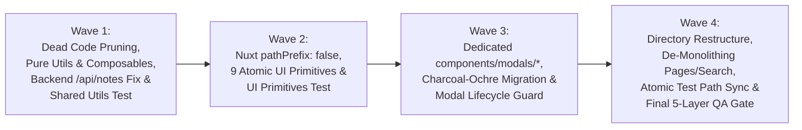

# NEXURA MANAGEMENT — MASTER REFACTORING, FILE STRUCTURE & UI COMPONENT ENHANCEMENT ROADMAP

> **Status Dokumen:** `RATIFIED & LOCKED MASTER ROADMAP`  
> **Otorisasi:** Disetujui oleh Project Owner (4 November 2026)  
> **Mode Tata Kelola:** Multi-Agent Governance Directive — Ready for Phased Wave Execution  
> **Baseline Pengujian Sistem:** **23 Test Suites / 312 Unit Tests (`100% PASS` dalam 3.56 detik)** · **0 Import Cycles** · **Strict Zero-Regression Guarantee**

---

## 1. Visi, Prinsip Desain & Sasaran Utama Refactoring

Inisiatif Master Refactoring ini adalah **penataan ulang arsitektur direktori, ekstraksi utilitas murni & komponen atomik *reusable*, eliminasi kode mati, pembasmian bug split-brain Nitro KV, serta penyempurnaan menyeluruh visual *Precision Dark Obsidian Bento*** di seluruh repositori Nexura Management:

1. **Zero Root-Level Component Clutter:**  
   Mengakhiri kondisi **27 file `.vue` yang menumpuk di root `components/`**. Setelah refactoring selesai, **tidak ada satu pun file `.vue` lepas di root `components/`**. Seluruh komponen tertata rapi dalam domain subdirektori (`ui/`, `modals/`, `layout/`, `dashboard/`, `kanban/`, `tasks/`, `notes/`, `project/`, `sprint/`).
2. **Dedicated Modal Architecture (`components/modals/`):**  
   Mengonsolidasikan seluruh **15 komponen Modal & Drawer** yang saat ini tercecer (di root `components/`, `components/sprint/`, dan inline di `app/pages/repos.vue`) ke dalam satu direktori terpadu **`components/modals/`** yang dikelompokkan berdasarkan sub-domain (`task/`, `project/`, `sprint/`, `devops/`, serta global `confirm/session`), dibangun di atas primitif `BaseModal.vue` / `BaseDrawer.vue` dan dikontrol oleh `useModalLifecycle.ts`.
3. **Penyempurnaan Visual & Eliminasi Residu *Charcoal-Ochre* (`#C98A4B`):**  
   Memigrasikan penuh **6 modal aktif** yang masih tertinggal di era tema lama konsol (`AddProjectModal`, `EditProjectModal`, `DeploymentModal`, `PackageModal`, `SecurityAlertModal`, `WorkflowLogModal`) ke standar **Precision Dark Obsidian Bento** (`#07080A`, `#0B0C10`, `#111318`, `#F3F4F6`, `#8A8F9E`, `#6366F1`) serta mengganti tombol `✕` teks mentah dengan tombol ikon standar.
4. **Atomic UI Component System (`components/ui/`):**  
   Memperluas `components/ui/` (yang sebelumnya hanya memuat `NexuraIcon.vue`) dengan **9 komponen UI atomik *reusable*** (`BaseButton`, `BaseCard`, `BaseModal`, `BaseDrawer`, `BaseInput`, `BaseSelect`, `BaseBadge`, `BaseSegmentedControl`, `BaseEmptyState`).
5. **Pemisahan Tegas Pure Utilities (`utils/`) vs Reactive Composables (`composables/`):**  
   Memisahkan fungsi kalkulasi murni tanpa state (`utils/formatters.ts`, `utils/badges.ts`, `utils/markdown-checklist.ts`) dari state reaktif (`composables/`), memangkas ratusan baris kode duplikat di 20+ file.
6. **Eliminasi 22 File Kode Mati & 3 Folder Backup (2.429 Baris Dipangkas):**  
   Menghapus 19 komponen stub/wrapper mati, 3 composable usang, dan 3 direktori backup temporer yang terbukti memiliki **0 active reference** di seluruh codebase.
7. **Penyelesaian Bug Nyata *Split-Brain* Nitro KV & Backend Clean Code (`server/`):**  
   Memperbaiki bug inkonsistensi storage key `'notes'` vs `'project_notes'` pada `/api/notes/*` yang memicu HTTP 404 pada promosi catatan lokal, mengekstrak `promoteNoteToTask` (110 baris duplikat), mengekstrak 23 blok error handling Supabase (~250 baris), mengekstrak 11 blok validasi router param, serta membersihkan dual-write sprint pada task PUT.
8. **De-monolithing Halaman Besar (> 700–1.262 Baris):**  
   Memecah file monolitik terbesar (`app/pages/projects/[slug].vue`, `app/pages/sprints.vue`, `composables/useOmniSearch.ts`, `components/search/HeaderSearch.vue`) menjadi modul-modul terfokus dengan tetap mempertahankan 100% kontrak pengujian.

---

## 2. Struktur Pohon Direktori Kanonikal (Before vs After)

### 2.1. Masalah pada Struktur Direktori Saat Ini
- **Root `components/` menampung 27 file lepas:** Terdiri dari 11 modal/drawer, 3 komponen layout shell, 3 komponen domain utama (`Dashboard.vue`, `KanbanBoard.vue`, `TaskCard.vue`), dan 10 wrapper/stub mati.
- **`components/ui/` hanya berisi 1 file (`NexuraIcon.vue`).**
- **Belum ada direktori `utils/` di frontend**, sehingga format tanggal, task ID, dan kalkulasi checklist disalin berulang di puluhan file.
- **Terdapat modal inline 114 baris** di dalam `app/pages/repos.vue` (L436-549).

### 2.2. Target Struktur Direktori Bersih (`Clean Layered & Domain-Driven Structure`)

```text
Management/
├── app/
│   ├── app.vue                                  # Root Inset Shell (.obs-workspace) & Global Modal Mounts
│   └── pages/                                   # 8 Rute Kanonikal (Deklaratif & Ramping)
│       ├── index.vue                            # / (Command Center Dashboard)
│       ├── tasks.vue                            # /tasks (Kanban Pipeline & Execution Matrix)
│       ├── projects/
│       │   ├── index.vue                        # /projects (Projects Catalog & Metrics)
│       │   └── [slug].vue                       # /projects/:slug (Project Cockpit — dirampingkan via useProjectCockpit)
│       ├── sprints.vue                          # /sprints (Weekly Sprints — dirampingkan via useSprintWorkspace)
│       ├── roadmap.vue                          # /roadmap (Architecture Roadmap)
│       ├── repos.vue                            # /repos (GitHub Repositories Catalog — inline modal diekstrak)
│       ├── telemetry.vue                        # /telemetry (System Telemetry & Backup)
│       └── settings.vue                         # /settings (Global Preferences & Obsidian Theme Presets)
│
├── components/                                  # 0 FILE LEPAS DI ROOT components/
│   ├── ui/                                      # 1. ATOMIC UI PRIMITIVES (Reusable Design Tokens)
│   │   ├── NexuraIcon.vue                       # Lucide Icon Wrapper
│   │   ├── BaseButton.vue                       # [BARU] Polimorfik (button/a/NuxtLink), Loading, Variant, Size
│   │   ├── BaseCard.vue                         # [BARU] Specular Bento Card (.obs-card, interactive, inset, slots)
│   │   ├── BaseModal.vue                        # [BARU] Modal Shell (Teleport, Transition, Header, Close, Backdrop)
│   │   ├── BaseDrawer.vue                       # [BARU] Slide-Over Drawer Shell (Teleport, Header, Close, Right Sheet)
│   │   ├── BaseInput.vue                        # [BARU] Text Input & Textarea (Prefix/Suffix Icon, Error, Clearable)
│   │   ├── BaseSelect.vue                       # [BARU] Dark Select (appearance-none, ChevronDown, dark options)
│   │   ├── BaseBadge.vue                        # [BARU] Status, Priority, Phase Pill (Standard min text-xs / 12px)
│   │   ├── BaseSegmentedControl.vue             # [BARU] Pill Tab & View Switcher
│   │   ├── BaseEmptyState.vue                   # [BARU] Standard Empty, Error, dan Skeleton Loading Card
│   │   └── IconArrowUpRight.vue                 # (Dipindahkan dari root components/)
│   │
│   ├── modals/                                  # 2. DEDICATED MODAL ARCHITECTURE (15 Komponen Terpusat)
│   │   ├── ConfirmDialog.vue                    # (Dipindahkan dari root + upgrade ke BaseModal/BaseButton)
│   │   ├── SessionAuthModal.vue                 # (Dipindahkan dari root + upgrade ke BaseModal/BaseButton)
│   │   ├── task/
│   │   │   ├── AddTaskModal.vue                 # (Dipindahkan dari root + BaseModal/BaseInput/BaseSelect)
│   │   │   ├── TaskDrawer.vue                   # (Dipindahkan dari root + useMarkdownChecklist/useModalLifecycle)
│   │   │   └── AddIdeaModal.vue                 # (Dipindahkan dari root + BaseModal/BaseInput/BaseSelect)
│   │   ├── project/
│   │   │   ├── AddProjectModal.vue              # (Dipindahkan + Migrasi Penuh ke Dark Obsidian)
│   │   │   ├── EditProjectModal.vue             # (Dipindahkan + Migrasi Penuh ke Dark Obsidian)
│   │   │   └── ConnectRepoModal.vue             # [BARU] Diekstrak dari modal inline app/pages/repos.vue (L436-549)
│   │   ├── sprint/
│   │   │   ├── AddTargetModal.vue               # (Dipindahkan dari sprint/ + tambah BaseSelect & Escape guard)
│   │   │   └── SprintRolloverModal.vue          # (Dipindahkan dari sprint/ + fix window keydown leak)
│   │   └── devops/
│   │       ├── DeploymentModal.vue              # (Dipindahkan + Migrasi Penuh ke Dark Obsidian)
│   │       ├── PackageModal.vue                 # (Dipindahkan + Migrasi Penuh ke Dark Obsidian)
│   │       ├── PullRequestsIssuesModal.vue      # (Dipindahkan + fix import issue ke Kanban via useTasks)
│   │       ├── SecurityAlertModal.vue           # (Dipindahkan + Migrasi Penuh ke Dark Obsidian)
│   │       └── WorkflowLogModal.vue             # (Dipindahkan + Migrasi Penuh ke Dark Obsidian)
│   │
│   ├── layout/                                  # 3. APP SHELL & NAVIGATION LAYOUT
│   │   ├── Sidebar.vue                          # (Dipindahkan dari root + dirampingkan)
│   │   ├── HeaderBar.vue                        # (Dipindahkan dari root)
│   │   └── AlertBar.vue                         # (Dipindahkan dari root)
│   │
│   ├── search/                                  # 4. GLOBAL OMNISEARCH
│   │   └── HeaderSearch.vue                     # (4 file stub/lama dihapus, kontrak test dipertahankan)
│   │
│   ├── dashboard/                               # 5. COMMAND CENTER DOMAIN
│   │   ├── Dashboard.vue                        # (Dipindahkan dari root components/Dashboard.vue)
│   │   ├── UnifiedHeroBanner.vue
│   │   ├── WorkspacePulse.vue
│   │   ├── ProjectExecutionOverview.vue
│   │   ├── LiveDevOpsStream.vue
│   │   ├── RecentShipmentsCard.vue
│   │   └── InfrastructureMeshCard.vue
│   │
│   ├── kanban/                                  # 6. KANBAN PIPELINE DOMAIN
│   │   ├── KanbanBoard.vue                      # (Dipindahkan dari root components/KanbanBoard.vue)
│   │   ├── KanbanColumn.vue
│   │   ├── TaskCard.vue                         # (Dipindahkan dari root components/TaskCard.vue)
│   │   └── KanbanDragGhost.vue
│   │
│   ├── tasks/                                   # 7. TASKS WORKSPACE DOMAIN
│   │   └── ActiveFocusPanel.vue
│   │
│   ├── notes/                                   # 8. SCRATCHPAD & NOTES DOMAIN
│   │   └── IdeaScratchpadPanel.vue
│   │
│   ├── project/                                 # 9. PROJECT COCKPIT CARDS & FEEDS
│   │   ├── ProjectHeroHeader.vue
│   │   ├── ProjectCicdCard.vue
│   │   ├── ProjectLiveDeploymentCard.vue
│   │   ├── ProjectPackageCard.vue
│   │   ├── ProjectSecurityCard.vue
│   │   ├── ProjectPriorityDeliverables.vue
│   │   ├── RepoActivityBadge.vue                # (Dipindahkan dari root components/)
│   │   ├── ProjectTaskMatrix.vue
│   │   ├── ProjectCommitsPreview.vue
│   │   ├── ProjectGitActivityFeed.vue
│   │   ├── ProjectPullsIssuesFeed.vue
│   │   ├── ProjectDeploymentFeed.vue
│   │   ├── ProjectPackageFeed.vue
│   │   ├── ProjectSecurityFeed.vue
│   │   ├── ProjectWorkflowRunsFeed.vue
│   │   └── ProjectVercelTab.vue
│   │
│   └── sprint/                                  # 10. WEEKLY SPRINT CARDS & MATRIX
│       ├── SprintHeader.vue
│       ├── SprintObjectiveBanner.vue
│       ├── WeeklyMetricsBento.vue
│       └── DeliverablesMatrix.vue
│
├── utils/                                       # [BARU] PURE SHARED UTILITIES (0 State, 100% Tree-shakable)
│   ├── formatters.ts                            # formatTaskId, formatDate, formatRelativeTime, getLocalDateString, isOverdue
│   ├── badges.ts                                # getStatusLabel, normalizeStatus, getStatusBadgeClass, getPriorityBadgeClass
│   └── markdown-checklist.ts                    # parseChecklist, toggleChecklistStep, appendChecklistStep, removeChecklistStep
│
├── composables/                                 # REACTIVE COMPOSABLES (Modular & Teruji)
│   ├── useWorkspaceStore.ts                     # Canonical SSOT Store
│   ├── useSession.ts                            # Session Auth & Error Handler
│   ├── useTasks.ts                              # Tasks CRUD + Optimistic Mutator
│   ├── useProjects.ts                           # Projects CRUD + Optimistic Mutator
│   ├── useSprints.ts                            # Sprints CRUD + Optimistic Mutator
│   ├── useNotes.ts                              # [BARU] Notes CRUD + Smart Promotion Composable
│   ├── useGitHub.ts                             # GitHub Proxy Data Composables
│   ├── useModalLifecycle.ts                     # [BARU] Shared Escape, Focus Trap, Scroll Lock & Focus Restore Guard
│   ├── useMarkdownChecklist.ts                  # [BARU] Reactive wrapper di atas utils/markdown-checklist.ts
│   ├── useToastFeedback.ts                      # [BARU] Shared Toast Notification State & Timer
│   ├── useThemePreset.ts                        # [BARU] Sinkronisasi tema ke localStorage & document.body.dataset.preset
│   ├── useHeaderActions.ts
│   ├── useQuickTask.ts
│   ├── useTaskDrawer.ts
│   ├── useProjectNav.ts
│   ├── useSprintCalendar.ts
│   ├── useSprintWorkspace.ts                    # [BARU] Ekstraksi logika halaman sprints.vue
│   ├── useProjectCockpit.ts                     # [BARU] Ekstraksi logika halaman projects/[slug].vue
│   ├── useOmniSearch.ts                         # Entry point utama OmniSearch (~240L facade re-export)
│   └── search/                                  # [BARU] Sub-modul internal OmniSearch
│       ├── omniSearchTypes.ts
│       ├── omniSearchScoring.ts
│       ├── omniSearchCatalog.ts
│       └── useHeaderSearchView.ts
│
└── server/                                      # NITRO BACKEND ENGINE (Clean, Deduplicated & Secure)
    ├── api/                                     # Seluruh route menggunakan withApiHandler & Repository Pattern
    │   └── notes/                               # Diselaraskan ke noteRepository (mengakhiri split-brain)
    ├── repositories/
    │   ├── contracts/
    │   ├── supabase/
    │   │   ├── mappers.ts                       # [BARU] Shared row <-> entity mappers
    │   │   └── supabase-*.repository.ts         # Menggunakan throwIfSupabaseError & getter this.client
    │   └── nitro/
    │       └── nitro-*.repository.ts            # Key kanonikal 'project_notes', promoteNoteToTask bersama
    ├── schemas/
    │   └── helper.ts                            # Ditambah requireRouterParam(event, name) & clampLimitQuery()
    └── utils/
        ├── supabase.ts                          # Ditambah requireSupabaseClient() & throwIfSupabaseError()
        ├── note.ts                              # Ditambah promoteNoteToTask() bersama (110L diekstrak)
        └── github-sync.ts                       # Reconcile deduplication
```

---

## 3. Spesifikasi Detail Komponen UI Atomik & Arsitektur Modal

### 3.1. `BaseButton.vue` (Polymorphic Navigation & Button)
Mengatasi masalah 3 gaya tombol primer yang saling bertabrakan, ketidakkonsistenan font, dan ketiadaan loading spinner terstandarisasi:
- **Polimorfisme Otomatis:**
  - Jika menerima prop `:to`, merender `<NuxtLink>`.
  - Jika menerima prop `:href`, merender `<a target="_blank" rel="noopener noreferrer">`.
  - Jika tidak ada keduanya, merender `<button type="button">`.
- **Varian Visual (`variant`):**
  - `primary`: `bg-[#F3F4F6] hover:bg-white text-[#07080A] font-sans font-semibold shadow-[0_1px_2px_rgba(0,0,0,0.4),inset_0_1px_0_rgba(255,255,255,0.9)]`
  - `accent`: `bg-indigo-600 hover:bg-indigo-500 text-white border border-indigo-400/20 font-sans font-medium shadow-[0_1px_12px_rgba(99,102,241,0.25)]`
  - `secondary`: `bg-white/[0.04] hover:bg-white/[0.08] text-[#F3F4F6] border border-white/[0.08] hover:border-white/[0.15] font-sans font-medium`
  - `ghost`: `bg-transparent hover:bg-white/[0.05] text-[#8A8F9E] hover:text-[#F3F4F6] font-sans font-medium`
  - `danger`: `bg-rose-500/10 hover:bg-rose-500/20 text-rose-400 border border-rose-500/25 font-sans font-medium`
- **Ukuran (`size`):** `sm` (`px-2.5 py-1 text-xs rounded-lg gap-1.5`), `md` (`px-3.5 py-1.5 text-xs rounded-lg gap-1.5`), `lg` (`px-4 py-2 text-xs rounded-xl gap-2`), `icon` (`w-8 h-8 rounded-lg flex items-center justify-center`).
- **Ergonomi Bawaan:** Prop `:loading` (otomatis merender `<NexuraIcon name="Loader2" class="animate-spin" />` dan menonaktifkan klik), `active:scale-[0.98]`, dan `focus-visible:outline-none focus-visible:ring-2 focus-visible:ring-indigo-500/50`.

### 3.2. `BaseCard.vue` (Specular Bento Container)
- Menyatukan penerapan class CSS `.obs-card` dengan specular top-edge highlight (`inset 0 1px 0 0 rgba(255,255,255,0.07)`).
- Menghapus penggunaan class warisan `.console-card`.
- **Varian Permukaan:** `default` (`.obs-card`), `interactive` (`.obs-card .obs-card-interactive cursor-pointer`), `inset` (`bg-[#0B0C10] border border-white/[0.06] rounded-xl`).
- **Slot Terstruktur:** `#header`, `#default`, `#actions`, `#footer`.

### 3.3. `BaseModal.vue`, `BaseDrawer.vue` & `useModalLifecycle.ts`
- **`BaseModal.vue`:**
  - `<Teleport to="body">` + `<Transition>` halus (150ms) dengan penyesuaian `@media (prefers-reduced-motion: reduce)`.
  - Header standar dengan ikon berbingkai, judul `font-sans text-base font-semibold text-[#F3F4F6]`, dan tombol close `<BaseButton variant="ghost" size="icon" icon="X" />`.
- **`useModalLifecycle.ts`:**
  - Mengunci scroll body (`document.body.style.overflow = 'hidden'`) hanya saat modal aktif.
  - Listener `Escape` hanya bereaksi saat `isOpen === true`, mencegah kebocoran listener global.
  - Focus trap `Tab` dan `Shift+Tab` terkurung di dalam dialog.
  - **OmniSearch Guard:** Saat modal ditutup, pemulihan fokus memeriksa elemen aktif sebelumnya; jika elemen tersebut adalah input OmniSearch, pemfokusan otomatis dibatalkan agar dropdown pencarian tidak terbuka tiba-tiba.

### 3.4. `BaseSelect.vue`, `BaseInput.vue`, `BaseBadge.vue` & `BaseEmptyState.vue`
- **`BaseSelect.vue`:** Memecahkan masalah menu dropdown putih bawaan OS pada Windows/macOS. Menerapkan `appearance-none`, ikon `ChevronDown`, dan tag opsi `<option class="bg-[#111318] text-[#F3F4F6] py-1.5">` yang menyatu dengan tema gelap.
- **`BaseBadge.vue`:** Menertibkan 492 instansi ukuran font mikro (`text-[9px]`, `text-[10px]`, `text-[11px]`) menjadi minimal `text-xs` (12px) dengan padding proporsional (`px-2 py-0.5`).
- **`BaseSegmentedControl.vue`:** Menyatukan gaya tab/filter switcher di seluruh halaman.
- **`BaseEmptyState.vue`:** Menyatukan tampilan Empty State, Error Card (`border-rose-500/30`), dan Loading Skeleton di 5 halaman workspace.

---

## 4. Peta Jalan Eksekusi 4 Gelombang (The Refined 4-Wave Execution Roadmap)

Untuk menjaga stabilitas **312 unit test (`100% PASS`)**, mencegah kegagalan *pipeline* (*Zero-Broken CI*), dan menegakkan aturan kepemilikan file tunggal (*Single Execution Owner*), eksekusi dibagi menjadi **4 Gelombang Terstruktur**:



---

### **WAVE 1 — Dead Code Pruning, Pure Utilities, Shared Composables & Backend Alignment**
*Tujuan: Membersihkan codebase dari 2.429 baris kode mati, membangun utilitas murni teruji, dan menuntaskan bug split-brain backend.*

1. **Penghapusan 22 File Kode Mati & 3 Direktori Backup (`page-workspaces-executor` & `frontend-store-executor`):**
   - Hapus 19 komponen mati: `OmniSearchModal.vue`, `search/OmniSearchModal.vue`, `search/OmniSearchInput.vue`, `search/OmniSearchResults.vue`, `search/OmniSearchPreviewPane.vue`, `IdeaScratchpadPanel.vue` (root wrapper), `tasks/IdeaScratchpadPanel.vue` (wrapper), `ActiveFocusPanel.vue` (root wrapper), `CommitList.vue`, `dashboard/ActiveExecutionQueue.vue`, `DeploymentBadge.vue`, `PackageBadge.vue`, `SecurityBadge.vue`, `WorkflowBadge.vue`, `kanban/KanbanToolbar.vue`, `NexuraLogo.vue`, `project/ProjectSupabaseTab.vue`, `StructureStaticGrid.vue`, `TaskQueue.vue`.
   - Hapus 3 composable mati: `composables/useSearch.ts`, `composables/useSidebar.ts`, `composables/useStats.ts`.
   - Hapus 3 folder backup: `.phase10-backup/`, `.phase12-backup/`, `.phase13-backup/`.
2. **Pembangunan Pure Utilities (`frontend-store-executor`):**
   - Buat `utils/formatters.ts` (`formatTaskId`, `formatDate`, `formatRelativeTime`, `getLocalDateString`, `isOverdue`).
   - Buat `utils/badges.ts` (`getStatusLabel`, `normalizeStatus`, `getStatusBadgeClass`, `getPriorityBadgeClass`, `getPriorityColor`).
   - Buat `utils/markdown-checklist.ts` (`parseChecklist`, `toggleChecklistStep`, `appendChecklistStep`, `removeChecklistStep`).
3. **Pembangunan Shared Composables Fondasi (`frontend-store-executor`):**
   - Buat `composables/useModalLifecycle.ts` (scroll lock, focus trap, Escape guard).
   - Buat `composables/useMarkdownChecklist.ts` (reactive wrapper atas `utils/markdown-checklist.ts`).
   - Buat `composables/useToastFeedback.ts` (global toast notification).
   - Buat `composables/useThemePreset.ts` (sinkronisasi `body[data-preset]` & `localStorage`).
   - Buat `composables/useNotes.ts` (composable resmi notes CRUD & smart promotion).
4. **Koreksi Timing QA — Pembuatan Unit Test Shared Utils (`qa-automation-executor`):**
   - Buat test suite baru `tests/unit/shared-utils.spec.mjs` untuk memvalidasi 100% fungsi murni pada `utils/formatters.ts`, `utils/badges.ts`, dan `utils/markdown-checklist.ts`.
5. **Penyelesaian Bug Split-Brain Backend & Clean Code (`backend-api-executor`):**
   - Refactor `server/api/notes/index.get.ts`, `index.post.ts`, dan `[id].delete.ts` agar menggunakan `withApiHandler` dan mendelegasikan ke `noteRepository`.
   - Selaraskan storage key di `nitro-note.repository.ts` ke key kanonikal `'project_notes'`.
   - Ekstrak fungsi `promoteNoteToTask` ke `server/utils/note.ts` (memangkas 110 baris duplikat) dengan tetap menjaga method `promoteToTask()` pada interface `INoteRepository`.
   - Ekstrak `requireSupabaseClient()` dan `throwIfSupabaseError()` ke `server/utils/supabase.ts`, serta buat `server/repositories/supabase/mappers.ts`.
   - **Critical Test Guard:** Repositori Supabase **wajib mempertahankan** properti getter `protected get client() { return requireSupabaseClient() }` agar mock injection di `tests/unit/supabase-task-injection.spec.mjs` tetap lulus.
   - Tambahkan `requireRouterParam()` di `server/schemas/helper.ts` (menggantikan 11 blok validasi param).
   - Sertakan `releasePhase` yang terlewat di `server/api/projects.post.ts` & `server/plugins/supabase-sync.ts`.
   - Hapus penulisan mutasi sekunder dual-write `sprints.task_ids` di `server/api/tasks/[id].put.ts`.
   - **GitHub Route Guard:** Dilarang menambah file helper di `server/api/github/` (pertahankan tepat 14 file sesuai `security-headers.spec.mjs:101`).
6. **QA Gate Wave 1 (`qa-automation-executor`):**
   - Jalankan `npm test` (Target: 24 test suites lulus 100%).

---

### **WAVE 2 — Nuxt Config Auto-Import & Pembangunan 9 Atomic UI Primitives**
*Tujuan: Membangun sistem komponen atomik terstandarisasi di `components/ui/` dan menyiapkan konfigurasi auto-import bebas prefix.*

1. **Konfigurasi Nuxt Component Auto-Import (`security-db-executor`):**
   - Perbarui baris 27 di `nuxt.config.ts`:
     ```typescript
     components: [{ path: '~~/components', pathPrefix: false }]
     ```
   - Verifikasi bahwa objek `routeRules` dan security headers tidak berubah (menjaga `security-headers.spec.mjs`).
2. **Pembangunan 9 Komponen UI Atomik di `components/ui/` (`frontend-store-executor`):**
   - `components/ui/BaseButton.vue` (Polymorphic button/link/NuxtLink, loading state, 5 varian, 4 ukuran).
   - `components/ui/BaseCard.vue` (.obs-card specular container, interactive, inset).
   - `components/ui/BaseModal.vue` (Teleport, transition, header slot, close button).
   - `components/ui/BaseDrawer.vue` (Slide-over right sheet inspector).
   - `components/ui/BaseInput.vue` (Prefix/suffix icon, textarea support, clearable, error state).
   - `components/ui/BaseSelect.vue` (appearance-none, ChevronDown, styled dark options).
   - `components/ui/BaseBadge.vue` (Standard status/priority/phase pill, min font `text-xs`).
   - `components/ui/BaseSegmentedControl.vue` (Pill tab switcher).
   - `components/ui/BaseEmptyState.vue` (Empty, error & loading skeleton card).
   - Pindahkan `components/IconArrowUpRight.vue` ke `components/ui/IconArrowUpRight.vue`.
3. **Koreksi Timing QA — Pembuatan Unit Test UI Primitives (`qa-automation-executor`):**
   - Buat test suite baru `tests/unit/ui-primitives.spec.mjs` untuk menguji rendering props, slot fallback, dan event emission pada 9 komponen `Base*.vue`.
4. **QA Gate Wave 2 (`qa-automation-executor`):**
   - Jalankan `npm test` dan `npm run typecheck` (Target: 25 test suites lulus, 0 error diagnostik).

---

### **WAVE 3 — Penataan Direktori Khusus `components/modals/**` & Migrasi Penuh Dark Obsidian**
*Tujuan: Memusatkan 15 modal ke direktori khusus dan melenyapkan seluruh sisa warna Charcoal-Ochre.*

1. **Penataan 15 Modal ke dalam `components/modals/` (`frontend-store-executor`):**
   - `components/modals/ConfirmDialog.vue` & `components/modals/SessionAuthModal.vue`
   - `components/modals/task/{AddTaskModal.vue, TaskDrawer.vue, AddIdeaModal.vue}`
   - `components/modals/project/{AddProjectModal.vue, EditProjectModal.vue, ConnectRepoModal.vue}`
   - `components/modals/sprint/{AddTargetModal.vue, SprintRolloverModal.vue}`
   - `components/modals/devops/{DeploymentModal.vue, PackageModal.vue, PullRequestsIssuesModal.vue, SecurityAlertModal.vue, WorkflowLogModal.vue}`
2. **Ekstraksi Connect Repo Modal (`frontend-store-executor`):**
   - Ekstrak 114 baris modal inline dari `app/pages/repos.vue` (L436-549) menjadi `components/modals/project/ConnectRepoModal.vue` berbasis `BaseModal` dan `BaseInput`.
3. **Migrasi Menyeluruh 6 Modal Charcoal-Ochre ke Precision Dark Obsidian (`frontend-store-executor`):**
   - Ganti seluruh warna `#C98A4B`, `#F5F2EB`, `#756F68`, `#111114`, `#09090B`, dan tombol close `✕` pada:
     - `AddProjectModal.vue`
     - `EditProjectModal.vue`
     - `DeploymentModal.vue`
     - `PackageModal.vue`
     - `SecurityAlertModal.vue`
     - `WorkflowLogModal.vue`
   - Gunakan `BaseModal`, `BaseButton`, `BaseInput`, `BaseSelect`, dan `BaseBadge`.
4. **Peningkatan Kualitas & Lifecycle Modal:**
   - Terapkan `useModalLifecycle` dan `useMarkdownChecklist` pada `TaskDrawer.vue`.
   - Perbaiki `SprintRolloverModal.vue` agar listener Escape tidak bocor ke window saat modal tertutup.
   - Perbaiki `importIssueToKanban` di `PullRequestsIssuesModal.vue` agar memakai `useTasks().createTask()`.
5. **QA Gate Wave 3 (`qa-automation-executor`):**
   - Jalankan `npm test` dan `npm run typecheck` (Target: 25 test suites lulus 100%).

---

### **WAVE 4 — Restrukturisasi Direktori Domain, De-Monolithing, Sinkronisasi Path Test & Final QA Gate**
*Tujuan: Menyelesaikan pemindahan seluruh komponen root ke domain subdirektori, merampingkan halaman monolitik, menertibkan font mikro, menyinkronkan path test, dan mengunci sistem.*

1. **Pemindahan Komponen Domain & Layout (0 File Lepas di Root `components/`) (`page-workspaces-executor`):**
   - Pindahkan `Sidebar.vue`, `HeaderBar.vue`, dan `AlertBar.vue` ke `components/layout/`.
   - Pindahkan `Dashboard.vue` ke `components/dashboard/Dashboard.vue`.
   - Pindahkan `KanbanBoard.vue` dan `TaskCard.vue` ke `components/kanban/`.
   - Pindahkan `RepoActivityBadge.vue` ke `components/project/RepoActivityBadge.vue`.
2. **De-Monolithing Modul Besar (> 700 Baris) (`page-workspaces-executor` & `frontend-store-executor`):**
   - **`composables/useOmniSearch.ts` (`1.035L` $\rightarrow$ `~240L`):** Ekstrak modul internal ke `composables/search/{omniSearchTypes,omniSearchScoring,omniSearchCatalog}.ts`. Simpan state inti di `useOmniSearch.ts` dan re-export seluruh fungsi/tipe agar memenuhi kontrak JITI di `tests/unit/omni-search.spec.mjs:84`.
   - **`components/search/HeaderSearch.vue` (`997L`):** Rampingkan visual grouping via `composables/search/useHeaderSearchView.ts` dengan **wajib mempertahankan 22 baris string kontrak** (ARIA attributes, `inputRef.value?.blur()`, closeSearch triggers) yang diuji oleh `omni-search.spec.mjs:1147-1225`.
   - **`app/pages/projects/[slug].vue` (`1.262L` $\rightarrow$ `~720L`):** Ekstrak state reaktif, polling data, dan modal lifecycle ke `composables/useProjectCockpit.ts`.
   - **`app/pages/sprints.vue` (`715L` $\rightarrow$ `~380L`):** Ekstrak task orchestration & calendar filters ke `composables/useSprintWorkspace.ts`.
3. **Standarisasi UI & Penertiban 492 Font Mikro (`page-workspaces-executor`):**
   - Terapkan `BaseButton`, `BaseCard`, `BaseSelect`, `BaseBadge`, `BaseSegmentedControl`, `BaseEmptyState`, `utils/formatters.ts`, dan `utils/badges.ts` di seluruh 8 halaman `app/pages/**` dan komponen subdirektori.
   - Ganti seluruh 492 instansi `text-[9px]`, `text-[10px]`, dan `text-[11px]` menjadi minimal `text-xs` (12px).
4. **Protokol Sinkronisasi Path Test Atomik (`qa-automation-executor`):**
   - Perbarui secara atomik string path di 4 file test yang membaca filesystem langsung:
     - `tests/unit/dashboard-command-center.spec.mjs`: Sesuaikan path ke `components/dashboard/Dashboard.vue`.
     - `tests/unit/omni-search.spec.mjs`: Sesuaikan path ke `components/layout/HeaderBar.vue`.
     - `tests/unit/scratchpad-smart-promotion.spec.mjs`: Sesuaikan path ke `components/kanban/KanbanBoard.vue` dan `components/kanban/TaskCard.vue`.
     - `tests/unit/settings-and-dashboard-polish.spec.mjs`: Sesuaikan path ke `components/dashboard/Dashboard.vue` dan `components/layout/Sidebar.vue`.
5. **The 5-Layer Final Quality Gate (`qa-automation-executor`):**
   - **Layer 1: Zero-Reference Audit:** Verifikasi tidak ada path impor yang rusak atau mengarah ke lokasi lama.
   - **Layer 2: Static Typecheck:** `npx vue-tsc --noEmit` (Exit Code 0, 0 diagnostik).
   - **Layer 3: Master Unit Test Suite:** `npm test` (100% lulus di seluruh 25+ suites).
   - **Layer 4: Knowledge Graph Synchronization:** `python -m graphify update .` (Sinkronisasi AST graph tanpa biaya API).
   - **Layer 5: Production Build Verification:** `npm run build` (Exit Code 0, bundle packaging berhasil sempurna).

---

## 5. Matriks Pengamanan Kontrak Pengujian (*Test Guardrails Matrix*)

| File Test (`tests/unit/*.spec.mjs`) | Target Verifikasi / Kontrak yang Dijaga | Tindakan Pengamanan Selama Refactoring |
| :--- | :--- | :--- |
| `security-headers.spec.mjs` | `nuxt.config.ts`, `server/api/github/*.ts` (tepat 14 file), `server/middleware/auth.ts` | **Dilarang menambah/menghapus file di `server/api/github/`**. Helper diletakkan di `server/utils/github.ts`. Objek `nitro.routeRules` tidak boleh diubah. |
| `supabase-task-injection.spec.mjs` | `server/repositories/supabase/supabase-task.repository.ts` | **Wajib mempertahankan properti getter `protected get client() { return requireSupabaseClient() }`** agar injeksi mock via `Object.defineProperty` tetap berjalan. |
| `omni-search.spec.mjs` | `composables/useOmniSearch.ts`, `components/search/HeaderSearch.vue`, `components/layout/HeaderBar.vue` | Pertahankan file `useOmniSearch.ts` sebagai fasad JITI. Pertahankan 22 string verbatim kontrak di `HeaderSearch.vue`. Sesuaikan path `HeaderBar.vue` di test pada Wave 4. |
| `dashboard-command-center.spec.mjs` | `components/dashboard/Dashboard.vue` | Pertahankan class CSS grid dashboard. Sesuaikan path pembacaan `Dashboard.vue` di baris 999, 1011, 1021 pada Wave 4. |
| `scratchpad-smart-promotion.spec.mjs` | `components/notes/IdeaScratchpadPanel.vue`, `components/kanban/{KanbanBoard,TaskCard}.vue`, `promote.post.ts` | Pertahankan fallback kategori di `IdeaScratchpadPanel.vue`. Pertahankan signature `promoteToTask()` pada repository. Sesuaikan path `KanbanBoard` & `TaskCard` di test pada Wave 4. |
| `settings-and-dashboard-polish.spec.mjs` | `components/dashboard/Dashboard.vue`, `components/layout/Sidebar.vue`, `app/pages/settings.vue` | Pertahankan kontrak single-viewport layout tanpa `pb-6`. Sesuaikan path `Dashboard.vue` dan `Sidebar.vue` di test pada Wave 4. |

---

## 6. Pembagian Peran Eksekutor & Batasan File Ketat (*Strict File Boundaries*)

Sesuai aturan mutlak tata kelola multi-agent (*Single Execution Owner*), setiap eksekutor hanya berwenang memodifikasi file dalam batas wilayahnya:

| Role Eksekutor | Wilayah Kepemilikan File Eksklusif (*Strict File Boundaries*) |
| :--- | :--- |
| **`security-db-executor`** | `server/database/migrations/*`, `server/middleware/auth.ts`, `server/utils/github-allowlist.ts`, `server/utils/supabase.ts` (blok config), `nuxt.config.ts` (blok `components` & `routeRules`). |
| **`backend-api-executor`** | `server/repositories/**`, `server/schemas/**`, `server/api/**`, `server/utils/note.ts`, `server/utils/supabase.ts` (blok repo helper), `server/utils/github-sync.ts`, `server/plugins/supabase-sync.ts`. |
| **`frontend-store-executor`** | `utils/**`, `composables/**`, `components/ui/**`, `components/modals/**`, `components/search/**`, `app/app.vue`. |
| **`page-workspaces-executor`** | `app/pages/**`, `components/layout/**`, `components/dashboard/**`, `components/kanban/**`, `components/tasks/**`, `components/notes/**`, `components/project/**`, `components/sprint/**`. |
| **`qa-automation-executor`** | `tests/**`, `vitest.config.ts`, `.github/workflows/ci.yml`. |

---

## 7. Status Eksekusi & Instruksi Tindak Lanjut

Dokumen roadmap ini telah **diratifikasi secara penuh**. Codebase saat ini berada dalam kondisi **STRICT FREEZE CODE (READ-ONLY)** hingga Project Owner memberikan perintah eksekusi per gelombang.

```text
STATUS SAAT INI:
[x] Tahap A: Investigasi Read-Only (Selesai)
[x] Tahap B: Diskusi Tim Analisis (Selesai & Konsensus Tercapai)
[x] Tahap C: Penyusunan Rencana Roadmap Terpadu (Selesai)
[x] Tahap D: Review Silang & Safeguard Tim Analis (Selesai)
[x] Tahap E: Persetujuan Project Owner (Diterima — 4 November 2026)
----------------------------------------------------------------------
[ ] WAVE 1: Dead Code Pruning, Pure Utils & Backend Alignment (MENUNGGU PERINTAH EKSEKUSI)
[ ] WAVE 2: Atomic UI Primitives (components/ui/Base*) (Menunggu Wave 1)
[ ] WAVE 3: Dedicated Modals & Charcoal-Ochre Migration (Menunggu Wave 2)
[ ] WAVE 4: Directory Restructuring, De-monolithing & Final QA Gate (Menunggu Wave 3)
```
