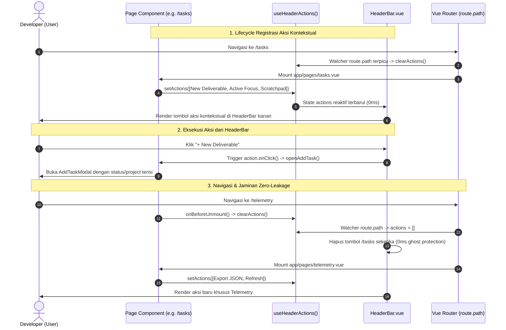
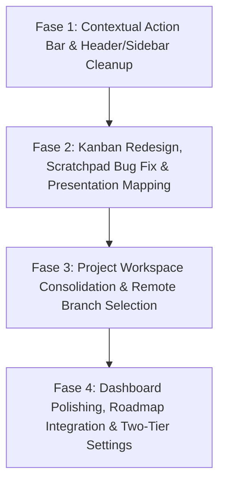

# MASTER IMPLEMENTATION PLAN: POST-COMPLETION UX REDESIGN & ARCHITECTURE PLANNING
## Nexura Management — Personal Engineering Command Center

> **Dokumen Referensi:** `docs/master-ux-redesign-architecture-plan.md`  
> **Status Dokumen:** `PLANNING DOCUMENT PREPARED — WAITING USER REVIEW`  
> **Status Implementasi:** `STRICT READ-ONLY (IMPLEMENTATION DISABLED)`  
> **Versi:** 1.0.0-PROPOSAL  
> **Tanggal Penetapan:** 30 Oktober 2026  
> **Lead Technical Architect / Head Agent:** Antigravity AI Orchestrator  
> **Disusun Berdasarkan:** Audit Kode Sumber Empiris, Investigasi 4 Domain Analis (*Analyst A: UI/UX/Navigation*, *Analyst B: Data/Workflow*, *Analyst C: Repository/DevOps*, *Analyst D: Architecture/Settings*), dan Arahan Kebutuhan Pemilik Proyek.

---

## 1. DOCUMENT METADATA

| Atribut Metadata | Nilai / Spesifikasi Resmi |
|---|---|
| **Nama Proyek** | Nexura Management (Personal Engineering Command Center) |
| **Repositori & Cabang** | `d:\Project_Center\REWORK\Management` (Branch: `development`) |
| **Stack Teknologi** | Nuxt 4 (`^4.1.2`), Vue 3.5, TypeScript Strict, Nitro Server, Supabase PostgreSQL, Tailwind CSS |
| **Baseline Kualitas Sistem** | 18 Test Suites, **244 / 244 Passed (100% Green)**, Coverage **83.05%**, 0 Diagnostic Type Errors |
| **Integritas Desain UI/UX** | Precision Dark Obsidian Bento UI (`#07080A` Void, `#0B0C10` Canvas, `#111318` Surface) |
| **Dokumen Prasyarat** | [`docs/master-remediation-plan.md`](file:///d:/Project_Center/REWORK/Management/docs/master-remediation-plan.md) (Fase 0 s.d. 13 Selesai & Terverifikasi) |
| **Dokumen Tata Kelola** | [`.agents/rules/multi-agent-governance.md`](file:///d:/Project_Center/REWORK/Management/.agents/rules/multi-agent-governance.md) & [`.agents/reporting-standard.md`](file:///d:/Project_Center/REWORK/Management/.agents/reporting-standard.md) |
| **Otoritas Persetujuan** | Bagja Iskandar (Project Owner) |

---

## 2. EXECUTIVE SUMMARY

### 2.1. Latar Belakang & Masalah Utama
Setelah penuntasan 14 fase remediasi arsitektur dasar (Fase 0 hingga Fase 13), evaluasi komprehensif terhadap pengalaman pengguna (*user experience*) menemukan 7 area friksi operasional dan ketidakkonsistenan perilaku sistem:
1. **Dashboard Vertical Layout & Information Density (Area A):** Tampilan Dashboard pada layar standar laptop (1080p / 1366x768) memunculkan scrollbar ganda dan bagian bawah terasa terpotong akibat benturan padding ganda (`app.vue:14` `p-5` + `Dashboard.vue:2` `pb-6`). Card commit pada `LiveDevOpsStream.vue` menempati 8 kolom bento yang sangat lapang namun menyembunyikan nama pembuat commit (*author*) dan link langsung ke GitHub. Sementara itu, `RecentShipmentsCard.vue` menampilkan *"No recent deployments recorded"* yang menyesatkan pengguna karena murni memfilter tugas Kanban internal, bukan event deployment infrastruktur.
2. **Duplikasi Tombol & Cacat Promosi Scratchpad (Area B):** Kolom Kanban memiliki dua tombol Add (di header dan di dasar kolom) yang 100% identik fungsinya. Pada saat yang sama, catatan bertipe `bug` dan `maintenance` yang dipromosikan dari Scratchpad selalu masuk secara keliru ke kolom `idea` karena nilai status di-hardcode di layer repository backend.
3. **Semantik 'Deployed' vs 'Done' (Area B):** Pemilik proyek menginginkan kolom terakhir Kanban bernama `Done`. Audit membuktikan bahwa mengubah raw database enum `'deployed'` menjadi `'done'` akan memicu kerusakan skema PostgreSQL, penolakan Zod, dan kegagalan pada minimal 8 test suites. Solusi presentation mapping diperlukan untuk memuaskan kebutuhan visual pengguna tanpa merusak integritas data.
4. **Evaluasi Relevansi Halaman Roadmap (Area C):** Roadmap 5-kolom fase rilis korporat sebagian besar kosong bagi solo developer yang hanya mengelola 1–3 proyek aktif.
5. **Keterbatasan Manajemen Branch Repositori (Area D):** Di dalam konteks proyek (`/projects/:slug`), daftar branch pada tab GitHub bersifat pasif tanpa kemampuan berpindah branch untuk melihat commit pada cabang tersebut. Endpoint backend commit juga belum mendukung parameter branch.
6. **Ketiadaan Contextual Action Bar & Elemen Header Usang (Area E):** HeaderBar saat ini memuat jam WIB, blocker pod, dan tombol kunci sesi yang statis. Aksi-aksi utama halaman tersebar di dalam body konten dan sering menduplikasi fungsi navigasi global.
7. **Fragmentasi Workspace Proyek & Ketiadaan Two-Tier Settings (Area F & G):** Tab Kanban dan Deliverables Matrix di detail proyek terpisah padahal mengonsumsi data yang sama. Selain itu, sistem belum memiliki pemisahan yang jelas antara pengaturan global (*Management Settings*) dan pengaturan spesifik proyek (*Project Settings*).

### 2.2. Tujuan Perubahan
- Mentransformasikan `HeaderBar.vue` menjadi **Contextual Action Bar dinamis** yang menyajikan aksi primer dan sekunder relevan per halaman aktif dengan proteksi *zero-leakage*.
- Mengeliminasi seluruh tombol dan backlink navigasi duplikat di seluruh antarmuka.
- Memperbaiki rantai data promosi Scratchpad secara cerdas (`bug`/`maintenance` $\rightarrow$ `in_queue`, `idea` $\rightarrow$ `idea`).
- Menerapkan label visual **`DONE`** pada Kanban via *Presentation Layer Mapping* tanpa merusak stabilitas database dan test runner.
- Menyediakan kemampuan **Remote Branch Selection** interaktif via GitHub API tanpa risiko operasi lokal.
- Menyatukan Kanban dan Deliverables dalam satu workspace proyek dengan tombol alih tampilan di HeaderBar.
- Membangun arsitektur **Two-Tier Settings** (Global `/settings` dan Project `/projects/:slug?tab=settings`).
- Mengoptimalkan ruang vertikal Dashboard agar mencapai **Zero Scrollbar pada resolusi desktop 1080p**.

### 2.3. Prinsip Implementasi & Batas Cakupan
1. **Strict Multi-Agent Governance:** Head Agent dilarang menulis kode implementasi. Seluruh modifikasi file wajib didelegasikan kepada subagent eksekutor berwenang berdasarkan batas kepemilikan file (*Single Execution Owner*).
2. **Strict Code Freeze Pre-Approval:** Tidak ada perubahan kode sumber atau schema database sebelum dokumen master plan ini disetujui secara eksplisit oleh Project Owner.
3. **Preservation of Test Suite Integrity:** Seluruh perubahan wajib mempertahankan tingkat kelulusan master test suite pada **100% Green (244/244 passing)** dan code coverage $\ge 80\%$.
4. **Preservation of Visual Design System:** Melindungi token dan estetika *Precision Dark Obsidian Bento UI* pada ~92 berkas lokal tanpa regresi visual.
5. **No Local Destructive Git Operations:** Pemilihan branch dibatasi murni pada remote metadata API; dilarang keras mengeksekusi shell `git checkout` di host server.

---

## 3. CURRENT STATE ASSESSMENT (EVIDENCE-BASED)

### 3.1. Ringkasan Kondisi Aktual & Temuan Terverifikasi (FACTS)

| ID Temuan | Area | Lokasi Berkas & Baris Kode | Fakta Empiris Terverifikasi | Klasifikasi |
|---|---|---|---|:---:|
| `AUD-DASH-01` | Dashboard | [`components/Dashboard.vue:2`](file:///d:/Project_Center/REWORK/Management/components/Dashboard.vue#L2) & [`app/app.vue:14`](file:///d:/Project_Center/REWORK/Management/app/app.vue#L14) | Terjadi benturan padding bawah ganda antara `app.vue` (`p-5` = 20px) dan `Dashboard.vue` (`pb-6` = 24px) $\rightarrow$ 44px terbuang sia-sia. Stack kolom kanan memiliki batas tinggi minimum $\ge 542\text{px}$ yang menyebabkan total tinggi Dashboard mencapai $760\text{px}$–$800\text{px}$, memicu scrollbar vertikal di layar 1080p. | `FACT` |
| `AUD-DASH-02` | Dashboard | [`components/dashboard/LiveDevOpsStream.vue:88-124`](file:///d:/Project_Center/REWORK/Management/components/dashboard/LiveDevOpsStream.vue#L88-L124) | Card commit menempati `xl:col-span-8` ($\approx 750\text{px}$ lebar) namun menyembunyikan field `authorName` dan direct link commit GitHub pada baris unexpanded, padahal data tersedia di `GitHubCommitItem`. | `FACT` |
| `AUD-DASH-03` | Dashboard | [`components/dashboard/RecentShipmentsCard.vue:96-98`](file:///d:/Project_Center/REWORK/Management/components/dashboard/RecentShipmentsCard.vue#L96-L98) | Kartu memfilter `allTasks.value.filter(t => t.status === 'deployed')`. Jika tidak ada tugas bertatus `deployed`, kartu menampilkan *"No recent deployments recorded"*, bertentangan dengan `LiveDevOpsStream` yang menampilkan deployment Vercel/GitHub riil. | `FACT` |
| `AUD-KAN-01` | Kanban | [`components/kanban/KanbanColumn.vue:36, 87`](file:///d:/Project_Center/REWORK/Management/components/kanban/KanbanColumn.vue#L36) | Tombol "Add" di header kolom dan tombol "Quick Add" di bawah kolom meng-emit event yang sama persis `@click="$emit('add-task', status)"`. Di `tasks.vue:296`, keduanya memanggil `openAddTask` tanpa argumen status. Terdapat 11 tombol add redundan di halaman Tasks. | `FACT` |
| `AUD-SCR-01` | Scratchpad | [`supabase-note.repository.ts:213`](file:///d:/Project_Center/REWORK/Management/server/repositories/supabase/supabase-note.repository.ts#L213) & [`nitro-note.repository.ts:90`](file:///d:/Project_Center/REWORK/Management/server/repositories/nitro/nitro-note.repository.ts#L90) | Pada method `promoteToTask(id)`, repository meng-hardcode `status: 'idea'` saat memanggil `taskRepository.create()`. Fallback di [`IdeaScratchpadPanel.vue:517`](file:///d:/Project_Center/REWORK/Management/components/notes/IdeaScratchpadPanel.vue#L517) juga meng-hardcode `status: 'idea'`. Akibatnya, note kategori `bug` atau `maintenance` dipaksa masuk ke kolom Idea. | `FACT` |
| `AUD-STAT-01` | Workflow | [`003_system_alignment...sql:6`](file:///d:/Project_Center/REWORK/Management/server/database/migrations/003_system_alignment_and_rls_lockdown.sql#L6) & [`server/schemas/task.schema.ts:15`](file:///d:/Project_Center/REWORK/Management/server/schemas/task.schema.ts#L15) | PostgreSQL menerapkan constraint `CHECK (status IN ('idea', 'in_queue', 'running_sprint', 'deployed', 'blocked'))`. Zod schema dan 15 test suites mengunci string `'deployed'`. Perubahan langsung di database akan memicu kegagalan sistem katastropik. | `FACT` |
| `AUD-REPO-01` | Repository | [`components/project/ProjectGitActivityFeed.vue:47-62`](file:///d:/Project_Center/REWORK/Management/components/project/ProjectGitActivityFeed.vue#L47-L62) | Daftar branch dirender sebagai elemen `div` pasif tanpa cursor pointer atau click handler. | `FACT` |
| `AUD-REPO-02` | Repository | [`server/api/github/commits.get.ts:11, 35`](file:///d:/Project_Center/REWORK/Management/server/api/github/commits.get.ts#L11) | Endpoint mengambil kueri commit default repo tanpa parameter `sha`/`branch`. Cache key Nitro (`getKey`) hanya mengombinasikan `token:repo:limit`, memicu tabrakan cache (*cache pollution*) jika branch ditambahkan tanpa memodifikasi key. | `FACT` |
| `AUD-CAB-01` | HeaderBar | [`components/HeaderBar.vue:42-65`](file:///d:/Project_Center/REWORK/Management/components/HeaderBar.vue#L42-L65) | Menampilkan jam WIB statis, blocker pod, dan tombol `KeyRound` yang membuka modal verifikasi session access key (`POST /api/auth/session`). Tidak ada area aksi kontekstual dinamis. | `FACT` |
| `AUD-WORK-01` | Workspace | [`app/pages/projects/[slug].vue:231, 244`](file:///d:/Project_Center/REWORK/Management/app/pages/projects/%5Bslug%5D.vue#L231) | Tab `kanban` dan Tab `matrix` adalah tab terpisah pada accordion sidebar yang merender data array yang persis sama (`projectTasks`). | `FACT` |
| `AUD-SET-01` | Settings | [`app/pages/`](file:///d:/Project_Center/REWORK/Management/app/pages/) | Berkas `settings.vue` belum ada. Di [`[slug].vue:126`](file:///d:/Project_Center/REWORK/Management/app/pages/projects/%5Bslug%5D.vue#L126), tombol Delete Project mengambang di bar atas tanpa tab settings proyek. | `FACT` |

---

## 4. TARGET STATE ARSITEKTUR & PENGALAMAN PENGGUNA

```
+---------------------------------------------------------------------------------------------------------------------+
|                                          UNIFIED APP SHELL (app/app.vue)                                             |
+----------------------------------+----------------------------------------------------------------------------------+
| UNIFIED LEFT SIDEBAR (w-56)      | INSET WORKSPACE PANEL (.obs-workspace)                                           |
|                                  +----------------------------------------------------------------------------------+
| Brand Header: Nexura             | CONTEXTUAL ACTION BAR (HeaderBar.vue)                                            |
|                                  | [Left] Breadcrumb: Workspace / Page Title                                        |
| Navigation Rail:                 | [Center] Global OmniSearch (⌘K)                                                  |
| 1. Command Center (/)            | [Right] Dynamic Contextual Actions (via useHeaderActions composable)             |
| 2. My Tasks & Queue (/tasks)     |   • Tasks:      [Kanban | Table] [⚡ Focus] [✨ Scratchpad] [+ New Task]         |
| 3. Weekly Sprints (/sprints)     |   • Projects:   [+ New Project]                                                  |
| 4. Repositories (/repos)         |   • ProjDetail: [Kanban | Table] [+ Add Deliverable]                             |
| 5. Telemetry (/telemetry)        |   • Sprints:    [+ Add Target]                                                   |
| 6. Global Settings (/settings)   |   • Repos:      [↻ Sync Repositories]                                            |
|                                  |   • Telemetry:  [📥 Export JSON] [↻ Refresh]                                     |
| Pinned Active Projects List      +----------------------------------------------------------------------------------+
|                                  | SCROLLABLE WORKSPACE CONTENT CANVAS                                              |
| Pinned Bottom Dock:              |                                                                                  |
| • Session Status: [● Active]     |   [Dashboard] Zero-scrollbar, enriched commits (author + link), shipped wins    |
| • Telemetry Mesh: Supabase + GH  |   [Tasks]     5-Col Kanban (with 'DONE'), smart scratchpad promotion, auto-height|
| • Rate Limit Quota: 4,892/5k     |   [Project]   Unified Deliverables (Kanban/Table), Remote Branch Selector,       |
|                                  |               Project Settings tab with Danger Zone                              |
|                                  |   [Settings]  Global Session management, GitHub allowlist, Theme Presets         |
+----------------------------------+----------------------------------------------------------------------------------+
```

---

## 5. DECISION REGISTER (CATATAN KEPUTUSAN ARSITEKTUR & DESAIN)

| ID Keputusan | Topik / Isu Arsitektur | Keputusan yang Diambil | Dasar Bukti Empiris | Alternatif yang Dipertimbangkan | Konsekuensi Teknis | Status |
|:---:|---|---|---|---|---|:---:|
| `DEC-01` | Label Kolom Terakhir Kanban | **UI Presentation Mapping (Opsi A)**: Header kolom ke-5 diubah menjadi `DONE` (subtitle: *Completed & deployed*). Raw enum database dan types tetap `'deployed'`. | Skema database PostgreSQL dilindungi `CHECK constraint`. Mengubah raw value merusak constraint dan menggagalkan minimal 8 test suites eksisting. | • Opsi B: DDL Migration skema DB.<br>• Opsi C: Decoupled metadata boolean `isDeployed`. | Zero migration risk, zero regression pada 244 unit tests, kebutuhan UX terpenuhi 100%. | `RECOMMENDED` (Menunggu Review Owner) |
| `DEC-02` | Eliminasi Duplikasi Tombol Add | Hapus permanen tombol `Quick Add` di bawah kolom (`KanbanColumn.vue:85-94`). Sambungkan tombol `Add` di header kolom agar mengoper parameter status ke `openAddTask(status)`. | Bukti kode menunjukkan kedua tombol memancarkan event dan payload yang 100% identik tanpa perbedaan fungsi sedikit pun. | • Mempertahankan kedua tombol.<br>• Menghapus tombol atas. | Menghemat 40px tinggi vertikal per kolom; mengurangi 5 tombol redundan di kanvas Kanban. | `RATIFIED_IN_PLAN` |
| `DEC-03` | Pemetaan Kategori Scratchpad | Terapkan **Smart Category Mapping**: `bug` $\rightarrow$ `status: 'in_queue', priority: 'high'`; `maintenance` $\rightarrow$ `status: 'in_queue', priority: 'medium'`; `idea` $\rightarrow$ `status: 'idea', priority: 'medium'`. | Investigasi membuktikan repository meng-hardcode `status: 'idea'` terlepas dari kategori note yang dipilih. | • Membuka modal pemilihan status saat klik promote.<br>• Membiarkan default 'idea'. | Bug dan maintenance langsung masuk antrean eksekusi Kanban tanpa tersasar ke backlog ide mentah. | `RATIFIED_IN_PLAN` |
| `DEC-04` | Manajemen Branch Git | Terapkan **Remote Branch Selection (Operasi A)** via GitHub REST API. Tambahkan parameter `branch` pada `commits.get.ts` dan sertakan dalam cache key. **Larang mutlak Operasi B (Local Checkout)**. | Menjalankan checkout lokal di web server berisiko merusak ~92 berkas visual unstaged, memicu race condition multi-sesi, dan membuka celah command injection. | • Operasi B: Shell `git checkout <branch>` lokal. | Aman 100%, stateless, zero host impact, data commit branch lain dapat ditinjau di UI. | `RATIFIED_IN_PLAN` |
| `DEC-05` | Arsitektur Contextual Action Bar | Gunakan reactive singleton composable **`useHeaderActions()`** berbasis Nuxt `useState` dengan double-guard: auto-reset pada watcher `route.path` dan cleanup pada `onBeforeUnmount()`. | Alternatif Teleport berisiko SSR hydration mismatch; Event Bus tidak type-safe dan rawan memory leak di Nuxt 3. | • Nuxt Layout Slots / Teleport.<br>• Event Bus / Mitt global. | Type-safe, reaktif, aman SSR/CSR, zero-leakage (aksi halaman lama tidak pernah tertinggal). | `RATIFIED_IN_PLAN` |
| `DEC-06` | Relokasi Tombol Verifikasi Sesi | Hapus icon `KeyRound` dari `HeaderBar.vue`. Pindahkan ke **Sidebar Footer Pinned Dock** sebagai status pill: `[● Session: Active]` / `[○ Session: Read-Only]`. | Tombol di header membingungkan pengguna ("tombol token") dan memboroskan ruang yang dibutuhkan Contextual Action Bar. | • Mempertahankan di header.<br>• Memasukkan ke dalam menu profil. | Membersihkan HeaderBar, memperjelas fungsi autentikasi sesi, dan mudah diakses di sidebar. | `RECOMMENDED` (Menunggu Review Owner) |
| `DEC-07` | Penyatuan Tab Kanban & Matrix | Satukan tab `kanban` dan `matrix` pada `projects/[slug].vue` menjadi satu tab kanonikal **`Deliverables`** dengan switcher `[Kanban \| Table]` di Contextual Action Bar. | Kedua tab terbukti merender data yang persis sama (`projectTasks`). Pola switcher sudah terbukti sukses di `/tasks`. | • Mempertahankan 2 tab terpisah.<br>• Menghapus tampilan Matrix. | Tab bar proyek lebih ringkas (dari 6 menjadi 5 tab), konsistensi pola interaksi dengan `/tasks`. | `RATIFIED_IN_PLAN` |
| `DEC-08` | Masa Depan Halaman Roadmap | **Opsi Rekomendasi:** Integrasikan Roadmap ke dalam `/projects` sebagai mode tampilan alternatif (`View: Grid \| Table \| Timeline`). Halaman `/roadmap` mandiri dapat didepresiasi secara bertahap. | Solo dev dengan 1–3 proyek menghasilkan 3–4 kolom kosong. Halaman `/projects` sudah memiliki pelacak status proyek yang lengkap. | • Mempertahankan `/roadmap` mandiri dengan pemetaan deliverable milestone.<br>• Menghapus permanen tanpa pengganti. | Menghilangkan halaman kosong, menyatukan seluruh lifecycle proyek dalam satu hub terpadu. | `RECOMMENDED` (Menunggu Review Owner) |

---

## 6. DETAILED REQUIREMENTS (DAFTAR KEBUTUHAN DETAIL)

### Area A: Dashboard Refinement
- **`REQ-DASH-01` (Vertical Height Optimization):** Sistem harus mengeliminasi benturan padding vertikal ganda dengan menghapus `pb-6` pada `Dashboard.vue:2` dan menyesuaikan min-height komponen kolom kanan sehingga total tinggi Dashboard tidak melebihi kanvas desktop 1080p (target: Zero Scrollbar pada viewport $\ge 800\text{px}$).
- **`REQ-DASH-02` (Commit Card Information Density):** Komponen `LiveDevOpsStream.vue` harus menampilkan `authorName` dan ikon tautan langsung ke commit GitHub eksternal pada setiap baris commit tanpa mewajibkan pengguna melebarkan (*expand*) baris tersebut.
- **`REQ-DASH-03` (Shipments Copywriting Alignment):** Komponen `RecentShipmentsCard.vue` harus menyelaraskan label visual menjadi *"Shipped Deliverables & Wins"* dan empty state menjadi *"No deliverables marked as deployed yet"*, menghilangkan klaim palsu mengenai kegagalan deployment infrastruktur.

### Area B: Kanban Redesign & Scratchpad Integration
- **`REQ-KAN-01` (Duplicate Button Elimination):** Sistem harus menghapus 5 tombol `Quick Add` di dasar kolom Kanban pada `KanbanColumn.vue:85-94` untuk menghemat ruang vertikal kanvas.
- **`REQ-KAN-02` (Column Status Preselection):** Tombol `Add` di header kolom Kanban harus mengoper status kolom terkait ke modal pembuatan tugas (`openAddTask(status)`), sehingga dropdown status otomatis terisi sesuai kolom yang dipilih.
- **`REQ-KAN-03` (Presentation Mapping 'DONE'):** Header kolom ke-5 Kanban harus menampilkan judul **`DONE`** dengan subtitle *"Completed & deployed"*, sementara nilai raw model di database dan Zod schema tetap `'deployed'`.
- **`REQ-KAN-04` (Flexible Card Height):** Komponen `TaskCard.vue` harus mengubah tinggi kaku `h-[180px]` menjadi tinggi fluid adaptif dengan batas minimum `min-h-[110px]`.
- **`REQ-SCR-01` (Smart Scratchpad Promotion):** Repository backend (`supabase-note.repository.ts` dan `nitro-note.repository.ts`) serta fallback frontend harus memetakan status deliverable berdasarkan kategori note: kategori `bug` $\rightarrow$ `status: 'in_queue', priority: 'high'`, kategori `maintenance` $\rightarrow$ `status: 'in_queue', priority: 'medium'`, kategori `idea` $\rightarrow$ `status: 'idea', priority: 'medium'`.

### Area C: Roadmap Evaluation
- **`REQ-ROAD-01` (Roadmap Integration / Reorientation):** Sistem harus mengevaluasi halaman `/roadmap`: merekomendasikan integrasi sebagai mode tampilan *Release Timeline* di dalam `/projects/index.vue`, atau mereorientasikan pemetaan dari entitas Proyek ke entitas *Major Feature Milestones*.

### Area D: Repository Branch Management
- **`REQ-REPO-01` (Remote Branch Selector UI):** Komponen `ProjectGitActivityFeed.vue` harus menyediakan dropdown pemilih branch interaktif yang memuat daftar branch dari `useGitHubBranches`.
- **`REQ-REPO-02` (Branch-Aware Commits API):** Endpoint `server/api/github/commits.get.ts` harus menerima query parameter opsional `branch`, meneruskannya ke GitHub REST API via parameter `sha`, dan menyertakan nama branch ke dalam Nitro cache key `getKey`.
- **`REQ-REPO-03` (Local Checkout Prohibition):** Sistem dilarang keras mengimplementasikan operasi `git checkout` lokal pada working tree server web.

### Area E: Contextual Action Bar & Header Rework
- **`REQ-CAB-01` (HeaderBar Chrome Cleanup):** Sistem harus menghapus tampilan jam WIB dan blocker pod dari `HeaderBar.vue:42-48`.
- **`REQ-CAB-02` (Session Auth Relocation):** Tombol verifikasi akses sesi harus dipindahkan dari HeaderBar ke bagian dock bawah `Sidebar.vue:452-464` dengan indikator status reaktif.
- **`REQ-CAB-03` (Dynamic Contextual Action Bar):** HeaderBar harus menyediakan wadah aksi kontekstual di sisi kanan yang secara dinamis me-render kontrol sesuai rute halaman aktif via `useHeaderActions()`.
- **`REQ-CAB-04` (Zero-Leakage Lifecycle Guarantee):** Composable `useHeaderActions` harus menjamin pembersihan otomatis (*auto-clear*) seluruh aksi saat route berubah untuk mencegah kebocoran kontrol antarhalaman.
- **`REQ-CAB-05` (Navigation Backlink Pruning):** Seluruh tombol backlink manual yang redundan (seperti *"Back to Projects Hub"* dan *"Dashboard"*) harus dieliminasi dari header halaman karena fungsinya telah dipenuhi oleh Breadcrumb dan Sidebar.

### Area F: Project Workspace Unification
- **`REQ-WORK-01` (Unified Deliverables Tab):** Halaman `app/pages/projects/[slug].vue` harus menyatukan tab `kanban` dan tab `matrix` menjadi satu tab tunggal `deliverables` dengan switcher `[Kanban | Table]` yang terhubung ke Contextual Action Bar.
- **`REQ-WORK-02` (Backwards-Compatible Tab Routing):** Query param lama `?tab=kanban` dan `?tab=matrix` harus secara otomatis dipetakan ke `tab=deliverables&view=kanban` dan `tab=deliverables&view=table`.

### Area G: Two-Tier Settings Architecture
- **`REQ-SET-01` (Tier 1 Global Management Settings):** Sistem harus menyediakan halaman baru `app/pages/settings.vue` untuk mengelola sesi akses, monitoring kuota GitHub, allowlist repository, dan switcher tema visual Obsidian (`indigo`, `amethyst`, `stealth`, `emerald`).
- **`REQ-SET-02` (Tier 2 Project Settings Tab):** Halaman detail proyek `projects/[slug].vue` harus menyediakan tab `settings` yang memuat form penyuntingan metadata proyek (judul, deskripsi, repo, deploy URL, release phase) serta Danger Zone untuk penghapusan proyek dengan konfirmasi ganda pengetikan slug.

---

## 7. CONTEXTUAL ACTION BAR MATRIX (INVENTARISASI ROUTE & AKSI)

| Route Terverifikasi | Halaman Sistem | Aksi & Kontrol Saat Ini | Lokasi Saat Ini | Usulan Tindakan | Prioritas | Kondisi Tampil | Ketergantungan State / API | Status Keputusan |
|---|---|---|---|:---:|:---:|---|---|:---:|
| **Universal Shell** | Global OmniSearch | Input search di header bar | `HeaderBar.vue:36` | `KEEP GLOBAL` | Primer | Selalu tampil di desktop & tablet | `useOmniSearch()` | `RATIFIED` |
| **Universal Shell** | Jam WIB & Blocker Pod | Telemetry pill kanan | `HeaderBar.vue:42` | `REMOVE AFTER VERIFICATION` | N/A | Dihapus dari sistem | Tidak ada | `RATIFIED` |
| **Universal Shell** | Session Auth Trigger | Icon KeyRound kanan | `HeaderBar.vue:53` | `MOVE TO SIDEBAR FOOTER` | Sekunder | Pindah ke dock bawah Sidebar | `useSession()` | `RECOMMENDED` |
| **`/`** | Create Task Quick Action | Tombol '+' di sidebar | Sidebar & Omni | `MOVE TO HEADER` | Primer | Rute aktif `/` | `useQuickTask.openAddTask()` | `RATIFIED` |
| **`/`** | DevOps Stream Tab Filter | Tab All/Commits/CI/Deploy | `LiveDevOpsStream:20` | `KEEP IN PAGE` | Lokal | Di dalam card Live DevOps | Local component state | `RATIFIED` |
| **`/tasks`** | New Deliverable | Tombol putih alabaster | `tasks.vue:82` | `MOVE TO HEADER` | Primer | Rute aktif `/tasks` | `useQuickTask.openAddTask()` | `RATIFIED` |
| **`/tasks`** | Active Focus Toggle | Button Zap dengan counter | `tasks.vue:42` | `MOVE TO HEADER` | Sekunder | Rute aktif `/tasks` | `tasks.vue:showActiveFocus` | `RATIFIED` |
| **`/tasks`** | Scratchpad Toggle | Button Sparkles counter | `tasks.vue:62` | `MOVE TO HEADER` | Sekunder | Rute aktif `/tasks` | `tasks.vue:showScratchpad` | `RATIFIED` |
| **`/tasks`** | View Mode (Kanban/Table) | Segmented pill button | `tasks.vue:16` | `KEEP IN PAGE (Toolbar)` | Lokal | Toolbar filter `/tasks` | `tasks.vue:viewMode` | `RATIFIED` |
| **`/tasks`** | Column Header "Add" (5x) | Button Add per kolom | `KanbanColumn.vue:36` | `KEEP IN PAGE (Enhanced)` | Lokal | Header setiap kolom | Emit `add-task(status)` | `RATIFIED` |
| **`/tasks`** | Column Bottom "Quick Add"| Button bawah per kolom | `KanbanColumn.vue:87` | `REMOVE DUPLICATE` | N/A | Dihapus permanen | Tidak ada | `RATIFIED` |
| **`/projects`** | `+ New Project` | Button primary header | `projects/index:18` | `MOVE TO HEADER` | Primer | Rute aktif `/projects` | `useProjectModal()` | `RATIFIED` |
| **`/projects`** | `Dashboard` Backlink | Button backlink kiri | `projects/index:35` | `REMOVE DUPLICATE` | N/A | Dihapus (sudah ada breadcrumb) | Tidak ada | `RATIFIED` |
| **`/projects/:slug`** | Switch `[Kanban \| Table]` | *Belum ada (tab terpisah)*| N/A | `MOVE TO HEADER` | Primer | Tab `deliverables` aktif | `projectNav.viewMode` | `RATIFIED` |
| **`/projects/:slug`** | `+ Add Deliverable` | *Hanya ada di modal global*| N/A | `MOVE TO HEADER` | Primer | Rute aktif `/projects/:slug` | `openAddTask(null, slug)` | `RATIFIED` |
| **`/projects/:slug`** | Branch Selector Dropdown | Teks statis di card git | `GitActivityFeed:47`| `MOVE TO HEADER / SUBNAV` | Sekunder | Tab `github` aktif | `useGitHubBranches()` | `RATIFIED` |
| **`/projects/:slug`** | `Back to Projects Hub` | Button backlink atas | `[slug].vue:117` | `REMOVE DUPLICATE` | N/A | Dihapus (sudah ada breadcrumb) | Tidak ada | `RATIFIED` |
| **`/projects/:slug`** | `Delete Project` | Button merah mengambang | `[slug].vue:126` | `MOVE TO SETTINGS TAB` | Danger | Tab `settings` proyek | Double-confirm slug modal | `RATIFIED` |
| **`/sprints`** | `+ Add Target to Sprint` | Button header sprint | `SprintHeader:53` | `MOVE TO HEADER` | Primer | Rute aktif `/sprints` | `openAddTask(status, null, sprintId)` | `RATIFIED` |
| **`/sprints`** | Sprint Week Navigator | Arrow Prev/Next & Week pill| `SprintHeader:10` | `KEEP IN PAGE (Toolbar)` | Lokal | Header kalender `/sprints` | `useSprints()` | `RATIFIED` |
| **`/sprints`** | `Dashboard` Backlink | Button backlink kanan | `SprintHeader:63` | `REMOVE DUPLICATE` | N/A | Dihapus (sudah ada breadcrumb) | Tidak ada | `RATIFIED` |
| **`/repos`** | `Sync Repositories` | Button refresh repos | `repos.vue:20` | `MOVE TO HEADER` | Primer | Rute aktif `/repos` | `useGitHub.refreshRepos()` | `RATIFIED` |
| **`/repos`** | `Projects Hub` Backlink | Link navigasi atas | `repos.vue:10` | `REMOVE DUPLICATE` | N/A | Dihapus (sudah ada sidebar) | Tidak ada | `RATIFIED` |
| **`/telemetry`** | `Export Backup (JSON)` | Button export header | `telemetry.vue:19` | `MOVE TO HEADER` | Primer | Rute aktif `/telemetry` | `POST /api/backup/export` | `RATIFIED` |
| **`/telemetry`** | `Refresh Telemetry` | Button refresh header | `telemetry.vue:30` | `MOVE TO HEADER` | Sekunder | Rute aktif `/telemetry` | `GET /api/telemetry` | `RATIFIED` |
| **`/settings`** | `Revoke Session` | *Halaman baru* | N/A | `KEEP IN PAGE` | Danger | Rute aktif `/settings` | `useSession.revokeSession()` | `RATIFIED` |
| **`/settings`** | `Save Theme Preset` | *Halaman baru* | N/A | `MOVE TO HEADER` | Primer | Rute aktif `/settings` | `localStorage theme update` | `RATIFIED` |

---

## 8. PROPOSED ARCHITECTURE

### 8.1. Diagram Interaksi Antarmodul Pasca-Perubahan



### 8.2. Alur Data Smart Scratchpad Promotion
```
IdeaScratchpadPanel.vue (User click "Promote to Kanban")
    ↓
POST /api/notes/:id/promote (No payload / Optional Overrides)
    ↓
server/api/notes/[id]/promote.post.ts -> noteRepository.promoteToTask(id)
    ↓
Evaluasi Cerdas note.category:
  • 'bug'         -> status: 'in_queue', priority: 'high',   tags: ['scratchpad', 'bug']
  • 'maintenance' -> status: 'in_queue', priority: 'medium', tags: ['scratchpad', 'maintenance']
  • 'idea'        -> status: 'idea',     priority: 'medium', tags: ['scratchpad', 'idea']
    ↓
taskRepository.create(payload) -> INSERT public.tasks
noteRepository.update(id, { promotedTaskId: task.id }) -> UPDATE public.project_notes
    ↓
Response OK -> workspaceStore.addTaskToStore(task) + updateNoteInStore(note.id)
    ↓
Task langsung tampil di kolom Kanban yang tepat (In Queue / Idea)
```

---

## 9. IMPLEMENTATION PHASES (FASE-FASE PELAKSANAAN)

Roadmap implementasi dibagi ke dalam **4 Fase Sekuensial Berkelanjutan**:



---

### FASE 1: CONTEXTUAL ACTION BAR & HEADER/SIDEBAR CLEANUP
> **STATUS:** `COMPLETED & VALIDATED (100% PRODUCTION READY)`  
> **REALISASI:** Composable `useHeaderActions.ts` terpasang, `HeaderBar.vue` refactored, Session Auth dipindah ke `Sidebar.vue`, 4 backlink redundant dipangkas, dan 15 unit test baru (`header-actions-lifecycle.spec.mjs`) lulus (259/259 tests passed).
- **Tujuan:** Membangun infrastruktur Contextual Action Bar dinamis, memindahkan verifikasi sesi ke dock sidebar, dan membersihkan elemen navigasi redundan.
- **Masalah yang Diselesaikan:** HeaderBar kaku dan memuat jam WIB/blocker statis; tombol verifikasi sesi membingungkan pengguna; backlink manual mengotori kanvas halaman.
- **Requirement IDs:** `REQ-CAB-01`, `REQ-CAB-02`, `REQ-CAB-03`, `REQ-CAB-04`, `REQ-CAB-05`.
- **Ruang Lingkup Pekerjaan:**
  1. Buat composable baru [`composables/useHeaderActions.ts`](file:///d:/Project_Center/REWORK/Management/composables/useHeaderActions.ts).
  2. Refactor [`components/HeaderBar.vue`](file:///d:/Project_Center/REWORK/Management/components/HeaderBar.vue): hapus jam WIB, blocker pod, tombol `KeyRound`, dan pasang container render Contextual Action.
  3. Refactor [`components/Sidebar.vue`](file:///d:/Project_Center/REWORK/Management/components/Sidebar.vue): tambahkan status pill verifikasi sesi di Zona 3 (Pinned Bottom Dock).
  4. Hapus tombol backlink navigasi manual di [`projects/index.vue:35`](file:///d:/Project_Center/REWORK/Management/app/pages/projects/index.vue#L35) dan [`SprintHeader.vue:63`](file:///d:/Project_Center/REWORK/Management/components/sprint/SprintHeader.vue#L63).
- **File Terdampak & Pemilik Eksekusi:**
  - `composables/useHeaderActions.ts` (Baru) $\rightarrow$ `frontend-store-executor`
  - `components/HeaderBar.vue` $\rightarrow$ `frontend-store-executor`
  - `components/Sidebar.vue` $\rightarrow$ `page-workspaces-executor`
  - `app/pages/projects/index.vue` $\rightarrow$ `page-workspaces-executor`
- **Dependensi:** Tidak ada. Aman dieksekusi sebagai pondasi awal.
- **Risiko & Mitigasi:** Kebocoran aksi antarhalaman $\rightarrow$ dicegah dengan double-guard watcher route di composable dan unmount cleanup di page.
- **Kriteria Penerimaan (DoD):**
  - Jam WIB dan blocker pod hilang dari HeaderBar.
  - Sisi kanan HeaderBar menampilkan tombol aksi dinamis sesuai halaman aktif.
  - Berpindah dari `/tasks` ke `/telemetry` secara instan membersihkan aksi tugas dan menggantinya dengan aksi telemetri tanpa efek *ghost button*.
  - Status sesi verifikasi tampil rapi di dock bawah Sidebar dan modal verifikasi tetap berfungsi saat diklik.
- **Strategi Rollback:** Pulihkan `HeaderBar.vue` dan `Sidebar.vue` dari commit baseline git jika terjadi regresi tata letak.

---

### FASE 2: KANBAN REDESIGN, SCRATCHPAD BUG FIX & PRESENTATION MAPPING
- **Tujuan:** Memperbaiki bug promosi Scratchpad, mengeliminasi duplikasi tombol Add, menerapkan label `DONE` pada Kanban, dan merampingkan kartu tugas.
- **Masalah yang Diselesaikan:** Catatan bug/maintenance salah masuk ke kolom idea; ada 11 tombol add redundan; istilah 'Deployed' tidak universal; kartu tugas memboroskan ruang.
- **Requirement IDs:** `REQ-KAN-01`, `REQ-KAN-02`, `REQ-KAN-03`, `REQ-KAN-04`, `REQ-SCR-01`.
- **Ruang Lingkup Pekerjaan:**
  1. Perbarui logic promosi di [`supabase-note.repository.ts:210-220`](file:///d:/Project_Center/REWORK/Management/server/repositories/supabase/supabase-note.repository.ts#L210-L220), [`nitro-note.repository.ts:87-95`](file:///d:/Project_Center/REWORK/Management/server/repositories/nitro/nitro-note.repository.ts#L87-L95), dan fallback [`IdeaScratchpadPanel.vue:511-523`](file:///d:/Project_Center/REWORK/Management/components/notes/IdeaScratchpadPanel.vue#L511-L523) agar memetakan status secara cerdas (`bug`/`maintenance` $\rightarrow$ `in_queue`).
  2. Hapus 5 tombol `Quick Add` di dasar kolom pada [`components/kanban/KanbanColumn.vue:85-94`](file:///d:/Project_Center/REWORK/Management/components/kanban/KanbanColumn.vue#L85-L94).
  3. Hubungkan tombol `Add` header kolom agar mem-pass status kolom ke `openAddTask(status)` di `KanbanColumn.vue` dan `KanbanBoard.vue`.
  4. Ubah judul kolom ke-5 Kanban di [`KanbanBoard.vue:115`](file:///d:/Project_Center/REWORK/Management/components/KanbanBoard.vue#L115) menjadi `title="DONE"`, `subtitle="Completed & deployed"`.
  5. Ubah tinggi kartu di [`components/TaskCard.vue:3`](file:///d:/Project_Center/REWORK/Management/components/TaskCard.vue#L3) dari fix 180px menjadi fluid `min-h-[110px]`.
  6. Daftarkan aksi primer `+ New Deliverable` dan toggle `Active Focus` & `Scratchpad` ke `useHeaderActions()` di [`app/pages/tasks.vue`](file:///d:/Project_Center/REWORK/Management/app/pages/tasks.vue).
- **File Terdampak & Pemilik Eksekusi:**
  - `server/repositories/supabase/supabase-note.repository.ts` $\rightarrow$ `backend-api-executor`
  - `server/repositories/nitro/nitro-note.repository.ts` $\rightarrow$ `backend-api-executor`
  - `components/notes/IdeaScratchpadPanel.vue` $\rightarrow$ `page-workspaces-executor`
  - `components/kanban/KanbanColumn.vue` $\rightarrow$ `page-workspaces-executor`
  - `components/KanbanBoard.vue` $\rightarrow$ `page-workspaces-executor`
  - `components/TaskCard.vue` $\rightarrow$ `page-workspaces-executor`
  - `app/pages/tasks.vue` $\rightarrow$ `page-workspaces-executor`
- **Dependensi:** Selesainya Fase 1.
- **Risiko & Mitigasi:** Database constraint violation $\rightarrow$ dicegah dengan mempertahankan nilai `'deployed'` di database dan membatasi perubahan kata "Done" murni pada layer presentasi.
- **Kriteria Penerimaan (DoD):**
  - Catatan Scratchpad berkategori `bug` atau `maintenance` saat dipromosikan otomatis muncul di kolom **IN QUEUE** dengan prioritas yang sesuai.
  - Catatan berkategori `idea` saat dipromosikan tetap muncul di kolom **IDEA**.
  - Kolom Kanban bebas dari tombol Quick Add di bagian bawah.
  - Kolom terakhir berlabel **DONE**.
  - Aksi `+ New Deliverable` muncul di HeaderBar saat di `/tasks`.
  - Seluruh 244 unit tests tetap 100% lulus.

---

### FASE 3: PROJECT WORKSPACE CONSOLIDATION & REMOTE BRANCH SELECTION
- **Tujuan:** Menyatukan Kanban dan Deliverables Matrix di detail proyek, serta mengaktifkan pemilihan branch remote via GitHub API.
- **Masalah yang Diselesaikan:** Fragmentasi navigasi proyek (Kanban dan Matrix terpisah); daftar branch git bersifat statis dan tidak dapat diperiksa commit-nya.
- **Requirement IDs:** `REQ-REPO-01`, `REQ-REPO-02`, `REQ-REPO-03`, `REQ-WORK-01`, `REQ-WORK-02`.
- **Ruang Lingkup Pekerjaan:**
  1. Satukan tab `kanban` dan `matrix` pada [`app/pages/projects/[slug].vue`](file:///d:/Project_Center/REWORK/Management/app/pages/projects/%5Bslug%5D.vue) menjadi satu tab kanonikal `deliverables` dengan segmented switcher `[Kanban | Table]` yang didaftarkan ke Contextual Action Bar.
  2. Implementasikan backward-compatible query param redirect (`?tab=kanban` & `?tab=matrix` $\rightarrow$ `tab=deliverables&view=...`).
  3. Perbarui [`server/api/github/commits.get.ts`](file:///d:/Project_Center/REWORK/Management/server/api/github/commits.get.ts) untuk menerima query parameter `branch`, meneruskannya ke GitHub REST API (`&sha=${branch}`), dan menyertakan branch ke dalam Nitro cache key.
  4. Perbarui [`composables/useGitHub.ts`](file:///d:/Project_Center/REWORK/Management/composables/useGitHub.ts) fungsi `useGitHubCommits` untuk mendukung reaktif `branchRef`.
  5. Perbarui [`components/project/ProjectGitActivityFeed.vue`](file:///d:/Project_Center/REWORK/Management/components/project/ProjectGitActivityFeed.vue): ganti daftar branch pasif menjadi dropdown interaktif yang memicu re-fetch commit stream untuk branch yang dipilih.
- **File Terdampak & Pemilik Eksekusi:**
  - `server/api/github/commits.get.ts` $\rightarrow$ `backend-api-executor`
  - `composables/useGitHub.ts` $\rightarrow$ `frontend-store-executor`
  - `components/project/ProjectGitActivityFeed.vue` $\rightarrow$ `page-workspaces-executor`
  - `app/pages/projects/[slug].vue` $\rightarrow$ `page-workspaces-executor`
- **Dependensi:** Selesainya Fase 1 & Fase 2.
- **Risiko & Mitigasi:** Stale cache commit antar-branch $\rightarrow$ dicegah dengan menyertakan nama branch ke dalam `getKey` Nitro cache.
- **Kriteria Penerimaan (DoD):**
  - Tab bar detail proyek berkurang menjadi 5 tab rapi (`Overview`, `Deliverables`, `GitHub`, `Vercel`, `Notes`).
  - Di dalam tab Deliverables, pengguna dapat beralih antara tampilan Kanban dan Table via Contextual Action Bar tanpa kehilangan filter atau reload halaman.
  - Di tab GitHub, pengguna dapat memilih branch (misal: `development` atau `main`) dan commit log otomatis terbarui menampilkan commit dari branch tersebut.
  - Tidak ada operasi shell `git checkout` yang dieksekusi pada server lokal.

---

### FASE 4: DASHBOARD POLISHING, ROADMAP INTEGRATION & TWO-TIER SETTINGS
- **Tujuan:** Menuntaskan optimasi tinggi vertikal Dashboard, meningkatkan info commit card, menyelaraskan copywriting shipments, membangun Two-Tier Settings, dan mengintegrasikan Roadmap.
- **Masalah yang Diselesaikan:** Dashboard memunculkan scrollbar ganda; commit card sepi info; shipments card misleading; belum ada halaman settings; roadmap kanban sebagian besar kosong.
- **Requirement IDs:** `REQ-DASH-01`, `REQ-DASH-02`, `REQ-DASH-03`, `REQ-ROAD-01`, `REQ-SET-01`, `REQ-SET-02`.
- **Ruang Lingkup Pekerjaan:**
  1. Hapus `pb-6` pada [`components/Dashboard.vue:2`](file:///d:/Project_Center/REWORK/Management/components/Dashboard.vue#L2) dan sesuaikan min-height bento kolom kanan agar pas 100% viewport 1080p tanpa scrollbar luar.
  2. Tambahkan `authorName` dan direct link commit GitHub pada [`components/dashboard/LiveDevOpsStream.vue:88-124`](file:///d:/Project_Center/REWORK/Management/components/dashboard/LiveDevOpsStream.vue#L88-L124).
  3. Selaraskan copywriting pada [`components/dashboard/RecentShipmentsCard.vue`](file:///d:/Project_Center/REWORK/Management/components/dashboard/RecentShipmentsCard.vue) menjadi *"Shipped Deliverables & Wins"*.
  4. Buat halaman baru Tier 1 Global Settings di `app/pages/settings.vue` (Session Management, GitHub status, Theme presets).
  5. Tambahkan tab Tier 2 Project Settings di [`app/pages/projects/[slug].vue`](file:///d:/Project_Center/REWORK/Management/app/pages/projects/%5Bslug%5D.vue) dengan form edit metadata dan Danger Zone relokasi tombol hapus proyek.
  6. Eksekusi keputusan akhir Roadmap: Integrasikan mode *Release Timeline* ke dalam [`app/pages/projects/index.vue`](file:///d:/Project_Center/REWORK/Management/app/pages/projects/index.vue).
- **File Terdampak & Pemilik Eksekusi:**
  - `components/Dashboard.vue` $\rightarrow$ `page-workspaces-executor`
  - `components/dashboard/LiveDevOpsStream.vue` $\rightarrow$ `page-workspaces-executor`
  - `components/dashboard/RecentShipmentsCard.vue` $\rightarrow$ `page-workspaces-executor`
  - `app/pages/settings.vue` (Baru) $\rightarrow$ `page-workspaces-executor`
  - `app/pages/projects/[slug].vue` $\rightarrow$ `page-workspaces-executor`
  - `app/pages/projects/index.vue` $\rightarrow$ `page-workspaces-executor`
- **Dependensi:** Selesainya Fase 1, 2, & 3.
- **Risiko & Mitigasi:** Halaman settings baru memuat kontrol palsu $\rightarrow$ dibatasi murni pada konfigurasi yang didukung backend (session token, allowlist, theme switcher).
- **Kriteria Penerimaan (DoD):**
  - Dashboard tampil presisi tanpa scrollbar vertikal luar pada resolusi 1080p.
  - Baris commit menampilkan nama author dan tautan yang dapat diklik ke GitHub.
  - Kartu shipments secara jujur mencerminkan deliverable yang telah diselesaikan.
  - Halaman `/settings` global dapat diakses via sidebar footer.
  - Tab Settings di detail proyek memungkinkan penyuntingan metadata dan penghapusan aman.
  - Seluruh test suite lulus 100% dan production build sukses.

---

## 10. TESTING AND QUALITY GATES

Sistem pengujian berbasis **Zero-Dependency Native Node.js Test Runner (`node:test`)** akan dijalankan secara bertahap pada setiap akhir fase implementasi:

```
+---------------------------------------------------------------------------------------------------+
| THE 4-GATE VERIFICATION PIPELINE PER PHASE                                                         |
+---------------------------------------------------------------------------------------------------+
| Gate 1: Static Typecheck    -> npm run typecheck (vue-tsc --noEmit, Exit Code 0, 0 Diagnostics)   |
| Gate 2: Master Test Suite   -> npm test (node:test tests/unit/*.spec.mjs, Target 244+ Pass, 0 Fail)|
| Gate 3: Code Coverage Audit -> npm run test:coverage (Lines >= 80%, Branches >= 75%)              |
| Gate 4: Production Build    -> npm run build (Nitro/Vercel Output Bundle Generation Check)        |
+---------------------------------------------------------------------------------------------------+
```

### Spesifikasi Pengujian Unit Baru yang Wajib Ditambahkan:
1. `tests/unit/scratchpad-smart-promotion.spec.mjs`:
   - Menguji bahwa note kategori `bug` dipromosikan menghasilkan task dengan `status: 'in_queue'` dan `priority: 'high'`.
   - Menguji bahwa note kategori `maintenance` dipromosikan dengan `status: 'in_queue'` dan `priority: 'medium'`.
   - Menguji bahwa note kategori `idea` dipromosikan dengan `status: 'idea'`.
2. `tests/unit/header-actions-lifecycle.spec.mjs`:
   - Menguji registrasi aksi kontekstual via `useHeaderActions()`.
   - Menguji bahwa watcher `route.path` secara otomatis mengosongkan array aksi saat rute berpindah (*zero-leakage verification*).
3. `tests/unit/github-branch-commits.spec.mjs`:
   - Menguji bahwa endpoint `/api/github/commits` merespons kueri dengan parameter `branch`.
   - Menguji bahwa Nitro cache key mengisolasi data commit antar-branch yang berbeda.

---

## 11. DATA INTEGRITY AND MIGRATION

- **Skema Database PostgreSQL (Supabase):**  
  **TIDAK ADA PERUBAHAN DDL / TIDAK ADA MIGRASI DATABASE YANG DIBUTUHKAN.**  
  Nilai enum `status` pada tabel `tasks` tetap menggunakan `'deployed'`. Pendekatan Presentation Layer Mapping memastikan data historis tidak berubah, tidak ada risiko kegagalan constraint PostgreSQL, dan zero-downtime.
- **Kompatibilitas Data Lama:**  
  Seluruh catatan `project_notes` dan relasi deliverable `sprint_id` tetap utuh.
- **Nitro KV Local Fallback:**  
  Struktur objek `Task` pada penyimpanan lokal offline tetap konsisten dengan Supabase.

---

## 12. RISK REGISTER

| ID Risiko | Deskripsi Risiko Teknis / UX | Probabilitas | Dampak | Strategi Mitigasi & Pencegahan | Pemilik Tindak Lanjut | Status |
|:---:|---|:---:|:---:|---|:---:|:---:|
| `RSK-01` | **Ghost Action Bar Leakage:** Aksi dari halaman sebelumnya tertinggal di HeaderBar setelah navigasi cepat. | Sedang | Sedang | Terapkan double-guard: watcher `route.path` pada composable `useHeaderActions` dan `onBeforeUnmount` di setiap halaman. | `frontend-store-executor` | Terencana |
| `RSK-02` | **PostgreSQL Check Constraint Violation:** Kesalahan pengiriman status `'done'` ke Supabase memicu error 500. | Rendah | Tinggi | Gunakan Presentation Mapping murni di template Vue; backend repository tetap mengirimkan `'deployed'`. | `backend-api-executor` | Terencana |
| `RSK-03` | **Stale Git Commits Cache Collision:** Commit branch A tertukar dengan branch B akibat cache key yang sama. | Sedang | Sedang | Perbarui `getKey` di `server/api/github/commits.get.ts` agar menyertakan nama branch ke dalam string kunci. | `backend-api-executor` | Terencana |
| `RSK-04` | **Local Working Tree Clobbering:** Tidak sengaja mengeksekusi perintah git checkout pada repositori host. | Rendah | Kritis | Larang keras penggunaan child_process git checkout; batasi manipulasi branch 100% via GitHub REST API proxy. | `integrations-qa-analyst` | Terencana |
| `RSK-05` | **Visual Bento Regression:** Perubahan layout merusak token warna atau border Dark Obsidian Bento. | Rendah | Sedang | Terapkan *Styling Freeze Rule*; verifikasi visual 1-ke-1 terhadap mockup dan standar desain di `DESIGN.md`. | `page-workspaces-executor` | Terencana |

---

## 13. TRACEABILITY MATRIX (MATRIKS KETERTELUSURAN)

| Kebutuhan Pemilik Proyek | Temuan Audit Terverifikasi | Requirement ID | Keputusan Terkait | Fase Pelaksana | Rencana Pengujian | Kriteria Penerimaan Sukses |
|---|---|---|---|:---:|---|---|
| Perbaikan layout Dashboard & info commit | `AUD-DASH-01`, `02`, `03` | `REQ-DASH-01`, `02`, `03` | `DEC-01` | **Fase 4** | Visual viewport check, unit test `dashboard.spec.mjs` | Zero scrollbar di 1080p, author tampil, copy shipments jujur. |
| Eliminasi tombol duplikat Add di Kanban | `AUD-KAN-01` | `REQ-KAN-01`, `REQ-KAN-02` | `DEC-02` | **Fase 2** | `tasks-workspace.spec.mjs` | 5 tombol Quick Add bawah dihapus; tombol atas pass status. |
| Perbaikan promosi Scratchpad (Bug -> Idea) | `AUD-SCR-01` | `REQ-SCR-01` | `DEC-03` | **Fase 2** | `scratchpad-smart-promotion.spec.mjs` | Bug/maintenance masuk ke kolom In Queue, bukan Idea. |
| Penggantian nama kolom Deployed -> Done | `AUD-STAT-01` | `REQ-KAN-03` | `DEC-01` | **Fase 2** | `metric-honesty.spec.mjs`, master suite | Header kolom ke-5 bertuliskan DONE; 244 test tetap 100% pass. |
| Evaluasi halaman Roadmap | `AUD-ROAD-01` | `REQ-ROAD-01` | `DEC-08` | **Fase 4** | Navigasi & route test | Roadmap diintegrasikan rapi ke Projects Hub. |
| Pemilihan branch repositori di proyek | `AUD-REPO-01`, `02` | `REQ-REPO-01`, `02`, `03` | `DEC-04` | **Fase 3** | `github-branch-commits.spec.mjs` | Dropdown branch interaktif; commit log update per branch. |
| Rework HeaderBar & Contextual Action Bar | `AUD-CAB-01` | `REQ-CAB-01`, `02`, `03`, `04`| `DEC-05`, `06` | **Fase 1** | `header-actions-lifecycle.spec.mjs` | Jam WIB dihapus, aksi dinamis per route, zero ghost action. |
| Penyatuan Kanban & Matrix di Proyek | `AUD-WORK-01` | `REQ-WORK-01`, `REQ-WORK-02` | `DEC-07` | **Fase 3** | `project-detail-cockpit.spec.mjs` | Tab kanonikal Deliverables dengan toggle Kanban/Table. |
| Two-Tier Settings (Global & Proyek) | `AUD-SET-01` | `REQ-SET-01`, `REQ-SET-02` | `DEC-06` | **Fase 4** | Route test & CRUD settings | Halaman `/settings` aktif; tab Project Settings aktif. |

---

## 14. OPEN DECISIONS (KEPUTUSAN YANG MENUNGGU PERSETUJUAN PEMILIK PROYEK)

Sebelum memulai implementasi Fase 1, mohon konfirmasi dan persetujuan Project Owner atas 4 hal berikut:

1. **Persetujuan Status 'Deployed' vs 'Done' (Presentation Mapping):**  
   Apakah menyetujui penerapan label visual **`DONE`** pada antarmuka Kanban dan matriks deliverable, sementara nilai database tetap `'deployed'` demi menjamin zero-migration dan zero-regression pada 244 unit tests eksisting?
2. **Persetujuan Integrasi Roadmap ke Projects Hub:**  
   Apakah menyetujui rekomendasi untuk mengintegrasikan Roadmap ke dalam halaman `/projects` sebagai mode tampilan alternatif (*Release Timeline*), sehingga merampingkan menu navigasi dan mengatasi masalah kolom kosong?
3. **Persetujuan Relokasi Tombol Verifikasi Sesi:**  
   Apakah menyetujui pemindahan tombol verifikasi akses sesi dari HeaderBar ke bagian footer Sidebar sebagai indikator status sesi reaktif (`Session: Active / Read-Only`)?
4. **Persetujuan Pembersihan Tombol Navigasi Manual:**  
   Apakah menyetujui penghapusan tombol-tombol backlink redundan seperti *"Back to Projects Hub"* dan *"Dashboard"* karena fungsinya telah dipenuhi secara elegan oleh Breadcrumb dan Sidebar?

---

## 15. IMPLEMENTATION APPROVAL GATE

> [!IMPORTANT]
> **PERNYATAAN TATA KELOLA MUTLAK (MANDATORY GOVERNANCE GATE):**  
> Dokumen ini adalah **rencana arsitektur dan spesifikasi teknis komprehensif**, BUKAN izin untuk memulai modifikasi kode sumber.  
> Status proyek saat ini tetap **STRICT READ-ONLY**.  
> Tidak ada subagent eksekutor yang diizinkan menyentuh kode aplikasi, konfigurasi, dependensi, atau database sebelum Project Owner memberikan persetujuan eksplisit secara tertulis terhadap dokumen Master Implementation Plan ini.

---

## 16. FINAL VALIDATION CHECKLIST

- [x] Seluruh 7 area kebutuhan pemilik proyek tercakup secara mendalam dan berbasis bukti kode aktual.
- [x] Tidak ada kebutuhan yang hilang dari Traceability Matrix.
- [x] Seluruh path berkas, komponen, dan endpoint API telah diverifikasi langsung pada codebase.
- [x] Duplikasi tombol Add terbukti secara empiris dan solusinya dirancang hemat ruang.
- [x] Bug Scratchpad terbukti secara empiris berasal dari hardcode repository dan solusinya dirancang cerdas.
- [x] Dampak status 'Deployed' vs 'Done' dianalisis tuntas dengan rekomendasi non-breaking yang aman.
- [x] Risiko branch Git lokal dicegah dengan mengunci arsitektur pada Remote Branch Selection via REST API.
- [x] Arsitektur Contextual Action Bar dirancang type-safe dengan jaminan zero-leakage lifecycle.
- [x] Penyatuan Kanban & Deliverables dalam satu workspace proyek dirancang backward-compatible.
- [x] Two-Tier Settings (Global vs Project) dipisahkan secara tegas berdasarkan scope data.
- [x] Strategi testing dan kriteria penerimaan (DoD) terdefinisi secara konkret per fase.
- [x] Status proyek tetap **STRICT READ-ONLY** dan tidak ada modifikasi kode yang dilakukan selama audit ini.
