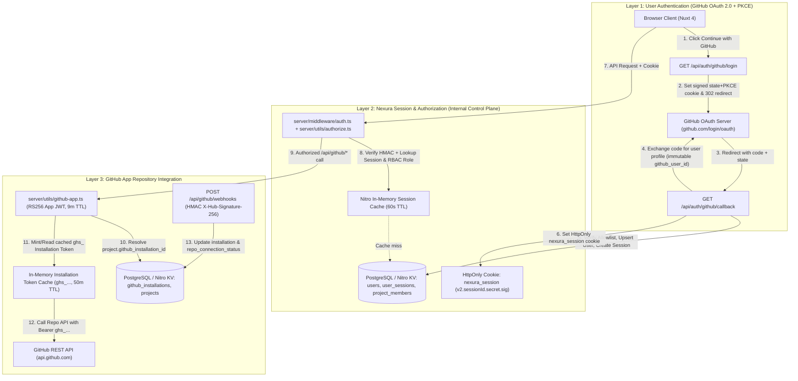
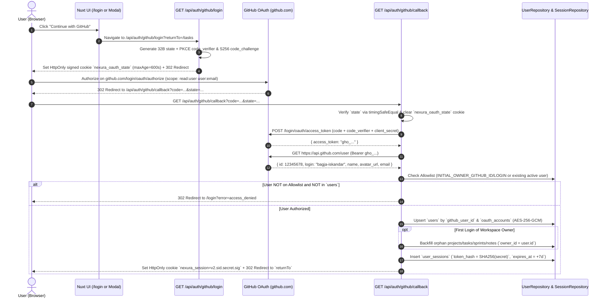
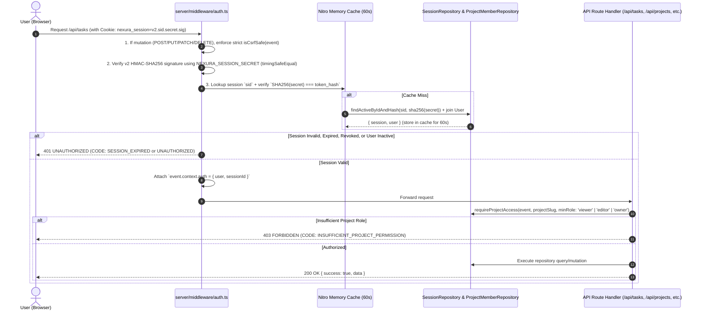
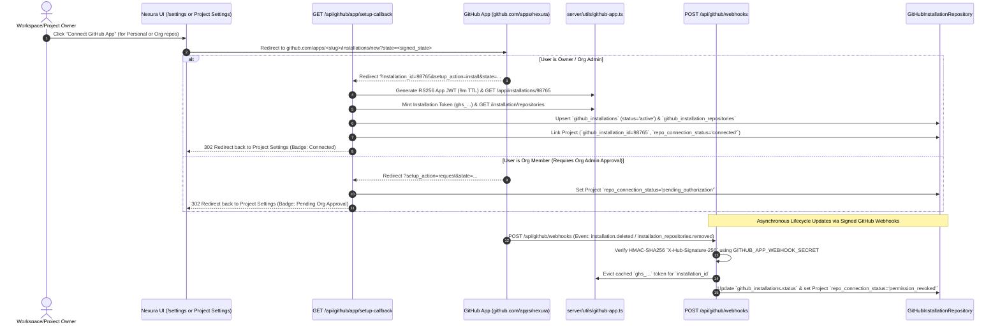

# NEXURA MANAGEMENT — SECURITY ARCHITECTURE & GITHUB INTEGRATION MASTER PLAN

> **Document ID:** `PLAN-SEC-GH-2026-01`  
> **Status:** `SECURITY ARCHITECTURE PLAN PREPARED — WAITING USER REVIEW & APPROVAL`  
> **Governance Mode:** `STRICT READ-ONLY AUDIT & ARCHITECTURE PLANNING (CODE FREEZE)`  
> **Reference Directives:**  
> - [`.agents/rules/multi-agent-governance.md`](file:///d:/Project_Center/REWORK/Management/.agents/rules/multi-agent-governance.md)  
> - [`.agents/reporting-standard.md`](file:///d:/Project_Center/REWORK/Management/.agents/reporting-standard.md)  
> **Prepared By:** Head Agent (Lead Technical Architect) in coordination with Analysts 1–6.

---

## Table of Contents

1. [Executive Summary](#1-executive-summary)
2. [Existing Security Session Audit (Phase A)](#2-existing-security-session-audit-phase-a)
3. [Existing GitHub Integration Audit (Phase B)](#3-existing-github-integration-audit-phase-b)
4. [Multi-Agent Discussion Results (Phase C)](#4-multi-agent-discussion-results-phase-c)
5. [Security Session Decision Matrix (Phase D)](#5-security-session-decision-matrix-phase-d)
6. [Final Recommended Architecture (Phase E)](#6-final-recommended-architecture-phase-e)
7. [Authentication Flow (Layer 1)](#7-authentication-flow-layer-1)
8. [Session & Authorization Flow (Layer 2)](#8-session--authorization-flow-layer-2)
9. [GitHub App Integration Flow (Layer 3)](#9-github-app-integration-flow-layer-3)
10. [Database & Backend Impact](#10-database--backend-impact)
11. [Frontend & UX Impact](#11-frontend--ux-impact)
12. [Global Settings & Project Settings Impact (Phase G)](#12-global-settings--project-settings-impact-phase-g)
13. [Migration & Backward Compatibility (Phase F)](#13-migration--backward-compatibility-phase-f)
14. [Security Risks & Threat Mitigation Matrix](#14-security-risks--threat-mitigation-matrix)
15. [Implementation Phases](#15-implementation-phases)
16. [Testing & Acceptance Criteria](#16-testing--acceptance-criteria)
17. [Rollback Strategy](#17-rollback-strategy)
18. [Open Decisions](#18-open-decisions)
19. [File-Level Impact Analysis](#19-file-level-impact-analysis)
20. [Final Recommendation & Approval Gate](#20-final-recommendation--approval-gate)

---

## 1. Executive Summary

### 1.1. Context & Architectural Objective
Nexura Management currently operates with a **shared static secret access gate** (`NEXURA_ACCESS_KEY`) verified via `SessionAuthModal.vue` (`POST /api/auth/session`) and a **single static global GitHub Personal Access Token (`GITHUB_TOKEN`)** hardcoded to a single default owner (`bagja-iskandar`).

As Nexura transitions to a production-grade engineering workspace with multi-repository, organization, and collaborator support, this master plan establishes the target **Three-Layer Security & Integration Architecture**:

1. **Layer 1 — User Authentication (`GitHub OAuth / Sign-in`):** Identifies the human user via OAuth 2.0 Authorization Code Flow + PKCE (`S256`) + cryptographic `state`, anchoring identity to GitHub's immutable numeric `github_user_id` and mapping it to an internal Nexura `users` record.
2. **Layer 2 — Nexura Session & Authorization (`Session, RBAC, and Project Access`):** Manages Nexura's own internal, revocable session (`nexura_session` `HttpOnly` cookie backed by `user_sessions`), workspace-level roles (`owner`, `member`, `viewer`), and project-level access (`project_members`), remaining 100% independent of GitHub token lifetimes.
3. **Layer 3 — GitHub App Integration (`Repository Installation, Permissions, and GitHub API`):** Replaces the static personal `GITHUB_TOKEN` with a dedicated **Nexura GitHub App** that uses short-lived RS256 App JWTs (9-min TTL) to mint scoped 1-hour **Installation Access Tokens (`ghs_...`)** per installation (`github_installations`), supporting personal and organization repositories, least-privilege permissions, and real-time lifecycle webhooks.

### 1.2. Core Architectural Decision (Fate of Security Session)
Following a structured 6-analyst audit and cross-review of Options A, B, C, and D:
- **RECOMMENDATION:** Adopt a **Unified Option B + Option D Architecture**:
  - **UI Boundary (Option B):** Retire the manual `NEXURA_ACCESS_KEY` password prompt (`SessionAuthModal.vue` password form, `Sidebar.vue` `KeyRound` button, and `/settings` access-key input) and replace it with **"Continue with GitHub"** sign-in, a `HeaderBar.vue` User Profile Pill, and a re-authentication modal on session expiry.
  - **Backend & Session Engine (Option D):** Refactor `server/utils/auth.ts`, `server/middleware/auth.ts`, `/api/auth/session.*`, and `composables/useSession.ts` from an anonymous, irrevocable shared-key gate into an **identity-aware, DB-backed Nexura Session & RBAC Management Layer (`v2` token format + `user_sessions` table)**.
  - **Rejected Options:** **Option A** (removing internal session management completely) is rejected due to severe security, latency, and revocation failures. **Option C** (requiring both GitHub OAuth and manual `NEXURA_ACCESS_KEY` entry in daily UI use) is rejected due to double-login UX friction and incompatibility with per-user RBAC (though `NEXURA_ACCESS_KEY` can optionally be retained solely as a headless CLI/CI break-glass Bearer token).

---

## 2. Existing Security Session Audit (Phase A)

> **Evidence Classification Key:**  
> - **FACT:** Verified directly in repository source files with exact file and line citations.  
> - **INFERENCE:** Logical architectural deduction derived directly from verified facts.  
> - **RECOMMENDATION:** Proposed design decision backed by empirical evidence.  
> - **OPEN DECISION:** Policy or product choice requiring Project Owner confirmation.  
> - **BLOCKED:** Unverifiable without external environment access.

### 2.1. What Security Session Actually Is Today
- **FACT** ([server/utils/auth.ts](file:///d:/Project_Center/REWORK/Management/server/utils/auth.ts#L20-L164), [server/middleware/auth.ts](file:///d:/Project_Center/REWORK/Management/server/middleware/auth.ts#L74-L187), [composables/useSession.ts](file:///d:/Project_Center/REWORK/Management/composables/useSession.ts#L11-L167)):
  The current "Security Session" is **not** a user identity or multi-user authorization system. It is a **stateless, anonymous write-mutation & GitHub-proxy access gate** based on a shared server environment secret (`NEXURA_ACCESS_KEY`).

### 2.2. Cryptographic Token Format, Key Resolution & Validation
- **FACT — Key Precedence & Dangerous Supabase Fallback** ([server/utils/auth.ts](file:///d:/Project_Center/REWORK/Management/server/utils/auth.ts#L20-L29)):
  `resolveSecurityKeys()` resolves secret keys from environment variables in this order:
  1. `process.env.NEXURA_ACCESS_KEY`
  2. `process.env.SUPABASE_SERVICE_ROLE_KEY`
  3. `process.env.SUPABASE_SERVICE_KEY || process.env.SUPABASE_KEY`
  All non-empty values are placed into `allKeys: string[]`.
- **INFERENCE (Critical Vulnerability — Key Conflation):** Because `allKeys` includes `SUPABASE_SERVICE_ROLE_KEY` and `SUPABASE_KEY`, and `verifyAccessKey(providedKey, allKeys)` ([server/utils/auth.ts](file:///d:/Project_Center/REWORK/Management/server/utils/auth.ts#L143-L164)) checks against `allKeys`, **a user or attacker can log into `SessionAuthModal.vue` or pass `Authorization: Bearer <SUPABASE_KEY>` using the database key**! Worse, if `NEXURA_ACCESS_KEY` and `SUPABASE_SERVICE_ROLE_KEY` are omitted and only `SUPABASE_KEY` (an `anon` key) is configured, the public anon key becomes the valid login password and HMAC signing key.
- **FACT — Stateless `v1` Token Structure** ([server/utils/auth.ts](file:///d:/Project_Center/REWORK/Management/server/utils/auth.ts#L37-L50)):
  `createSessionToken(secretKey, options)` produces a 5-segment string:
  `v1.<nonce>.<issuedAt>.<expiresAt>.<signature>`
  - `nonce`: 16 random bytes (32 hex chars).
  - `issuedAt` / `expiresAt`: Epoch milliseconds. Default `ttlMs` in `createSessionToken` is 7 days ([server/utils/auth.ts](file:///d:/Project_Center/REWORK/Management/server/utils/auth.ts#L42)), but [server/api/auth/session.post.ts](file:///d:/Project_Center/REWORK/Management/server/api/auth/session.post.ts#L35) overrides `ttlMs` to **30 days** (`30 * 24 * 60 * 60 * 1000`).
  - `signature`: `HMAC-SHA256` hex digest over `v1.<nonce>.<issuedAt>.<expiresAt>`, verified via `crypto.timingSafeEqual` ([server/utils/auth.ts](file:///d:/Project_Center/REWORK/Management/server/utils/auth.ts#L119-L131)).
  - **Zero Identity Claims:** The token contains no `userId`, `githubId`, `username`, `role`, or database `sessionId`.

### 2.3. Cookie Storage, Expiration & Invalidation Lifecycle
- **FACT — Cookie Attributes** ([server/api/auth/session.post.ts](file:///d:/Project_Center/REWORK/Management/server/api/auth/session.post.ts#L44-L50)):
  `POST /api/auth/session` sets the `nexura_session` cookie with:
  - `httpOnly: true`
  - `secure: process.env.NODE_ENV === 'production'`
  - `sameSite: 'lax'`
  - `path: '/'`
  - `maxAge: 30 * 24 * 60 * 60` (30 days)
- **FACT — Client State Storage** ([composables/useSession.ts](file:///d:/Project_Center/REWORK/Management/composables/useSession.ts#L12-L20)):
  The frontend stores zero tokens in `localStorage`, `sessionStorage`, or JS-accessible cookies. It holds only memory-backed Nuxt `useState` refs (`authStatus: 'unknown' | 'authenticated' | 'unauthenticated'`, `isAuthModalOpen`, `authError`, `isSubmitting`, `networkWarning`, `csrfWarning`).
- **FACT — Invalidation Gap on Logout** ([server/api/auth/session.delete.ts](file:///d:/Project_Center/REWORK/Management/server/api/auth/session.delete.ts#L4-L15)):
  `DELETE /api/auth/session` calls `deleteCookie(event, 'nexura_session', ...)`. Because `v1` tokens are purely stateless and not recorded in any database table or denylist, **server-side token revocation does not exist**. Any stolen `nexura_session` cookie value remains cryptographically valid for up to 30 days until `expiresAt` unless the server's environment variables are rotated.

### 2.4. Route Guards, Middleware & API Protection Matrix
- **FACT — Zero Frontend Page Route Guards:** There is no `app/middleware/` or `middleware/` directory for Nuxt pages. Every UI page (`/`, `/tasks`, `/sprints`, `/projects`, `/projects/[slug]`, `/roadmap`, `/repos`, `/telemetry`, `/settings`) renders publicly without requiring login.
- **FACT — API Protection Scope** ([server/middleware/auth.ts](file:///d:/Project_Center/REWORK/Management/server/middleware/auth.ts#L75-L105)):
  The server middleware only intercepts `/api/**` and enforces authentication **only** when `isGitHubEndpoint || isMutation`:

| Endpoint Pattern | HTTP Method | Protected by `server/middleware/auth.ts`? | Handler-Level Auth? | Current Access Level |
|---|---|---|---|---|
| `/api/auth/session` | `POST`, `DELETE` | Whitelisted (`L87-89`) | Validates key on `POST` | Public handshake |
| `/api/auth/session` | `GET` | Bypassed (`!isMutation`) | Inspects cookie (`session.get.ts`) | Public status check |
| `/api/github/**` (14 endpoints) | `GET`, `POST` | **YES (`L98`)** | Via middleware | **Requires `nexura_session` or Bearer** |
| `/api/projects/**`, `/api/tasks/**`, `/api/sprints/**`, `/api/notes/**` | `POST`, `PUT`, `PATCH`, `DELETE` | **YES (`L99-100`)** | Via middleware | **Requires `nexura_session` or Bearer** |
| `/api/backup/export` | `GET` | Bypassed (`!isMutation`) | **YES** ([export.get.ts](file:///d:/Project_Center/REWORK/Management/server/api/backup/export.get.ts#L9-L42)) | **Requires `nexura_session` or Bearer** |
| `/api/projects/**`, `/api/tasks/**`, `/api/sprints/**`, `/api/notes/**` | **`GET`** | **NO (`L102`)** | **NO** | **100% PUBLIC (Unauthenticated Read)** |
| `/api/telemetry`, `/api/stats`, `/api/activities`, `/api/ping` | **`GET`** | **NO (`L91, L102`)** | **NO** | **100% PUBLIC (Unauthenticated Read)** |

### 2.5. Complete Map of Features Depending on Security Session
Every file in the repository that depends on `useSession()`, `SessionAuthModal.vue`, or `KeyRound`:

1. **[app/app.vue](file:///d:/Project_Center/REWORK/Management/app/app.vue#L46-L150):** Mounts `<SessionAuthModal />` globally (`L47`), blocks single-key shortcuts (`Ctrl+K`, `/`, `C`, `I`) when `session.isAuthModalOpen.value` is true (`L80-82`), and calls `session.checkSession()` on boot (`L148`).
2. **[components/modals/SessionAuthModal.vue](file:///d:/Project_Center/REWORK/Management/components/modals/SessionAuthModal.vue#L1-L179):** Renders the `"Verify Session Access"` modal with `<NexuraIcon name="KeyRound" />` (`L20`) and password input calling `session.loginWithAccessKey()`.
3. **[components/layout/Sidebar.vue](file:///d:/Project_Center/REWORK/Management/components/layout/Sidebar.vue#L536-L560):** Renders the bottom-dock `"Session"` button with `KeyRound` icon (`L546`), `"Active"` / `"Unverified"` badge (`L554-559`), and `@click="session.openAuthModal"` (`L539`).
4. **[app/pages/settings.vue](file:///d:/Project_Center/REWORK/Management/app/pages/settings.vue#L14-L141):** Renders header pill (`"Session Active"` vs `"Read-Only Session"`) and **Bento Card 1: Security & Session** with `"Workspace Access Key"` input, `KeyRound` `"Authenticate"` button (`L125`), and `"Sign Out"` button (`L135`, calling `session.logout()` at `L352`).
5. **[composables/useTasks.ts](file:///d:/Project_Center/REWORK/Management/composables/useTasks.ts#L75) (`L75, L95, L127`), [composables/useProjects.ts](file:///d:/Project_Center/REWORK/Management/composables/useProjects.ts#L35) (`L35, L74, L94, L121`), & [composables/useSprints.ts](file:///d:/Project_Center/REWORK/Management/composables/useSprints.ts#L35) (`L35, L75, L95, L122`):** Call `session.handleApiError(err)` on API errors; when a mutation returns `401 UNAUTHORIZED`, `useWorkspaceStore` rolls back the optimistic change and `useSession` opens `SessionAuthModal.vue`.
6. **[composables/useNotes.ts](file:///d:/Project_Center/REWORK/Management/composables/useNotes.ts#L1-L160) (Inconsistency Bug):** **FACT:** `useNotes.ts` forgot to import `useSession()`! When `POST /api/notes` fails with `401` (`L60-63`), it catches the error and leaves a fake `temp-note-*` in the store without opening `SessionAuthModal.vue`.
7. **[components/modals/devops/PackageModal.vue](file:///d:/Project_Center/REWORK/Management/components/modals/devops/PackageModal.vue#L126) & [components/project/ProjectPackageFeed.vue](file:///d:/Project_Center/REWORK/Management/components/project/ProjectPackageFeed.vue#L124):** Use `<NexuraIcon name="KeyRound" />` purely as a decorative icon inside the missing `read:packages` scope banner.

---

## 3. Existing GitHub Integration Audit (Phase B)

### 3.1. Answers to Phase B Audit Questions
1. **Has GitHub OAuth ever been implemented?**
   - **FACT:** **No.** Neither GitHub OAuth nor GitHub App has ever been implemented anywhere in the codebase (`nuxt.config.ts`, `server/`, `composables/`, `components/`).
2. **Is GitHub currently used for user authentication or only API access?**
   - **FACT:** **Only for server-side API access.** All 14 endpoints in `server/api/github/*.ts` and `server/api/telemetry.get.ts` read a single global static Personal Access Token (`config.githubToken` from `process.env.GITHUB_TOKEN` in [nuxt.config.ts](file:///d:/Project_Center/REWORK/Management/nuxt.config.ts#L35)) and pass it to `createGitHubClient(token)` ([server/utils/github.ts](file:///d:/Project_Center/REWORK/Management/server/utils/github.ts#L40-L61)).
3. **Is GitHub identity connected to Nexura internal identity?**
   - **FACT:** **No.** Nexura has no `users` table and no user identity model. A static string `config.githubUsername || 'bagja-iskandar'` ([nuxt.config.ts](file:///d:/Project_Center/REWORK/Management/nuxt.config.ts#L36)) is hardcoded as the default repository owner across the server and frontend.
4. **How are multi-repository and organization access handled today?**
   - **FACT:** Poorly. In [server/api/github/repos.get.ts](file:///d:/Project_Center/REWORK/Management/server/api/github/repos.get.ts#L16-L19), `fetchCachedRepos` calls `/user/repos?affiliation=owner` and filters `owner.toLowerCase() === username.toLowerCase()`, which **discards all organization repositories and collaborator repositories**! Meanwhile, [server/utils/github-allowlist.ts](file:///d:/Project_Center/REWORK/Management/server/utils/github-allowlist.ts#L73-L109) permits any `owner/repo` string that either belongs to `defaultOwner` (`bagja-iskandar`) or is saved in `projects.github_repo`.

### 3.2. Strict Separation of the Three Concepts
To prevent architectural conflation, this plan enforces a strict separation across all layers:

| Dimension | Layer 1: GitHub OAuth (User Identity) | Layer 2: Nexura Session (Internal App Session) | Layer 3: GitHub App (Repository Integration) |
|---|---|---|---|
| **Primary Purpose** | Prove *who the human user is* at sign-in (`GET /user`). | Maintain authenticated Nexura state, CSRF protection, and RBAC permissions across `/api/**`. | Read/write repository data (commits, PRs, issues, actions, deployments, security) on behalf of Nexura. |
| **Credential Type** | Short-lived OAuth authorization `code` + PKCE exchanged once at login. | `nexura_session` (`HttpOnly`, `Secure`, `SameSite=Lax`) backed by `user_sessions` (`token_hash`). | RS256 App JWT (9-min TTL) $\rightarrow$ Installation Access Token `ghs_...` (1-hr TTL, cached in server memory). |
| **Lifetime & Expiry** | Used at login handshake (or encrypted at rest in `oauth_accounts`). | Controlled 100% by Nexura (e.g., 7-day sliding TTL, instant revocation in `user_sessions`). | 1 hour per `ghs_...` token; automatically refreshed by server using `GITHUB_APP_PRIVATE_KEY`. |
| **Scope of Access** | Identity only: `read:user user:email` (zero repository scopes required on user OAuth!). | Nexura workspace & project RBAC (`owner`, `editor`, `viewer`). | Per-installation repository selection (`all` or `selected` repos) with granular App permissions. |
| **Failure / Revocation Impact** | Only affects future sign-ins if GitHub account is deleted/suspended. | Terminates user's access to Nexura immediately when revoked. | Transitions affected Project to `Permission Revoked` badge; **never logs the user out of Nexura**. |

---

## 4. Multi-Agent Discussion Results (Phase C)

Three specialist research units covering all six architectural roles audited the codebase and conducted cross-domain evaluation:
- **Unit 1 (`571e31e7-0997-4bf9-9333-17644f8b2bdd`):** Analyst 1 (Authentication & Identity) & Analyst 2 (Session & Application Security)
- **Unit 2 (`099e1e0a-0801-4b3b-8586-14e609b8a02c`):** Analyst 3 (Authorization & Access Control) & Analyst 5 (Database & Backend Architecture)
- **Unit 3 (`7b9d88fc-b616-4d39-8ad3-a8abfb8ecfb9`):** Analyst 4 (GitHub App & Repository Integration) & Analyst 6 (Frontend & UX Architecture)

### 4.1. Analyst 1: Authentication & Identity
- **Key Findings & Recommendations:**
  1. **GitHub OAuth Viability:** GitHub OAuth 2.0 (Authorization Code Flow + PKCE `S256` + signed `state` cookie) is the ideal primary authentication method for an engineering management platform.
  2. **Immutable Identity Mapping (`github_user_id` vs `login`):** **FACT:** GitHub usernames (`login`, e.g., `bagja-iskandar`) are mutable; if a user renames their GitHub account, another user can claim the old username. **RECOMMENDATION:** Always map `public.users` to GitHub's immutable numeric integer ID (`github_user_id BIGINT UNIQUE NOT NULL`), treating `github_login`, `name`, `email`, and `avatar_url` as mutable profile fields updated on every login.
  3. **Unified GitHub App OAuth vs Legacy OAuth App:** By using the **Nexura GitHub App's Client ID and Client Secret** for user OAuth login (`/api/auth/github/login` $\rightarrow$ `/api/auth/github/callback`), the Project Owner only registers **one** entity in GitHub Developer Settings for both Layer 1 Sign-In and Layer 3 Repository Installations.
  4. **Future Extensibility:** Separating `public.users` (internal UUID `id`) from `public.oauth_accounts` (`provider`, `provider_account_id`) allows adding Google, GitLab, or Passkeys in the future without altering foreign keys on `projects`, `tasks`, or `user_sessions`.

### 4.2. Analyst 2: Session & Application Security
- **Key Findings & Recommendations:**
  1. **Never Use GitHub Access Tokens as Nexura Session Tokens:** Verifying a GitHub token on every API request would add 150–400ms latency, exhaust GitHub rate limits, and tie Nexura's uptime to GitHub's API.
  2. **Fix Secret Key Conflation (`resolveSecurityKeys`):** Remove `SUPABASE_SERVICE_ROLE_KEY` and `SUPABASE_KEY` from session/access-key validation in [server/utils/auth.ts](file:///d:/Project_Center/REWORK/Management/server/utils/auth.ts#L20-L29). Introduce a dedicated `NEXURA_SESSION_SECRET` (32+ bytes).
  3. **Harden CSRF Validation (`isCsrfSafe`):** In [server/middleware/auth.ts](file:///d:/Project_Center/REWORK/Management/server/middleware/auth.ts#L38), remove `secFetchSite === 'same-site'` from the automatic bypass before `Origin`/`Host` verification so sibling subdomains on shared hosting suffixes cannot bypass CSRF checks.
  4. **Fix `useNotes.ts` Missing `handleApiError`:** Wire `session.handleApiError(err)` into [composables/useNotes.ts](file:///d:/Project_Center/REWORK/Management/composables/useNotes.ts#L60-L145) so `401` errors on notes behave identically to tasks, projects, and sprints.

### 4.3. Analyst 3: Authorization & Access Control
- **Key Findings & Recommendations:**
  1. **Authentication $\neq$ Authorization (Default-Deny Allowlist Gate):** Completing GitHub OAuth only proves the user owns *some* GitHub account. Before creating a Nexura session, `/api/auth/github/callback` MUST check that the user is either the configured initial owner (`INITIAL_OWNER_GITHUB_ID` / `INITIAL_OWNER_GITHUB_LOGIN`), in `NEXURA_ALLOWED_GITHUB_USERS`, or an active row in `public.users` (`is_active = true`). Unlisted GitHub accounts are rejected with `403 FORBIDDEN`.
  2. **Two-Tier Right-Sized RBAC:**
     - **Workspace Role (`users.workspace_role`):** `owner` (full instance admin, installations, backups), `member` (can access assigned projects and sprints), `viewer` (read-only).
     - **Project Role (`project_members.role`):** `owner` (edit project settings, bind GitHub repo/installation, manage members, delete project), `editor` (CRUD tasks & notes, trigger GitHub issue creation & workflow rerun), `viewer` (read-only access to project, tasks, notes, and GitHub feeds).
  3. **Decoupling Project Access from GitHub Collaborator Access:** Because Layer 3 uses the project's **GitHub App Installation Token (`ghs_...`)** on the server, an authorized Nexura project `viewer` or `editor` can view repository telemetry in Nexura without needing personal GitHub repository permissions, while unauthorized GitHub org members cannot view the Nexura project unless added to `project_members`.
  4. **Lock Down Unauthenticated `GET` Endpoints:** Leaving `GET /api/projects`, `/api/tasks`, `/api/sprints`, `/api/notes`, and `/api/telemetry` open to anonymous visitors is a critical data-leak risk once private repositories and internal engineering notes are linked. Require a valid session on all `/api/**` routes by default.

### 4.4. Analyst 4: GitHub App & Repository Integration
- **Key Findings & Recommendations:**
  1. **Replace Global `GITHUB_TOKEN` with Installation Access Tokens:** Implement `server/utils/github-app.ts` using Node's built-in `node:crypto` (`RS256`) to sign a 9-minute App JWT and exchange it via `POST /app/installations/{installation_id}/access_tokens` for a 1-hour `ghs_...` token cached in server memory for 50 minutes.
  2. **Fix `repos.get.ts` Hardcoded Owner Filter & `packages.get.ts` User Endpoint:**
     - [server/api/github/repos.get.ts](file:///d:/Project_Center/REWORK/Management/server/api/github/repos.get.ts#L16-L19) currently drops any repo where `owner !== 'bagja-iskandar'`. Replace with `GET /installation/repositories` across active `github_installations` so personal, organization, and collaborator repos all appear.
     - [server/api/github/packages.get.ts](file:///d:/Project_Center/REWORK/Management/server/api/github/packages.get.ts#L30-L36) calls `/user/packages` (which fails for GitHub App installation tokens); update to `/users/{account_login}/packages` or `/orgs/{account_login}/packages`.
  3. **Non-Owner & Organization Approval Flow (`setup_action=request`):** When an organization member requests installation from an org admin, GitHub redirects back with `setup_action=request`. Nexura sets `projects.repo_connection_status = 'pending_authorization'` and transitions to `'connected'` automatically upon receiving the `installation.created` webhook or manual **"Verify Approval"** probe.

### 4.5. Analyst 5: Database & Backend Architecture
- **Key Findings & Recommendations:**
  1. **Current Schema Gap:** **FACT:** The database currently has only 4 tables (`projects`, `sprints`, `tasks`, `project_notes`) and zero ownership columns (`owner_id`, `created_by`).
  2. **Target Schema (`004_auth_rbac_and_github_app.sql`):** Add `users`, `oauth_accounts`, `user_sessions`, `github_installations`, `github_installation_repositories`, and `project_members`, plus nullable `owner_id` / `created_by` / `github_installation_id` / `repo_connection_status` columns on existing tables.
  3. **Token Security at Rest:** Hash session tokens with `SHA-256` (`user_sessions.token_hash`). Encrypt any stored OAuth tokens with `AES-256-GCM` (`server/utils/crypto.ts`). Never store `ghs_...` installation tokens in PostgreSQL (keep them in ephemeral server memory cache only).
  4. **Dual-Driver Continuity (`Supabase` + `Nitro KV`):** Implement `IUserRepository`, `ISessionRepository`, `IProjectMemberRepository`, and `IGitHubInstallationRepository` for both `Supabase*Repository` and `Nitro*Repository` so offline development and `npm test` remain 100% operational.

### 4.6. Analyst 6: Frontend & UX Architecture
- **Key Findings & Recommendations:**
  1. **Retire Raw Key UI:** Remove the password input from `SessionAuthModal.vue`, remove the `KeyRound` `"Session: Active / Unverified"` button from [components/layout/Sidebar.vue](file:///d:/Project_Center/REWORK/Management/components/layout/Sidebar.vue#L536-L560), and remove the access-key form from [app/pages/settings.vue](file:///d:/Project_Center/REWORK/Management/app/pages/settings.vue#L88-L140).
  2. **New 4-Surface Identity & Integration UX:**
     - Dedicated `/login` screen (*Precision Dark Obsidian* card with **"Continue with GitHub"**).
     - `HeaderBar.vue` right-side **User Profile Pill** (GitHub avatar, `@login`, role badge, Sign Out menu).
     - Repurposed `SessionAuthModal.vue` $\rightarrow$ **Session Expired / Re-Authenticate Modal** that preserves unsaved `useWorkspaceStore` state if a session expires mid-session.
     - Standardized 5-state `<RepoConnectionBadge />` (`Not Connected`, `Connected`, `Pending Authorization`, `Permission Revoked`, `Connection Error`) across `/repos`, `/projects/[slug]`, and `/settings`.

### 4.7. Resolution of Technical Debates Between Analysts
1. **Debate 1 — Stateless `v2` HMAC Cookie (Analyst 2 Option D1) vs. Stateful DB-Backed `user_sessions` (Analyst 5 & Analyst 2 Option D2):**
   - *Resolution:* **Hybrid Signed Cookie + DB-Backed `user_sessions` with 60s In-Memory Cache.** The cookie format `v2.<sessionId>.<rawSecret>.<hmacSig>` rejects tampered cookies at the edge in `<0.1ms` via HMAC check, while `user_sessions` (storing `SHA256(rawSecret)`) enables multi-device session listing in `/settings` and instant server-side revocation (`revoked_at = now()`). Caching validated session records in Nitro memory for 60 seconds eliminates DB read overhead on burst API requests.
2. **Debate 2 — Supabase Auth Broker vs. Direct Nitro GitHub OAuth (Analyst 4/6 Option C vs Option D):**
   - *Resolution:* **Direct Nitro Server OAuth (`/api/auth/github/login` & `/api/auth/github/callback`) using the Nexura GitHub App credentials.** This requires only **one** GitHub App registration, preserves 100% compatibility with Nexura's `Nitro KV` local fallback driver, and avoids fighting `003_system_alignment_and_rls_lockdown.sql` (which locked RLS exclusively to `service_role`).

---

## 5. Security Session Decision Matrix (Phase D)

All six analysts evaluated the four architectural options for the fate of the current Security Session across the 8 mandatory criteria:

| Criterion | Option A: Remove Security Session Completely | Option B: Replace Session UI Only, Keep `v1` Token | Option C: Preserve Security Session as 2nd Access Gate | Option D: Refactor into Identity-Aware Nexura Session Mgmt | **Recommended: Unified Option B (UI) + Option D (Backend)** |
|---|---|---|---|---|---|
| **1. Security** | **1/5 (Critical Fail):** Exposes or couples requests directly to GitHub tokens; no server revocation or CSRF isolation. | **3/5 (Moderate):** Removes shared key in UI, but `v1` token is anonymous, irrevocable for 30d, and conflates `SUPABASE_KEY`. | **3.5/5 (Mixed):** Adds a second factor, but relies on a shared static secret that cannot distinguish users. | **5/5 (Excellent):** PKCE OAuth + immutable `github_user_id` + hashed DB session + `NEXURA_SESSION_SECRET`. | **5/5 (Enterprise Grade):** Combines OAuth PKCE login UI with revocable, identity-bound `v2` DB-backed sessions and RBAC. |
| **2. Maintainability** | **1.5/5 (Poor):** Couples every endpoint directly to external GitHub API state. | **4/5 (Good):** Keeps `useSession.ts` and `auth.ts` intact. | **2/5 (Poor):** Permanently maintains two parallel auth state machines (OAuth + Key modal). | **5/5 (Excellent):** Clean separation of Layer 1 (OAuth), Layer 2 (Nexura Session), and Layer 3 (GitHub App). | **5/5 (Excellent):** Extends existing Repository Pattern and `useSession()` reactive contract cleanly. |
| **3. User Experience** | **2/5 (Poor):** High latency and broken UX when GitHub API rate-limits. | **4/5 (Good):** 1-click GitHub login replaces typing secret keys. | **1.5/5 (Poor):** Frustrating double gate (sign in with GitHub, then also type a hex access key). | **5/5 (Excellent):** Seamless login, active session visibility, and preserved local drafts on expiry. | **5/5 (Excellent):** 1-click GitHub login, `HeaderBar` profile pill, zero password copy-pasting. |
| **4. Scalability** | **1/5 (None):** Cannot support multi-user RBAC or multiple IdPs. | **2/5 (Low):** Anonymous `v1` token has no `userId` or role claims. | **1.5/5 (Low):** Shared `NEXURA_ACCESS_KEY` breaks multi-collaborator RBAC. | **5/5 (Excellent):** Full support for `users`, `project_members` (`owner`/`editor`/`viewer`), and audit logs. | **5/5 (Excellent):** Scales from solo founder to multi-collaborator org projects seamlessly. |
| **5. Complexity** | **2.5/5 (High Debt):** Invasive removal across 15+ files. | **4.5/5 (Low):** Minimal code changes. | **2/5 (High):** Complex dual-auth edge cases. | **3.5/5 (Moderate):** Structured DB migration + repository classes. | **4/5 (Well-Bounded):** Cleanly phased across backend, DB, and frontend boundaries. |
| **6. Compatibility** | **1/5 (Breaking):** Breaks `useSession` consumers and test suite. | **4.5/5 (High):** Preserves `useSession` refs. | **3/5 (Moderate):** Requires dual-gate flags in `useSession`. | **5/5 (High):** Preserves `isAuthenticated`, `checkSession`, `handleApiError` while adding `user` & `role`. | **5/5 (High):** 100% compatible with both `Supabase` and `Nitro KV` drivers. |
| **7. Migration Risk** | **1.5/5 (High):** Risk of unguarded routes during rip-and-replace. | **4.5/5 (Low):** Smooth UI swap. | **3/5 (Moderate):** Confusing transition for existing sessions. | **4.5/5 (Low):** Nullable FK columns + automatic orphan claim on first owner login. | **4.5/5 (Low):** Supports optional CLI Bearer fallback and zero-downtime data backfill. |
| **8. Operational Cost** | **2/5 (High):** Consumes GitHub API quota on auth validation. | **5/5 (Zero):** Zero extra cost. | **5/5 (Zero):** Zero extra cost. | **5/5 (Zero):** Uses existing Postgres + in-memory cache. | **5/5 (Zero):** Zero third-party auth subscription cost. |

### Why Other Alternatives Were Rejected
1. **Why Option A is Rejected:** Deleting Nexura's internal session layer violates Layer 2 independence. If Nexura relied directly on GitHub tokens for request authentication, every API request would either suffer external network latency/rate-limits or lack instant session revocation and internal RBAC.
2. **Why Pure Option B (Without Option D) is Rejected:** Simply swapping `SessionAuthModal.vue`'s password box for a GitHub OAuth button while keeping the existing `v1.<nonce>.<iat>.<exp>.<sig>` token unchanged leaves the session completely anonymous (`userId` unknown), retains the 30-day irrevocable token flaw, and leaves `resolveSecurityKeys()` vulnerable to `SUPABASE_KEY` conflation.
3. **Why Option C is Rejected:** Requiring a user who already authenticated via GitHub OAuth (with 2FA/Passkeys) to *also* type `NEXURA_ACCESS_KEY` into `SessionAuthModal.vue` creates severe daily UX friction without enabling per-user RBAC. *(Note: Retaining `NEXURA_ACCESS_KEY` strictly as an optional headless CLI/automation `Authorization: Bearer` key on the backend is supported under Option B+D without burdening browser users).*

---

## 6. Final Recommended Architecture (Phase E)

### 6.1. High-Level Three-Layer Architecture Diagram

### 6.2. Core Architectural Invariants
1. **A. Stable Internal User Identity:** Every user has an internal UUID (`users.id`). GitHub's immutable numeric `github_user_id` is mapped via `users.github_user_id` and `oauth_accounts`. Renaming a GitHub handle (`github_login`) updates profile metadata on next login without breaking any foreign keys.
2. **B. Independent Nexura Session:** The browser holds only `nexura_session` (`v2.<sessionId>.<secret>.<hmacSig>`). The GitHub OAuth token is never used as a session token and never sent to the client.
3. **C. Isolated GitHub App Credentials:** Repository API calls (`/api/github/**`) use short-lived `ghs_...` Installation Access Tokens minted from `GITHUB_APP_ID` + `GITHUB_APP_PRIVATE_KEY` for the project's `github_installation_id`.
4. **D. Explicit RBAC Authorization:** Logging into Nexura does not grant access to all projects unless the user's `workspace_role === 'owner'`. Otherwise, access is governed per-project via `project_members` (`owner`, `editor`, `viewer`).
5. **E. Cryptographically Verified Repository Access:** A project can only query or mutate a GitHub repository if `projects.github_installation_id` references an `active` row in `github_installations` that has been granted permission to that repository (`github_installation_repositories`).

---

## 7. Authentication Flow (Layer 1)

### 7.1. Sequence Diagram: GitHub OAuth Sign-In, Allowlist Gate & First-Owner Claim

### 7.2. Handling Edge Cases in Layer 1
- **Revoked OAuth Access or Deleted GitHub Account:** Because Nexura establishes its own `user_sessions` record, mid-session work is not disrupted by transient GitHub glitches. When the Nexura session expires (7 days) or the user signs out and attempts to sign in again, `GET /api/auth/github/callback` will fail at GitHub's OAuth handshake. Furthermore, a Workspace Owner can set `users.is_active = false` or revoke all sessions for a user via `ISessionRepository.revokeAllForUser(userId)`, taking effect immediately.
- **Same GitHub Account Across Multiple Devices:** Each sign-in creates a distinct row in `public.user_sessions` with its own `id`, `token_hash`, `user_agent`, `ip_address`, and `last_active_at`. Signing out on a laptop (`DELETE /api/auth/session`) revokes only that device's `sessionId`, leaving the user's desktop or tablet session intact (with a **"Revoke All Other Sessions"** button available in `/settings`).

---

## 8. Session & Authorization Flow (Layer 2)

### 8.1. Sequence Diagram: Request Verification, RBAC Check & Logout

### 8.2. Cookie, Token & CSRF Security Specifications
1. **Token Format (`v2`):** `v2.<sessionId>.<rawSecretHex>.<hmacSignatureHex>`
   - `sessionId`: UUID matching `public.user_sessions.id`.
   - `rawSecretHex`: 32 random bytes (64 hex chars). PostgreSQL stores only `token_hash = SHA256(rawSecretHex)`.
   - `hmacSignatureHex`: `HMAC-SHA256("v2." + sessionId + "." + rawSecretHex, NEXURA_SESSION_SECRET)`.
2. **Cookie Security Flags:**
   - Name: `__Host-nexura_session` in HTTPS production (`Secure: true`, `HttpOnly: true`, `SameSite: 'lax'`, `Path: '/'`, no `Domain` attribute—preventing subdomain cookie tossing) and `nexura_session` on `http://localhost` in development.
   - TTL: `7 days` (`maxAge: 7 * 24 * 60 * 60`), with sliding extension (`expires_at` extended by 7 days when `< 3 days` remaining).
3. **CSRF Hardening ([server/middleware/auth.ts](file:///d:/Project_Center/REWORK/Management/server/middleware/auth.ts#L24-L72)):**
   - Require `Origin` (or `Referer` fallback) host to strictly match `getHeader(event, 'host')` on all `POST`, `PUT`, `PATCH`, `DELETE` requests using cookie authentication. Remove `'same-site'` from `secFetchSite` auto-allow (`only 'same-origin'` is safe when `Origin` is absent).

---

## 9. GitHub App Integration Flow (Layer 3)

### 9.1. Sequence Diagram: GitHub App Installation, Token Minting & Webhook Revocation

### 9.2. GitHub App Token Lifecycle (`App JWT` $\rightarrow$ `Installation Access Token`)
1. **App JWT Generation (`server/utils/github-app.ts`):**
   - Signed in memory using Node's native `crypto.createSign('RSA-SHA256')` with `GITHUB_APP_PRIVATE_KEY` and `iss: GITHUB_APP_ID`.
   - `iat = now - 60s`, `exp = now + 540s` (9 minutes).
2. **Installation Token Exchange & Memory Cache:**
   - Calls `POST /app/installations/{installation_id}/access_tokens` using `Bearer <App_JWT>`.
   - Caches the returned `ghs_...` token in a server-only `Map<number, { token: string, expiresAt: number }>` for **50 minutes** (10-minute safety buffer before GitHub's 60-minute expiration).
   - If any GitHub API call returns `401`, the cached `ghs_...` token is immediately evicted and refreshed once. If refreshing fails with `403` (suspended) or `404` (uninstalled), the project's `repo_connection_status` is updated to `'permission_revoked'`.

---

## 10. Database & Backend Impact

### 10.1. Current vs. Target Database State
- **FACT** ([server/database/migrations/001_create_nexura_tables.sql](file:///d:/Project_Center/REWORK/Management/server/database/migrations/001_create_nexura_tables.sql#L1-L75), [003_system_alignment_and_rls_lockdown.sql](file:///d:/Project_Center/REWORK/Management/server/database/migrations/003_system_alignment_and_rls_lockdown.sql#L1-L46)):
  The database currently has 4 tables (`projects`, `sprints`, `tasks`, `project_notes`), all using `TEXT PRIMARY KEY DEFAULT gen_random_uuid()::text`, with RLS enabled and locked down exclusively to `service_role`.
- **RECOMMENDATION — Migration `004_security_auth_rbac_and_github_app.sql`:**
  Add 6 new tables and non-breaking nullable columns to the 4 existing tables:

| Table Name | Status | Primary Purpose & Key Columns |
|---|---|---|
| `public.users` | **NEW** | Internal Nexura user identity (`id TEXT PK`, `github_user_id BIGINT UNIQUE NOT NULL`, `github_login TEXT`, `name TEXT`, `email TEXT`, `avatar_url TEXT`, `workspace_role TEXT CHECK ('owner','member','viewer')`, `is_active BOOLEAN DEFAULT true`). |
| `public.oauth_accounts` | **NEW** | External IdP link (`id TEXT PK`, `user_id TEXT FK`, `provider TEXT`, `provider_account_id TEXT`, `access_token_encrypted TEXT`, `scopes TEXT`, `UNIQUE(provider, provider_account_id)`). |
| `public.user_sessions` | **NEW** | Revocable Nexura sessions (`id TEXT PK`, `user_id TEXT FK`, `token_hash TEXT UNIQUE NOT NULL`, `ip_address TEXT`, `user_agent TEXT`, `expires_at TIMESTAMPTZ`, `revoked_at TIMESTAMPTZ`, `last_active_at TIMESTAMPTZ`). |
| `public.github_installations` | **NEW** | GitHub App installations (`id TEXT PK`, `installation_id BIGINT UNIQUE NOT NULL`, `account_id BIGINT`, `account_login TEXT`, `account_type TEXT`, `repository_selection TEXT`, `status TEXT CHECK ('active','suspended','deleted','pending')`, `permissions JSONB`, `installed_by_user_id TEXT FK`). |
| `public.github_installation_repositories` | **NEW** | Repositories granted to each installation (`id TEXT PK`, `installation_id BIGINT FK`, `github_repo_id BIGINT`, `full_name TEXT`, `is_private BOOLEAN`, `default_branch TEXT`, `UNIQUE(installation_id, github_repo_id)`). |
| `public.project_members` | **NEW** | Project-level RBAC (`id TEXT PK`, `project_id TEXT FK`, `user_id TEXT FK`, `role TEXT CHECK ('owner','editor','viewer')`, `UNIQUE(project_id, user_id)`). |
| `public.projects` | **ALTER** | Add `owner_id TEXT FK`, `github_installation_id BIGINT FK`, `github_repo_id BIGINT`, `repo_connection_status TEXT DEFAULT 'not_connected'`. |
| `public.tasks`, `sprints`, `project_notes` | **ALTER** | Add `created_by TEXT REFERENCES public.users(id) ON DELETE SET NULL` (plus `assignee_id` on `tasks`). |

### 10.2. Dual-Repository Architecture Impact (`Supabase` + `Nitro KV`)
- **FACT** ([server/repositories/index.ts](file:///d:/Project_Center/REWORK/Management/server/repositories/index.ts#L49-L128)): Nexura proxies all repository calls to either `Supabase*Repository` or `Nitro*Repository`.
- **RECOMMENDATION:** Implement `userRepository`, `sessionRepository`, `projectMemberRepository`, and `githubInstallationRepository` in **both** `server/repositories/supabase/` and `server/repositories/nitro/` so local offline development and unit tests work without requiring a live Supabase instance.

---

## 11. Frontend & UX Impact

### 11.1. Component-by-Component UX Transformation
1. **New Dedicated Login Page (`app/pages/login.vue`):**
   - Renders a *Precision Dark Obsidian Bento* login card (`bg-surface border-white/[0.08] rounded-2xl`) with the Nexura Hexagon emblem, **"Sign in with GitHub"** button (`/api/auth/github/login`), and clear error banners for unauthorized GitHub accounts (`?error=access_denied`).
2. **`HeaderBar.vue` User Profile Pill ([components/layout/HeaderBar.vue](file:///d:/Project_Center/REWORK/Management/components/layout/HeaderBar.vue#L39-L71)):**
   - Adds a compact identity pill on the right side of the header displaying the user's GitHub avatar (`24x24` rounded-full), `@github_login` (`font-mono text-xs`), and dropdown menu (**Account & Sessions (`/settings`)**, **Sign Out**).
3. **`Sidebar.vue` Bottom Dock Cleanup ([components/layout/Sidebar.vue](file:///d:/Project_Center/REWORK/Management/components/layout/Sidebar.vue#L536-L560)):**
   - Removes the `KeyRound` `"Session: Active / Unverified"` button from Zona 3 of the sidebar, keeping Zona 3 dedicated to Infrastructure Health status.
4. **Repurposing `SessionAuthModal.vue` ([components/modals/SessionAuthModal.vue](file:///d:/Project_Center/REWORK/Management/components/modals/SessionAuthModal.vue#L1-L179)):**
   - Removes the `"Secret Access Key"` `<input type="password">` form.
   - Transforms `SessionAuthModal.vue` into a **"Session Expired — Re-authenticate with GitHub"** modal that triggers if an API call returns `401` mid-session, allowing the user to re-authenticate without losing their current page state.
5. **Upgrading `composables/useSession.ts` ([composables/useSession.ts](file:///d:/Project_Center/REWORK/Management/composables/useSession.ts#L1-L167)):**
   - Retains `authStatus`, `isAuthenticated`, `isAuthModalOpen`, `checkSession()`, `logout()`, and `handleApiError(err)` so all existing callers (`useTasks`, `useProjects`, `useSprints`, `app.vue`) remain 100% unbroken.
   - Adds reactive `user = useState<AuthUser | null>('session:user', () => null)` containing `{ id, githubUserId, githubLogin, name, avatarUrl, workspaceRole }`.
   - Deprecates `loginWithAccessKey()` in favor of `loginWithGitHub(returnTo?: string)`.

---

## 12. Global Settings & Project Settings Impact (Phase G)

### 12.1. Global Settings (`/settings` — [app/pages/settings.vue](file:///d:/Project_Center/REWORK/Management/app/pages/settings.vue#L60-L285))
- **Bento Card 1: Account Profile & Active Sessions (Layer 1 & 2):**
  - Displays connected GitHub identity (Avatar, Display Name, `@github_login`, Immutable GitHub ID `#12345678`, Workspace Role badge `OWNER`).
  - Lists **Active Device Sessions** (`user_sessions`: current browser badge, device/User-Agent, masked IP, `last_active_at`) with per-session **"Revoke"** buttons and **"Sign Out All Devices"**.
- **Bento Card 2: GitHub App Installations & Infrastructure Telemetry (Layer 3):**
  - Lists installed **GitHub App Accounts/Organizations** (`github_installations`: e.g., `bagja-iskandar (Personal)` — `Active · 12 repos`, `acme-org (Organization)` — `Pending Approval`).
  - Provides **"Install GitHub App"** and **"Sync Installations"** buttons alongside Supabase latency and GitHub App installation rate-limit telemetry.
- **Bento Card 3: Theme & Appearance:**
  - Unchanged (*Precision Dark Obsidian* visual presets).

### 12.2. Project Settings (`/projects/[slug]`, `AddProjectModal.vue`, `EditProjectModal.vue`)
- Replaces the raw free-text `githubRepo` input with an **Installation-Backed Repository Selector** populated from `github_installation_repositories`, plus a **"Request / Configure GitHub App Access"** link for new repositories.
- Renders the standardized 5-state connection badge (`<RepoConnectionBadge />`):

| Visual State | Badge Copy | Color Token (`DESIGN.md`) | Meaning & User Action |
|---|---|---|---|
| **`Not Connected`** | `Not Connected` | Neutral Zinc (`bg-white/[0.03] text-muted border-white/[0.08]`) | Project has no linked repository or installation. CTA: **Connect Repository**. |
| **`Connected`** | `Connected · App Active` | Emerald (`bg-emerald-500/10 text-emerald-400 border-emerald-500/20`) | `github_installation_id` is active and repo is accessible. CTA: **Sync / Configure**. |
| **`Pending Authorization`** | `Pending Org Approval` | Amber (`bg-amber-500/10 text-amber-400 border-amber-500/25`) | User requested GitHub App installation on an Org; awaiting Org Admin approval. CTA: **Verify Status**. |
| **`Permission Revoked`** | `Permission Revoked` | Rose (`bg-rose-500/10 text-rose-400 border-rose-500/30`) | GitHub App was uninstalled, suspended, or repo was removed from installation scope. CTA: **Re-authorize App**. |
| **`Connection Error`** | `Connection Error` | Orange (`bg-orange-500/10 text-orange-400 border-orange-500/30`) | Transient GitHub API 5xx, network timeout, or rate-limit exhaustion. CTA: **Retry Probe**. |

---

## 13. Migration & Backward Compatibility (Phase F)

| Migration Item | Current State | Target Migration & Compatibility Strategy |
|---|---|---|
| **1. `NEXURA_ACCESS_KEY`** | Primary browser login password & HMAC secret (`server/utils/auth.ts:21`). | Removed from browser login UI. Optionally retained ONLY as a headless CLI/CI Bearer secret (`NEXURA_CLI_BEARER_KEY`) if needed; replaced by `NEXURA_SESSION_SECRET` for cookie HMAC signing. |
| **2. `SessionAuthModal.vue`** | Password input modal (`components/modals/SessionAuthModal.vue`). | Refactored in-place into the **Session Expired / GitHub Re-Auth Modal** so `app.vue` and `useSession.ts` imports do not break. |
| **3. `KeyRound` Icon Usage** | Used in `Sidebar.vue:546`, `SessionAuthModal.vue:20`, `settings.vue:125`, `PackageModal.vue:126`. | Removed from `Sidebar.vue` and `settings.vue`; replaced with GitHub / Shield / User icons. |
| **4. Existing Auth State (`v1.` cookies)** | 30-day stateless `v1.<nonce>.<iat>.<exp>.<sig>` cookie. | `verifySessionToken` rejects legacy anonymous `v1.` cookies once `v2.` is deployed, cleanly prompting the user to sign in once with GitHub OAuth. |
| **5. Existing Project/Task/Sprint/Note Data** | Ownerless rows in `projects`, `tasks`, `sprints`, `project_notes`. | Nullable `owner_id` / `created_by` columns added in Migration `004`. **Zero rows deleted or broken.** |
| **6. Legacy User Account Management** | Single implicit owner (`bagja-iskandar` in `nuxt.config.ts:36`). | On first GitHub OAuth sign-in by `INITIAL_OWNER_GITHUB_LOGIN` (`bagja-iskandar`), `claimOrphanWorkspaceEntities(userId)` automatically binds all existing rows where `owner_id IS NULL` to that user and inserts `project_members` (`role = 'owner'`). |
| **7. Projects Not Yet Connected to GitHub App** | Projects have `github_repo` string (`e.g. bagja-iskandar/Management`) but `github_installation_id = NULL`. | During transition, if `github_installation_id` is `NULL`, `projects.repo_connection_status` defaults to `'not_connected'` (or automatically matches if the owner installs the GitHub App on `bagja-iskandar/*` during onboarding). Optional temporary read fallback to `GITHUB_TOKEN` can be toggled via `GITHUB_LEGACY_PAT_FALLBACK=true`. |
| **8. Recovery Path (Lockout Prevention)** | If GitHub account is inaccessible or OAuth is misconfigured. | 1) Workspace Owner can update `INITIAL_OWNER_GITHUB_ID` in `.env`. 2) In local development, `NEXURA_DEV_AUTH_BYPASS=true` (`NODE_ENV !== 'production'`) seeds a local synthetic owner session so local work is never locked out. |
| **9. Environment Variables (`.env`)** | `NEXURA_ACCESS_KEY`, `GITHUB_TOKEN`, `GITHUB_USERNAME`. | Add `NEXURA_SESSION_SECRET`, ` NEXURA_ENCRYPTION_KEY`, `INITIAL_OWNER_GITHUB_LOGIN`, `GITHUB_APP_ID`, `GITHUB_APP_SLUG`, `GITHUB_APP_CLIENT_ID`, `GITHUB_APP_CLIENT_SECRET`, `GITHUB_APP_PRIVATE_KEY`, `GITHUB_APP_WEBHOOK_SECRET`. |
| **10. Database Migration** | Migrations `001`, `002`, `003`, `all_in_one_setup.sql`. | Add `server/database/migrations/004_security_auth_rbac_and_github_app.sql` (idempotent `CREATE TABLE IF NOT EXISTS` and `ADD COLUMN IF NOT EXISTS`) and update `all_in_one_setup.sql`. |

---

## 14. Security Risks & Threat Mitigation Matrix

| Risk ID | Threat / Vulnerability Description | Severity | Architectural Mitigation |
|---|---|---|---|
| **SEC-01** | **GitHub Username Squatting / Rename Takeover:** Matching owner by mutable `github_login` (`bagja-iskandar`) allows an attacker to claim the old handle if the owner renames their GitHub account. | **Critical** | Anchor `public.users` to immutable numeric `github_user_id BIGINT UNIQUE NOT NULL`. Once `INITIAL_OWNER_GITHUB_LOGIN` logs in once, their immutable `github_user_id` is permanently bound in `public.users`. |
| **SEC-02** | **OAuth Login CSRF & Open Redirect:** Attacker tricks victim's browser into logging into attacker's GitHub account or redirecting OAuth callback to an external domain. | **High** | Enforce signed, single-use `nexura_oauth_state` `HttpOnly` cookie with PKCE (`S256`) and validate `returnTo` to strictly allow relative internal paths starting with `/` (rejecting `//` or `http:`). |
| **SEC-03** | **Database Leak of Session or OAuth Tokens:** Read compromise of `user_sessions` or `oauth_accounts` exposes active credentials. | **High** | Store only `SHA-256` hashes in `user_sessions.token_hash`; encrypt OAuth tokens with `AES-256-GCM` using `NEXURA_ENCRYPTION_KEY`; never store `ghs_...` installation tokens in PostgreSQL. |
| **SEC-04** | **Supabase Key Conflation (`resolveSecurityKeys`):** Current `server/utils/auth.ts:20-29` accepts `SUPABASE_KEY` as a valid login key and HMAC secret. | **Critical** | Separate secrets strictly: `NEXURA_SESSION_SECRET` is used exclusively for session HMAC signing; `SUPABASE_SERVICE_ROLE_KEY` is used exclusively by `server/utils/supabase.ts`. |
| **SEC-05** | **Unauthenticated Read Leakage (`GET /api/*`):** Current `server/middleware/auth.ts:102` exposes all tasks, projects, sprints, notes, and telemetry publicly without login. | **High** | Require a valid authenticated session for all `/api/**` routes (including `GET`), whitelisting only `/api/ping`, `/api/auth/**`, and HMAC-verified `/api/github/webhooks`. |
| **SEC-06** | **Spoofed GitHub Webhooks:** Attacker sends fake `installation.deleted` or `pull_request` payloads to `/api/github/webhooks`. | **High** | Verify raw request body against `X-Hub-Signature-256` using `crypto.timingSafeEqual` and `GITHUB_APP_WEBHOOK_SECRET` before parsing JSON. |

---

## 15. Implementation Phases

To respect technical dependencies and `.agents/rules/multi-agent-governance.md` strict file ownership boundaries, implementation is structured into **5 Sequential Phases**:

### Phase 1: Database Schema, Cryptographic Utilities & Security Config Foundation
- **Objective:** Establish the database schema (`004`), AES-256-GCM / RS256 / v2 session crypto primitives, and `nuxt.config.ts` runtime config without breaking existing behavior.
- **Scope:** Migration `004`, `all_in_one_setup.sql`, `server/utils/auth.ts`, `server/utils/crypto.ts` (new), `server/utils/github-app.ts` (new), `nuxt.config.ts`, `.env.example`.
- **Dependencies:** User approval of this master plan.
- **File / Component Impact & Responsible Executor Role:**
  - **`security-db-executor`:** `server/database/migrations/004_security_auth_rbac_and_github_app.sql`, `server/database/migrations/all_in_one_setup.sql`, `nuxt.config.ts` (`runtimeConfig` block), `.env.example`, `server/middleware/auth.ts`, `server/utils/github-allowlist.ts`.
  - **`backend-api-executor`:** `types/auth.ts` (new), `server/utils/auth.ts`, `server/utils/crypto.ts` (new), `server/utils/github-app.ts` (new).
- **Acceptance Criteria:** Migration `004` runs cleanly and idempotently; `v2` session token signing/verification and `AES-256-GCM` encryption pass unit tests; `SUPABASE_KEY` is removed from `resolveSecurityKeys()`.
- **Testing Requirements:** Unit tests for `v2` HMAC tokens, `AES-256-GCM` round-trip, and RS256 App JWT generation.
- **Rollback Considerations:** Migration `004` only adds new tables and nullable columns; reverting code leaves existing 4 tables untouched.

### Phase 2: Dual-Driver Repositories (`Users`, `Sessions`, `ProjectMembers`, `GitHubInstallations`) & OAuth / Session API
- **Objective:** Implement the repository layer (Supabase + Nitro KV) and the Layer 1 & Layer 2 authentication endpoints (`/api/auth/github/login`, `/api/auth/github/callback`, `/api/auth/session`, `/api/auth/sessions/[id]`).
- **Scope:** `server/repositories/**`, `server/api/auth/**`, `server/utils/authorize.ts` (new).
- **Dependencies:** Phase 1 complete.
- **Responsible Executor Role:**
  - **`backend-api-executor`:** `server/repositories/contracts/*`, `server/repositories/supabase/*`, `server/repositories/nitro/*`, `server/repositories/index.ts`, `server/api/auth/github/login.get.ts`, `server/api/auth/github/callback.get.ts`, `server/api/auth/session.get.ts`, `server/api/auth/session.delete.ts`, `server/api/auth/sessions/[id].delete.ts`, `server/utils/authorize.ts`.
  - **`security-db-executor`:** Update `server/middleware/auth.ts` to populate `event.context.auth` using the hybrid 60s cache + `sessionRepository` and enforce `isCsrfSafe` hardening.
- **Acceptance Criteria:** OAuth login redirects with PKCE + `state`, callback verifies allowlist, claims orphan rows for initial owner, sets `v2` `HttpOnly` cookie, and `GET /api/auth/session` returns `{ authenticated: true, user, expiresAt }`.
- **Testing Requirements:** Contract tests for `userRepository`, `sessionRepository`, `projectMemberRepository` (Nitro KV), and OAuth callback state/allowlist enforcement.
- **Rollback Considerations:** Keep `NEXURA_DEV_AUTH_BYPASS` support in development; can toggle `NEXURA_PUBLIC_READ_MODE` if needed.

### Phase 3: Layer 3 GitHub App Installation Flow, Webhooks & Refactoring the 14 GitHub Endpoints
- **Objective:** Transition `/api/github/**` from static `config.githubToken` to per-installation `ghs_...` tokens via `githubInstallationRepository` and `server/utils/github-app.ts`, plus add `/api/github/app/setup-callback` and `/api/github/webhooks`.
- **Scope:** `server/api/github/**`, `server/utils/github.ts`, `server/utils/github-allowlist.ts`.
- **Dependencies:** Phase 2 complete.
- **Responsible Executor Role:**
  - **`backend-api-executor`:** `server/api/github/**` (all 14 existing endpoints + `app/installations.get.ts`, `app/setup-callback.get.ts`, `webhooks.post.ts`), `server/utils/github.ts`.
  - **`security-db-executor`:** `server/utils/github-allowlist.ts` (verify project RBAC + active installation repo grant).
- **Acceptance Criteria:** Repositories from personal and organization installations are listed; `packages.get.ts` uses `/users|orgs/{login}/packages`; webhook events (`installation.deleted`, `suspend`, `installation_repositories.removed`) immediately evict cached tokens and update `projects.repo_connection_status`.
- **Testing Requirements:** Unit and contract tests for webhook HMAC verification, installation token caching/eviction, and 5-state transitions.
- **Rollback Considerations:** Optional `GITHUB_LEGACY_PAT_FALLBACK=true` env flag allows falling back to `GITHUB_TOKEN` during initial GitHub App setup.

### Phase 4: Frontend Auth UX, HeaderBar Profile Pill, Global Settings & Project Settings
- **Objective:** Deliver the Layer 1, 2, and 3 user interfaces while preserving all *Precision Dark Obsidian Bento* styling (`Styling Freeze Rule`).
- **Scope:** `composables/useSession.ts`, `composables/useNotes.ts`, `app/app.vue`, `components/modals/SessionAuthModal.vue`, `components/layout/HeaderBar.vue`, `components/layout/Sidebar.vue`, `app/pages/login.vue` (new), `app/pages/settings.vue`, `app/pages/repos.vue`, `app/pages/projects/[slug].vue`, `components/project/RepoConnectionBadge.vue` (new).
- **Dependencies:** Phases 2 & 3 complete.
- **Responsible Executor Role:**
  - **`frontend-store-executor`:** `composables/useSession.ts`, `composables/useNotes.ts`, `app/app.vue`, `components/modals/SessionAuthModal.vue`, `components/layout/HeaderBar.vue`, `components/modals/project/AddProjectModal.vue`, `components/modals/project/EditProjectModal.vue`.
  - **`page-workspaces-executor`:** `app/pages/login.vue` (new), `app/pages/settings.vue`, `app/pages/repos.vue`, `app/pages/projects/[slug].vue`, `components/layout/Sidebar.vue`, `components/project/RepoConnectionBadge.vue` (new).
- **Acceptance Criteria:** Raw `NEXURA_ACCESS_KEY` password inputs and `Sidebar.vue` `KeyRound` button are removed; `HeaderBar.vue` displays authenticated GitHub user pill; `/settings` displays active sessions and GitHub App installations; projects display the 5 distinct connection states.
- **Testing Requirements:** Component contract tests and full `npx nuxi typecheck`.
- **Rollback Considerations:** Isolated to frontend auth bindings; `useSession()` maintains backward-compatible reactive refs.

### Phase 5: End-to-End Security & Regression Verification Suite
- **Objective:** Update and expand the automated test suite (`tests/unit/*`, `tests/contract/*`) and run `graphify update .`.
- **Scope:** `tests/unit/auth-middleware.spec.mjs`, `tests/unit/session-auth.spec.mjs`, `tests/unit/route-security.spec.mjs`, plus new GitHub App & RBAC tests.
- **Dependencies:** Phases 1–4 complete.
- **Responsible Executor Role:** **`qa-automation-executor`**.
- **Acceptance Criteria:** 100% pass rate across all unit and contract tests (`npm test`), zero TypeScript errors (`npx nuxi typecheck`), and updated AST knowledge graph (`graphify update .`).

---

## 16. Testing & Acceptance Criteria

1. **Identity & Allowlist Gate (`AC-01`):** Signing in with an allowed GitHub account (`INITIAL_OWNER_GITHUB_ID` / `INITIAL_OWNER_GITHUB_LOGIN`) establishes a `v2` session and links `github_user_id`; signing in with an unlisted GitHub account returns `403` and creates no session.
2. **Session Independence & Instant Revocation (`AC-02`):** `nexura_session` cookie contains no GitHub token; clicking Sign Out or revoking a session in `/settings` sets `user_sessions.revoked_at = now()` and immediately rejects subsequent API requests with `401`.
3. **Secret Separation (`AC-03`):** `SUPABASE_SERVICE_ROLE_KEY` and `SUPABASE_KEY` are rejected if submitted as Bearer tokens or session secrets.
4. **RBAC Enforcement (`AC-04`):** Project `viewer` can `GET` project tasks/notes but receives `403 FORBIDDEN` on `POST/PUT/DELETE`; users not in `project_members` receive `403 FORBIDDEN`.
5. **GitHub App Installation & 5 Visual States (`AC-05`):** Projects accurately reflect `Not Connected`, `Connected`, `Pending Authorization`, `Permission Revoked`, and `Connection Error`, and a `Permission Revoked` repository never invalidates the user's Nexura login session.
6. **Zero Data Loss Migration (`AC-06`):** All pre-existing projects, tasks, sprints, and notes are automatically claimed by the initial Workspace Owner on first OAuth sign-in.

---

## 17. Rollback Strategy

1. **Database Rollback Safety:** Migration `004` is strictly additive (`CREATE TABLE IF NOT EXISTS` for 6 new tables; `ADD COLUMN IF NOT EXISTS` with `NULL` defaults on the 4 existing tables). No existing columns or constraints on `projects`, `tasks`, `sprints`, or `project_notes` are dropped.
2. **Application Rollback Safety:** Each implementation phase is self-contained. During Phase 3 rollout, setting `GITHUB_LEGACY_PAT_FALLBACK=true` in `.env` allows any project not yet bound to a `github_installation_id` to continue reading via `GITHUB_TOKEN` until the GitHub App installation is completed.

---

## 18. Open Decisions

Before authorizing Phase 1 implementation, the Project Owner is requested to confirm the following **4 Open Decisions**:

1. **OPEN DECISION 1 — Unauthenticated Workspace Visibility Policy:**
   - **Option 1A (Recommended by Security & RBAC Analysts — Default Private Workspace):** Require GitHub Sign-In for **all** pages and **all** `GET /api/**` endpoints (redirecting unauthenticated visitors to `/login`), preventing any public exposure of private repo names, tasks, sprints, or notes.
   - **Option 1B (Public Read-Only Portfolio Mode):** Keep `GET /api/projects`, `/api/tasks`, `/api/sprints` publicly readable in read-only mode for unauthenticated visitors, while requiring GitHub Sign-In for `/api/notes`, `/api/telemetry`, `/api/github/**`, and all write mutations (`POST/PUT/DELETE`).
2. **OPEN DECISION 2 — Headless CLI / Automation Bearer Token:**
   - Should we completely remove static key `Authorization: Bearer` authentication once browser login uses GitHub OAuth, OR retain an optional `NEXURA_CLI_BEARER_KEY` header strictly for automated CLI/backup scripts?
3. **OPEN DECISION 3 — Initial Workspace Owner Bootstrap Handle:**
   - Confirm that `INITIAL_OWNER_GITHUB_LOGIN` should default to `'bagja-iskandar'` (matching `nuxt.config.ts:36`) so all existing ownerless projects, tasks, sprints, and notes are automatically claimed by `@bagja-iskandar` upon first GitHub OAuth sign-in.
4. **OPEN DECISION 4 — Legacy `GITHUB_TOKEN` Transition Fallback:**
   - During the transition before you install the new GitHub App on your repositories, should `server/utils/github.ts` temporarily allow falling back to `.env` `GITHUB_TOKEN` when `project.github_installation_id` is `null` (`GITHUB_LEGACY_PAT_FALLBACK=true`), or strictly show `Not Connected` until the GitHub App is installed?

---

## 19. File-Level Impact Analysis

> **Current Phase Note:** During this audit and planning phase, **zero repository source files were modified** (`Strict Read-Only Mode`). The table below inventories the files planned for modification in Phases 1–5 upon Project Owner approval:

| Planned File Path | Planned Action | Responsible Executor Role | Phase | Purpose of Planned Change |
|---|---|---|---|---|
| `server/database/migrations/004_security_auth_rbac_and_github_app.sql` | Create | `security-db-executor` | Phase 1 | Create `users`, `oauth_accounts`, `user_sessions`, `github_installations`, `github_installation_repositories`, `project_members` & alter existing 4 tables. |
| `server/database/migrations/all_in_one_setup.sql` | Modify | `security-db-executor` | Phase 1 | Synchronize consolidated setup SQL with Migration `004`. |
| `nuxt.config.ts` | Modify | `security-db-executor` | Phase 1 | Add `githubAppId`, `githubAppClientId`, `githubAppClientSecret`, `githubAppPrivateKey`, `githubAppWebhookSecret`, `nexuraSessionSecret` to `runtimeConfig`. |
| `server/middleware/auth.ts` | Modify | `security-db-executor` | Phase 2 | Upgrade to `v2` session verification + 60s cache + `event.context.auth` + CSRF hardening + default-private `GET` gate. |
| `server/utils/github-allowlist.ts` | Modify | `security-db-executor` | Phase 3 | Enforce project RBAC + active `github_installations` repository verification. |
| `types/auth.ts` | Create | `backend-api-executor` | Phase 1 | Define TypeScript interfaces for `User`, `UserSession`, `ProjectMember`, `GitHubInstallation`, `RepoConnectionStatus`. |
| `server/utils/auth.ts` | Modify | `backend-api-executor` | Phase 1 | Add `v2` session token creation/verification and remove `SUPABASE_KEY` conflation in `resolveSecurityKeys()`. |
| `server/utils/crypto.ts` | Create | `backend-api-executor` | Phase 1 | Implement `AES-256-GCM` encryption/decryption for `oauth_accounts` tokens and `SHA-256` session hashing. |
| `server/utils/github-app.ts` | Create | `backend-api-executor` | Phase 1 | Implement `RS256` GitHub App JWT signing and 50-min in-memory `ghs_...` Installation Token cache. |
| `server/utils/authorize.ts` | Create | `backend-api-executor` | Phase 2 | Implement `requireWorkspaceAuth()` and `requireProjectAccess()` RBAC guards. |
| `server/repositories/**` | Create / Modify | `backend-api-executor` | Phase 2 | Add `User`, `Session`, `ProjectMember`, and `GitHubInstallation` repositories for both `Supabase` and `Nitro KV`. |
| `server/api/auth/**` | Create / Modify | `backend-api-executor` | Phase 2 | Add `github/login.get.ts`, `github/callback.get.ts`, `sessions/[id].delete.ts`, and upgrade `session.get.ts` & `session.delete.ts`. |
| `server/api/github/**` & `server/utils/github.ts` | Create / Modify | `backend-api-executor` | Phase 3 | Switch 14 endpoints to Installation Access Tokens; add `app/setup-callback.get.ts`, `app/installations.get.ts`, and `webhooks.post.ts`. |
| `composables/useSession.ts` & `composables/useNotes.ts` | Modify | `frontend-store-executor` | Phase 4 | Add `user` & `role` state, `loginWithGitHub()`, active session management, and wire `handleApiError` into `useNotes.ts`. |
| `components/modals/SessionAuthModal.vue` | Modify | `frontend-store-executor` | Phase 4 | Replace raw access-key password form with GitHub OAuth Re-Authentication prompt. |
| `components/layout/HeaderBar.vue` & `app/app.vue` | Modify | `frontend-store-executor` | Phase 4 | Add authenticated GitHub User Profile Pill and menu in `HeaderBar.vue`. |
| `app/pages/login.vue` & `components/project/RepoConnectionBadge.vue` | Create | `page-workspaces-executor` | Phase 4 | Create Dark Obsidian login view and standardized 5-state repository connection badge. |
| `app/pages/settings.vue`, `repos.vue`, `projects/[slug].vue`, `Sidebar.vue` | Modify | `page-workspaces-executor` | Phase 4 | Remove `KeyRound` access-key UI; add Active Sessions card, GitHub App Installations card, and 5-state repo connection badges. |
| `tests/unit/**` & `tests/contract/**` | Create / Modify | `qa-automation-executor` | Phase 5 | Add comprehensive test coverage for `v2` sessions, OAuth callback, RBAC, and GitHub App tokens/webhooks. |

---

## 20. Final Recommendation & Approval Gate

- **Final Recommendation:** Approve the **Unified Option B + Option D Architecture** across the 3-Layer Security & GitHub App Integration model and provide direction on the **4 Open Decisions** in Section 18.
- **Current Governance Gate Status:** **`SECURITY ARCHITECTURE PLAN PREPARED — WAITING USER REVIEW & APPROVAL`**.
- **Mandatory Prohibition Notice:** In strict accordance with `.agents/rules/multi-agent-governance.md` Section 4 (Tahap E) and Section 9 (Larangan Mutlak #1), **NO source code, configuration, or database schema modifications have been or will be executed** until the Project Owner provides explicit written approval of this master plan.
