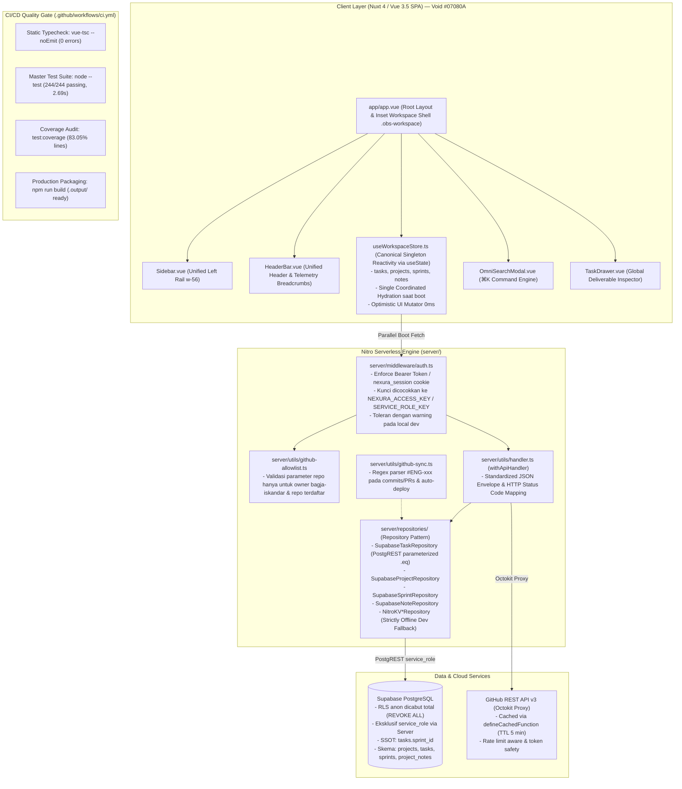

# ARCHITECTURE.md — Arsitektur Sistem Nexura Management

> **Status:** RATIFIED & HARDENED (Production-Ready)  
> **Last Updated:** 29 Oktober 2026  
> **Lead Architect & Orchestrator:** Bagja Iskandar & Antigravity Head Agent  
> **Design Pattern:** Precision Dark Obsidian Bento Architecture (Linear / Raycast Inset Shell)  
> **Master Reference:** [`DOCUMENTATION.md`](../DOCUMENTATION.md) | [`docs/master-remediation-plan.md`](../docs/master-remediation-plan.md)

---

## 1. Gambaran Arsitektur Sistem

**Nexura Management** adalah *Personal Engineering Command Center* mutakhir berbasis **Nuxt 4 Full-Stack Monolith** yang dirancang secara khusus untuk solo software engineer. Sistem menyatukan manajemen proyek, antrean deliverable teknis dengan Kanban 5-lajur, siklus sprint mingguan, roadmap rilis, katalog repositori GitHub, telemetri kesehatan devops, dan pencadangan data ke dalam satu panel kerja terpadu.



---

## 2. Struktur Direktori Sistem (Terkini)

```
Management/
├── .github/
│   └── workflows/ci.yml             # Pipeline GitHub Actions (typecheck, test, build)
├── app/
│   ├── app.vue                      # Root Layout, Workspace Shell & Global Modals
│   └── pages/                       # 8 Rute Kanonikal Sistem
│       ├── index.vue                # / (Dashboard Command Center)
│       ├── tasks.vue                # /tasks (5-Column Kanban Board & Queue Workspace)
│       ├── projects/
│       │   ├── index.vue            # /projects (Projects Hub)
│       │   └── [slug].vue           # /projects/:slug (Project Detail Cockpit)
│       ├── sprints.vue              # /sprints (Weekly Iterations & Calendar)
│       ├── roadmap.vue              # /roadmap (Release Phase Roadmap)
│       ├── repos.vue                # /repos (Repositories Catalog & 1-Click Importer)
│       └── telemetry.vue            # /telemetry (DevOps Observability & JSON Backup)
├── assets/
│   └── css/
│       └── main.css                 # Tailwind directives, Dark Obsidian variables & Specular borders
├── components/                      # Komponen Vue 3.5 Dark Obsidian Bento
│   ├── Dashboard.vue                # Bento Cockpit Dashboard View
│   ├── KanbanBoard.vue              # Papan Kanban 5-Kolom (idea -> deployed)
│   ├── TaskDrawer.vue               # Global Deliverable Inspector Slide-Over
│   ├── AddTaskModal.vue             # Modal Global Pembuatan Tugas
│   ├── AddProjectModal.vue          # Modal Global Pembuatan Proyek Baru
│   ├── EditProjectModal.vue         # Modal Global Penyuntingan Metadata Proyek
│   ├── OmniSearchModal.vue          # Modal Global ⌘K OmniSearch & Command Engine
│   ├── ConfirmDialog.vue            # Dialog Konfirmasi Hapus Ganda
│   ├── HeaderBar.vue                # Unified Header Bar & Telemetry Breadcrumbs
│   ├── Sidebar.vue                  # Unified Left Rail (w-56)
│   ├── dashboard/                   # Subkomponen Asymmetric Bento 8:4
│   ├── kanban/                      # Subkomponen Kanban Board & Drag-Drop Cards
│   ├── tasks/                       # Active Focus Panel & Idea Scratchpad
│   ├── project/                     # Subkomponen Project Cockpit & DevOps Tabs
│   ├── sprint/                      # Subkomponen Weekly Sprint Calendar
│   └── search/                      # Subkomponen OmniSearch Preview & Results
├── composables/                     # Reactive Vue Composables (Nuxt Auto-Imported)
│   ├── useWorkspaceStore.ts         # Singleton Workspace Store (SSOT)
│   ├── useTaskDrawer.ts             # Pengendali State TaskDrawer
│   ├── useQuickTask.ts              # Pengendali AddTaskModal
│   ├── useProjectModal.ts           # Pengendali Modal Proyek
│   ├── useOmniSearch.ts             # Pengendali State & Algoritma Pencarian ⌘K
│   ├── useTasks.ts                  # Tasks REST API Client
│   ├── useProjects.ts               # Projects REST API Client
│   ├── useSprints.ts                # Sprints REST API Client
│   ├── useNotes.ts                  # Notes/Scratchpad REST API Client
│   ├── useGitHub.ts                 # GitHub Gateway Proxy Client
│   └── useStats.ts                  # Dynamic Telemetry Stats Fetcher
├── server/                          # Nitro Backend Serverless Engine
│   ├── api/                         # REST API Endpoints Terpusat
│   │   ├── tasks/                   # CRUD /api/tasks & /api/tasks/:id
│   │   ├── projects/                # CRUD /api/projects & /api/projects/:slug
│   │   ├── sprints/                 # CRUD /api/sprints & /api/sprints/:id
│   │   ├── notes/                   # CRUD /api/notes & /api/notes/:id
│   │   ├── github/                  # Proxy /api/github/repos, commits, branches, issues
│   │   ├── telemetry.get.ts         # Live ping Supabase & GitHub rate limits
│   │   └── backup/                  # /api/backup/export (1-klik dump JSON)
│   ├── database/migrations/         # Migrasi SQL PostgreSQL Supabase
│   │   ├── 001_initial.sql          # Inisialisasi tabel dasar
│   │   ├── 002_add_github_repo.sql  # Penambahan kolom repo GitHub
│   │   └── 003_system_alignment... # RLS lockdown & enum alignment
│   ├── middleware/                  # Server Middleware
│   │   └── auth.ts                  # Unified Auth Gate (Bearer Token & Session Cookie)
│   ├── plugins/                     # Server Nitro Plugins
│   │   └── seed.ts                  # Hardened Seed Plugin (nitro_seed_v2_completed guard)
│   ├── repositories/                # Dual-Adapter Repository Layer
│   │   ├── task.repository.ts       # Interface ITaskRepository
│   │   ├── project.repository.ts    # Interface IProjectRepository
│   │   ├── sprint.repository.ts     # Interface ISprintRepository
│   │   ├── note.repository.ts       # Interface INoteRepository
│   │   ├── supabase/                # PostgreSQL PostgREST Implementations
│   │   └── nitro/                   # In-Memory Unstorage KV Implementations
│   ├── schemas/                     # Zod Validation Schemas
│   └── utils/                       # Server Utilities (handler, allowlist, github-sync, errors)
├── tests/                           # Master Automated Test Suite
│   └── unit/                        # 18 Test Suites (244 Tests Passing via node:test)
├── types/                           # Definisi TypeScript Interfaces & Enums
├── nuxt.config.ts                   # Konfigurasi Nuxt 4 & RuntimeConfig Security
├── tailwind.config.ts               # Precision Dark Obsidian Design Tokens
└── package.json                     # NPM Manifest & Quality Gate Scripts
```

---

## 3. Komponen Arsitektur Kunci

### 3.1. Unified State Management (`useWorkspaceStore.ts`)
- **Single Source of Truth:** Menggunakan `useState` Nuxt untuk mengelola state global: `tasks`, `projects`, `sprints`, dan `notes`.
- **Single Coordinated Hydration:** Saat inisialisasi boot di `app/app.vue`, fungsi `initializeWorkspace()` mengeksekusi paralel fetch tunggal (`Promise.all`) untuk mengisi store. Ini menggantikan multiplikasi 25 kunci cache Nuxt terfragmentasi sebelumnya.
- **Optimistic UI (0ms Interactivity):** Setiap mutasi (tambah tugas, update kolom Kanban, toggle checklist, hapus deliverable) langsung memodifikasi state memori lokal secara instan (0ms) sambil mengirim request sinkronisasi ke server di latar belakang.

### 3.2. Serverless Security & Gateway Layer
- **Unified Auth Gate ([`server/middleware/auth.ts`](../server/middleware/auth.ts)):**
  - Mengamankan seluruh rute mutasi (`POST`, `PUT`, `PATCH`, `DELETE`) di bawah `/api/**`.
  - Memverifikasi header `Authorization: Bearer <key>` atau cookie `nexura_session`.
  - Di lingkungan cloud produksi, mutasi tanpa kredensial valid ditolak dengan HTTP 401 Unauthorized.
- **Supabase RLS Lockdown (Migration 003):**
  - Hak akses peran publik `anon` dicabut secara total dari seluruh tabel database.
  - Akses database diisolasi eksklusif untuk peran `service_role` melalui Nitro backend repository. Klien browser tidak pernah mengekspos koneksi langsung ke PostgREST.
- **GitHub Parameter Allowlist ([`server/utils/github-allowlist.ts`](../server/utils/github-allowlist.ts)):**
  - Membatasi eksekusi issue GitHub dan workflow rerun hanya pada repositori milik akun pemilik (`bagja-iskandar`) atau yang terdaftar di kolom `projects.github_repo`.

### 3.3. Repository Pattern & PostgREST DSL Parameterization
- Akses data dibungkus oleh abstraksi repository interface (`ITaskRepository`, `IProjectRepository`, dll.).
- **Hardening Injeksi PostgREST (`SEC-004`):**
  - Meniadakan interpolasi string mentah pada pemanggilan `.or(...)`.
  - Pemilahan query dibangun secara deterministik: jika format ID adalah `ENG-xxx`, query diarahkan ke `.eq('task_id', val)`; jika format ID adalah UUID, query diarahkan ke `.eq('id', val)`.
  - Nilai selalu diproteksi sebagai parameter literal yang aman dari manipulasi query grammar.
- **Zero Silent Data Loss Policy:**
  - Repositori Supabase tidak lagi melakukan failover mutasi diam-diam ke penyimpanan ephemeral lokal Nitro KV. Jika Supabase mengalami gangguan jaringan di lingkungan produksi, sistem merespons secara transparan dengan HTTP 503 Service Unavailable.

### 3.4. Alur 5 Kolom Kanban Pipeline & Markdown Checklist
- Kolom kanonikal: `idea` (Amber) → `in_queue` (Slate) → `running_sprint` (Indigo) → `blocked` (Rose) → `deployed` (Emerald).
- Deliverable yang berada pada `running_sprint` terhubung langsung dengan panel **Active Focus**.
- Parser checklist mengevaluasi sintaks Markdown `- [ ]` dan `- [x]`. Mengklik checkbox langsung memodifikasi string deskripsi tugas dan menyimpannya secara otomatis ke database.

### 3.5. Otomasi GitHub Sync & Sprint Rollover
- **Automated Deploy Detection ([`server/utils/github-sync.ts`](../server/utils/github-sync.ts)):**
  - Memindai commit messages dan pull request titles pada repositori tertaut.
  - Menemukan pola `#ENG-xxx` dan secara otomatis memindahkan status deliverable terkait ke kolom `deployed`.
- **Confirmed Sprint Rollover (`AUTO-002`):**
  - Menyediakan modal konfirmasi 1-klik untuk merollover deliverable yang belum selesai dari sprint sebelumnya ke sprint minggu berjalan secara aman.

---

## 4. Testing & CI/CD Pipeline

Kualitas sistem dijaga oleh pipeline otomatis pada `.github/workflows/ci.yml`:

```yaml
name: CI Quality Gate
on:
  push:
    branches: [main, development]
  pull_request:
    branches: [main, development]

jobs:
  validate:
    name: Typecheck, Test & Build
    runs-on: ubuntu-latest
    timeout-minutes: 10
    steps:
      - uses: actions/checkout@v4
      - uses: actions/setup-node@v4
        with:
          node-version: 20
          cache: 'npm'
      - run: npm ci
      - name: Static Typecheck
        run: npm run typecheck
      - name: Master Automated Test Suite
        run: npm test
      - name: Code Coverage Audit
        run: npm run test:coverage
      - name: Production Packaging
        run: npm run build
```

---

## 5. Ringkasan API Kontrak REST

Semua endpoint dibungkus dengan utilitas terpusat [`withApiHandler`](../server/utils/handler.ts) dan mematuhi format envelope JSON standar:

| Resource | Method | Path | Auth Gate | Deskripsi |
|---|---|---|---|---|
| **Tasks** | `GET` | `/api/tasks` | Terbuka | Mengambil daftar tugas (filter: `projectSlug`, `status`, `priority`) |
| | `POST` | `/api/tasks` | **Protected** | Membuat tugas baru (auto-generates format `#ENG-xxx`) |
| | `GET` | `/api/tasks/:id` | Terbuka | Mengambil detail tugas berdasarkan UUID atau `task_id` |
| | `PUT` | `/api/tasks/:id` | **Protected** | Memperbarui status, checklist deskripsi, atau sprint deliverable |
| | `DELETE` | `/api/tasks/:id` | **Protected** | Menghapus tugas dari database |
| **Projects** | `GET` | `/api/projects` | Terbuka | Mengambil seluruh katalog proyek terdaftar |
| | `POST` | `/api/projects` | **Protected** | Mendaftarkan proyek baru |
| | `GET` | `/api/projects/:slug` | Terbuka | Mengambil detail proyek berdasarkan slug |
| | `PUT` | `/api/projects/:slug` | **Protected** | Memperbarui metadata proyek (title, repo, releasePhase, techStack) |
| | `DELETE` | `/api/projects/:slug` | **Protected** | Menghapus proyek dari sistem |
| **Sprints** | `GET` | `/api/sprints` | Terbuka | Mengambil seluruh riwayat sprint |
| | `POST` | `/api/sprints` | **Protected** | Membuat siklus sprint baru |
| | `PUT` | `/api/sprints/:id` | **Protected** | Memperbarui status atau rentang sprint |
| **Notes** | `GET` | `/api/notes` | Terbuka | Mengambil catatan ide/bug (filter via `projectSlug`) |
| | `POST` | `/api/notes` | **Protected** | Menambahkan catatan ide baru ke scratchpad |
| | `PUT` | `/api/notes/:id` | **Protected** | Mengupdate catatan atau menandai `promoted_task_id` |
| | `DELETE` | `/api/notes/:id` | **Protected** | Menghapus catatan ide |
| **GitHub** | `GET` | `/api/github/repos` | Terbuka | Mengambil katalog repositori akun (cached 5 min) |
| | `GET` | `/api/github/commits` | Terbuka | Mengambil daftar commit terbaru (`?repo=owner/repo`) |
| | `GET` | `/api/github/branches` | Terbuka | Mengambil daftar branch repositori |
| | `POST` | `/api/github/create-issue` | **Protected** | Membuat issue GitHub (allowlist verified) |
| | `POST` | `/api/github/workflow-rerun` | **Protected** | Memicu rerun GitHub Action (allowlist verified) |
| **Telemetry** | `GET` | `/api/telemetry` | Terbuka | Live ping Supabase, kuota rate-limit GitHub & runtime detection |
| | `GET` | `/api/backup/export` | **Protected** | Mengunduh dump JSON seluruh data workspace |
