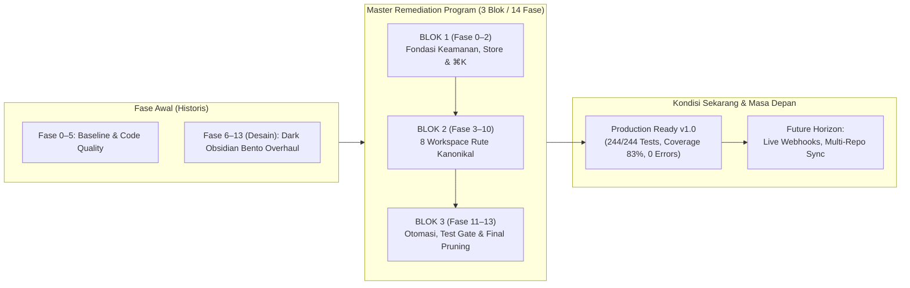

# ROADMAP.md — Nexura Evolution Roadmap

> **Status:** RATIFIED & 100% COMPLETED (Production Ready)  
> **Last Updated:** 29 Oktober 2026  
> **Lead Architect & Orchestrator:** Bagja Iskandar & Antigravity Head Agent  
> **Master Reference:** [`docs/master-remediation-plan.md`](../docs/master-remediation-plan.md) & [`DOCUMENTATION.md`](../DOCUMENTATION.md)

---

## 1. Prinsip Utama Evolusi Arsitektur

1. **Function over Form:** Setiap keindahan visual Bento harus ditopang oleh data riil dan logika backend yang kokoh.
2. **Zero-Tolerance Data Honesty (`UX-002`):** Bebas dari data sintetis, angka fabrikasi (14, 3, 78%), atau fallback diam-diam.
3. **Single Source of Truth (SSOT):** Persistensi PostgreSQL via Supabase dengan Row Level Security (RLS) terkunci penuh ke `service_role`.
4. **Single-Owner Ergonomics:** Dirancang khusus untuk efisiensi eksekusi solo engineer tanpa friksi birokrasi enterprise.
5. **Continuous Quality Gate:** Setiap rilis dilindungi oleh unit testing komprehensif, TypeScript static checking, dan automated CI pipeline.

---

## 2. Rangkuman Siklus Evolusi Sistem

---

## 3. Master Remediation Program (14 Fase Mandiri / 3 Blok Logis)

Sesuai arahan arsitektur, seluruh program remediasi telah diselesaikan 100% dengan status **`COMPLETED & VALIDATED`**:

### BLOK 1: FONDASI ARSITEKTUR, KEAMANAN & FITUR GLOBAL

| Fase | Nama & Ruang Lingkup | Status | Hasil & Bukti Empiris |
|---|---|---|---|
| **Fase 0** | **Security Lockdown, Database Alignment & Core Safety** - Migration 003 (`idea`, `project_notes`, `release_phase`) - Supabase RLS lockdown ke peran `service_role` - Auth middleware (`server/middleware/auth.ts`) & GitHub allowlist - Eliminasi silent KV failover (zero data loss policy) | ✅ **100% Selesai** | RLS terkunci, PostgREST direct probe dicegah, mutasi via Bearer token aman. |
| **Fase 1** | **Global Workspace Store & Shell Infrastructure** - Singleton reactive store `useWorkspaceStore.ts` - Single coordinated hydration saat boot di `app/app.vue` - Backend REST API `/api/notes/**` - Global modal shell mounting (`TaskDrawer`, `AddTaskModal`, `AddProjectModal`) | ✅ **100% Selesai** | 25 kunci cache Nuxt tereliminasi; boot latency berkurang drastis, interaktivitas optimistik 0ms. |
| **Fase 2** | **Global OmniSearch & Command Engine (`⌘K`)** - Shortcut global `⌘K` / `Ctrl+K` & penutup `Esc` - Deep-linking langsung ke global `<TaskDrawer />` - Sanitasi keamanan URL eksternal (`NEW-SEC-01` reverse tabnabbing guard) | ✅ **100% Selesai** | Navigasi instan lintas entitas tanpa page reload; tautan eksternal terproteksi `noopener,noreferrer`. |

---

### BLOK 2: REMEDIASI 1 HALAMAN PER FASE (8 WORKSPACES KANONIKAL)

| Fase | Halaman & Ruang Lingkup | Status | Hasil & Bukti Empiris |
|---|---|---|---|
| **Fase 3** | **Tasks & Queue Workspace (`/tasks`)** - Full 5-column Kanban board (`idea` → `deployed`) - View mode switcher (Kanban Board vs High-Density Table) - Companion panel Active Focus dengan checklist Markdown reaktif (`- [ ]` / `- [x]`) - Slide-over Idea Scratchpad dengan tombol *Promote to Kanban* | ✅ **100% Selesai** | Pipeline 5-lajur beroperasi mulus; mutasi checklist langsung memperbarui deskripsi di database. |
| **Fase 4** | **Dashboard Command Center (`/`)** - Pembersihan total angka palsu (14, 3, 78%) di `UnifiedHeroBanner.vue` - Clean empty states jujur pada `ActiveExecutionQueue.vue` - `RecentShipmentsCard.vue` strictly menampilkan deliverable deployed | ✅ **100% Selesai** | Zero fake metrics; visual Asymmetric Bento 8:4 render metrik matematis murni. |
| **Fase 5** | **Projects Hub (`/projects`)** - Pemasangan tombol `+ New Project` pada header bar - Pembuatan komponen `<EditProjectModal />` - Dynamic progress calculation: `Math.round((deployed / total) * 100)` | ✅ **100% Selesai** | Full CRUD proyek aktif; progres kalkulasi berbasis array tugas aktual. |
| **Fase 6** | **Project Detail Cockpit (`/projects/:slug`)** - Penghapusan tab internal Supabase (`PDET-002`) - Penambahan tab Notes/Scratchpad terisolasi per proyek - Graceful honest 404 page & modal konfirmasi hapus ganda aman | ✅ **100% Selesai** | Cockpit proyek fokus pada metrik teknis, deliverables, devops tab, dan notes internal. |
| **Fase 7** | **Sprints & Iterations (`/sprints`)** - Migrasi relasi ke SSOT `tasks.sprint_id` (eliminasi dual-write array) - Perbaikan kalender navigasi rentang minggu (Senin–Minggu) - Integrasi klik kartu tugas langsung ke global `<TaskDrawer />` | ✅ **100% Selesai** | Integritas relasi sprint terjaga tanpa desinkronisasi data; navigasi kalender presisi. |
| **Fase 8** | **Release Phase Roadmap (`/roadmap`)** - Rekonstruksi kolom menjadi 5 Release Phases (`Backlog`, `MVP / v1.0`, `v1.1`, `v2.0`, `Released`) - Pemetaan deliverable dan proyek berdasarkan kolom `projects.release_phase` | ✅ **100% Selesai** | Peta jalan mencerminkan siklus rilis perangkat lunak dunia nyata bagi solo developer. |
| **Fase 9** | **Repositories Catalog (`/repos`)** - Pemangkasan ~340 baris kode duplikasi inspector internal GitHub - Strict repository matching (`p.githubRepo === repo.fullName`) - Pagination `per_page=100` & 1-klik Import as Managed Project | ✅ **100% Selesai** | Katalog ringan, tautan langsung ke `/projects/:slug`, dan aksi detasemen non-destruktif. |
| **Fase 10** | **Telemetry & DevOps Health (`/telemetry`)** - Live ping nyata milidetik ke Supabase PostgreSQL - Live rate limit check GitHub REST API v3 - Runtime environment detector (*Development* vs *Production*) - Tombol 1-klik Export Backup JSON seluruh data workspace | ✅ **100% Selesai** | Observabilitas sistem jujur, transparan, dan backup snapshot instan. |

---

### BLOK 3: OTOMASI SISTEM, PENGUJIAN OTOMATIS & SIGN-OFF FINAL

| Fase | Fokus Teknis | Status | Hasil & Bukti Empiris |
|---|---|---|---|
| **Fase 11** | **Otomasi Lanjutan & GitHub Sync** - Deteksi kode `#ENG-xxx` pada commit message & auto-move deliverable ke `deployed` - Modal 1-klik Confirmed Sprint Rollover (`AUTO-002`) untuk tugas belum selesai | ✅ **100% Selesai** | Otomasi sinkronisasi git devops mulus tanpa intervensi manual; rollover sprint aman. |
| **Fase 12** | **CI/CD Quality Gate & Automated Tests** - Penyelenggaraan Node.js native test runner (`node:test`) dengan 18 suites & 244 tests passing - Parameterisasi PostgREST query DSL (`.eq`) menutup celah manipulasi query grammar - Pipeline terpadu `.github/workflows/ci.yml` (typecheck + test + build) | ✅ **100% Selesai** | 244/244 tests passing (100% green), 83.05% coverage, zero diagnostic errors. |
| **Fase 13** | **Dead Code Pruning & Final Audit Sign-Off** - Pemangkasan permanen stub redirect [`focus.vue`](../app/pages/focus.vue) dan middleware [`visit.ts`](../server/middleware/visit.ts) - Hardening plugin seed (`server/plugins/seed.ts`) dengan guard `nitro_seed_v2_completed` - Pembersihan sisa referensi rute di HeaderBar & Sidebar - Eksekusi *The 5-Layer Final Quality Gate* & Sign-Off Paripurna | ✅ **100% Selesai** | Zero dangling references, production bundle `.output/` siap rilis, 8 rute kanonikal stabil. |

---

## 4. Metrik Kualitas Saat Ini (Quality Baseline)

- **Total Test:** 244 Passed / 244 Total (100% Green, 0 Failures) across 18 Test Suites dalam ~2.69s
- **Code Coverage:** Lines **83.05%**, Branches **79.30%**, Functions **81.58%** (Target $\ge 80\%$)
- **TypeScript Typecheck:** `vue-tsc --noEmit` Exit Code 0 (0 Errors)
- **Production Build:** Sukses memproduksi bundle Nitro/Vercel (Client: 2,003 modul, Server: 211 modul, Total 5.93 MB / 1.33 MB gzip)
- **UI Design System:** Dark Obsidian Bento UI 100% terlindungi tanpa regresi visual pada ~92 berkas lokal

---

## 5. Rencana Masa Depan (Future Horizon)

Setelah penyelesaian 14 fase remediasi, pengembangan masa depan dapat memprioritaskan fitur-fitur bernilai tambah (*enhancement backlog*):

1. **GitHub & Vercel Webhook Receiver (`/api/webhooks/*`):**
   - Mendengarkan webhook `push`, `pull_request`, dan `deployment_status` secara asinkron untuk update real-time tanpa polling manual.
2. **Multi-Theme Obsidian Customizer:**
   - Menyediakan UI switcher untuk preset tema CSS variables (`indigo`, `amethyst`, `stealth`, `emerald`) yang tersimpan di localStorage.
3. **Multi-Repo Batch Operations:**
   - Kemampuan membuat issue atau deliverable yang terdistribusi ke beberapa repositori sekaligus.
4. **Vercel Analytics & Edge Telemetry:**
   - Widget tambahan di `/telemetry` untuk memantau bandwidth dan latency Vercel Edge.
